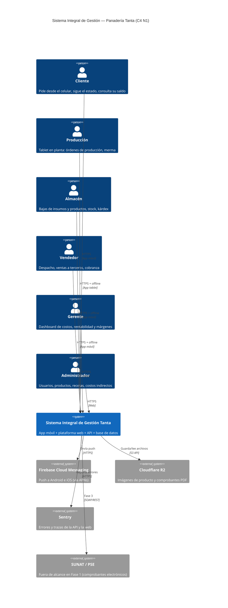
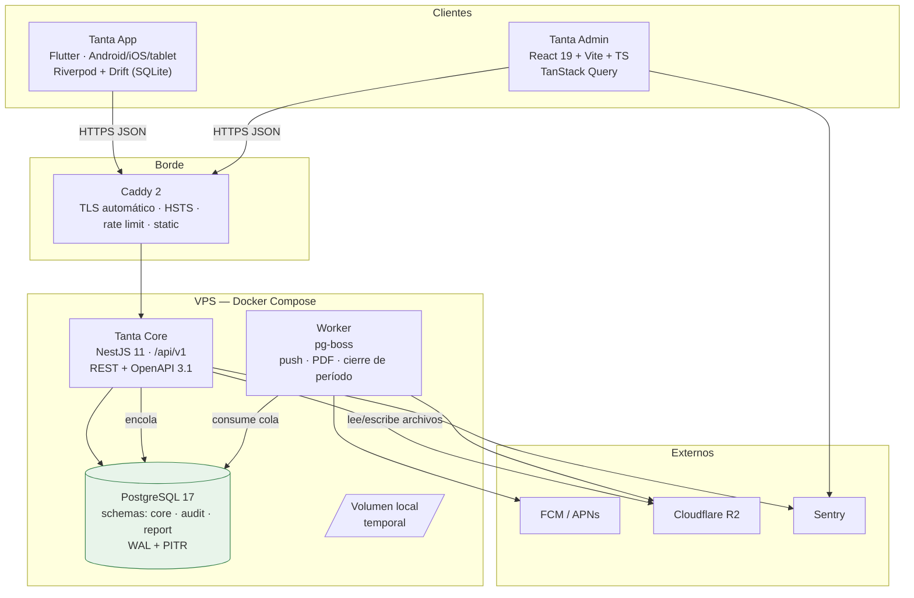
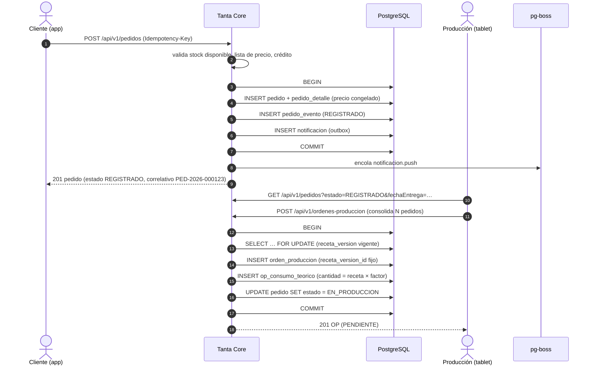
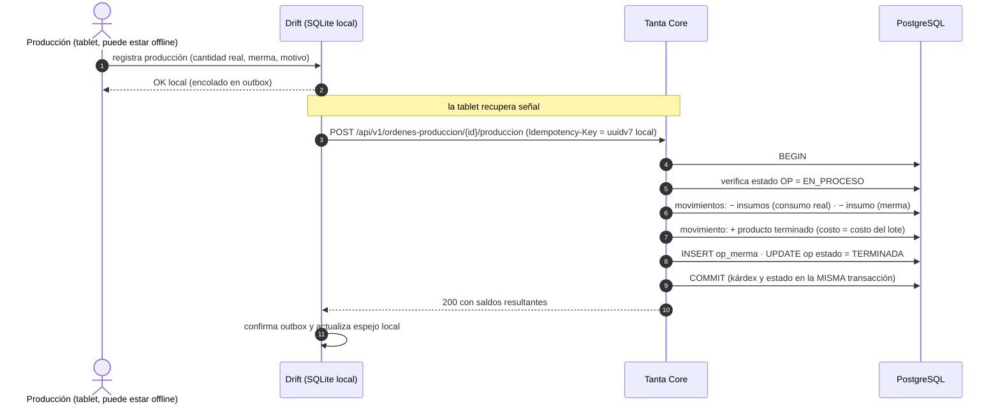
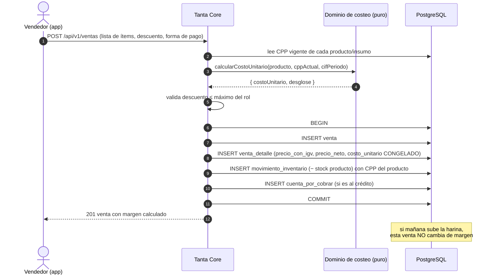
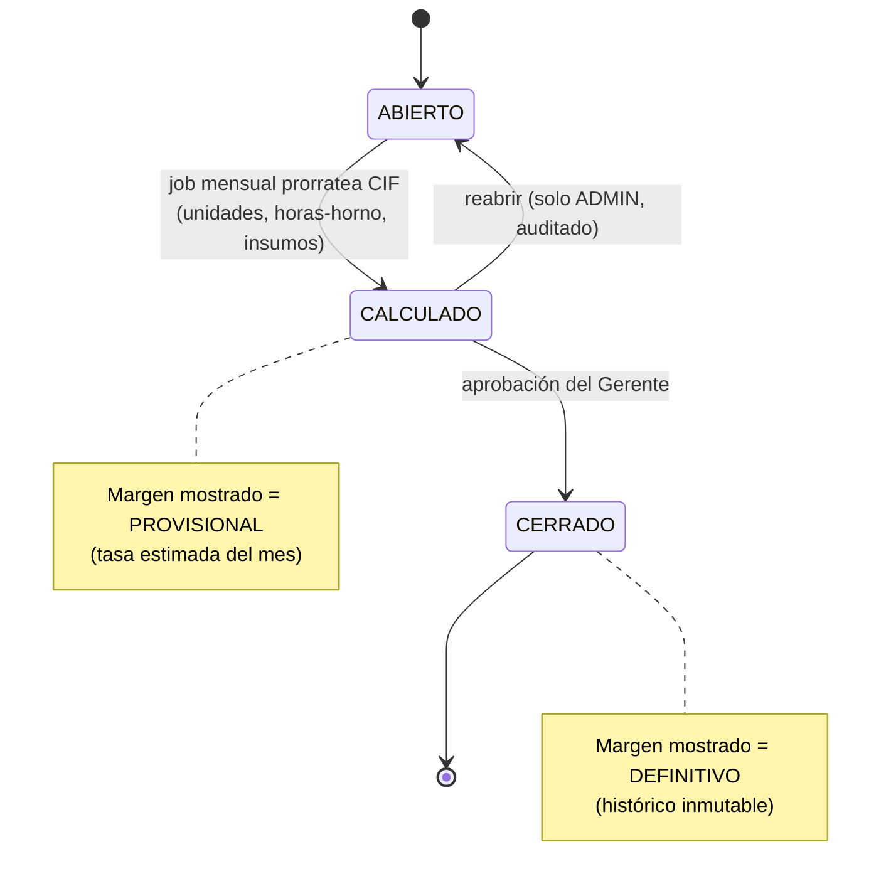
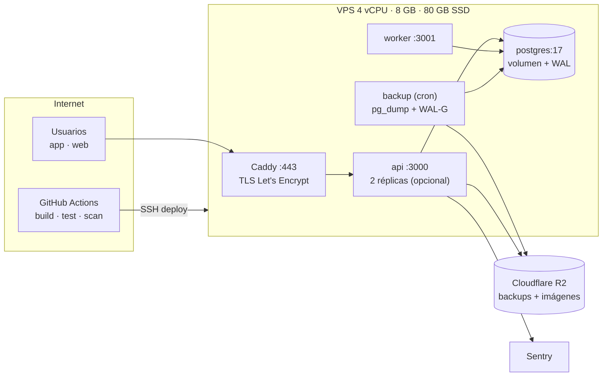

# 02 · Arquitectura de la solución

> Cómo se construye el Sistema Integral de Gestión de Panadería Tanta para que las reglas del dinero
> —costo, kárdex, margen— sean **correctas, auditables y reproducibles**.
> Las decisiones de stack están en `03`; el modelo de datos en `04`; los endpoints en `05`.

---

## 1. Principios arquitectónicos

Estos diez principios resuelven discusiones antes de que ocurran. Si una propuesta de diseño los viola,
se rechaza.

| ID | Principio | Consecuencia práctica |
|---|---|---|
| **P-01** | **El dinero se calcula una sola vez, en el servidor.** | La app móvil puede *previsualizar* un costo, pero el valor que se guarda y se reporta lo produce la API. |
| **P-02** | **Todo lo que afecta al dinero se versiona y se congela.** | Receta, precio, costo unitario, IGV y umbrales tienen vigencia. La venta guarda su propio costo. |
| **P-03** | **El inventario es un libro, no un campo.** | `movimiento_inventario` es append-only. El stock es una consecuencia, no una variable editable. |
| **P-04** | **Nada se borra.** | Borrado lógico en negocio, asientos de reverso en inventario, `audit.evento` inmutable. |
| **P-05** | **Toda mutación es idempotente.** | `Idempotency-Key` obligatorio. Un reintento del celular nunca duplica una venta. |
| **P-06** | **El estado se mueve por máquinas de estado explícitas.** | No hay `UPDATE estado = 'X'` suelto; hay transiciones con guardas y evento de auditoría. |
| **P-07** | **Un solo despliegue, fronteras internas duras.** | Monolito modular: módulos que no se importan entre sí salvo por contratos públicos y eventos. |
| **P-08** | **La tablet funciona sin internet.** | Offline-first en Producción, Almacén y Vendedor. La red es una mejora, no un requisito. |
| **P-09** | **Lo que no se mide no se opera.** | SLOs, logs correlacionados, métricas de negocio (saldo negativo, sync pendiente) y alertas. |
| **P-10** | **La seguridad es una propiedad del diseño, no una capa.** | Autorización en el caso de uso, no solo en el controlador; el vendedor nunca recibe el costo. |

---

## 2. Contexto (C4 · Nivel 1)



---

## 3. Contenedores (C4 · Nivel 2)



**Un solo contenedor de API y uno de worker**, ambos con la misma imagen y distinto entrypoint. La cola
vive en PostgreSQL (`pg-boss`), así que **no hay Redis**: menos piezas que operar, menos que se caiga, y
la cola es transaccional con la base de datos (si la transacción hace rollback, el job no se encola).

### 3.1 Por qué esta topología y no otra

| Alternativa | Veredicto | Motivo |
|---|---|---|
| Microservicios | **Rechazada** | 6 usuarios concurrentes y una panadería no justifican la complejidad operativa. Añade fallos de red, consistencia eventual y 5 despliegues en vez de 1. |
| Serverless (Lambda) | **Rechazada** | Conexiones a PostgreSQL, cold start y costeo transaccional con bloqueo se llevan mal. Además complica el entorno local. |
| BaaS (Supabase/Firebase) | **Rechazada como backend** | Las reglas de costeo, kárdex y cierre de período no caben en RLS. Se usaría solo como hosting de PostgreSQL, y aún así se pierde control de PITR/WAL. |
| Monolito modular + worker | **Elegida** | Máxima velocidad de entrega, transacciones reales, una sola cosa que desplegar y monitorear. Escala verticalmente de sobra para este volumen. |

---

## 4. Monolito modular: qué significa en concreto

### 4.1 Contextos delimitados (bounded contexts)

| # | Contexto | Responsabilidad | Tablas que posee | Eventos que publica |
|---|---|---|---|---|
| 1 | **Identidad** | Usuarios, roles, sesiones, dispositivos, MFA | `usuario`, `rol`, `permiso`, `rol_permiso`, `sesion`, `dispositivo`, `usuario_rol` | `usuario.creado`, `sesion.revocada` |
| 2 | **Maestros** | Clientes, proveedores, unidades de medida, categorías | `cliente`, `proveedor`, `unidad_medida`, `categoria`, `sucursal` | `cliente.actualizado` |
| 3 | **Catálogo y precios** | Productos, imágenes, listas de precio, vigencias | `producto`, `producto_imagen`, `lista_precio`, `producto_precio` | `precio.cambiado` |
| 4 | **Recetas** | Recetas versionadas, líneas de insumo, rendimiento, merma estándar | `receta`, `receta_version`, `receta_linea` | `receta.aprobada` |
| 5 | **Costos indirectos** | CIF, bases de prorrateo, períodos, asignaciones | `costo_indirecto`, `periodo_costos`, `cif_asignacion` | `periodo.calculado`, `periodo.cerrado` |
| 6 | **Inventario** | Kárdex, CPP, movimientos, tomas de inventario | `movimiento_inventario`, `stock_actual`, `toma_inventario`, `toma_inventario_linea` | `inventario.movido`, `stock.bajo_minimo` |
| 7 | **Compras** | Órdenes de compra, recepciones, cuentas por pagar | `compra`, `compra_detalle`, `cuenta_por_pagar` | `compra.recibida` |
| 8 | **Producción** | Órdenes de producción, requisiciones, consumo real, merma | `orden_produccion`, `op_consumo`, `op_merma`, `requisicion` | `op.terminada`, `op.anulada` |
| 9 | **Pedidos** | Carrito, pedidos, estados, eventos de pedido | `pedido`, `pedido_detalle`, `pedido_evento` | `pedido.creado`, `pedido.estado_cambiado` |
| 10 | **Ventas** | Despachos, ventas, líneas con costo congelado, devoluciones | `despacho`, `venta`, `venta_detalle`, `devolucion` | `venta.registrada`, `venta.anulada` |
| 11 | **Cobranza** | Cuentas por cobrar, pagos, aplicaciones, antigüedad | `cuenta_por_cobrar`, `cobranza`, `cobranza_aplicacion` | `cobranza.registrada`, `cxc.vencida` |
| 12 | **Costeo** | Ficha de costo por producto, cálculo y snapshots | `ficha_costo`, `costo_snapshot` | `costo.recalculado` |
| 13 | **Reportes** | Vistas materializadas, exportaciones, dashboard | `report.*` (MV) | — |
| 14 | **Notificaciones** | Push, plantillas, outbox de envío | `notificacion`, `notificacion_envio` | `notificacion.enviada` |
| 15 | **Sincronización** | Push/pull offline, resolución de conflictos | `sync_operacion`, `idempotencia` | — |
| 16 | **Auditoría** | Eventos inmutables con cadena de hash | `audit.evento` | — |

### 4.2 Regla de dependencia

```
┌──────────────────────────────────────────────────────────┐
│  Presentación   controllers · resolvers · DTOs · guards  │
├──────────────────────────────────────────────────────────┤
│  Aplicación     casos de uso · transacciones · eventos   │
├──────────────────────────────────────────────────────────┤
│  Dominio        entidades · value objects · reglas puras │
│                 (sin Prisma, sin Nest, sin I/O)          │
├──────────────────────────────────────────────────────────┤
│  Infraestructura  repositorios Prisma · FCM · R2 · colas │
└──────────────────────────────────────────────────────────┘
        ▲ las flechas de dependencia apuntan SOLO hacia arriba
```

- El **dominio de costeo es TypeScript puro**: recibe números y devuelve números. Se prueba sin base de datos y sin servidor, en milisegundos. Es la pieza que más se va a tocar y la que más caro sale si falla.
- Un módulo **no importa** las clases internas de otro. Solo puede: (a) llamar a un **caso de uso público** exportado por el módulo, o (b) **reaccionar a un evento**. Se hace cumplir con `eslint-plugin-boundaries` en CI; la build falla si se rompe.
- Las **transacciones** son del caso de uso, no del repositorio. El caso de uso abre `prisma.$transaction` y pasa el `tx` hacia abajo.

### 4.3 Estructura de carpetas de la API

```
apps/api/src/
├─ main.ts
├─ app.module.ts
├─ common/            # filtros, interceptores, decoradores, paginación, errores
├─ modules/
│  ├─ identidad/
│  │  ├─ domain/          usuario.ts · permisos.ts
│  │  ├─ application/     crear-usuario.usecase.ts · autenticar.usecase.ts
│  │  ├─ infrastructure/  usuario.prisma-repo.ts · jwt.adapter.ts
│  │  └─ presentation/    auth.controller.ts · usuarios.controller.ts
│  ├─ inventario/
│  │  ├─ domain/          cpp.ts · movimiento.ts · invariantes.ts
│  │  ├─ application/     registrar-movimiento.usecase.ts
│  │  ├─ infrastructure/  movimiento.prisma-repo.ts
│  │  └─ presentation/    inventario.controller.ts
│  └─ … (un módulo por contexto)
├─ jobs/              # handlers de pg-boss
└─ shared/            # decimal, fechas America/Lima, correlativos
```

---

## 5. Flujos críticos

### 5.1 Del pedido a la orden de producción



**Punto clave:** la OP fija `receta_version_id`. Si mañana alguien edita la receta, esa OP sigue
apuntando a la versión con la que se planificó. Sin esto, el costo histórico se corrompe (`V-01`).

### 5.2 Producción: consumo real, merma e ingreso a stock



### 5.3 Venta: congelamiento del costo (el corazón del sistema)



**Invariante que se prueba en cada build:** para toda `venta_detalle`,
`utilidad = precio_neto − costo_unitario` y `margen = utilidad / precio_neto`, calculados con la misma
función pura que usa el dashboard. Si el reporte y la venta dan distinto, el test falla.

### 5.4 Cierre de período de costos (CIF)



El dashboard indica siempre si el margen que muestra es **provisional** o **definitivo**. Un gerente
puede tolerar un número que va a ajustarse; no tolera un número que cambia sin avisar.

---

## 6. Consistencia y transacciones

| Operación | Frontera transaccional | Por qué |
|---|---|---|
| Crear pedido | pedido + detalle + evento + notificación (outbox) | El push no debe perderse ni enviarse sin pedido. |
| Terminar OP | estado OP + movimientos de insumos + ingreso de producto + merma | Si el kárdex se actualiza y el estado no, la OP se puede ejecutar dos veces. |
| Registrar venta | venta + detalle + movimiento de inventario + CxC | El stock y la deuda deben nacer juntos. |
| Registrar cobranza | cobranza + aplicaciones + saldo de CxC | Un pago aplicado a medias descuadra la cartera. |
| Cerrar período | asignación CIF + estado del período | El cierre es todo o nada. |

**No hay sagas ni consistencia eventual** entre contextos del mismo monolito: todo lo que debe ser
atómico, lo es en una transacción de PostgreSQL. La única asincronía es la **entrega de efectos
externos** (push, PDF, correo), resuelta con el patrón **outbox transaccional**: el job se encola en la
misma transacción y `pg-boss` garantiza el procesamiento.

**Nivel de aislamiento:** `READ COMMITTED` por defecto; `REPEATABLE READ` para cierres de período y
reportes de consistencia; bloqueo explícito de fila (`SELECT … FOR UPDATE`) para el CPP y los correlativos.

---

## 7. Despliegue



### 7.1 Servicios de `docker-compose.prod.yml`

| Servicio | Imagen | Recursos | Notas |
|---|---|---|---|
| `caddy` | `caddy:2-alpine` | 0.25 vCPU / 128 MB | TLS automático, compresión, cabeceras de seguridad. Sirve la SPA web como estático. |
| `api` | `ghcr.io/…/tanta-api` | 2 vCPU / 1.5 GB | `NODE_OPTIONS=--max-old-space-size=1024` |
| `worker` | misma imagen, `CMD node dist/worker.js` | 1 vCPU / 512 MB | Jobs: push, PDF/Excel, cierre de período, verificación de kárdex |
| `postgres` | `postgres:17-alpine` | 2 vCPU / 3 GB | `shared_buffers=1GB`, `work_mem=32MB`, `max_connections=100`; **WAL archiving activado** |
| `backup` | `prodrigestivill/postgres-backup-local` o script propio | mínimos | `pg_dump` diario cifrado + `WAL-G` continuo → R2 |

### 7.2 Entornos

| Entorno | Propósito | Datos | Dominio |
|---|---|---|---|
| **local** | Desarrollo | Seed sintético | `localhost:3000` |
| **staging** | UAT, demos, pruebas de migración | Copia anonimizada de producción (nunca datos reales de clientes) | `staging.tantapanaderia.com` (protegido con basic auth + IP allowlist) |
| **producción** | Operación real | Reales | `www.tantapanaderia.com` / `api.tantapanaderia.com` |

**Regla:** toda migración se ejecuta primero en staging con una copia de producción. Si el tiempo de
migración supera 30 s o toma un lock exclusivo, se rediseña.

---

## 8. Requisitos no funcionales

### 8.1 Capacidad asumida (dimensionamiento)

| Métrica | Supuesto | Margen de diseño |
|---|---|---|
| Pedidos/día | 150–250 | ×4 (1,000) |
| Ventas a terceros/día | 100–200 | ×4 |
| Usuarios activos concurrentes | 10–20 | ×5 (100) |
| Tablets de producción | 1–3 | ×5 |
| Productos | 80–150 | ×10 |
| Insumos | 120–200 | ×10 |
| Movimientos de inventario/mes | 10,000–20,000 | ×10 |
| Crecimiento anual de la BD | 3–5 GB | holgado en 80 GB |

**Conclusión de dimensionamiento:** un VPS de 4 vCPU / 8 GB cubre el año 1 con holgura ×5. No hace
falta nada distribuido. Ver `13 §5` para el costo.

### 8.2 SLOs

| SLO | Objetivo | Cómo se mide | Qué se hace si se rompe |
|---|---|---|---|
| Disponibilidad de la API | **99.5 % mensual** (≈ 3.6 h de caída/mes) | Uptime Kuma cada 60 s sobre `/health/ready` | Postmortem en 48 h; si se repite 2 meses, se escala a 99.9 % con réplica |
| Latencia p95 de lectura | **< 300 ms** | pino + métricas por ruta | Revisar índice o vista materializada |
| Latencia p95 de escritura | **< 800 ms** | idem | Revisar transacción y locks |
| Dashboard gerencial p95 | **< 2 s** | idem | Recalcular MV o cachear por período |
| Frescura de backup | **RPO ≤ 15 min** (WAL) | verificación del archivo WAL en R2 | Alerta inmediata; si falla 2 h, incidente |
| Restauración | **RTO ≤ 4 h** | ensayo mensual cronometrado | Revisar procedimiento y tamaño del dump |
| Sync móvil pendiente | **< 5 min** en condiciones normales | métrica `sync_pendientes` por dispositivo | Alerta al admin si un dispositivo lleva > 1 h |

### 8.3 Presupuesto de latencia (p95, escritura)

```
TLS + Caddy            ~15 ms
Guard + JWT            ~5 ms
Validación (Zod)       ~3 ms
Caso de uso + reglas   ~20 ms
Prisma + PostgreSQL    ~60 ms
Commit (fsync)         ~10 ms
Serialización          ~10 ms
──────────────────────────────
Total objetivo        ~125 ms   (límite 800 ms → margen ×6)
```

---

## 9. Evolución prevista

| Cuándo | Qué se hace | Qué NO se hace antes de tiempo |
|---|---|---|
| Año 1 | Monolito en 1 VPS. Vistas materializadas para reportes. | Nada distribuido. |
| Si la BD supera 20 GB o el dashboard pasa de 3 s | Réplica de lectura para reportes + mover MV a la réplica | No separar en microservicios |
| Si se abre una 2.ª sucursal | Activar `sucursal_id` (ya modelado), precios y stock por sucursal | No reescribir el modelo |
| Si aparece una integración pesada (SUNAT, pasarela) | Módulo aparte con su propio worker | No convertirlo en servicio externo todavía |
| Si el equipo crece a 8+ devs y hay fricción de despliegue | Evaluar extraer 1–2 contextos (Reportes, Notificaciones) | Solo con evidencia de fricción real |

**Umbral escrito:** se extrae un servicio cuando *el contexto necesita escalar por separado de forma
sostenida* o *su equipo lo despliega con una cadencia incompatible*. "Es más moderno" no es un motivo.

---

## 10. Riesgos arquitectónicos residuales

| Riesgo | Residual | Vigilancia |
|---|---|---|
| Un solo VPS = punto único de falla | Aceptado conscientemente (costo). | RTO de 4 h con backup verificado; si la caída supera 4 h dos veces, se justifica réplica. |
| Crecimiento de `movimiento_inventario` | Bajo (20k/mes). | Particionar por año cuando supere 5 M de filas. |
| Vistas materializadas desactualizadas | Medio (datos "de ayer"). | Refresco cada 15 min + botón "actualizar ahora" en el dashboard + sello de hora en cada tarjeta. |
| Reloj del dispositivo en el móvil | Bajo. | El servidor sella `recibido_en`; `occurred_at` solo ordena dentro del dispositivo. Ver `09`. |
| Migración de datos iniciales desde Excel | Medio-alto. | Importador con previsualización y rechazo por fila. Ver `04` e `11`. |

---

**Siguiente lectura:** `03-STACK-Y-DECISIONES.md` — con qué se construye, cuánto cuesta y qué se descartó.
