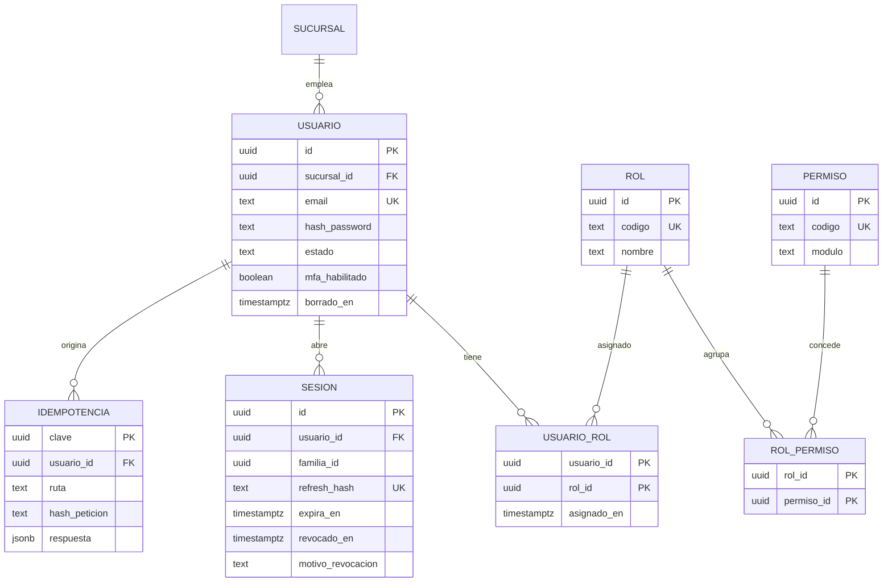
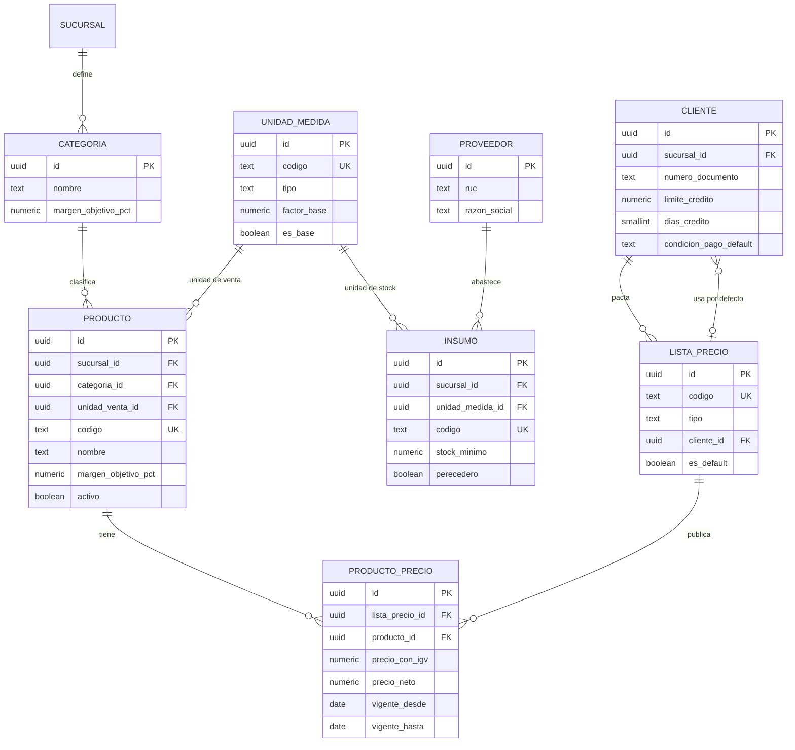
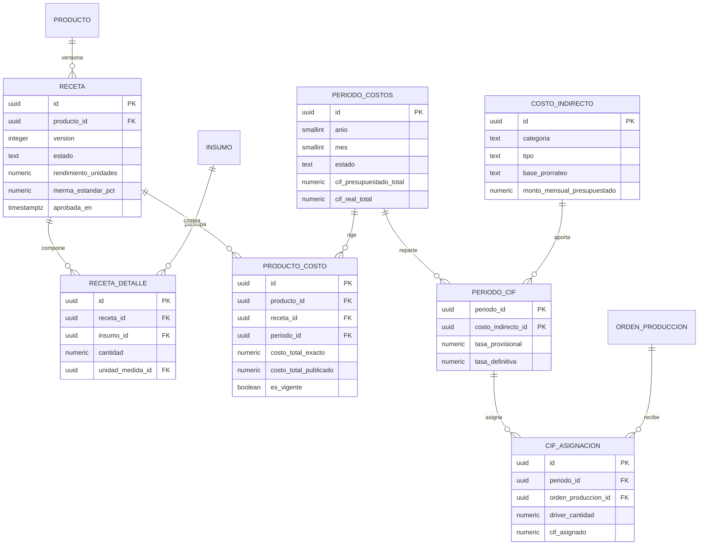
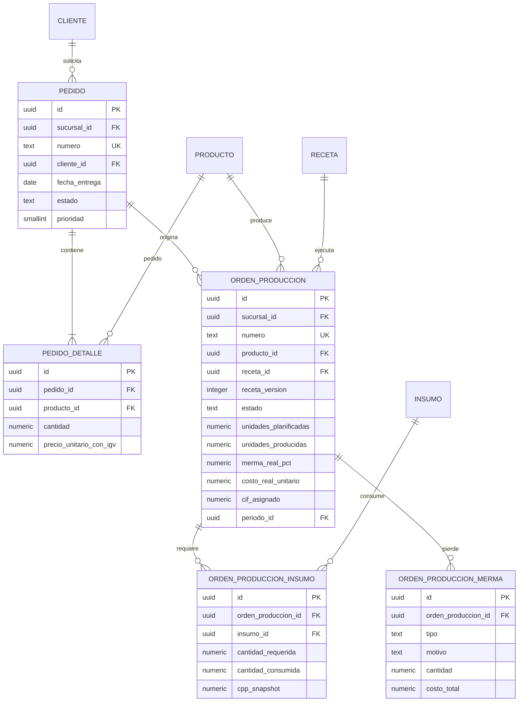
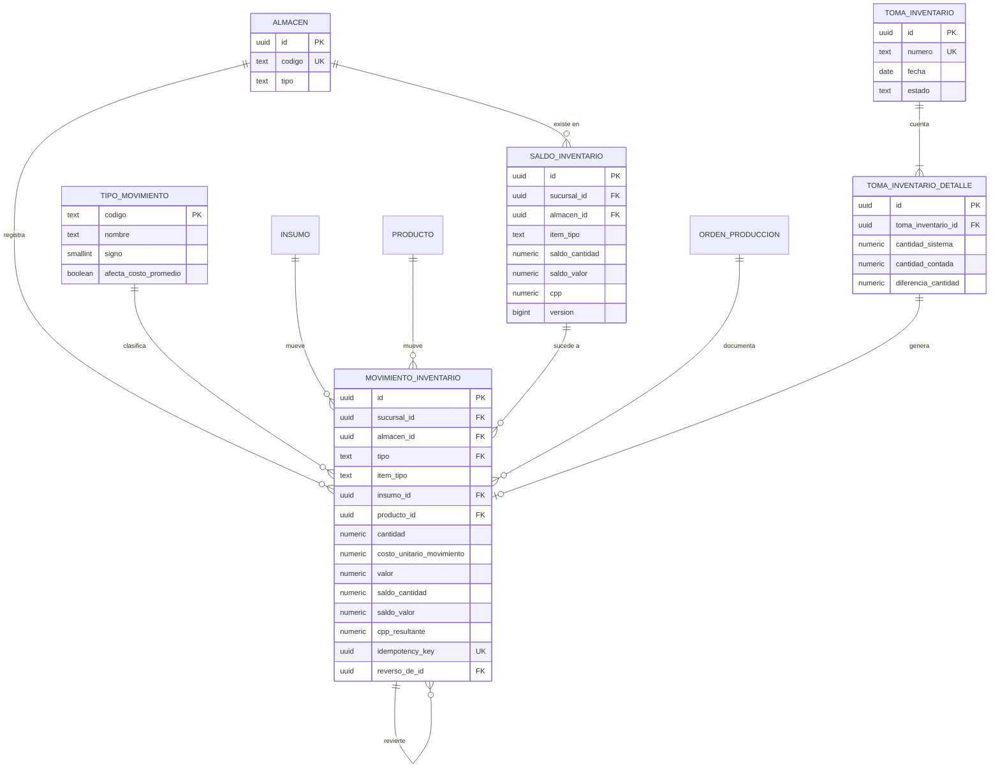
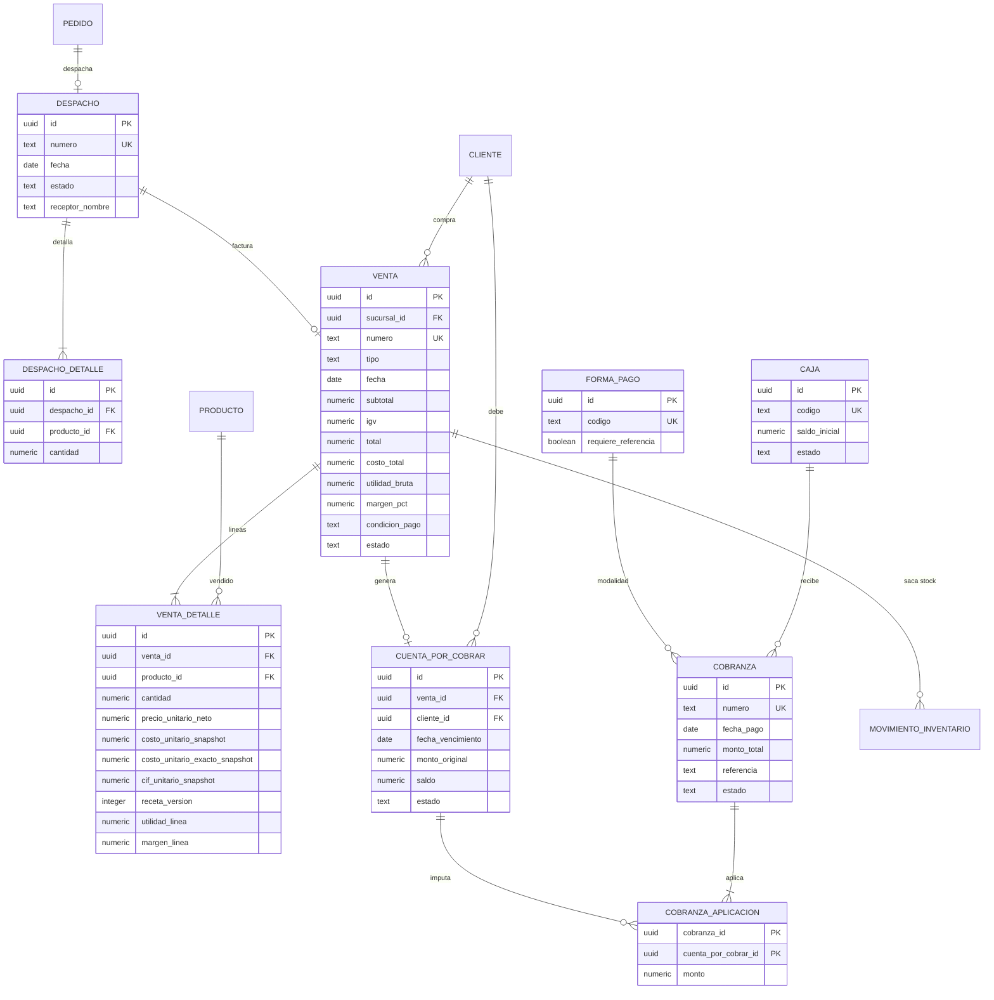
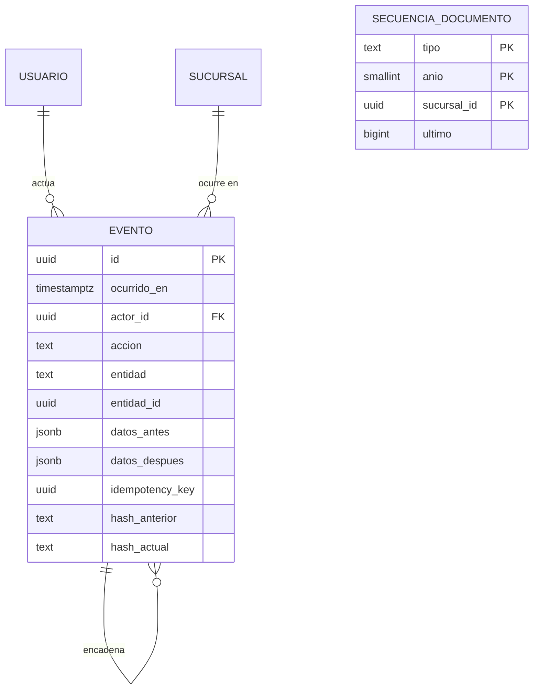

# 04 · Modelo de Datos

| | |
|---|---|
| **Sistema** | Tanta Core — Panadería Tanta |
| **Base de datos** | `tanta` · PostgreSQL 17 · esquemas `core`, `audit`, `report` |
| **Versión** | 1.0 · 01/11/2026 |
| **Norma** | `00-CONTEXTO-Y-DECISIONES.md` (D-03 precisión, D-04 convenciones, D-05 correlativos, D-08 fechas, D-10 multi-sucursal) |
| **Fuente de alcance** | Informe Ejecutivo v1.0, 21/10/2026, §3.3 y §4.4 |
| **Estado** | Normativo. El DDL de §4 es la migración inicial (`0001_init.sql`). |

---

## 1. Principios del modelo

1. **El kárdex es la única verdad del stock.** Ninguna tabla guarda un "stock" editable; todo saldo
   proviene de `core.movimiento_inventario` (append-only) y se materializa en `core.saldo_inventario`
   como proyección bloqueable.
2. **La historia no se reescribe.** Precio, costo, receta, CIF y tipo de cambio se congelan en el
   documento que los usó (snapshot). Cambiar un maestro nunca altera un margen pasado.
3. **Nada se borra.** `borrado_en` para maestros; prohibido `UPDATE`/`DELETE` en el ledger y en
   `audit.evento`. Las correcciones son asientos de reverso.
4. **La unidad mínima monetaria es el céntimo.** Todo importe se almacena con 4 decimales
   (`numeric(16,4)`) y se publica con 2; los costos unitarios y cantidades retienen 6
   (`numeric(18,6)`); los porcentajes son fracciones con 6 decimales (`numeric(9,6)`), nunca `55.0`.
5. **Prohibido `float`, `double precision` y `real`.** Se verifica con la consulta de §8.3.

### 1.1 Mapa de precisión (aplica a todo el esquema)

| Concepto | Tipo PostgreSQL | Escala efectiva | Redondeo | Ejemplo |
|---|---|---|---|---|
| Importe monetario (precio, total, saldo de valor) | `numeric(16,4)` | 4 | 4 dec al escribir; 2 al publicar | `2.3600` |
| Costo unitario publicado (ficha) | `numeric(16,4)` | **2** | HALF_UP a centavos | `0.9000` |
| Costo unitario analítico, CPP, cantidad | `numeric(18,6)` | 6 | HALF_UP a 6 | `0.899175` |
| Porcentaje / tasa (merma, margen, IGV) | `numeric(9,6)` | 6 | HALF_UP a 6, guardado como fracción | `0.550000` |
| Factor de conversión de unidad | `numeric(18,6)` | 6 | exacto por catálogo | `0.001000` |
| Contadores, correlativos | `integer` / `bigint` | — | — | `123` |

> `[CORRECCIÓN]` C-01 · El Informe (§5.3) publica el costo unitario en 2 decimales (S/ 0.90) pero no
> declara escala ni política de redondeo. Sin fijarla, el mismo producto da margen 55.0 % o 55.1 %
> según el orden de las operaciones. Se fija en §1.1 y se desarrolla en `06-MOTOR-DE-COSTEO.md §4`.

### 1.2 Convenciones obligatorias (D-04)

- Tablas en `snake_case` **singular**; PK `id uuid` con `DEFAULT core.uuid_v7()`; FK `<tabla>_id`.
- Auditoría de fila en toda tabla de negocio: `creado_en`, `creado_por`, `actualizado_en`,
  `actualizado_por` (+ `borrado_en` donde aplica).
- `sucursal_id` desde el día 1 en toda tabla de negocio.
- Estados como `text` + `CHECK` (nunca `ENUM` nativo) para evolucionar sin migración destructiva.
- Fechas de negocio `date`; instantes `timestamptz` (UTC, se presenta en `America/Lima`).
- **Excepciones justificadas a `sucursal_id`** (catálogos paramétricos globales, sin dimensión
  operativa): `unidad_medida`, `rol`, `permiso`, `rol_permiso`, `forma_pago`, `tipo_movimiento`,
  `parametro`, `secuencia_documento` (esta última lleva `sucursal_id` porque el correlativo es por
  sucursal), `audit.evento` (lo lleva opcional). Ninguna otra tabla queda exenta.
- **Tablas sin `borrado_en`** (append-only, prohibido borrar): `movimiento_inventario`,
  `audit.evento`, `cobranza_aplicacion`, `rol_permiso`, `usuario_rol`.

---

## 2. Diagramas ER por grupo

Los siete grupos del Informe §4.4 se mantienen; se añaden las entidades que el Informe insinúa pero
no modela (`lista_precio`, `producto_precio`, `periodo_cif`, `cif_asignacion`, `saldo_inventario`,
`idempotencia`). Varias entidades aparecen en más de un diagrama por legibilidad.

### 2.1 Seguridad

`usuario_rol` es la tabla de asignación (un usuario puede cubrir más de un perfil, como admite el
Informe §7: "una persona puede asumir más de un rol"). `sesion` implementa rotación de refresh token
con detección de reuso (D-07).



### 2.2 Maestros

`lista_precio` + `producto_precio` sustituyen el campo único "precio (con IGV)" del Informe §3.3
`[AMPLIACIÓN]` A-01: una panadería vende al mostrador, a clientes con precio pactado y por canal, y
necesita historial de precios para auditar márgenes.



### 2.3 Recetas y costos

Versionado de receta: `version` incremental por producto y un índice único parcial que garantiza
**una sola versión `VIGENTE`** por producto. `producto_costo` es la ficha congelada por período.



### 2.4 Pedidos y producción

La OP congela la receta (`receta_id`, `receta_version`, `merma_estandar_pct_snapshot`) al lanzarse;
así, editar la receta después no altera una OP en curso ni su costo.



### 2.5 Inventario

`movimiento_inventario` es el ledger; `saldo_inventario` es su proyección bloqueable (una fila por
ítem y almacén) y `saldo_*` dentro del movimiento es la foto del saldo **después** del asiento.



### 2.6 Ventas y cobranza

`venta_detalle` es la tabla más crítica del sistema: guarda `costo_unitario_snapshot` y
`costo_unitario_exacto_snapshot`, ambos inmutables, más la versión de receta usada. Es lo que hace
que el margen histórico del Informe §4.4 sea real y no una promesa.



### 2.7 Auditoría

Cadena de hash por encadenamiento (`hash_anterior` → `hash_actual`), serializada con un
`pg_advisory_xact_lock`. Sin esta tabla, una anulación o un cambio de precio no es defendible ante
una auditoría tributaria o una disputa con el cliente.



---

## 3. Dependencias de creación

El orden importa solo por FKs. Bloques: `00` utilidades y sucursal · `01` seguridad · `02` maestros
(con `proveedor` y `cliente` antes de `insumo`/`lista_precio`) · `03` recetas y costos ·
`04` pedidos y producción (incluye `cif_asignacion`, que depende de `orden_produccion`) ·
`05` inventario · `06` ventas y cobranza · `07` auditoría, correlativos y vistas.

Dos ciclos se resuelven con `ALTER TABLE` al final del bloque que cierra el ciclo: `sucursal.creado_por
→ usuario` (bloque 01) y `movimiento_inventario.venta_id → venta` (bloque 06).

---

## 4. DDL ejecutable

### Bloque 00 · Esquemas, funciones y sucursal

```sql
BEGIN;

CREATE SCHEMA IF NOT EXISTS core;
CREATE SCHEMA IF NOT EXISTS audit;
CREATE SCHEMA IF NOT EXISTS report;

-- UUIDv7 (RFC 9562): 48 bits de milisegundos + versión 7 + variante 10 + 64 bits aleatorios.
-- PostgreSQL 17 no lo trae nativo (llega en 18); esta implementación no necesita extensiones.
CREATE OR REPLACE FUNCTION core.uuid_v7() RETURNS uuid
LANGUAGE sql VOLATILE PARALLEL SAFE AS $$
  SELECT encode(
           overlay(
             overlay(
               overlay(
                 uuid_send(gen_random_uuid())
                 PLACING substring(int8send((extract(epoch FROM clock_timestamp()) * 1000)::bigint) FROM 3 FOR 6)
                 FROM 1 FOR 6),
               '\x70'::bytea FROM 7 FOR 1),   -- versión 7 (4 bits aleatorios a cero)
             '\x80'::bytea FROM 9 FOR 1),     -- variante RFC 9562 (6 bits aleatorios a cero)
           'hex')::uuid;
$$;

COMMENT ON FUNCTION core.uuid_v7() IS
  'UUIDv7 ordenable por tiempo (ms). 74 bits de entropía efectiva; sin contador monotónico.';

-- Sella la auditoría de fila en cada UPDATE.
CREATE OR REPLACE FUNCTION core.fn_touch() RETURNS trigger
LANGUAGE plpgsql AS $$
BEGIN
  NEW.actualizado_en := now();
  IF NEW.actualizado_por IS NULL THEN
    NEW.actualizado_por := NEW.creado_por;
  END IF;
  RETURN NEW;
END $$;

-- Inmutabilidad de tablas append-only.
CREATE OR REPLACE FUNCTION core.fn_append_only() RETURNS trigger
LANGUAGE plpgsql AS $$
BEGIN
  RAISE EXCEPTION '% no permitido en tabla append-only %.%', TG_OP, TG_TABLE_SCHEMA, TG_TABLE_NAME
    USING ERRCODE = '55000',
          HINT = 'Registre un asiento de reverso; no modifique ni borre movimientos.';
END $$;

CREATE TABLE core.sucursal (
  id               uuid PRIMARY KEY DEFAULT core.uuid_v7(),
  codigo           text        NOT NULL,
  nombre           text        NOT NULL,
  direccion        text,
  zona_horaria     text        NOT NULL DEFAULT 'America/Lima',
  activo           boolean     NOT NULL DEFAULT true,
  creado_en        timestamptz NOT NULL DEFAULT now(),
  creado_por       uuid,
  actualizado_en   timestamptz NOT NULL DEFAULT now(),
  actualizado_por  uuid,
  borrado_en       timestamptz,
  CONSTRAINT ux_sucursal_codigo UNIQUE (codigo),
  CONSTRAINT ck_sucursal_zona CHECK (zona_horaria = 'America/Lima')
);

CREATE TRIGGER trg_sucursal_touch BEFORE UPDATE ON core.sucursal
  FOR EACH ROW EXECUTE FUNCTION core.fn_touch();
```

### Bloque 01 · Seguridad

```sql
CREATE TABLE core.usuario (
  id                   uuid PRIMARY KEY DEFAULT core.uuid_v7(),
  sucursal_id          uuid        NOT NULL REFERENCES core.sucursal(id),
  email                text        NOT NULL,
  nombre_completo      text        NOT NULL,
  telefono             text,
  hash_password        text        NOT NULL,
  algoritmo_hash       text        NOT NULL DEFAULT 'argon2id'
                         CHECK (algoritmo_hash IN ('argon2id')),
  mfa_habilitado       boolean     NOT NULL DEFAULT false,
  mfa_secreto_cifrado  bytea,
  estado               text        NOT NULL DEFAULT 'ACTIVO'
                         CHECK (estado IN ('ACTIVO','BLOQUEADO','INACTIVO')),
  intentos_fallidos    smallint    NOT NULL DEFAULT 0 CHECK (intentos_fallidos >= 0),
  bloqueado_hasta      timestamptz,
  ultimo_acceso_en     timestamptz,
  debe_cambiar_password boolean    NOT NULL DEFAULT true,
  creado_en            timestamptz NOT NULL DEFAULT now(),
  creado_por           uuid,
  actualizado_en       timestamptz NOT NULL DEFAULT now(),
  actualizado_por      uuid,
  borrado_en           timestamptz,
  CONSTRAINT ck_usuario_mfa CHECK (NOT mfa_habilitado OR mfa_secreto_cifrado IS NOT NULL),
  CONSTRAINT ck_usuario_email CHECK (email LIKE '%_@_%._%')
);

CREATE UNIQUE INDEX ux_usuario_email ON core.usuario (lower(email)) WHERE borrado_en IS NULL;

CREATE TABLE core.rol (
  id          uuid PRIMARY KEY DEFAULT core.uuid_v7(),
  codigo      text NOT NULL CHECK (codigo IN ('ADMIN','CLIENTE','PRODUCCION','ALMACEN','VENDEDOR','GERENTE')),
  nombre      text NOT NULL,
  descripcion text,
  es_sistema  boolean NOT NULL DEFAULT true,
  creado_en   timestamptz NOT NULL DEFAULT now(),
  creado_por  uuid,
  CONSTRAINT ux_rol_codigo UNIQUE (codigo)
);

CREATE TABLE core.permiso (
  id          uuid PRIMARY KEY DEFAULT core.uuid_v7(),
  codigo      text NOT NULL,             -- 'venta:anular', 'inventario:ajustar', ...
  modulo      text NOT NULL,
  descripcion text,
  creado_en   timestamptz NOT NULL DEFAULT now(),
  CONSTRAINT ux_permiso_codigo UNIQUE (codigo)
);

CREATE TABLE core.rol_permiso (
  rol_id     uuid NOT NULL REFERENCES core.rol(id),
  permiso_id uuid NOT NULL REFERENCES core.permiso(id),
  PRIMARY KEY (rol_id, permiso_id)
);

CREATE TABLE core.usuario_rol (
  usuario_id  uuid NOT NULL REFERENCES core.usuario(id),
  rol_id      uuid NOT NULL REFERENCES core.rol(id),
  asignado_en timestamptz NOT NULL DEFAULT now(),
  asignado_por uuid REFERENCES core.usuario(id),
  PRIMARY KEY (usuario_id, rol_id)
);

CREATE TABLE core.sesion (
  id               uuid PRIMARY KEY DEFAULT core.uuid_v7(),
  usuario_id       uuid NOT NULL REFERENCES core.usuario(id),
  familia_id       uuid NOT NULL,                  -- familia de rotación
  refresh_hash     text NOT NULL,                  -- SHA-256 del token opaco
  dispositivo_id   text,
  ip               inet,
  user_agent       text,
  emitido_en       timestamptz NOT NULL DEFAULT now(),
  expira_en        timestamptz NOT NULL,
  revocado_en      timestamptz,
  motivo_revocacion text CHECK (motivo_revocacion IN
                      ('ROTACION','LOGOUT','REUSO_DETECTADO','ADMIN','EXPIRADO')),
  CONSTRAINT ck_sesion_expira CHECK (expira_en > emitido_en)
);

CREATE UNIQUE INDEX ux_sesion_refresh ON core.sesion (refresh_hash);
CREATE INDEX ix_sesion_familia ON core.sesion (familia_id);

CREATE TABLE core.idempotencia (
  clave          uuid PRIMARY KEY,                  -- Idempotency-Key enviada por el cliente
  usuario_id     uuid REFERENCES core.usuario(id),
  metodo         text NOT NULL,
  ruta           text NOT NULL,
  hash_peticion  text NOT NULL,
  estado_http    smallint,
  respuesta      jsonb,
  creado_en      timestamptz NOT NULL DEFAULT now(),
  expira_en      timestamptz NOT NULL DEFAULT now() + interval '7 days'
);

CREATE INDEX ix_idempotencia_expira ON core.idempotencia (expira_en);

ALTER TABLE core.sucursal
  ADD CONSTRAINT fk_sucursal_creado_por FOREIGN KEY (creado_por) REFERENCES core.usuario(id),
  ADD CONSTRAINT fk_sucursal_actualizado_por FOREIGN KEY (actualizado_por) REFERENCES core.usuario(id);

CREATE TRIGGER trg_usuario_touch BEFORE UPDATE ON core.usuario
  FOR EACH ROW EXECUTE FUNCTION core.fn_touch();
```

### Bloque 02 · Maestros

```sql
CREATE TABLE core.unidad_medida (
  id          uuid PRIMARY KEY DEFAULT core.uuid_v7(),
  codigo      text NOT NULL,                 -- 'KG','G','L','ML','UN','BOLSA50','DOCENA'
  nombre      text NOT NULL,
  tipo        text NOT NULL CHECK (tipo IN ('MASA','VOLUMEN','UNIDAD','TIEMPO')),
  factor_base numeric(18,6) NOT NULL CHECK (factor_base > 0),
  es_base     boolean NOT NULL DEFAULT false,
  activo      boolean NOT NULL DEFAULT true,
  creado_en   timestamptz NOT NULL DEFAULT now(),
  CONSTRAINT ux_um_codigo UNIQUE (codigo),
  CONSTRAINT ck_um_factor_base CHECK (NOT es_base OR factor_base = 1)
);

-- Una sola unidad base por magnitud (KG para MASA, L para VOLUMEN, UN para UNIDAD).
CREATE UNIQUE INDEX ux_um_base_por_tipo ON core.unidad_medida (tipo) WHERE es_base;

CREATE TABLE core.parametro (
  clave          text PRIMARY KEY,
  valor          text NOT NULL,
  tipo_dato      text NOT NULL CHECK (tipo_dato IN ('TEXTO','ENTERO','DECIMAL','BOOLEANO','FECHA')),
  descripcion    text,
  actualizado_en timestamptz NOT NULL DEFAULT now(),
  actualizado_por uuid REFERENCES core.usuario(id)
);

INSERT INTO core.parametro (clave, valor, tipo_dato, descripcion) VALUES
  ('igv.tasa',                     '0.180000', 'DECIMAL',  'IGV vigente (18 %), parametrizable'),
  ('costeo.metodo_merma',          'DIVIDE_POR_RENDIMIENTO', 'TEXTO', 'costo/(1-merma); ver 06 §4'),
  ('costeo.decimales_publicacion', '2',        'ENTERO',   'Decimales del costo unitario publicado'),
  ('inventario.permite_saldo_negativo', 'false','BOOLEANO','Política de saldo negativo'),
  ('inventario.tolerancia_saldo',  '0.000010', 'DECIMAL',  'Tolerancia del job de integridad'),
  ('costeo.base_prorrateo_default','HORAS_HORNO','TEXTO',  'Base CIF por defecto'),
  ('venta.dias_credito_default',   '0',        'ENTERO',   'Días de crédito si el cliente no define'),
  ('cobranza.dias_gracia',         '0',        'ENTERO',   'Días antes de marcar VENCIDA');

CREATE TABLE core.proveedor (
  id            uuid PRIMARY KEY DEFAULT core.uuid_v7(),
  sucursal_id   uuid NOT NULL REFERENCES core.sucursal(id),
  codigo        text NOT NULL,
  razon_social  text NOT NULL,
  ruc           text CHECK (ruc ~ '^[0-9]{11}$'),
  contacto      text,
  telefono      text,
  email         text,
  dias_credito  smallint NOT NULL DEFAULT 0 CHECK (dias_credito BETWEEN 0 AND 120),
  activo        boolean NOT NULL DEFAULT true,
  creado_en     timestamptz NOT NULL DEFAULT now(),
  creado_por    uuid REFERENCES core.usuario(id),
  actualizado_en timestamptz NOT NULL DEFAULT now(),
  actualizado_por uuid REFERENCES core.usuario(id),
  borrado_en    timestamptz,
  CONSTRAINT ux_proveedor_codigo UNIQUE (sucursal_id, codigo)
);

CREATE TABLE core.categoria (
  id                uuid PRIMARY KEY DEFAULT core.uuid_v7(),
  sucursal_id       uuid NOT NULL REFERENCES core.sucursal(id),
  padre_id          uuid REFERENCES core.categoria(id),
  nombre            text NOT NULL,
  margen_objetivo_pct numeric(9,6) CHECK (margen_objetivo_pct >= 0 AND margen_objetivo_pct < 1),
  orden             smallint NOT NULL DEFAULT 1,
  creado_en         timestamptz NOT NULL DEFAULT now(),
  creado_por        uuid REFERENCES core.usuario(id),
  actualizado_en    timestamptz NOT NULL DEFAULT now(),
  actualizado_por   uuid REFERENCES core.usuario(id),
  borrado_en        timestamptz,
  CONSTRAINT ux_categoria_nombre UNIQUE (sucursal_id, nombre),
  CONSTRAINT ck_categoria_padre CHECK (padre_id IS DISTINCT FROM id)
);

CREATE TABLE core.insumo (
  id                 uuid PRIMARY KEY DEFAULT core.uuid_v7(),
  sucursal_id        uuid NOT NULL REFERENCES core.sucursal(id),
  codigo             text NOT NULL,
  nombre             text NOT NULL,
  unidad_medida_id   uuid NOT NULL REFERENCES core.unidad_medida(id),
  unidad_compra_id   uuid REFERENCES core.unidad_medida(id),
  factor_compra      numeric(18,6) NOT NULL DEFAULT 1 CHECK (factor_compra > 0),
  proveedor_habitual_id uuid REFERENCES core.proveedor(id),
  stock_minimo       numeric(18,6) NOT NULL DEFAULT 0 CHECK (stock_minimo >= 0),
  stock_maximo       numeric(18,6) CHECK (stock_maximo IS NULL OR stock_maximo >= stock_minimo),
  perecedero         boolean NOT NULL DEFAULT true,
  vida_util_dias     integer CHECK (vida_util_dias IS NULL OR vida_util_dias > 0),
  activo             boolean NOT NULL DEFAULT true,
  creado_en          timestamptz NOT NULL DEFAULT now(),
  creado_por         uuid REFERENCES core.usuario(id),
  actualizado_en     timestamptz NOT NULL DEFAULT now(),
  actualizado_por    uuid REFERENCES core.usuario(id),
  borrado_en         timestamptz,
  CONSTRAINT ux_insumo_codigo UNIQUE (sucursal_id, codigo)
);

CREATE TABLE core.producto (
  id                  uuid PRIMARY KEY DEFAULT core.uuid_v7(),
  sucursal_id         uuid NOT NULL REFERENCES core.sucursal(id),
  categoria_id        uuid NOT NULL REFERENCES core.categoria(id),
  codigo              text NOT NULL,
  nombre              text NOT NULL,
  descripcion         text,
  unidad_venta_id     uuid NOT NULL REFERENCES core.unidad_medida(id),
  es_producido        boolean NOT NULL DEFAULT true,
  controla_stock      boolean NOT NULL DEFAULT true,
  margen_objetivo_pct numeric(9,6) CHECK (margen_objetivo_pct >= 0 AND margen_objetivo_pct < 1),
  imagen_url          text,
  orden               smallint NOT NULL DEFAULT 1,
  disponible_app      boolean NOT NULL DEFAULT true,
  activo              boolean NOT NULL DEFAULT true,
  creado_en           timestamptz NOT NULL DEFAULT now(),
  creado_por          uuid REFERENCES core.usuario(id),
  actualizado_en      timestamptz NOT NULL DEFAULT now(),
  actualizado_por     uuid REFERENCES core.usuario(id),
  borrado_en          timestamptz,
  CONSTRAINT ux_producto_codigo UNIQUE (sucursal_id, codigo)
);

CREATE TABLE core.cliente (
  id                    uuid PRIMARY KEY DEFAULT core.uuid_v7(),
  sucursal_id           uuid NOT NULL REFERENCES core.sucursal(id),
  codigo                text NOT NULL,
  tipo_documento        text NOT NULL DEFAULT 'SIN_DOC'
                          CHECK (tipo_documento IN ('DNI','RUC','CE','PASAPORTE','SIN_DOC')),
  numero_documento      text,
  nombre                text NOT NULL,
  razon_social          text,
  email                 text,
  telefono              text,
  direccion_entrega     text,
  es_cliente_app        boolean NOT NULL DEFAULT false,
  vendedor_asignado_id  uuid REFERENCES core.usuario(id),
  lista_precio_id       uuid,
  limite_credito        numeric(16,4) NOT NULL DEFAULT 0 CHECK (limite_credito >= 0),
  dias_credito          smallint NOT NULL DEFAULT 0 CHECK (dias_credito BETWEEN 0 AND 120),
  condicion_pago_default text NOT NULL DEFAULT 'CONTADO'
                          CHECK (condicion_pago_default IN ('CONTADO','CREDITO')),
  consentimiento_datos_en timestamptz,     -- Ley 29733
  activo                boolean NOT NULL DEFAULT true,
  creado_en             timestamptz NOT NULL DEFAULT now(),
  creado_por            uuid REFERENCES core.usuario(id),
  actualizado_en        timestamptz NOT NULL DEFAULT now(),
  actualizado_por       uuid REFERENCES core.usuario(id),
  borrado_en            timestamptz,
  CONSTRAINT ux_cliente_codigo UNIQUE (sucursal_id, codigo),
  CONSTRAINT ux_cliente_documento UNIQUE (sucursal_id, tipo_documento, numero_documento),
  CONSTRAINT ck_cliente_doc CHECK ((tipo_documento = 'SIN_DOC') = (numero_documento IS NULL)),
  CONSTRAINT ck_cliente_credito CHECK (condicion_pago_default <> 'CREDITO' OR limite_credito > 0)
);

CREATE TABLE core.lista_precio (
  id            uuid PRIMARY KEY DEFAULT core.uuid_v7(),
  sucursal_id   uuid NOT NULL REFERENCES core.sucursal(id),
  codigo        text NOT NULL,              -- 'MOSTRADOR','MAYORISTA','APP','CONVENIO'
  nombre        text NOT NULL,
  tipo          text NOT NULL DEFAULT 'BASE'
                  CHECK (tipo IN ('BASE','CLIENTE','CANAL','PROMOCIONAL')),
  cliente_id    uuid REFERENCES core.cliente(id),
  es_default    boolean NOT NULL DEFAULT false,
  activo        boolean NOT NULL DEFAULT true,
  creado_en     timestamptz NOT NULL DEFAULT now(),
  creado_por    uuid REFERENCES core.usuario(id),
  actualizado_en timestamptz NOT NULL DEFAULT now(),
  actualizado_por uuid REFERENCES core.usuario(id),
  borrado_en    timestamptz,
  CONSTRAINT ux_lista_codigo UNIQUE (sucursal_id, codigo),
  CONSTRAINT ck_lista_cliente CHECK ((tipo = 'CLIENTE') = (cliente_id IS NOT NULL))
);

CREATE UNIQUE INDEX ux_lista_default ON core.lista_precio (sucursal_id) WHERE es_default AND borrado_en IS NULL;

ALTER TABLE core.cliente
  ADD CONSTRAINT fk_cliente_lista_precio FOREIGN KEY (lista_precio_id) REFERENCES core.lista_precio(id);

CREATE TABLE core.producto_precio (
  id              uuid PRIMARY KEY DEFAULT core.uuid_v7(),
  lista_precio_id uuid NOT NULL REFERENCES core.lista_precio(id),
  producto_id     uuid NOT NULL REFERENCES core.producto(id),
  precio_con_igv  numeric(16,4) NOT NULL CHECK (precio_con_igv >= 0),
  igv_tasa        numeric(9,6) NOT NULL DEFAULT 0.180000 CHECK (igv_tasa >= 0 AND igv_tasa < 1),
  precio_neto     numeric(16,4) GENERATED ALWAYS AS (round(precio_con_igv / (1 + igv_tasa), 4)) STORED,
  vigente_desde   date NOT NULL DEFAULT (now() AT TIME ZONE 'America/Lima')::date,
  vigente_hasta   date,
  creado_en       timestamptz NOT NULL DEFAULT now(),
  creado_por      uuid REFERENCES core.usuario(id),
  actualizado_en  timestamptz NOT NULL DEFAULT now(),
  actualizado_por uuid REFERENCES core.usuario(id),
  CONSTRAINT ck_precio_rango CHECK (vigente_hasta IS NULL OR vigente_hasta > vigente_desde)
);

-- Un solo precio vigente por (lista, producto); el historial se cierra con vigente_hasta.
CREATE UNIQUE INDEX ux_precio_vigente ON core.producto_precio (lista_precio_id, producto_id)
  WHERE vigente_hasta IS NULL;
CREATE INDEX ix_precio_producto ON core.producto_precio (producto_id, vigente_desde DESC);

CREATE TRIGGER trg_categoria_touch BEFORE UPDATE ON core.categoria
  FOR EACH ROW EXECUTE FUNCTION core.fn_touch();
CREATE TRIGGER trg_insumo_touch BEFORE UPDATE ON core.insumo
  FOR EACH ROW EXECUTE FUNCTION core.fn_touch();
CREATE TRIGGER trg_producto_touch BEFORE UPDATE ON core.producto
  FOR EACH ROW EXECUTE FUNCTION core.fn_touch();
CREATE TRIGGER trg_cliente_touch BEFORE UPDATE ON core.cliente
  FOR EACH ROW EXECUTE FUNCTION core.fn_touch();
CREATE TRIGGER trg_proveedor_touch BEFORE UPDATE ON core.proveedor
  FOR EACH ROW EXECUTE FUNCTION core.fn_touch();
```

### Bloque 03 · Recetas y costos

```sql
CREATE TABLE core.receta (
  id                        uuid PRIMARY KEY DEFAULT core.uuid_v7(),
  sucursal_id               uuid NOT NULL REFERENCES core.sucursal(id),
  producto_id               uuid NOT NULL REFERENCES core.producto(id),
  version                   integer NOT NULL CHECK (version >= 1),
  estado                    text NOT NULL DEFAULT 'BORRADOR'
                              CHECK (estado IN ('BORRADOR','VIGENTE','OBSOLETA')),
  rendimiento_unidades      numeric(18,6) NOT NULL CHECK (rendimiento_unidades > 0),
  rendimiento_unidad_medida_id uuid NOT NULL REFERENCES core.unidad_medida(id),
  merma_estandar_pct        numeric(9,6) NOT NULL DEFAULT 0
                              CHECK (merma_estandar_pct >= 0 AND merma_estandar_pct < 1),
  horas_horno_estandar      numeric(9,4) NOT NULL DEFAULT 0 CHECK (horas_horno_estandar >= 0),
  horas_maquina_estandar    numeric(9,4) NOT NULL DEFAULT 0 CHECK (horas_maquina_estandar >= 0),
  notas                     text,
  aprobada_por              uuid REFERENCES core.usuario(id),
  aprobada_en               timestamptz,
  creado_en                 timestamptz NOT NULL DEFAULT now(),
  creado_por                uuid REFERENCES core.usuario(id),
  actualizado_en            timestamptz NOT NULL DEFAULT now(),
  actualizado_por           uuid REFERENCES core.usuario(id),
  borrado_en                timestamptz,
  CONSTRAINT ux_receta_version UNIQUE (producto_id, version),
  CONSTRAINT ck_receta_aprobada CHECK (estado <> 'VIGENTE' OR aprobada_en IS NOT NULL)
);

-- Solo una versión VIGENTE por producto.
CREATE UNIQUE INDEX ux_receta_vigente ON core.receta (producto_id)
  WHERE estado = 'VIGENTE' AND borrado_en IS NULL;

CREATE TABLE core.receta_detalle (
  id                 uuid PRIMARY KEY DEFAULT core.uuid_v7(),
  receta_id          uuid NOT NULL REFERENCES core.receta(id),
  insumo_id          uuid NOT NULL REFERENCES core.insumo(id),
  cantidad           numeric(18,6) NOT NULL CHECK (cantidad > 0),
  unidad_medida_id   uuid NOT NULL REFERENCES core.unidad_medida(id),
  merma_especifica_pct numeric(9,6) NOT NULL DEFAULT 0
                       CHECK (merma_especifica_pct >= 0 AND merma_especifica_pct < 1),
  orden              smallint NOT NULL DEFAULT 1,
  observacion        text,
  creado_en          timestamptz NOT NULL DEFAULT now(),
  actualizado_en     timestamptz NOT NULL DEFAULT now(),
  CONSTRAINT ux_receta_detalle UNIQUE (receta_id, insumo_id)
);

CREATE TABLE core.costo_indirecto (
  id                          uuid PRIMARY KEY DEFAULT core.uuid_v7(),
  sucursal_id                 uuid NOT NULL REFERENCES core.sucursal(id),
  codigo                      text NOT NULL,
  nombre                      text NOT NULL,
  categoria                   text NOT NULL CHECK (categoria IN
                                ('ALQUILER','ENERGIA','GAS','AGUA','PLANILLA_INDIRECTA',
                                 'DEPRECIACION','MANTENIMIENTO','LIMPIEZA','OTRO')),
  tipo                        text NOT NULL CHECK (tipo IN ('FIJO','VARIABLE')),
  base_prorrateo              text NOT NULL CHECK (base_prorrateo IN
                                ('UNIDADES_PRODUCIDAS','HORAS_HORNO','HORAS_MAQUINA','COSTO_INSUMOS')),
  monto_mensual_presupuestado numeric(16,4) NOT NULL CHECK (monto_mensual_presupuestado >= 0),
  centro_costo                text,
  vigente_desde               date NOT NULL DEFAULT (now() AT TIME ZONE 'America/Lima')::date,
  vigente_hasta               date,
  activo                      boolean NOT NULL DEFAULT true,
  creado_en                   timestamptz NOT NULL DEFAULT now(),
  creado_por                  uuid REFERENCES core.usuario(id),
  actualizado_en              timestamptz NOT NULL DEFAULT now(),
  actualizado_por             uuid REFERENCES core.usuario(id),
  borrado_en                  timestamptz,
  CONSTRAINT ux_costo_indirecto UNIQUE (sucursal_id, codigo),
  CONSTRAINT ck_ci_vigencia CHECK (vigente_hasta IS NULL OR vigente_hasta >= vigente_desde)
);

CREATE TABLE core.periodo_costos (
  id                    uuid PRIMARY KEY DEFAULT core.uuid_v7(),
  sucursal_id           uuid NOT NULL REFERENCES core.sucursal(id),
  anio                  smallint NOT NULL CHECK (anio BETWEEN 2020 AND 2100),
  mes                   smallint NOT NULL CHECK (mes BETWEEN 1 AND 12),
  estado                text NOT NULL DEFAULT 'ABIERTO'
                          CHECK (estado IN ('ABIERTO','CALCULADO','CERRADO')),
  cif_presupuestado_total numeric(16,4) NOT NULL DEFAULT 0 CHECK (cif_presupuestado_total >= 0),
  cif_real_total        numeric(16,4) CHECK (cif_real_total IS NULL OR cif_real_total >= 0),
  diferencia_cif_total  numeric(16,4),
  unidades_producidas   numeric(18,6) CHECK (unidades_producidas IS NULL OR unidades_producidas >= 0),
  calculado_en          timestamptz,
  cerrado_en            timestamptz,
  cerrado_por           uuid REFERENCES core.usuario(id),
  observacion           text,
  creado_en             timestamptz NOT NULL DEFAULT now(),
  creado_por            uuid REFERENCES core.usuario(id),
  actualizado_en        timestamptz NOT NULL DEFAULT now(),
  actualizado_por       uuid REFERENCES core.usuario(id),
  CONSTRAINT ux_periodo UNIQUE (sucursal_id, anio, mes),
  CONSTRAINT ck_periodo_cierre CHECK ((estado = 'CERRADO') = (cerrado_en IS NOT NULL)),
  CONSTRAINT ck_periodo_calculado CHECK (estado = 'ABIERTO' OR cif_real_total IS NOT NULL)
);

CREATE TABLE core.periodo_cif (
  periodo_id         uuid NOT NULL REFERENCES core.periodo_costos(id),
  costo_indirecto_id uuid NOT NULL REFERENCES core.costo_indirecto(id),
  base               text NOT NULL CHECK (base IN
                       ('UNIDADES_PRODUCIDAS','HORAS_HORNO','HORAS_MAQUINA','COSTO_INSUMOS')),
  monto_presupuestado numeric(16,4) NOT NULL DEFAULT 0 CHECK (monto_presupuestado >= 0),
  monto_real          numeric(16,4) CHECK (monto_real IS NULL OR monto_real >= 0),
  driver_presupuestado numeric(18,6) NOT NULL DEFAULT 0 CHECK (driver_presupuestado >= 0),
  driver_real         numeric(18,6) CHECK (driver_real IS NULL OR driver_real >= 0),
  tasa_provisional    numeric(18,6) GENERATED ALWAYS AS (
                        CASE WHEN driver_presupuestado > 0
                             THEN round(monto_presupuestado / driver_presupuestado, 6)
                             ELSE 0 END) STORED,
  tasa_definitiva     numeric(18,6),
  PRIMARY KEY (periodo_id, costo_indirecto_id)
);

CREATE TABLE core.producto_costo (
  id                      uuid PRIMARY KEY DEFAULT core.uuid_v7(),
  sucursal_id             uuid NOT NULL REFERENCES core.sucursal(id),
  producto_id             uuid NOT NULL REFERENCES core.producto(id),
  receta_id               uuid NOT NULL REFERENCES core.receta(id),
  periodo_id              uuid NOT NULL REFERENCES core.periodo_costos(id),
  unidades_lote           numeric(18,6) NOT NULL CHECK (unidades_lote > 0),
  merma_estandar_pct      numeric(9,6) NOT NULL CHECK (merma_estandar_pct >= 0 AND merma_estandar_pct < 1),
  costo_insumos_lote      numeric(16,4) NOT NULL CHECK (costo_insumos_lote >= 0),
  cif_asignado_lote       numeric(16,4) NOT NULL DEFAULT 0 CHECK (cif_asignado_lote >= 0),
  costo_insumos_unit      numeric(18,6) NOT NULL CHECK (costo_insumos_unit >= 0),
  costo_merma_unit        numeric(18,6) NOT NULL CHECK (costo_merma_unit >= 0),
  cif_unit                numeric(18,6) NOT NULL CHECK (cif_unit >= 0),
  costo_total_exacto      numeric(18,6) NOT NULL CHECK (costo_total_exacto >= 0),
  costo_insumos_unit_pub  numeric(16,4) NOT NULL,
  costo_merma_unit_pub    numeric(16,4) NOT NULL,
  cif_unit_pub            numeric(16,4) NOT NULL,
  costo_total_publicado   numeric(16,4) NOT NULL CHECK (costo_total_publicado >= 0),
  es_vigente              boolean NOT NULL DEFAULT true,
  calculado_en            timestamptz NOT NULL DEFAULT now(),
  calculado_por           uuid REFERENCES core.usuario(id),
  CONSTRAINT ux_producto_costo UNIQUE (producto_id, periodo_id, receta_id),
  CONSTRAINT ck_costo_publicado_suma CHECK (
    costo_total_publicado = costo_insumos_unit_pub + costo_merma_unit_pub + cif_unit_pub),
  CONSTRAINT ck_costo_exacto_suma CHECK (
    costo_total_exacto = round(costo_insumos_unit / (1 - merma_estandar_pct), 6) + cif_unit)
  -- Nota: el redondeo a 6 dentro del CHECK es obligatorio; sin él, la división
  -- numérica de PostgreSQL (escala 20+) nunca iguala al valor almacenado.
);

CREATE UNIQUE INDEX ux_producto_costo_vigente ON core.producto_costo (producto_id) WHERE es_vigente;

COMMENT ON COLUMN core.producto_costo.costo_total_exacto IS
  'Costo analítico a 6 decimales. Nunca se usa para valorizar inventario ni COGS: ver 06 §4.3.';
```

### Bloque 04 · Pedidos y producción

```sql
CREATE TABLE core.pedido (
  id              uuid PRIMARY KEY DEFAULT core.uuid_v7(),
  sucursal_id     uuid NOT NULL REFERENCES core.sucursal(id),
  numero          text NOT NULL CHECK (numero ~ '^PED-[0-9]{4}-[0-9]{6}$'),
  cliente_id      uuid NOT NULL REFERENCES core.cliente(id),
  fecha_entrega   date NOT NULL,
  ventana_entrega text CHECK (ventana_entrega IN ('MANANA','TARDE','NOCHE','TODO_EL_DIA')),
  canal           text NOT NULL DEFAULT 'APP'
                    CHECK (canal IN ('APP','MOSTRADOR','TELEFONO','WHATSAPP')),
  estado          text NOT NULL DEFAULT 'REGISTRADO' CHECK (estado IN
                    ('REGISTRADO','CONFIRMADO','EN_PRODUCCION','LISTO',
                     'DESPACHADO','ENTREGADO','CANCELADO')),
  prioridad       smallint NOT NULL DEFAULT 3 CHECK (prioridad BETWEEN 1 AND 5),
  observaciones   text,
  total_estimado  numeric(16,4) NOT NULL DEFAULT 0 CHECK (total_estimado >= 0),
  registrado_en   timestamptz NOT NULL DEFAULT now(),
  confirmado_en   timestamptz,
  listo_en        timestamptz,
  despachado_en   timestamptz,
  entregado_en    timestamptz,
  cancelado_en    timestamptz,
  motivo_cancelacion text,
  creado_en       timestamptz NOT NULL DEFAULT now(),
  creado_por      uuid REFERENCES core.usuario(id),
  actualizado_en  timestamptz NOT NULL DEFAULT now(),
  actualizado_por uuid REFERENCES core.usuario(id),
  borrado_en      timestamptz,
  CONSTRAINT ux_pedido_numero UNIQUE (sucursal_id, numero),
  CONSTRAINT ck_pedido_cancel CHECK ((estado = 'CANCELADO') = (cancelado_en IS NOT NULL))
);

CREATE INDEX ix_pedido_entrega ON core.pedido (sucursal_id, fecha_entrega, estado)
  WHERE borrado_en IS NULL;

CREATE TABLE core.pedido_detalle (
  id                    uuid PRIMARY KEY DEFAULT core.uuid_v7(),
  pedido_id             uuid NOT NULL REFERENCES core.pedido(id),
  linea                 smallint NOT NULL CHECK (linea > 0),
  producto_id           uuid NOT NULL REFERENCES core.producto(id),
  cantidad              numeric(18,6) NOT NULL CHECK (cantidad > 0),
  precio_unitario_con_igv numeric(16,4) NOT NULL CHECK (precio_unitario_con_igv >= 0),
  importe_total         numeric(16,4) NOT NULL CHECK (importe_total >= 0),
  notas_personalizacion text,
  creado_en             timestamptz NOT NULL DEFAULT now(),
  CONSTRAINT ux_pedido_detalle_linea UNIQUE (pedido_id, linea)
);

CREATE TABLE core.orden_produccion (
  id                        uuid PRIMARY KEY DEFAULT core.uuid_v7(),
  sucursal_id               uuid NOT NULL REFERENCES core.sucursal(id),
  numero                    text NOT NULL CHECK (numero ~ '^OP-[0-9]{4}-[0-9]{6}$'),
  producto_id               uuid NOT NULL REFERENCES core.producto(id),
  receta_id                 uuid NOT NULL REFERENCES core.receta(id),
  receta_version            integer NOT NULL CHECK (receta_version >= 1),
  pedido_id                 uuid REFERENCES core.pedido(id),
  periodo_id                uuid REFERENCES core.periodo_costos(id),
  estado                    text NOT NULL DEFAULT 'PENDIENTE'
                              CHECK (estado IN ('PENDIENTE','EN_PROCESO','TERMINADA','ANULADA')),
  fecha_programada          date NOT NULL,
  unidades_planificadas     numeric(18,6) NOT NULL CHECK (unidades_planificadas > 0),
  tandas                    numeric(18,6) NOT NULL CHECK (tandas > 0),
  rendimiento_unidades_snapshot  numeric(18,6) NOT NULL CHECK (rendimiento_unidades_snapshot > 0),
  merma_estandar_pct_snapshot    numeric(9,6) NOT NULL
                              CHECK (merma_estandar_pct_snapshot >= 0 AND merma_estandar_pct_snapshot < 1),
  unidades_producidas       numeric(18,6) CHECK (unidades_producidas IS NULL OR unidades_producidas >= 0),
  merma_real_pct            numeric(9,6) CHECK (merma_real_pct IS NULL OR merma_real_pct < 1),
  horas_horno               numeric(9,4) NOT NULL DEFAULT 0 CHECK (horas_horno >= 0),
  horas_maquina             numeric(9,4) NOT NULL DEFAULT 0 CHECK (horas_maquina >= 0),
  costo_insumos_estandar    numeric(16,4) CHECK (costo_insumos_estandar IS NULL OR costo_insumos_estandar >= 0),
  costo_insumos_real        numeric(16,4) CHECK (costo_insumos_real IS NULL OR costo_insumos_real >= 0),
  cif_asignado              numeric(16,4) NOT NULL DEFAULT 0 CHECK (cif_asignado >= 0),
  costo_real_total          numeric(16,4),
  costo_real_unitario       numeric(18,6),
  costo_real_unitario_pub   numeric(16,4),
  responsable_id            uuid REFERENCES core.usuario(id),
  iniciada_en               timestamptz,
  terminada_en              timestamptz,
  anulada_en                timestamptz,
  motivo_anulacion          text,
  creado_en                 timestamptz NOT NULL DEFAULT now(),
  creado_por                uuid REFERENCES core.usuario(id),
  actualizado_en            timestamptz NOT NULL DEFAULT now(),
  actualizado_por           uuid REFERENCES core.usuario(id),
  borrado_en                timestamptz,
  CONSTRAINT ux_op_numero UNIQUE (sucursal_id, numero),
  CONSTRAINT ck_op_terminada CHECK (
    estado <> 'TERMINADA'
    OR (unidades_producidas IS NOT NULL AND costo_real_unitario IS NOT NULL AND terminada_en IS NOT NULL)),
  CONSTRAINT ck_op_unidades CHECK (
    unidades_producidas IS NULL OR unidades_producidas <= unidades_planificadas * 1.5)
);

CREATE INDEX ix_op_periodo ON core.orden_produccion (periodo_id, estado);
CREATE INDEX ix_op_programada ON core.orden_produccion (sucursal_id, fecha_programada, estado)
  WHERE borrado_en IS NULL;

CREATE TABLE core.orden_produccion_insumo (
  id                   uuid PRIMARY KEY DEFAULT core.uuid_v7(),
  orden_produccion_id  uuid NOT NULL REFERENCES core.orden_produccion(id),
  insumo_id            uuid NOT NULL REFERENCES core.insumo(id),
  cantidad_requerida   numeric(18,6) NOT NULL CHECK (cantidad_requerida >= 0),
  cantidad_consumida   numeric(18,6) NOT NULL DEFAULT 0 CHECK (cantidad_consumida >= 0),
  cpp_snapshot         numeric(18,6) NOT NULL DEFAULT 0 CHECK (cpp_snapshot >= 0),
  costo_estandar       numeric(16,4) NOT NULL DEFAULT 0 CHECK (costo_estandar >= 0),
  costo_real           numeric(16,4) NOT NULL DEFAULT 0 CHECK (costo_real >= 0),
  creado_en            timestamptz NOT NULL DEFAULT now(),
  CONSTRAINT ux_op_insumo UNIQUE (orden_produccion_id, insumo_id)
);

CREATE TABLE core.orden_produccion_merma (
  id                  uuid PRIMARY KEY DEFAULT core.uuid_v7(),
  orden_produccion_id uuid NOT NULL REFERENCES core.orden_produccion(id),
  tipo                text NOT NULL CHECK (tipo IN ('INSUMO','PRODUCTO')),
  insumo_id           uuid REFERENCES core.insumo(id),
  producto_id         uuid REFERENCES core.producto(id),
  motivo              text NOT NULL CHECK (motivo IN
                        ('PROCESO','HORNEADO','VENCIMIENTO','ROTURA','ERROR_PESAJE',
                         'DEVOLUCION_CLIENTE','OTRO')),
  cantidad            numeric(18,6) NOT NULL CHECK (cantidad > 0),
  unidad_medida_id    uuid NOT NULL REFERENCES core.unidad_medida(id),
  costo_unitario      numeric(18,6) NOT NULL DEFAULT 0 CHECK (costo_unitario >= 0),
  costo_total         numeric(16,4) NOT NULL DEFAULT 0 CHECK (costo_total >= 0),
  registrado_por      uuid REFERENCES core.usuario(id),
  registrado_en       timestamptz NOT NULL DEFAULT now(),
  CONSTRAINT ck_merma_item CHECK (
    (tipo = 'INSUMO'  AND insumo_id IS NOT NULL AND producto_id IS NULL) OR
    (tipo = 'PRODUCTO' AND producto_id IS NOT NULL AND insumo_id IS NULL))
);

-- CIF: depende de orden_produccion; pertenece al grupo "recetas y costos".
CREATE TABLE core.cif_asignacion (
  id                   uuid PRIMARY KEY DEFAULT core.uuid_v7(),
  periodo_id           uuid NOT NULL,
  orden_produccion_id  uuid NOT NULL REFERENCES core.orden_produccion(id),
  costo_indirecto_id   uuid NOT NULL,
  base                 text NOT NULL CHECK (base IN
                         ('UNIDADES_PRODUCIDAS','HORAS_HORNO','HORAS_MAQUINA','COSTO_INSUMOS')),
  driver_cantidad      numeric(18,6) NOT NULL CHECK (driver_cantidad >= 0),
  tasa_aplicada        numeric(18,6) NOT NULL CHECK (tasa_aplicada >= 0),
  cif_asignado         numeric(16,4) NOT NULL CHECK (cif_asignado >= 0),
  cif_definitivo       numeric(16,4) CHECK (cif_definitivo IS NULL OR cif_definitivo >= 0),
  diferencia           numeric(16,4),
  creado_en            timestamptz NOT NULL DEFAULT now(),
  CONSTRAINT ux_cif_asignacion UNIQUE (periodo_id, orden_produccion_id, costo_indirecto_id),
  CONSTRAINT fk_cif_periodo FOREIGN KEY (periodo_id, costo_indirecto_id)
    REFERENCES core.periodo_cif (periodo_id, costo_indirecto_id)
);

CREATE TRIGGER trg_pedido_touch BEFORE UPDATE ON core.pedido
  FOR EACH ROW EXECUTE FUNCTION core.fn_touch();
CREATE TRIGGER trg_op_touch BEFORE UPDATE ON core.orden_produccion
  FOR EACH ROW EXECUTE FUNCTION core.fn_touch();
```

### Bloque 05 · Inventario

```sql
CREATE TABLE core.tipo_movimiento (
  codigo                 text PRIMARY KEY,
  nombre                 text NOT NULL,
  signo                  smallint NOT NULL CHECK (signo IN (-1, 0, 1)),
  afecta_costo_promedio  boolean NOT NULL,
  requiere_documento     boolean NOT NULL DEFAULT true,
  descripcion            text
);

INSERT INTO core.tipo_movimiento (codigo, nombre, signo, afecta_costo_promedio, requiere_documento, descripcion) VALUES
 ('APERTURA',            'Saldo inicial de inventario',           1, true,  false, 'Carga de apertura; una sola vez por ítem'),
 ('COMPRA',              'Ingreso por compra',                     1, true,  true,  'Recalcula CPP con el costo de compra'),
 ('CONSUMO_OP',          'Consumo de insumo por OP',              -1, false, true,  'Valorizado al CPP vigente'),
 ('MERMA_INSUMO',        'Merma de insumo',                        -1, false, true,  'No recalcula CPP'),
 ('INGRESO_PRODUCTO',    'Ingreso de producto terminado',           1, true,  true,  'Valorizado al costo real de la OP'),
 ('DESPACHO',            'Salida por despacho de pedido',          -1, false, true,  'Valorizado al costo del producto'),
 ('VENTA_DIRECTA',       'Salida por venta a terceros',            -1, false, true,  'Valorizado al costo del producto'),
 ('DEVOLUCION',          'Reingreso por devolución de cliente',     1, false, true,  'Al costo del snapshot de venta'),
 ('AJUSTE_TOMA_POSITIVO','Sobrante de toma de inventario',          1, true,  true,  'Ajuste por conteo físico'),
 ('AJUSTE_TOMA_NEGATIVO','Faltante de toma de inventario',         -1, false, true,  'Ajuste por conteo físico'),
 ('REVERSO_ENTRADA',     'Reverso de movimiento de entrada',       -1, false, true,  'Espejo exacto del asiento original'),
 ('REVERSO_SALIDA',      'Reverso de movimiento de salida',         1, false, true,  'Espejo exacto del asiento original'),
 ('AJUSTE_VALORIZACION', 'Ajuste de valor sin cambio de cantidad',  0, true,  true,  'Absorbe residuo de CPP al llegar a cero');

CREATE TABLE core.almacen (
  id            uuid PRIMARY KEY DEFAULT core.uuid_v7(),
  sucursal_id   uuid NOT NULL REFERENCES core.sucursal(id),
  codigo        text NOT NULL,
  nombre        text NOT NULL,
  tipo          text NOT NULL CHECK (tipo IN ('INSUMOS','PRODUCTO_TERMINADO','TRANSITO','MERMA')),
  responsable_id uuid REFERENCES core.usuario(id),
  activo        boolean NOT NULL DEFAULT true,
  creado_en     timestamptz NOT NULL DEFAULT now(),
  borrado_en    timestamptz,
  CONSTRAINT ux_almacen_codigo UNIQUE (sucursal_id, codigo)
);

CREATE TABLE core.saldo_inventario (
  id                   uuid PRIMARY KEY DEFAULT core.uuid_v7(),
  sucursal_id          uuid NOT NULL REFERENCES core.sucursal(id),
  almacen_id           uuid NOT NULL REFERENCES core.almacen(id),
  item_tipo            text NOT NULL CHECK (item_tipo IN ('INSUMO','PRODUCTO')),
  insumo_id            uuid REFERENCES core.insumo(id),
  producto_id          uuid REFERENCES core.producto(id),
  saldo_cantidad       numeric(18,6) NOT NULL DEFAULT 0,
  saldo_valor          numeric(16,4) NOT NULL DEFAULT 0,
  cpp                  numeric(18,6) CHECK (cpp IS NULL OR cpp >= 0),
  ultimo_movimiento_id uuid,
  ultimo_movimiento_en timestamptz,
  version              bigint NOT NULL DEFAULT 0,
  actualizado_en       timestamptz NOT NULL DEFAULT now(),
  CONSTRAINT ck_saldo_item CHECK (
    (item_tipo = 'INSUMO'  AND insumo_id IS NOT NULL AND producto_id IS NULL) OR
    (item_tipo = 'PRODUCTO' AND producto_id IS NOT NULL AND insumo_id IS NULL)),
  CONSTRAINT ck_saldo_coherencia CHECK (
    (saldo_cantidad = 0  AND saldo_valor = 0  AND cpp IS NULL)
    OR (saldo_cantidad > 0 AND saldo_valor >= 0 AND cpp IS NOT NULL)
    OR (saldo_cantidad < 0 AND saldo_valor <= 0 AND cpp IS NOT NULL))
  -- Con saldo negativo (política opt-in, ver 07 §6) el valor también es negativo:
  -- se debe stock, no se tiene. El CPP se conserva y no se recalcula mientras qty <= 0.
);

CREATE UNIQUE INDEX ux_saldo_insumo ON core.saldo_inventario (almacen_id, insumo_id)
  WHERE insumo_id IS NOT NULL;
CREATE UNIQUE INDEX ux_saldo_producto ON core.saldo_inventario (almacen_id, producto_id)
  WHERE producto_id IS NOT NULL;

-- Política de saldo negativo (ver 07 §6 y 13 D13-04).
-- Por defecto el sistema es ESTRICTO: el saldo no puede quedar negativo.
-- Un invariante de dinero no debe depender de un `if` en el código de aplicación.
-- Si Tanta elige explícitamente la política permisiva (permitir despachar contra stock
-- teórico), esta constraint se elimina en una migración versionada y queda registrado
-- en `audit.evento`. Nunca se desactiva "temporalmente" en producción.
ALTER TABLE core.saldo_inventario
  ADD CONSTRAINT ck_saldo_no_negativo CHECK (saldo_cantidad >= 0) NOT VALID;
ALTER TABLE core.saldo_inventario VALIDATE CONSTRAINT ck_saldo_no_negativo;

CREATE TABLE core.movimiento_inventario (
  id                      uuid PRIMARY KEY DEFAULT core.uuid_v7(),
  sucursal_id             uuid NOT NULL REFERENCES core.sucursal(id),
  almacen_id              uuid NOT NULL REFERENCES core.almacen(id),
  tipo                    text NOT NULL REFERENCES core.tipo_movimiento(codigo),
  item_tipo               text NOT NULL CHECK (item_tipo IN ('INSUMO','PRODUCTO')),
  insumo_id               uuid REFERENCES core.insumo(id),
  producto_id             uuid REFERENCES core.producto(id),
  cantidad                numeric(18,6) NOT NULL,
  costo_unitario_movimiento numeric(18,6) NOT NULL CHECK (costo_unitario_movimiento >= 0),
  valor                   numeric(16,4) NOT NULL,
  saldo_cantidad          numeric(18,6) NOT NULL,
  saldo_valor             numeric(16,4) NOT NULL,
  cpp_resultante          numeric(18,6) CHECK (cpp_resultante IS NULL OR cpp_resultante >= 0),
  idempotency_key         uuid NOT NULL,
  ocurrido_en             timestamptz NOT NULL DEFAULT now(),
  registrado_en           timestamptz NOT NULL DEFAULT now(),
  registrado_por          uuid REFERENCES core.usuario(id),
  documento_tipo          text CHECK (documento_tipo IN
                            ('COMPRA','ORDEN_PRODUCCION','VENTA','DESPACHO','TOMA_INVENTARIO',
                             'COTIZACION','PEDIDO','MANUAL')),
  documento_id            uuid,
  documento_linea_id      uuid,
  orden_produccion_id     uuid REFERENCES core.orden_produccion(id),
  venta_id                uuid,            -- FK añadida en el bloque 06
  reverso_de_id           uuid REFERENCES core.movimiento_inventario(id),
  motivo                  text,
  CONSTRAINT ux_mov_idempotency UNIQUE (idempotency_key),
  CONSTRAINT ck_mov_item CHECK (
    (item_tipo = 'INSUMO'  AND insumo_id IS NOT NULL AND producto_id IS NULL) OR
    (item_tipo = 'PRODUCTO' AND producto_id IS NOT NULL AND insumo_id IS NULL)),
  CONSTRAINT ck_mov_cantidad CHECK (cantidad <> 0 OR tipo = 'AJUSTE_VALORIZACION'),
  CONSTRAINT ck_mov_valor_signo CHECK (
    cantidad = 0 OR valor = 0 OR sign(valor) = sign(cantidad)),
  CONSTRAINT ck_mov_reverso CHECK (tipo NOT IN ('REVERSO_ENTRADA','REVERSO_SALIDA')
                                   OR reverso_de_id IS NOT NULL)
);

CREATE INDEX ix_mov_item ON core.movimiento_inventario
  (almacen_id, item_tipo, insumo_id, producto_id, ocurrido_en, id);
CREATE INDEX ix_mov_documento ON core.movimiento_inventario (documento_tipo, documento_id);
CREATE INDEX ix_mov_op ON core.movimiento_inventario (orden_produccion_id)
  WHERE orden_produccion_id IS NOT NULL;
CREATE INDEX ix_mov_fecha ON core.movimiento_inventario (sucursal_id, ocurrido_en);

-- Un movimiento solo puede revertirse una vez (ver 07 §9).
CREATE UNIQUE INDEX ux_mov_reverso_unico ON core.movimiento_inventario (reverso_de_id)
  WHERE reverso_de_id IS NOT NULL;

CREATE TRIGGER trg_mov_inmutable BEFORE UPDATE OR DELETE ON core.movimiento_inventario
  FOR EACH ROW EXECUTE FUNCTION core.fn_append_only();

-- Defensa en profundidad: además del trigger, se revocan privilegios al rol de aplicación.
-- REVOKE UPDATE, DELETE ON core.movimiento_inventario FROM tanta_app;

CREATE TABLE core.toma_inventario (
  id             uuid PRIMARY KEY DEFAULT core.uuid_v7(),
  sucursal_id    uuid NOT NULL REFERENCES core.sucursal(id),
  almacen_id     uuid NOT NULL REFERENCES core.almacen(id),
  numero         text NOT NULL CHECK (numero ~ '^TIN-[0-9]{4}-[0-9]{6}$'),
  fecha          date NOT NULL,
  estado         text NOT NULL DEFAULT 'BORRADOR'
                   CHECK (estado IN ('BORRADOR','CONFIRMADA','ANULADA')),
  responsable_id uuid REFERENCES core.usuario(id),
  confirmada_en  timestamptz,
  observacion    text,
  creado_en      timestamptz NOT NULL DEFAULT now(),
  creado_por     uuid REFERENCES core.usuario(id),
  actualizado_en timestamptz NOT NULL DEFAULT now(),
  CONSTRAINT ux_toma_numero UNIQUE (sucursal_id, numero),
  CONSTRAINT ck_toma_confirmada CHECK ((estado = 'CONFIRMADA') = (confirmada_en IS NOT NULL))
);

CREATE TABLE core.toma_inventario_detalle (
  id                   uuid PRIMARY KEY DEFAULT core.uuid_v7(),
  toma_inventario_id   uuid NOT NULL REFERENCES core.toma_inventario(id),
  item_tipo            text NOT NULL CHECK (item_tipo IN ('INSUMO','PRODUCTO')),
  insumo_id            uuid REFERENCES core.insumo(id),
  producto_id          uuid REFERENCES core.producto(id),
  cantidad_sistema     numeric(18,6) NOT NULL CHECK (cantidad_sistema >= 0),
  cantidad_contada     numeric(18,6) NOT NULL CHECK (cantidad_contada >= 0),
  diferencia_cantidad  numeric(18,6) GENERATED ALWAYS AS (cantidad_contada - cantidad_sistema) STORED,
  costo_unitario       numeric(18,6) NOT NULL DEFAULT 0 CHECK (costo_unitario >= 0),
  diferencia_valor     numeric(16,4) GENERATED ALWAYS AS
                         (round((cantidad_contada - cantidad_sistema) * costo_unitario, 4)) STORED,
  movimiento_id        uuid REFERENCES core.movimiento_inventario(id),
  CONSTRAINT ck_toma_item CHECK (
    (item_tipo = 'INSUMO'  AND insumo_id IS NOT NULL AND producto_id IS NULL) OR
    (item_tipo = 'PRODUCTO' AND producto_id IS NOT NULL AND insumo_id IS NULL))
);

-- UNIQUE con columnas nullable no deduplica (NULL <> NULL): se usan índices parciales.
CREATE UNIQUE INDEX ux_toma_det_insumo ON core.toma_inventario_detalle (toma_inventario_id, insumo_id)
  WHERE insumo_id IS NOT NULL;
CREATE UNIQUE INDEX ux_toma_det_producto ON core.toma_inventario_detalle (toma_inventario_id, producto_id)
  WHERE producto_id IS NOT NULL;
```

### Bloque 06 · Ventas y cobranza

```sql
CREATE TABLE core.forma_pago (
  id                  uuid PRIMARY KEY DEFAULT core.uuid_v7(),
  codigo              text NOT NULL,        -- 'EFECTIVO','TRANSFERENCIA','YAPE','PLIN','TARJETA'
  nombre              text NOT NULL,
  requiere_referencia boolean NOT NULL DEFAULT false,
  afecta_caja         boolean NOT NULL DEFAULT true,
  activo              boolean NOT NULL DEFAULT true,
  CONSTRAINT ux_forma_pago_codigo UNIQUE (codigo)
);

CREATE TABLE core.caja (
  id             uuid PRIMARY KEY DEFAULT core.uuid_v7(),
  sucursal_id    uuid NOT NULL REFERENCES core.sucursal(id),
  codigo         text NOT NULL,
  nombre         text NOT NULL,
  responsable_id uuid REFERENCES core.usuario(id),
  estado         text NOT NULL DEFAULT 'CERRADA' CHECK (estado IN ('ABIERTA','CERRADA')),
  saldo_inicial  numeric(16,4) NOT NULL DEFAULT 0,
  saldo_final    numeric(16,4),
  abierta_en     timestamptz,
  cerrada_en     timestamptz,
  creado_en      timestamptz NOT NULL DEFAULT now(),
  CONSTRAINT ux_caja_codigo UNIQUE (sucursal_id, codigo),
  CONSTRAINT ck_caja_abierta CHECK ((estado = 'ABIERTA') = (abierta_en IS NOT NULL))
);

CREATE TABLE core.despacho (
  id               uuid PRIMARY KEY DEFAULT core.uuid_v7(),
  sucursal_id      uuid NOT NULL REFERENCES core.sucursal(id),
  numero           text NOT NULL CHECK (numero ~ '^DSP-[0-9]{4}-[0-9]{6}$'),
  pedido_id        uuid REFERENCES core.pedido(id),
  fecha            date NOT NULL,
  hora_salida      timestamptz,
  hora_entrega     timestamptz,
  estado           text NOT NULL DEFAULT 'PREPARADO'
                     CHECK (estado IN ('PREPARADO','EN_RUTA','ENTREGADO','RECHAZADO')),
  receptor_nombre  text,
  receptor_documento text,
  vendedor_id      uuid REFERENCES core.usuario(id),
  observacion      text,
  creado_en        timestamptz NOT NULL DEFAULT now(),
  creado_por       uuid REFERENCES core.usuario(id),
  actualizado_en   timestamptz NOT NULL DEFAULT now(),
  CONSTRAINT ux_despacho_numero UNIQUE (sucursal_id, numero)
);

CREATE TABLE core.despacho_detalle (
  id           uuid PRIMARY KEY DEFAULT core.uuid_v7(),
  despacho_id  uuid NOT NULL REFERENCES core.despacho(id),
  producto_id  uuid NOT NULL REFERENCES core.producto(id),
  cantidad     numeric(18,6) NOT NULL CHECK (cantidad > 0),
  movimiento_id uuid REFERENCES core.movimiento_inventario(id),
  CONSTRAINT ux_despacho_detalle UNIQUE (despacho_id, producto_id)
);

CREATE TABLE core.venta (
  id              uuid PRIMARY KEY DEFAULT core.uuid_v7(),
  sucursal_id     uuid NOT NULL REFERENCES core.sucursal(id),
  numero          text NOT NULL CHECK (numero ~ '^VTA-[0-9]{4}-[0-9]{6}$'),
  tipo            text NOT NULL CHECK (tipo IN ('PEDIDO','TERCEROS','MOSTRADOR')),
  cliente_id      uuid REFERENCES core.cliente(id),
  cliente_nombre_libre text,
  vendedor_id     uuid REFERENCES core.usuario(id),
  pedido_id       uuid REFERENCES core.pedido(id),
  despacho_id     uuid REFERENCES core.despacho(id),
  lista_precio_id uuid REFERENCES core.lista_precio(id),
  periodo_id      uuid REFERENCES core.periodo_costos(id),
  fecha           date NOT NULL DEFAULT (now() AT TIME ZONE 'America/Lima')::date,
  ocurrida_en     timestamptz NOT NULL DEFAULT now(),
  moneda          char(3) NOT NULL DEFAULT 'PEN' CHECK (moneda = 'PEN'),
  igv_tasa        numeric(9,6) NOT NULL DEFAULT 0.180000 CHECK (igv_tasa >= 0 AND igv_tasa < 1),
  subtotal        numeric(16,4) NOT NULL DEFAULT 0 CHECK (subtotal >= 0),
  igv             numeric(16,4) NOT NULL DEFAULT 0 CHECK (igv >= 0),
  total           numeric(16,4) NOT NULL DEFAULT 0 CHECK (total >= 0),
  descuento_total numeric(16,4) NOT NULL DEFAULT 0 CHECK (descuento_total >= 0),
  costo_total     numeric(16,4) NOT NULL DEFAULT 0 CHECK (costo_total >= 0),
  utilidad_bruta  numeric(16,4) NOT NULL DEFAULT 0,
  margen_pct      numeric(9,6),
  condicion_pago  text NOT NULL DEFAULT 'CONTADO' CHECK (condicion_pago IN ('CONTADO','CREDITO')),
  dias_credito    smallint NOT NULL DEFAULT 0 CHECK (dias_credito BETWEEN 0 AND 120),
  estado          text NOT NULL DEFAULT 'REGISTRADA'
                    CHECK (estado IN ('REGISTRADA','ANULADA','DEVUELTA_PARCIAL','DEVUELTA_TOTAL')),
  anulada_en      timestamptz,
  anulada_por     uuid REFERENCES core.usuario(id),
  motivo_anulacion text,
  venta_origen_id uuid REFERENCES core.venta(id),
  creado_en       timestamptz NOT NULL DEFAULT now(),
  creado_por      uuid REFERENCES core.usuario(id),
  actualizado_en  timestamptz NOT NULL DEFAULT now(),
  actualizado_por uuid REFERENCES core.usuario(id),
  CONSTRAINT ux_venta_numero UNIQUE (sucursal_id, numero),
  CONSTRAINT ck_venta_totales CHECK (round(subtotal + igv, 4) = total),
  CONSTRAINT ck_venta_margen CHECK (margen_pct IS NULL OR margen_pct <= 1),
  CONSTRAINT ck_venta_anulada CHECK ((estado = 'ANULADA') = (anulada_en IS NOT NULL)),
  CONSTRAINT ck_venta_cliente CHECK (cliente_id IS NOT NULL OR tipo = 'TERCEROS')
);

CREATE INDEX ix_venta_fecha ON core.venta (sucursal_id, fecha DESC) WHERE borrado_en IS NULL;
CREATE INDEX ix_venta_cliente ON core.venta (cliente_id, fecha DESC);
CREATE INDEX ix_venta_vendedor ON core.venta (vendedor_id, fecha DESC);

CREATE TABLE core.venta_detalle (
  id                           uuid PRIMARY KEY DEFAULT core.uuid_v7(),
  venta_id                     uuid NOT NULL REFERENCES core.venta(id),
  linea                        smallint NOT NULL CHECK (linea > 0),
  producto_id                  uuid NOT NULL REFERENCES core.producto(id),
  cantidad                     numeric(18,6) NOT NULL CHECK (cantidad > 0),
  unidad_venta_id              uuid NOT NULL REFERENCES core.unidad_medida(id),
  precio_unitario_con_igv      numeric(16,4) NOT NULL CHECK (precio_unitario_con_igv >= 0),
  descuento_unitario           numeric(16,4) NOT NULL DEFAULT 0 CHECK (descuento_unitario >= 0),
  igv_tasa                     numeric(9,6) NOT NULL,
  precio_unitario_neto         numeric(16,4) NOT NULL CHECK (precio_unitario_neto >= 0),
  importe_neto                 numeric(16,4) NOT NULL CHECK (importe_neto >= 0),
  importe_igv                  numeric(16,4) NOT NULL CHECK (importe_igv >= 0),
  importe_total                numeric(16,4) NOT NULL CHECK (importe_total >= 0),
  -- Snapshots inmutables de costo (ver 06 §5)
  costo_unitario_snapshot      numeric(18,6) NOT NULL CHECK (costo_unitario_snapshot >= 0),
  costo_unitario_exacto_snapshot numeric(18,6) NOT NULL CHECK (costo_unitario_exacto_snapshot >= 0),
  cif_unitario_snapshot        numeric(18,6) NOT NULL DEFAULT 0 CHECK (cif_unitario_snapshot >= 0),
  receta_id                    uuid REFERENCES core.receta(id),
  receta_version               integer CHECK (receta_version IS NULL OR receta_version >= 1),
  costo_total_linea            numeric(16,4) NOT NULL CHECK (costo_total_linea >= 0),
  utilidad_linea               numeric(16,4) NOT NULL,
  margen_linea                 numeric(9,6),
  markup_linea                 numeric(9,6),
  devuelto_cantidad            numeric(18,6) NOT NULL DEFAULT 0 CHECK (devuelto_cantidad >= 0),
  creado_en                    timestamptz NOT NULL DEFAULT now(),
  CONSTRAINT ux_venta_detalle_linea UNIQUE (venta_id, linea),
  CONSTRAINT ck_vd_devuelto CHECK (devuelto_cantidad <= cantidad),
  CONSTRAINT ck_vd_importes CHECK (round(importe_neto + importe_igv, 4) = importe_total)
);

CREATE INDEX ix_vd_producto ON core.venta_detalle (producto_id);

CREATE TABLE core.cuenta_por_cobrar (
  id               uuid PRIMARY KEY DEFAULT core.uuid_v7(),
  sucursal_id      uuid NOT NULL REFERENCES core.sucursal(id),
  venta_id         uuid NOT NULL REFERENCES core.venta(id),
  cliente_id       uuid NOT NULL REFERENCES core.cliente(id),
  vendedor_id      uuid REFERENCES core.usuario(id),
  fecha_emision    date NOT NULL,
  fecha_vencimiento date NOT NULL,
  monto_original   numeric(16,4) NOT NULL CHECK (monto_original > 0),
  saldo            numeric(16,4) NOT NULL CHECK (saldo >= 0),
  estado           text NOT NULL DEFAULT 'PENDIENTE'
                     CHECK (estado IN ('PENDIENTE','PARCIAL','PAGADA','VENCIDA','INCOBRABLE','ANULADA')),
  creado_en        timestamptz NOT NULL DEFAULT now(),
  actualizado_en   timestamptz NOT NULL DEFAULT now(),
  CONSTRAINT ck_cxc_vencimiento CHECK (fecha_vencimiento >= fecha_emision),
  CONSTRAINT ck_cxc_saldo CHECK (saldo <= monto_original)
);

CREATE UNIQUE INDEX ux_cxc_venta ON core.cuenta_por_cobrar (venta_id) WHERE estado <> 'ANULADA';
CREATE INDEX ix_cxc_cliente ON core.cuenta_por_cobrar (cliente_id, estado, fecha_vencimiento);
CREATE INDEX ix_cxc_vencimiento ON core.cuenta_por_cobrar (fecha_vencimiento)
  WHERE estado IN ('PENDIENTE','PARCIAL','VENCIDA');

CREATE TABLE core.cobranza (
  id             uuid PRIMARY KEY DEFAULT core.uuid_v7(),
  sucursal_id    uuid NOT NULL REFERENCES core.sucursal(id),
  numero         text NOT NULL CHECK (numero ~ '^COB-[0-9]{4}-[0-9]{6}$'),
  cliente_id     uuid NOT NULL REFERENCES core.cliente(id),
  fecha_pago     date NOT NULL,
  ocurrida_en    timestamptz NOT NULL DEFAULT now(),
  monto_total    numeric(16,4) NOT NULL CHECK (monto_total > 0),
  forma_pago_id  uuid NOT NULL REFERENCES core.forma_pago(id),
  referencia     text,                    -- nro. de operación Yape/Plin/transferencia
  caja_id        uuid REFERENCES core.caja(id),
  estado         text NOT NULL DEFAULT 'REGISTRADA' CHECK (estado IN ('REGISTRADA','ANULADA')),
  anulada_en     timestamptz,
  anulada_por    uuid REFERENCES core.usuario(id),
  motivo_anulacion text,
  registrado_por uuid REFERENCES core.usuario(id),
  creado_en      timestamptz NOT NULL DEFAULT now(),
  actualizado_en timestamptz NOT NULL DEFAULT now(),
  CONSTRAINT ux_cobranza_numero UNIQUE (sucursal_id, numero),
  CONSTRAINT ck_cobranza_anulada CHECK ((estado = 'ANULADA') = (anulada_en IS NOT NULL))
);

CREATE TABLE core.cobranza_aplicacion (
  cobranza_id          uuid NOT NULL REFERENCES core.cobranza(id),
  cuenta_por_cobrar_id uuid NOT NULL REFERENCES core.cuenta_por_cobrar(id),
  monto                numeric(16,4) NOT NULL CHECK (monto > 0),
  creado_en            timestamptz NOT NULL DEFAULT now(),
  PRIMARY KEY (cobranza_id, cuenta_por_cobrar_id)
);

CREATE TABLE core.movimiento_caja (
  id           uuid PRIMARY KEY DEFAULT core.uuid_v7(),
  caja_id      uuid NOT NULL REFERENCES core.caja(id),
  tipo         text NOT NULL CHECK (tipo IN ('APERTURA','COBRANZA','VENTA','EGRESO','CIERRE')),
  monto        numeric(16,4) NOT NULL CHECK (monto >= 0),
  signo        smallint NOT NULL CHECK (signo IN (-1, 1)),
  cobranza_id  uuid REFERENCES core.cobranza(id),
  venta_id     uuid REFERENCES core.venta(id),
  descripcion  text,
  ocurrido_en  timestamptz NOT NULL DEFAULT now(),
  registrado_por uuid REFERENCES core.usuario(id)
);

ALTER TABLE core.movimiento_inventario
  ADD CONSTRAINT fk_mov_venta FOREIGN KEY (venta_id) REFERENCES core.venta(id);

CREATE TRIGGER trg_venta_touch BEFORE UPDATE ON core.venta
  FOR EACH ROW EXECUTE FUNCTION core.fn_touch();
CREATE TRIGGER trg_cxc_touch BEFORE UPDATE ON core.cuenta_por_cobrar
  FOR EACH ROW EXECUTE FUNCTION core.fn_touch();
CREATE TRIGGER trg_cobranza_touch BEFORE UPDATE ON core.cobranza
  FOR EACH ROW EXECUTE FUNCTION core.fn_touch();
CREATE TRIGGER trg_despacho_touch BEFORE UPDATE ON core.despacho
  FOR EACH ROW EXECUTE FUNCTION core.fn_touch();
```

### Bloque 07 · Correlativos, auditoría y vistas

```sql
CREATE TABLE core.secuencia_documento (
  tipo        text NOT NULL,           -- 'PED','OP','VTA','TIN','DSP','COB','CMP'
  anio        smallint NOT NULL,
  sucursal_id uuid NOT NULL REFERENCES core.sucursal(id),
  ultimo      bigint NOT NULL DEFAULT 0 CHECK (ultimo >= 0),
  PRIMARY KEY (tipo, anio, sucursal_id)
);

-- Correlativo atómico (D-05). Se llama dentro de la transacción del documento.
CREATE OR REPLACE FUNCTION core.siguiente_numero(p_tipo text, p_sucursal_id uuid)
RETURNS text
LANGUAGE plpgsql AS $$
DECLARE
  v_anio smallint := extract(year FROM (now() AT TIME ZONE 'America/Lima'))::smallint;
  v_n    bigint;
BEGIN
  INSERT INTO core.secuencia_documento (tipo, anio, sucursal_id, ultimo)
  VALUES (p_tipo, v_anio, p_sucursal_id, 1)
  ON CONFLICT (tipo, anio, sucursal_id)
  DO UPDATE SET ultimo = core.secuencia_documento.ultimo + 1
  RETURNING ultimo INTO v_n;

  RETURN p_tipo || '-' || v_anio::text || '-' || lpad(v_n::text, 6, '0');
END $$;

CREATE TABLE audit.evento (
  id              uuid PRIMARY KEY DEFAULT core.uuid_v7(),
  ocurrido_en     timestamptz NOT NULL DEFAULT now(),
  sucursal_id     uuid REFERENCES core.sucursal(id),
  actor_id        uuid REFERENCES core.usuario(id),
  actor_rol       text,
  accion          text NOT NULL CHECK (accion IN
                    ('CREAR','ACTUALIZAR','BORRAR','ANULAR','REVERSAR','LOGIN','LOGOUT',
                     'LOGIN_FALLIDO','CERRAR_PERIODO','AJUSTE_INVENTARIO','CAMBIO_PRECIO',
                     'CAMBIO_COSTO','CAMBIO_RECETA','DESCUENTO_AUTORIZADO')),
  entidad         text NOT NULL,
  entidad_id      uuid,
  datos_antes     jsonb,
  datos_despues   jsonb,
  ip              inet,
  user_agent      text,
  request_id      uuid,
  idempotency_key uuid,
  hash_anterior   text NOT NULL,
  hash_actual     text NOT NULL,
  CONSTRAINT ux_evento_hash UNIQUE (hash_actual)
);

CREATE INDEX ix_evento_entidad ON audit.evento (entidad, entidad_id, ocurrido_en DESC);
CREATE INDEX ix_evento_actor ON audit.evento (actor_id, ocurrido_en DESC);
CREATE INDEX ix_evento_accion ON audit.evento (accion, ocurrido_en DESC);

-- Cadena de hash: cada evento incluye el hash del anterior. Serializa con advisory lock.
CREATE OR REPLACE FUNCTION audit.fn_encadenar() RETURNS trigger
LANGUAGE plpgsql AS $$
DECLARE
  v_prev text;
BEGIN
  PERFORM pg_advisory_xact_lock(hashtext('audit.evento'));

  SELECT hash_actual INTO v_prev
  FROM audit.evento
  ORDER BY ocurrido_en DESC, id DESC
  LIMIT 1;

  NEW.hash_anterior := coalesce(v_prev, repeat('0', 64));
  NEW.hash_actual := encode(sha256(convert_to(
      NEW.hash_anterior
      || NEW.ocurrido_en::text
      || coalesce(NEW.actor_id::text, '')
      || NEW.accion
      || NEW.entidad
      || coalesce(NEW.entidad_id::text, '')
      || coalesce(NEW.datos_antes::text, '')
      || coalesce(NEW.datos_despues::text, '')
      || coalesce(NEW.idempotency_key::text, ''), 'UTF8')), 'hex');
  RETURN NEW;
END $$;

CREATE TRIGGER trg_evento_encadenar BEFORE INSERT ON audit.evento
  FOR EACH ROW EXECUTE FUNCTION audit.fn_encadenar();

CREATE TRIGGER trg_evento_inmutable BEFORE UPDATE OR DELETE ON audit.evento
  FOR EACH ROW EXECUTE FUNCTION core.fn_append_only();

-- Proyección de kárdex para reportes (A-01 del Informe).
CREATE VIEW report.v_kardex AS
SELECT m.sucursal_id,
       m.almacen_id,
       m.item_tipo,
       coalesce(m.insumo_id, m.producto_id) AS item_id,
       m.ocurrido_en,
       m.tipo,
       m.cantidad,
       m.costo_unitario_movimiento,
       m.valor,
       m.saldo_cantidad,
       m.saldo_valor,
       m.cpp_resultante,
       m.documento_tipo,
       m.documento_id,
       m.id
FROM core.movimiento_inventario m;

-- Ficha de costo vigente con margen publicado frente a lista base.
CREATE VIEW report.v_ficha_costo AS
SELECT pc.producto_id,
       p.nombre AS producto,
       pc.receta_id,
       r.version AS receta_version,
       pc.periodo_id,
       pc.costo_insumos_unit_pub AS costo_insumos,
       pc.costo_merma_unit_pub   AS costo_merma,
       pc.cif_unit_pub           AS cif,
       pc.costo_total_publicado  AS costo_total,
       pp.precio_con_igv,
       pp.precio_neto,
       round(pp.precio_neto - pc.costo_total_publicado, 4) AS utilidad,
       CASE WHEN pp.precio_neto > 0
            THEN round((pp.precio_neto - pc.costo_total_publicado) / pp.precio_neto, 6)
       END AS margen_pct,
       CASE WHEN pc.costo_total_publicado > 0
            THEN round((pp.precio_neto - pc.costo_total_publicado) / pc.costo_total_publicado, 6)
       END AS markup_pct
FROM core.producto_costo pc
JOIN core.producto p ON p.id = pc.producto_id
JOIN core.receta r   ON r.id = pc.receta_id
LEFT JOIN core.lista_precio lp
       ON lp.sucursal_id = pc.sucursal_id AND lp.es_default AND lp.borrado_en IS NULL
LEFT JOIN core.producto_precio pp
       ON pp.producto_id = pc.producto_id
      AND pp.lista_precio_id = lp.id
      AND pp.vigente_hasta IS NULL
WHERE pc.es_vigente;

COMMIT;
```

---

## 5. Resumen de entidades

### 5.1 Seguridad

| Entidad | Propósito | Campos clave | Reglas |
|---|---|---|---|
| `sucursal` | Local operativo; hoy uno solo | `codigo`, `zona_horaria` | `zona_horaria` fija en `America/Lima`; multi-sucursal `[AMPLIACIÓN]` A-05 |
| `usuario` | Credencial y perfil de acceso | `email`, `hash_password`, `mfa_habilitado`, `estado` | Argon2id; email único por `lower()`; MFA obligatorio para ADMIN/GERENTE; borrado lógico |
| `rol` | Los 6 perfiles del Informe §3.1 | `codigo` | `CHECK` cerrado a los 6 códigos; no editable si `es_sistema` |
| `permiso` | Permiso atómico por operación | `codigo` (`venta:anular`) | Catálogo global |
| `rol_permiso` | Matriz de permisos del Informe Tabla 2 | `(rol_id, permiso_id)` | Sin auditoría de fila: se reemplaza en bloque |
| `usuario_rol` | Asignación persona↔perfil | `(usuario_id, rol_id)` | Permite multi-rol (§7 del Informe) |
| `sesion` | Refresh token con rotación | `refresh_hash`, `familia_id`, `revocado_en` | Reuso detectado ⇒ revocar toda la familia |
| `idempotencia` | Replay seguro de mutaciones (D-06) | `clave`, `ruta`, `hash_peticion` | TTL 7 días; mismo `clave` + distinto `hash_peticion` ⇒ 409 |

### 5.2 Maestros

| Entidad | Propósito | Campos clave | Reglas |
|---|---|---|---|
| `unidad_medida` | UoM con factor a la base | `codigo`, `tipo`, `factor_base` | Una base por `tipo` (índice único parcial); `KG`=1, `G`=0.001 |
| `parametro` | Parámetros de negocio | `clave`, `valor`, `tipo_dato` | IGV, política de negativos, decimales de publicación |
| `categoria` | Categoría de producto | `margen_objetivo_pct` | Jerárquica (`padre_id`); alimenta el semáforo del dashboard |
| `insumo` | Materia prima | `unidad_medida_id`, `stock_minimo`, `perecedero` | `factor_compra` para bolsas/sacos; sin costo propio: el CPP vive en `saldo_inventario` |
| `producto` | Artículo vendible | `unidad_venta_id`, `es_producido` | Precio **no** vive aquí: vive en `producto_precio` por lista |
| `producto_precio` | Precio histórico por lista | `precio_con_igv`, `vigente_desde/hasta` | Un vigente por (lista, producto); histórico = cerrar fila, nunca `UPDATE` de importe |
| `lista_precio` | Lista/canal/convenio | `tipo`, `es_default`, `cliente_id` | Una sola `es_default` por sucursal |
| `cliente` | Cliente app o de cartera | `limite_credito`, `dias_credito`, `lista_precio_id` | `CREDITO` exige `limite_credito > 0`; consentimiento Ley 29733 |
| `proveedor` | Proveedor de insumos | `ruc`, `dias_credito` | `[AMPLIACIÓN]` A-03: el Informe lo lista en Maestros pero no modela la compra |

### 5.3 Recetas y costos

| Entidad | Propósito | Campos clave | Reglas |
|---|---|---|---|
| `receta` | LdM versionada con rendimiento | `version`, `estado`, `rendimiento_unidades`, `merma_estandar_pct` | Una `VIGENTE` por producto; `VIGENTE` exige `aprobada_en`; se edita creando versión |
| `receta_detalle` | Insumo, cantidad y UoM de la línea | `cantidad`, `unidad_medida_id` | `UNIQUE(receta_id, insumo_id)`; conversión por `factor_base` |
| `costo_indirecto` | Concepto CIF | `tipo` (FIJO/VARIABLE), `base_prorrateo` | `tipo` separa margen bruto de margen de contribución |
| `periodo_costos` | Mes de costeo | `estado` ABIERTO→CALCULADO→CERRADO | `CERRADO` exige `cerrado_en`; `CALCULADO` exige `cif_real_total` |
| `periodo_cif` | Tasa CIF por concepto y base | `tasa_provisional`, `tasa_definitiva` | Provisional = presupuesto/driver presupuestado |
| `cif_asignacion` | CIF imputado a cada OP | `driver_cantidad`, `cif_asignado`, `diferencia` | `UNIQUE(periodo, op, concepto)`; `diferencia` se llena al cerrar |
| `producto_costo` | Ficha de costo congelada | 4 pares exacto/publicado | Suma de componentes publicados verificada por `CHECK`; una vigente por producto |

### 5.4 Pedidos y producción

| Entidad | Propósito | Campos clave | Reglas |
|---|---|---|---|
| `pedido` | Demanda del cliente | `numero`, `fecha_entrega`, `estado`, `prioridad` | Flujo Registrado→…→Entregado del Informe §3.2; `CANCELADO` exige `cancelado_en` |
| `pedido_detalle` | Líneas | `cantidad`, `precio_unitario_con_igv` | Precio congelado al confirmar |
| `orden_produccion` | Ejecución de una receta | `receta_version`, `unidades_planificadas`, `costo_real_unitario` | Snapshot de receta y merma; `TERMINADA` exige costo calculado |
| `orden_produccion_insumo` | Requerido vs consumido | `cantidad_requerida`, `cantidad_consumida`, `cpp_snapshot` | Origen del cálculo de merma real |
| `orden_produccion_merma` | Merma con motivo | `tipo`, `motivo`, `cantidad` | Motivos cerrados; `costo_total` valorizado |
| `cif_asignacion` | (ver 5.3) | — | — |

### 5.5 Inventario

| Entidad | Propósito | Campos clave | Reglas |
|---|---|---|---|
| `tipo_movimiento` | Catálogo de 13 tipos con signo | `signo`, `afecta_costo_promedio` | Define si el asiento recalcula CPP |
| `almacen` | Ubicación física | `tipo` | `MERMA` como almacén virtual de pérdidas |
| `saldo_inventario` | Proyección bloqueable | `saldo_cantidad`, `saldo_valor`, `cpp`, `version` | Una fila por ítem y almacén; `cpp` NULL si saldo 0 |
| `movimiento_inventario` | Ledger append-only | `cantidad`, `costo_unitario_movimiento`, `valor`, `saldo_*`, `idempotency_key` | Trigger inmutable; `idempotency_key` UNIQUE; reverso con `reverso_de_id` |
| `toma_inventario` | Conteo físico | `numero`, `estado` | Confirmar genera movimientos de ajuste, no edita saldos |
| `toma_inventario_detalle` | Línea contada | `cantidad_sistema`, `cantidad_contada`, `diferencia_cantidad` | Diferencia y valor generados; enlace al movimiento |

### 5.6 Ventas y cobranza

| Entidad | Propósito | Campos clave | Reglas |
|---|---|---|---|
| `venta` | Documento de venta interno | `numero`, `subtotal`, `igv`, `total`, `costo_total`, `margen_pct` | `subtotal + igv = total` por `CHECK`; anulación deja rastro; nunca se borra |
| `venta_detalle` | Línea con snapshots | `costo_unitario_snapshot`, `costo_unitario_exacto_snapshot`, `receta_version` | Inmutable por política; `devuelto_cantidad ≤ cantidad` |
| `despacho` / `despacho_detalle` | Entrega física | `estado`, `receptor_*`, `movimiento_id` | Trazabilidad despacho→kárdex |
| `cuenta_por_cobrar` | Saldo por venta al crédito | `fecha_vencimiento`, `saldo`, `estado` | Una CxC vigente por venta; `saldo ≤ monto_original` |
| `cobranza` | Pago recibido | `fecha_pago`, `monto_total`, `referencia` | Yape/Plin como referencia, no integración; anulación con motivo |
| `cobranza_aplicacion` | Imputación pago→CxC | `monto` | Permite pago parcial multi-factura; append-only |
| `forma_pago` | Modalidades | `requiere_referencia` | Catálogo |
| `caja` / `movimiento_caja` | Arqueo `[AMPLIACIÓN]` A-04 | `saldo_inicial`, `signo` | Una caja abierta por sucursal |

### 5.7 Auditoría y soporte

| Entidad | Propósito | Campos clave | Reglas |
|---|---|---|---|
| `secuencia_documento` | Correlativos por tipo/año/sucursal | `ultimo` | `UPDATE ... RETURNING` en la transacción del documento |
| `audit.evento` | Bitácora encadenada | `hash_anterior`, `hash_actual`, `datos_antes/despues` | Append-only; `sha256` + advisory lock; anclaje externo periódico |

---

## 6. Decisiones justificadas

**D-M01 · UUIDv7 como PK, no `bigserial`.**
Ordenable por tiempo (localidad de índice B-tree, inserciones al final de la página), sin exponer
volumen de negocio en la URL y generable en el cliente sin coordinación. `bigserial` obligaría a un
round-trip para conocer el ID; UUIDv4 fragmentaría el índice. Costo: 16 bytes vs 8; irrelevante al
volumen de Tanta (< 10⁶ filas/año).

**D-M02 · Recetas versionadas (`version` + una sola `VIGENTE`).**
`[CORRECCIÓN]` C-02 · El Informe (§4.4) promete que "la utilidad y el margen histórico no cambian si
luego se modifican precios o costos", pero modela la receta como cabecera/detalle editable *in situ*:
al cambiar la receta, el costo histórico se vuelve irreproducible. Con versión + snapshot en
`venta_detalle`/`orden_produccion` la promesa es verificable. Regla operativa: la receta vigente
**nunca** se edita; se crea versión `n+1` y se marca `OBSOLETA` la anterior.

**D-M03 · Snapshots de costo en el documento, no solo en la ficha.**
`venta_detalle` congela `costo_unitario_snapshot` (publicado, 2 dec), `costo_unitario_exacto_snapshot`
(analítico, 6 dec), `cif_unitario_snapshot`, `receta_id` y `receta_version`. Sin el valor exacto no se
puede explicar después una diferencia de S/ 0.01 en un reporte de margen; sin el publicado no se
reproduce el margen del Informe.

**D-M04 · Ledger append-only con saldo corriente en el asiento.**
`movimiento_inventario` guarda `saldo_cantidad`, `saldo_valor` y `cpp_resultante` **después** del
asiento, además de `idempotency_key UNIQUE`. Ventajas: (a) el kárdex se reconstruye sin ventana de
tiempo y sin agregaciones; (b) el `CHECK` de signo detecta asientos invertidos en el momento; (c) la
UNIQUE de idempotencia hace seguros los reintentos de la tablet con red inestable (riesgo del
Informe §8). Prohibido `UPDATE`/`DELETE` por trigger y por `REVOKE`.

**D-M05 · `saldo_inventario` como proyección bloqueable.**
Bloquear "el último movimiento" es ambiguo bajo concurrencia; bloquear una fila fija por ítem es
determinista. `version bigint` permite detección optimista; `SELECT ... FOR UPDATE` sobre esta fila
serializa dos tablets que consumen el mismo insumo (`07 §5`).

**D-M06 · Precio por lista, no campo en `producto`.**
`[AMPLIACIÓN]` A-01. El Informe pone "precio (con IGV)" en el maestro de producto: un solo precio
para mostrador, app, convenios y ventas a terceros con descuento autorizado. Eso hace imposible
responder "¿cuánto gana en el canal X?" (G-05) y borra el historial de precios que G-02 necesita. Se
resuelve con `lista_precio` + `producto_precio` con vigencia; el precio sigue siendo un dato
histórico, no un atributo mutable.

**D-M07 · Unidades con `factor_base` y conversión en el costeo.**
`unidad_medida(tipo, factor_base, es_base)` con una base por magnitud. La receta puede expresar
gramos y el insumo estar en kilos; el costo convierte a la unidad base del insumo antes de multiplicar
por CPP. Sin esto, "250 g de harina" se costea como 250 kg (caso dorado C8: 0.525 vs 525.00).
`receta_detalle` guarda la UoM original para que el panadero vea lo que escribió.

**D-M08 · Ficha de costo con doble salida (exacta y publicada).**
`producto_costo` guarda 6 decimales (analítico) y 2 (publicado) y un `CHECK` obliga a que el publicado
sea la suma de sus componentes redondeados. Así la ficha cuadra a mano (0.62 + 0.02 + 0.26) y el
análisis de varianza conserva precisión. Detalle en `06 §4`.

**D-M09 · CIF con tasa provisional y definitiva por período.**
`periodo_cif` guarda la tasa provisional (presupuesto/driver presupuestado) y la definitiva (real/driver
real); `cif_asignacion` guarda lo imputado a cada OP y la diferencia. El cierre **no** reescribe OP ni
ventas: reconoce la diferencia en el período. Ver `06 §6`.

**D-M10 · Correlativo por función, no por `sequence`.**
`core.siguiente_numero()` hace UPSERT + `RETURNING` en la misma transacción del documento. Una
`SEQUENCE` deja huecos ante rollback y el Informe exige numeración legible (`PED-2026-000123`).

**D-M11 · `audit.evento` encadenado.**
Cada evento incluye SHA-256 del anterior; alterar un registro rompe la cadena y es detectable. El
`pg_advisory_xact_lock` evita bifurcaciones. Se ancla el último hash fuera de la base (R2) en el
respaldo diario.

**D-M12 · Borrado lógico con excepciones explícitas.**
`borrado_en` en maestros y documentos; prohibido en ledger y auditoría. Un documento con movimientos
asociados no se borra: se anula. Esto evita FKs huérfanas en el kárdex.

---

## 7. `[AMPLIACIÓN]` — lo que la propuesta no incluye

| ID | Elemento | Por qué se añade | Costo de no tenerlo |
|---|---|---|---|
| A-01 | `lista_precio` + `producto_precio` | El Informe fija un precio único por producto | Sin historial de precios, G-02/G-05 no son auditables |
| A-02 | Límite de crédito y términos de pago por cliente | El Informe solo dice "ventas al crédito" y "antigüedad" | Se sigue vendiendo al crédito a clientes morosos |
| A-03 | `proveedor` + documento de compra | El Informe lo lista en Maestros pero no modela la compra | CPP sin respaldo documental; no se puede auditar el costo de entrada |
| A-04 | `caja` + `movimiento_caja` | El Informe registra cobros sin arqueo | Descuadre de efectivo sin responsable |
| A-05 | `sucursal` en todas las tablas | El Informe es de una sola sede | Añadir la segunda sede requeriría migración destructiva |
| A-06 | `idempotencia` | El Informe menciona "reintentos automáticos" sin mecanismo | Doble consumo de insumo al reintentar desde la tablet |
| A-07 | `periodo_cif` / `cif_asignacion` | El Informe prorratea CIF "en el mes" sin trazar por OP | Imposible explicar por qué dos OP iguales costaron distinto |
| A-08 | `toma_inventario` con diferencia generada | El Informe menciona "toma de inventario físico" sin modelo | Ajustes manuales sin evidencia del conteo |
| A-09 | `parametro` | El Informe deja IGV y margen objetivo "en Maestros" | Cambiar el IGV exigiría despliegue |

---

## 8. `[CORRECCIÓN]` — donde la propuesta se queda corta

| ID | Lo que dice el Informe | Problema | Corrección aplicada |
|---|---|---|---|
| C-01 | §5.3 publica costo S/ 0.90 y margen 55.0 % sin política de redondeo | El mismo dato da 55.0 % o 55.1 % según el orden; el equipo implementaría cada uno a su manera | Escala y punto de redondeo fijados (`06 §4`); costo unitario publicado a centavos |
| C-02 | §4.4 "receta (cabecera/detalle)" editable | Editar la receta corrompe el margen histórico que el propio Informe promete | `receta.version` + snapshot en venta y OP (D-M02/D-M03) |
| C-03 | §5.2 merma = costo × (1 + %merma) | Modela la merma como recargo, no como pérdida de rendimiento; subestima el costo y no cierra si la merma real supera la estándar | `costo / (1 − merma)` (merma = pérdida de unidades, `06 §4.2`) |
| C-04 | §5.2 "CIF por unidad = CIF mensual ÷ unidades del mes" | Mezcla CIF fijo y variable y reparte solo por unidades; el punto de equilibrio queda mal calculado | Base de prorrateo configurable por concepto + distinción FIJO/VARIABLE (`06 §6`) |
| C-05 | §4.4 "movimiento de inventario (kárdex)" + "ajustes" | Si el ajuste edita el movimiento, se pierde la trazabilidad que el Informe exige | Ledger inmutable + asiento de reverso (`07 §2`) |
| C-06 | §4.4 "cada detalle guarda precio y costo" | No dice qué costo (¿estándar, CPP, exacto?), ni congela IGV, UoM ni versión de receta | Snapshot de 6 campos (D-M03) |
| C-07 | §3.3 "producto: precio (con IGV)" como atributo | El precio es histórico; un atributo mutable reescribe márgenes pasados | `producto_precio` con vigencia (D-M06) |
| C-08 | §5.2 margen de contribución con la misma base que el margen bruto | Con CIF fijo dentro del costo, el PE = CF / MC% cuenta los costos fijos dos veces | MC se calcula solo con costos variables (`06 §7.4`) |
| C-09 | §4.4 entidades sin `sucursal` ni `caja` | Toda ampliación futura obliga a migración destructiva | `sucursal_id` en toda tabla de negocio (D-10 del contrato) |

---

## 9. Operación del esquema

### 9.1 Índices críticos y por qué

| Índice | Consulta que sirve |
|---|---|
| `ix_mov_item` | Kárdex por ítem ordenado por tiempo (A-01) |
| `ux_mov_idempotency` | Rechazo de reintentos duplicados (riesgo de conectividad del Informe §8) |
| `ix_venta_fecha`, `ix_venta_cliente`, `ix_venta_vendedor` | Reportes G-01/G-04/G-05 |
| `ix_cxc_vencimiento` (parcial) | Antigüedad de saldos V-01 sin escanear CxC pagadas |
| `ux_receta_vigente`, `ux_precio_vigente` (parciales) | Garantizan unicidad sin tabla de control |
| `ix_evento_entidad` | Bitácora por documento para auditoría |

### 9.2 Crecimiento

`movimiento_inventario` y `venta_detalle` son las tablas que crecen. Estimación a 3 años
(≈ 15 insumos × 6 movimientos/día + 800 líneas de venta/día): ~1 M de movimientos y ~0.9 M de líneas,
sin particionar. **Decisión:** no se particiona en v1; se deja `ocurrido_en` + `id` en el índice
principal para que un `PARTITION BY RANGE (ocurrido_en)` sea posible sin cambiar consultas.

### 9.3 Verificaciones de contrato (CI)

```sql
-- 1) No existe ninguna columna de punto flotante en el esquema core.
SELECT table_name, column_name, data_type
FROM information_schema.columns
WHERE table_schema = 'core'
  AND data_type IN ('real','double precision','money');
-- Esperado: 0 filas.

-- 2) Todo porcentaje es fracción <= 1.
SELECT table_name, column_name
FROM information_schema.columns
WHERE table_schema = 'core' AND column_name LIKE '%pct%'
  AND numeric_scale <> 6;
-- Esperado: 0 filas.

-- 3) Toda tabla de negocio con movimientos tiene sucursal_id.
SELECT c.relname
FROM pg_class c
JOIN pg_namespace n ON n.oid = c.relnamespace
WHERE n.nspname = 'core' AND c.relkind = 'r'
  AND c.relname NOT IN ('unidad_medida','rol','permiso','rol_permiso','forma_pago','tipo_movimiento','parametro')
  AND NOT EXISTS (
    SELECT 1 FROM information_schema.columns col
    WHERE col.table_schema = 'core' AND col.table_name = c.relname
      AND col.column_name = 'sucursal_id');
-- Esperado: 0 filas.
```

---

## 10. Riesgos abiertos del modelo

| Riesgo | Impacto | Mitigación decidida | Estado |
|---|---|---|---|
| El Informe no modela compras: el CPP no tiene documento de respaldo | Costo de entrada no auditable | `[AMPLIACIÓN]` A-03, tabla `proveedor` creada y `documento_tipo='MANUAL'` en el movimiento de compra hasta que exista el módulo | **Abierto** |
| `rendimiento_unidades` puede ya incluir la merma en las recetas reales de Tanta | Costo sobrestimado si se divide dos veces | Se define rendimiento **sin** merma; validación obligatoria con Producción en H1 (riesgo "costos o rendimientos imprecisos" del Informe §8) | **Abierto** |
| Costo unitario publicado con 2 decimales distorsiona ítems de costo < S/ 0.05 | Margen inflado en productos muy baratos | Regla: producto con costo exacto < S/ 0.05 debe venderse en presentación múltiple; el job de integridad lo marca | **Abierto** |
| El Informe excluye comprobantes electrónicos SUNAT | Si Tanta los exige, falta serie/correlativo fiscal | `venta.numero` es interno; se reserva `documento_tipo` para una capa fiscal futura | **Fuera de alcance** |
| Saldos de apertura sin toma de inventario física al inicio | CPP inicial especulativo | `APERTURA` exige `documento_tipo` y aprobación de Gerencia; primera toma formal a los 30 días | **Abierto** |

---

## Anexo A-1 · Concordancia de nombres con el resto del dossier

**Este documento es la autoridad física del esquema.** Ningún otro documento redefine el DDL.
`05-API-CONTRATOS.md` nombra las entidades en **nivel lógico** (por contexto y por lenguaje ubicuo);
la correspondencia con las tablas reales es la siguiente. Si un nombre lógico y uno físico difieren,
**manda el físico**.

| Nombre lógico usado en `05` / `09` | Tabla física (`04`) | Nota |
|---|---|---|
| `receta` / `receta_version` | `core.receta` (fila por versión) | La versión es una fila; no hay tabla aparte. `version` + índice único parcial = una VIGENTE por producto. |
| `receta_detalle` | `core.receta_detalle` | Igual. |
| `periodo_costo` | `core.periodo_costos` | Plural. |
| `cif_prorrateo` | `core.periodo_cif` + `core.cif_asignacion` | Cabecera por insumo en `periodo_cif`; asignación por producto en `cif_asignacion`. |
| `ficha_costo` / `ficha_costo_detalle` | `core.producto_costo` | El costo se congela por (producto, receta, período). |
| `stock` | `core.saldo_inventario` | Un saldo corriente por (almacén, ítem). |
| `op_detalle` / `op_consumo` / `merma_produccion` | `core.orden_produccion_insumo` + `core.orden_produccion_merma` | El consumo teórico y el real viven en la misma fila, separados por columna. |
| `pago` / `pago_aplicacion` | `core.cobranza` / `core.cobranza_aplicacion` | Se usa "cobranza" (lenguaje ubicuo de la propuesta). |
| `pedido_estado_historial` | `core.pedido_evento` | Nombre definitivo: `pedido_evento`. |
| `requisicion` / `requisicion_detalle` | **No existe como tabla propia** | La requisición es `orden_produccion_insumo` con su estado de entrega. `[CORRECCIÓN]` a `05 §1.2`. |
| `compra` / `compra_detalle` | **No existe en Fase 1** | El ingreso por compra se registra como `movimiento_inventario` con `documento_tipo` y `proveedor_id`; el módulo de compras es Fase 2. `[CORRECCIÓN]` a `05 §1.2`. |
| `notificacion` / `dispositivo` | **No existe en el esquema núcleo** | Pendiente de añadir en el bloque de plataforma antes del sprint 3. Ver riesgo abierto abajo. |
| `sync_*` | **No existe en el esquema núcleo** | Igual: se define junto con `09 §5` antes del sprint 3. |

### Riesgo abierto derivado de esta concordancia

| Riesgo | Impacto | Acción |
|---|---|---|
| Tres bloques de tablas que `05` y `09` necesitan (`notificacion`, `sync_*`, `compra`) aún no tienen DDL en este documento | La API de notificaciones y el motor de sync no se pueden implementar sin esquema | Se añaden como **Bloque 12 · Plataforma** antes de iniciar el sprint 3. Son ~6 tablas y no afectan a las ya definidas. |

---

*Fin de `04-MODELO-DE-DATOS.md`. Las fórmulas y los casos de prueba están en `06-MOTOR-DE-COSTEO.md`;
el algoritmo del kárdex en `07-INVENTARIO-Y-KARDEX.md`.*
