# 06 · Motor de Costeo

| | |
|---|---|
| **Sistema** | Tanta Core — módulo `costeo` |
| **Versión** | 1.0 · 01/11/2026 |
| **Norma** | `00-CONTEXTO-Y-DECISIONES.md` D-03 (precisión), D-09 (el móvil no calcula costo) |
| **Implementa** | Informe Ejecutivo §5.1–§5.4 y reportes G-01…G-13, M-01 |
| **Tablas** | `receta`, `receta_detalle`, `producto_costo`, `periodo_costos`, `periodo_cif`, `cif_asignacion`, `orden_produccion`, `venta_detalle` |
| **Estado** | Normativo. Los casos dorados de §9 son el set de aceptación del módulo. |

---

## 1. Principio rector

El costo es **un dato calculado en el servidor y congelado en el documento**, no una fórmula que se
reevalúa al abrir un reporte. Tres consecuencias no negociables:

1. El cliente móvil **nunca** calcula costo, margen ni saldo definitivo (D-09). Solo previsualiza con
   la última ficha recibida y la marca como `provisional`.
2. Toda cifra que un reporte histórico muestre debe poder recalcularse con los campos congelados de
   `venta_detalle` y `orden_produccion`, sin leer `receta` ni `insumo` (§6).
3. Las funciones de cálculo son **puras**: sin `Date.now()`, sin I/O, sin estado. Entran números,
   salen números. Esto es lo que permite tener una versión TypeScript y una SQL que deben coincidir
   (§10).

---

## 2. Modelo numérico

### 2.1 Escalas

| Símbolo | Concepto | Escala de almacenamiento | Tipo |
|---|---|---|---|
| `dinero` | Importes en soles | 4 | `numeric(16,4)` |
| `costo` | Costos unitarios analíticos, cantidades, CPP | 6 | `numeric(18,6)` |
| `pct` | Porcentajes como fracción (`0.550000`) | 6 | `numeric(9,6)` |
| `pub` | Costo unitario **publicado** | 2 (en columna `numeric(16,4)`) | `numeric(16,4)` |

Los cálculos intermedios **no se redondean**: se ejecutan en `numeric` de PostgreSQL (escala 20+ en
división) y en `decimal.js` con `precision=34`. Se redondea exactamente en los puntos de §2.3.

### 2.2 Modo de redondeo

**ROUND_HALF_UP** (mitad alejándose de cero) en todos los puntos. En PostgreSQL es el
comportamiento nativo de `round(numeric, n)`; en TypeScript es `Decimal.ROUND_HALF_UP`.
Advertencia: `Math.round(-0.5)` devuelve `-0` (redondea hacia +∞); **jamás** usar `Math.round` ni
`Number` en el motor. Esta es la razón por la que D-03 prohíbe `float`.

### 2.3 Puntos de redondeo (lista cerrada)

| # | Punto | Entrada | Salida | Dónde |
|---|---|---|---|---|
| R1 | CPP tras un movimiento | valor y cantidad exactos | 6 dec | `07 §4` |
| R2 | Componentes de la ficha (insumos, merma, CIF) | valor analítico | 6 dec (exacto) | `producto_costo.*_unit` |
| R3 | **Costo unitario publicado** | componentes exactos | **2 dec, por componente**, total = suma | `producto_costo.costo_total_publicado` |
| R4 | Neto de una línea de venta | precio con IGV | 4 dec | `venta_detalle.precio_unitario_neto` |
| R5 | Importes de línea | cantidad × precio | 4 dec | `venta_detalle.importe_*` |
| R6 | Utilidad unitaria | neto − costo publicado | 4 dec | `venta_detalle.utilidad_linea` |
| R7 | Margen y markup | utilidad / base | 6 dec | `venta_detalle.margen_linea` |
| R8 | Costo real unitario de OP | (insumos reales + CIF) / unidades | 6 dec exacto, 2 dec publicado | `orden_produccion.costo_real_unitario*` |
| R9 | Agregados de período (margen de venta, MC, PE) | importes ya redondeados a 4 | 6 dec | vistas de `report` |

**Por qué R3 redondea a centavos y no a 4 decimales.** El Informe §5.3 publica costo S/ 0.90 con
utilidad S/ 1.10 y markup 122.2 %. Con costo 0.899175 el markup es 122.42 % y con 0.8992 es 122.4 %:
**ninguno reproduce la tabla**. Solo costo = 0.9000 da 1.10/0.90 = 1.222222 → 122.2 %. El céntimo es
además la granularidad con la que Tanta fija precios y la única con la que la ficha cuadra a mano
(0.62 + 0.02 + 0.26). La suma de componentes redondeados —no el redondeo de la suma— garantiza que la
ficha siempre cuadre; el `CHECK ck_costo_publicado_suma` de `04 §4` lo impone en la base.

**Regla de presentación.** En pantalla, el costo publicado se muestra a 2 dec, el margen a 1 dec y el
markup a 1 dec; en base y API se conservan 6. El redondeo de presentación nunca se reutiliza para
calcular.

---

## 3. Notación

```
i            índice de insumo de la receta
cant_i       cantidad del insumo i expresada en la unidad base del insumo (kg, L, UN)
cpp_i        costo promedio ponderado del insumo i (S/ por unidad base)
R            rendimiento de la receta: unidades vendibles que produce la tanda
m            merma estándar de la receta, como fracción (0.03 = 3 %)
CIF_op       CIF asignado a la orden de producción (S/)
U_op         unidades producidas realmente en la OP
P_igv        precio de venta con IGV
t            tasa de IGV (0.18)
```

---

## 4. Fórmulas

### 4.1 Costo promedio ponderado (CPP)

```
CPP_nuevo = (saldo_valor + cantidad_compra × costo_compra) / (saldo_cantidad + cantidad_compra)
```

Se recalcula **solo** en movimientos con `afecta_costo_promedio = true` y `cantidad > 0`
(`COMPRA`, `APERTURA`, `AJUSTE_TOMA_POSITIVO`, `INGRESO_PRODUCTO`, `AJUSTE_VALORIZACION`). Las
salidas **no** recalculan CPP: valorizan al CPP vigente y el CPP resultante es el mismo. El detalle
transaccional, el bloqueo y la prueba de no-*lost-update* están en `07 §4`.

Ejemplo (kárdex de harina, `07 §7`): `(198.0000 + 40 × 2.35) / 130 = 2.246154`.

### 4.2 Costo de insumos por unidad

```
costo_insumos_unit = Σ_i (cantidad_base_i × cpp_i) / R
```

- `cantidad_base_i = cantidad_i × factor_base(unidad_medida_i)`, donde `factor_base` es el factor a la
  unidad base de su magnitud (`KG`=1, `G`=0.001, `L`=1, `ML`=0.001, `UN`=1).
- La división por `R` **reparte la tanda** entre las unidades vendibles; no incluye merma.
- **Regla dura:** `R > 0` se garantiza con `CHECK (rendimiento_unidades > 0)`. No existe división por
  cero en producción; si una receta no tiene rendimiento declarado, no se puede publicar ficha.

### 4.3 Merma estándar

```
costo_con_merma_unit = costo_insumos_unit / (1 - m)
costo_merma_unit     = costo_con_merma_unit - costo_insumos_unit
```

> `[CORRECCIÓN]` C-03 · El Informe §5.2 usa `costo × (1 + m)`. Eso trata la merma como un *recargo*
> sobre el costo, no como una *pérdida de rendimiento*. Si se pierde el 3 % de las unidades, el costo
> de las que sobreviven se divide entre 0.97, no se multiplica por 1.03:
> `1/(1−0.03) = 1.030928` vs `1.03`. La diferencia relativa es `m²/(1−m)` (0.093 % a m=3 %,
> 2.3 % a m=15 %). Con mermas altas —tortas, hojaldre— el Informe subestima el costo y el margen
> aparece sistemáticamente mejor de lo real. Se adopta `/(1−m)`.

La tabla del Informe no cambia: con 0.62 y 3 %, ambos métodos muestran S/ 0.02 de merma y S/ 0.90 de
costo total.

### 4.4 Merma real y desvío

```
merma_real_pct = 1 - (costo_insumos_estandar / costo_insumos_real)
desvio_merma   = merma_real_pct - m
```

donde `costo_insumos_estandar = U_op × costo_insumos_unit` (lo que debió consumirse según receta, sin
merma) y `costo_insumos_real = Σ consumo real × CPP` (lo que efectivamente salió del almacén).
`merma_real_pct` puede ser **negativa** si se consumió menos de lo teórico (sobrante de masa,
sobre-porcionado). Se guarda tal cual: es información, no un error.

### 4.5 CIF por unidad

```
CIF_op       = Σ_k (driver_k(op) × tasa_k(período))
cif_unit     = CIF_op / U_op
```

`driver_k` ∈ {unidades producidas, horas-horno, horas-máquina, costo de insumos}, configurable por
concepto en `costo_indirecto.base_prorrateo` (§7). La división es por **unidades producidas de la
OP**, no por el total del mes: dos productos con distinto consumo de horno no pueden recibir el mismo
CIF por unidad.

### 4.6 Costo total unitario

```
costo_total_exacto    = costo_con_merma_unit + cif_unit                        [6 dec]
costo_total_publicado = R2(costo_insumos_unit) + R2(costo_merma_unit) + R2(cif_unit)   [2 dec]
```

`costo_total_exacto` es el que se usa para analizar varianzas y estructura de costos (G-07).
`costo_total_publicado` es el único que se congela en `venta_detalle` y valoriza inventario de
producto terminado. **Nunca se mezclan en la misma comparación.**

### 4.7 Precio neto

```
P_neto = P_igv / (1 + t)          → R4 (4 dec)
```

Si el precio se captura **sin** IGV (lista para clientes con RUC), entonces `P_neto = P_sin_igv` y
`P_igv = P_sin_igv × (1 + t)`; la dirección de la conversión se declara en `lista_precio.tipo` y no se
adivina. Cargar un precio neto en un campo "con IGV" baja el margen 8.1 puntos (caso C7).

### 4.8 Utilidad bruta

```
utilidad_unitaria = P_neto - costo_total_publicado        → R6 (4 dec)
utilidad_linea    = R4(cantidad × utilidad_unitaria)      → R6
utilidad_venta    = Σ utilidad_linea                      → R6
```

### 4.9 Margen de utilidad

```
margen = utilidad / P_neto     → R7 (6 dec, fracción)
```

**Nunca** se usa el precio con IGV como denominador. Un margen de 0.55 se muestra `55.0 %`.

### 4.10 Markup

```
markup = utilidad / costo_total_publicado    → R7
```

Markup y margen no son intercambiables: 55.0 % de margen equivale a 122.2 % de markup. El dashboard
los muestra juntos porque el Informe los pide juntos, pero **el semáforo de margen objetivo usa
margen, no markup**.

### 4.11 Margen de la venta

```
margen_venta = (Σ ventas_netas - Σ costo_de_lo_vendido) / Σ ventas_netas     → R9
```

Se calcula sobre **importes de documento ya redondeados a 4 dec**, no sobre la suma de márgenes de
línea. Con líneas de distinto precio, el promedio simple de márgenes de línea es matemáticamente
distinto del margen de la venta; el Informe §5.2 pide el de documento y ese es el que gobierna G-06.

### 4.12 Margen de contribución y punto de equilibrio

```
costos_variables = insumos + merma + CIF de conceptos con tipo = 'VARIABLE'
MC%              = (ventas_netas - costos_variables) / ventas_netas          → R9
PE(S/)           = costos_fijos_periodo / MC%                                → R9 (2 dec)
PE(unidades)     = PE(S/) / precio_neto_promedio_ponderado                   → techo entero
```

> `[CORRECCIÓN]` C-08 · El Informe §5.2 define `MC% = (Ventas netas − Costos variables)/Ventas netas`
> pero enseguida prorratea **todos** los CIF —fijos incluidos— al costo unitario. Si el equipo usa el
> margen unitario (que ya descuenta CIF fijo) como `MC%`, el punto de equilibrio cuenta los costos
> fijos dos veces. Ejemplo: ventas 200.00, costo variable 90.00, CIF fijo 40.00 ⇒ margen unitario
> 35 %, pero MC real 55 %. Con CF = 4,500: PE correcto 8,181.82; PE erróneo 12,857.14 (57 % más alto).
> El motor calcula `MC%` **solo** con conceptos `tipo='VARIABLE'`.

### 4.13 Costo real de la OP (con merma real)

```
costo_real_total     = costo_insumos_real + CIF_op
costo_real_unitario  = costo_real_total / U_op                          → R8 (6 dec)
costo_real_unit_pub  = R2(costo_real_unitario)                          → 2 dec
```

Es el costo con el que el producto terminado entra al inventario y, por tanto, el que alimenta el CPP
del producto y el costo de la venta. La ficha de costo (estándar) es la línea base de comparación.

### 4.14 Varianza de costo

```
varianza_unitaria = costo_real_unitario - costo_total_exacto
varianza_total    = varianza_unitaria × U_op
```

Descomposición obligatoria en G-07: `varianza_insumos` (cantidad × CPP real vs estándar) y
`varianza_cif` (`cif_asignado` real vs el embebido en la ficha del período).

---

## 5. Snapshots: qué se congela y cuándo

### 5.1 `venta_detalle` (al registrar la venta, dentro de la transacción)

| Campo congelado | Origen | Por qué |
|---|---|---|
| `precio_unitario_con_igv` | `producto_precio` vigente de la lista aplicada | El precio cambia; la venta no |
| `precio_unitario_neto` | R4 sobre el precio anterior | Evita recalcular si cambia el IGV |
| `igv_tasa` | `parametro('igv.tasa')` al momento | Si el IGV cambia a 19 %, la historia no se reescribe |
| `costo_unitario_snapshot` | `costo_total_publicado` vigente **del producto** | Es el costo con el que se calculó el margen |
| `costo_unitario_exacto_snapshot` | `costo_total_exacto` vigente | Permite explicar diferencias de S/ 0.01 |
| `cif_unitario_snapshot` | `cif_unit` de la ficha del período | Separa margen operativo de CIF |
| `receta_id` + `receta_version` | Receta de la ficha | Trazabilidad hacia la LdM exacta usada |
| `margen_linea`, `markup_linea`, `utilidad_linea` | R6/R7 | Reportes instantáneos sin recomputar |

Regla: si el producto no tiene `producto_costo` vigente, la venta se **bloquea** con
`409 COSTO_NO_DISPONIBLE`. No se vende a costo cero por defecto.

### 5.2 `orden_produccion` (al lanzar, cierre y terminar)

| Campo | Se congela en | Por qué |
|---|---|---|
| `receta_id`, `receta_version` | lanzamiento | La OP no cambia si Administración publica la versión n+1 |
| `rendimiento_unidades_snapshot` | lanzamiento | El requerimiento de insumos se calculó con ese rendimiento |
| `merma_estandar_pct_snapshot` | lanzamiento | La comparación merma real vs estándar usa el estándar de ese día |
| `unidades_planificadas`, `tandas` | lanzamiento | Origen del requerimiento y de la alerta de insumos |
| `cpp_snapshot` por insumo | lanzamiento (y al consumir) | Valorización del consumo sin relecturas |
| `costo_insumos_estandar` | lanzamiento | Numerador del desvío de merma |
| `costo_insumos_real`, `cif_asignado`, `costo_real_unitario` | cierre | Costo con el que ingresa el producto terminado |
| `merma_real_pct` | cierre | Indicador G-10 |
| `horas_horno`, `horas_maquina` | cierre | Drivers de prorrateo, ya medidos |

### 5.3 Qué **no** es un snapshot

`saldo_inventario.cpp` y `producto_costo.es_vigente` son **estado actual**, no historia. Un reporte que
lea esos campos responde "cuánto cuesta hoy", no "cuánto costó esa venta". Todo reporte histórico
(§11) lee snapshots.

---

## 6. CIF y prorrateo

### 6.1 Ciclo de vida del período

```mermaid
stateDiagram-v2
    [*] --> ABIERTO
    ABIERTO --> CALCULADO : se registran los CIF reales del mes
    CALCULADO --> ABIERTO : corrección (solo si no hay cierre)
    CALCULADO --> CERRADO : Gerencia cierra; se congelan tasas definitivas
    CERRADO --> [*]
```



| Estado | Qué permite | Tasa que usan las fichas |
|---|---|---|
| `ABIERTO` | Registrar CIF reales, emitir OP y fichas | Provisional (`monto_presupuestado / driver_presupuestado`) |
| `CALCULADO` | Ver la diferencia, corregir antes de cerrar | Provisional (aún no aprobada) |
| `CERRADO` | Nada. Solo lectura | Definitiva (`monto_real / driver_real`), y la diferencia va a resultado |

Un período `CERRADO` **no se reabre**. Si hay un error, se corrige en el período siguiente con un
asiento de ajuste y se documenta en `observacion`.

### 6.2 Bases de prorrateo

| Base | Driver | Se usa para | Ejemplo en Tanta |
|---|---|---|---|
| `UNIDADES_PRODUCIDAS` | `U_op` | Costos que escalan con volumen | Bolsas, etiquetas, comisión de venta |
| `HORAS_HORNO` | `horas_horno` | El costo más importante de una panadería | Gas, energía del horno, depreciación del horno |
| `HORAS_MAQUINA` | `horas_maquina` | Amasadoras, batidoras, cámara de frío | Energía, mantenimiento |
| `COSTO_INSUMOS` | `costo_insumos_real` | CIF proporcional al valor del material | Mermas administrativas, flete de insumos |

Cada `costo_indirecto` declara **una** base. La tasa se calcula por concepto y período en
`periodo_cif`; `cif_asignacion` guarda el driver real de cada OP y lo imputado.

### 6.3 Ejemplo numérico

Presupuesto de noviembre: alquiler 2,000 + gas 900 + energía 600 + planilla indirecta 1,500 +
depreciación 400 = **S/ 5,400**. Driver presupuestado: 720 horas-horno (todo el CIF con base
`HORAS_HORNO` para simplificar).

```
tasa_provisional = 5,400 / 720 = 7.500000 S/ por hora-horno
OP-2026-000312: 12.5 h de horno  →  cif_asignado = 93.75
OP-2026-000313: 27.5 h de horno  →  cif_asignado = 206.25
... total 720 h                  →  5,400.00  (cuadra con el presupuesto)
```

Al cerrar: CIF real **S/ 5,760** con **720 h** reales.

```
tasa_definitiva = 5,760 / 720 = 8.000000
diferencia OP-312 = 12.5 × (8.00 − 7.50) = 6.25
diferencia_total  = 5,760 − 5,400 = 360.00   (= 720 × 0.50)
```

### 6.4 Provisional vs definitivo sin romper la historia

**Decisión:** el cierre **no** reescribe `venta_detalle`, `orden_produccion` ni `producto_costo`. La
diferencia se reconoce en `periodo_costos.diferencia_cif_total` y se presenta en dos líneas separadas
del dashboard, nunca sumada al margen histórico:

| Línea del dashboard | Contenido | Endpoint |
|---|---|---|
| Margen operativo | Σ utilidad con `costo_unitario_snapshot` (CIF provisional embebido) | `/api/v1/gerencia/rentabilidad?base=cif-provisional` |
| Ajuste CIF del período | `diferencia_cif_total`, informativo, no imputado a ventas | `/api/v1/gerencia/periodos/{id}/cif` |
| Margen final del período | Margen operativo − ajuste CIF, a nivel **período**, no por venta | mismo endpoint, campo `margenFinalPeriodo` |

Mientras el período esté `ABIERTO`, todo margen de venta se devuelve con `"cifEstado": "PROVISIONAL"`
y la UI muestra la etiqueta. Un margen histórico nunca cambia de valor: solo cambia la etiqueta de
calidad del dato.

---

## 7. Casos borde (respuesta decidida)

| # | Caso | Comportamiento correcto | Fundamento |
|---|---|---|---|
| B-01 | Margen negativo | Se calcula y se muestra en rojo; `utilidad_linea` negativa, `margen_linea` negativa. No se bloquea la venta salvo que Gerencia active `venta.bloquear_margen_negativo` | El Informe §5.4 (G-06) pide auditar ventas con margen negativo: deben existir |
| B-02 | Precio 0 (cortesía, muestra) | `P_neto = 0.0000`, `utilidad = −costo`, `margen = NULL` (no 0 %), `markup = −1.000000` | Un margen de 0 % afirmaría "no gané nada"; NULL dice "no hay base". Excluido de promedios, incluido en utilidad S/ |
| B-03 | Costo 0 con precio > 0 | `margen = 1.000000`, `markup = NULL` | Sin costo no hay markup posible. Se emite alerta `INSUMO_SIN_COSTO` (caso C5) |
| B-04 | División por cero en rendimiento | Imposible: `CHECK (rendimiento_unidades > 0)`. La API rechaza publicar ficha sin rendimiento con `422 RECETA_SIN_RENDIMIENTO` | Evita el `NaN` que contamina todo el reporte |
| B-05 | Merma = 100 % | Imposible: `CHECK (merma_estandar_pct < 1)`. La API rechaza `> 0.95` con `422 MERMA_FUERA_DE_RANGO` | `1/(1−1)` es infinito; el límite operativo es 95 % |
| B-06 | Insumo sin compras (CPP 0) | El costo del insumo es 0 y **se arrastra**: la ficha se publica con `costo_insumos_unit = 0` si es el único insumo, y se levanta `ALERTA_CPP_CERO` visible en G-08 | No se inventa un costo; se hace visible el dato faltante. Caso C5 |
| B-07 | Receta editada después de vender | La venta conserva su snapshot; la nueva versión solo afecta OP nuevas. Los reportes históricos no se mueven | D-M02; es la razón de `receta_version` |
| B-08 | Merma real > estándar | El costo real de la OP sube, el producto entra al kárdex más caro y el CPP del producto sube; las ventas siguientes venden a ese costo. Las ventas anteriores no se tocan | Caso C6: costo 0.96 vs estándar 0.899175 |
| B-09 | Anulación de venta | Asiento `REVERSO_SALIDA` en el kárdex (reingreso al costo del snapshot), CxC a `ANULADA`, `venta.estado='ANULADA'`. La venta **sale de los agregados** de margen, pero sigue en la base y en la auditoría | No se borra: G-06 debe poder ver el hecho y su reverso |
| B-10 | Devolución parcial | Reingreso de `devuelto_cantidad` **al costo del snapshot**, reversa del neto proporcional. El margen de la venta queda idéntico (55.0 % en C11) porque numerador y denominador bajan en la misma proporción | Si se reingresa al CPP actual, el margen de la venta se contamina con costos posteriores |
| B-11 | IGV incluido vs excluido | Se declara por lista; el motor nunca adivina. Un precio de 2.00 cargado con IGV da margen 46.9 %, no 55.0 % | Caso C7, cuantifica el error de 8.1 pp |
| B-12 | kg vs g en la receta | `cantidad_base = cantidad × factor_base`. 250 g de harina a S/ 2.10/kg = S/ 0.525, no S/ 525.00 | Caso C8 |
| B-13 | Insumo con CPP actualizado entre OP y venta | La OP usa el CPP del momento del consumo (`cpp_snapshot`); la venta usa el costo del producto terminado | Dos costos distintos y correctos en momentos distintos |
| B-14 | Venta de un producto sin inventario | Si la política `inventario.permite_saldo_negativo=false`, se bloquea con `409 STOCK_INSUFICIENTE`; si es `true`, se registra con saldo negativo y alerta | `07 §6` |
| B-15 | Anulación de una OP ya terminada | No se permite. Se corrige con merma/ajuste y, si el producto ya se vendió, con una venta de reverso | El costo ya entró al CPP del producto; revertirlo reescribiría ventas |

---

## 8. Reproducción exacta del ejemplo del Informe

Entradas de la Tabla 3: costo de insumos por unidad S/ 0.62, merma estándar 3 %, CIF por unidad
S/ 0.26, precio con IGV S/ 2.36, IGV 18 %.

| Paso | Operación | Resultado |
|---|---|---|
| 1 | `costo_insumos_unit` (dato) | `0.620000` |
| 2 | `costo_con_merma = 0.62 / (1 − 0.03)` | `0.639175` |
| 3 | `costo_merma = 0.639175 − 0.62` | `0.019175` → publicado **0.02** |
| 4 | `cif_unit` | `0.260000` → publicado **0.26** |
| 5 | `costo_total_exacto = 0.639175 + 0.26` | `0.899175` |
| 6 | `costo_total_publicado = 0.62 + 0.02 + 0.26` | **`0.9000`** |
| 7 | `P_neto = round(2.36 / 1.18, 4)` | `2.0000` |
| 8 | `utilidad = 2.0000 − 0.9000` | **`1.1000`** |
| 9 | `margen = 1.1000 / 2.0000` | **`0.550000` → 55.0 %** |
| 10 | `markup = 1.1000 / 0.9000` | **`1.222222` → 122.2 %** |
| 11 | 100 unidades: ventas netas `100 × 2.0000` | `200.0000` |
| 12 | 100 unidades: costo `100 × 0.9000` | `90.0000` |
| 13 | 100 unidades: utilidad y margen | `110.0000` · **55.0 %** |

Los 13 valores coinciden con la Tabla 3 del Informe. Las fórmulas de §4 reproducen el documento sin
ajustes ad hoc; la única decisión añadida es el punto de redondeo R3.

> `[CORRECCIÓN]` C-01 · El Informe no declara política de redondeo; su propia tabla solo es
> reproducible con costo unitario a centavos. Se fija en §2.3.

---

## 9. Casos de prueba dorados

Todos los valores fueron calculados con aritmética decimal exacta (BigInt, HALF_UP) y son los
esperados en los tests unitarios de `packages/domain/costeo`. Formato: fracción para porcentajes.

| ID | Caso | Entradas | Salida esperada | Verifica |
|---|---|---|---|---|
| **C1** | Ciabatta (Informe §5.3) | insumos `0.62`, merma `0.03`, CIF `0.26`, precio `2.36`, IGV `0.18` | exacto `0.899175` · publicado `0.90` · neto `2.0000` · util `1.1000` · margen `0.550000` · markup `1.222222` | Reproducción exacta del documento |
| **C2** | Pan de yema, margen negativo leve | insumos `0.18`, merma `0.04`, CIF `0.05`, precio `0.26` | exacto `0.237500` · publicado `0.24` · neto `0.2203` · util `-0.0197` · margen `-0.089424` · markup `-0.082083` | R3 redondea 0.0075 → 0.01 (HALF_UP); margen negativo |
| **C3** | Torta, margen negativo fuerte | insumos `8.00`, merma `0.05`, CIF `2.50`, precio `10.00` | exacto `10.921053` · publicado `10.92` · neto `8.4746` · util `-2.4454` · margen `-0.288556` · markup `-0.223938` | Margen negativo > 25 %; el precio con IGV no es el denominador |
| **C4** | Precio 0 (cortesía) | insumos `0.62`, merma `0.03`, CIF `0.26`, precio `0.00` | neto `0.0000` · util `-0.9000` · margen `NULL` · markup `-1.000000` | B-02: margen NULL, no 0 % |
| **C5** | Insumo sin compras (CPP 0) y CIF 0 | insumos `0.00`, merma `0.03`, CIF `0.00`, precio `2.36` | publicado `0.00` · neto `2.0000` · util `2.0000` · margen `1.000000` · markup `NULL` | B-03/B-06: markup NULL, no infinito |
| **C6** | OP 240 u, merma real 11.43 % vs 3 % | consumo real `168.00`, CIF OP `62.40`, `U_op` `240`, insumos estándar/u `0.62` | costo real `0.960000` · publicado `0.96` · merma real `0.114286` · desvío `0.084286` · varianza total `14.5980` · margen con costo real `0.520000` | Merma real ≠ estándar (B-08) |
| **C7** | Precio neto cargado como "con IGV" | insumos `0.62`, merma `0.03`, CIF `0.26`, precio `2.00` | neto `1.6949` · util `0.7949` · margen `0.468995` · markup `0.883222` | B-11: confundir IGV cuesta 8.1 pp de margen |
| **C8** | Conversión kg ↔ g | cantidad `250` g, `factor_base` `0.001`, CPP `2.10` S/kg | costo `0.525000` (y `525.000000` si se ignora la UoM) | B-12: unidad de medida con factor |
| **C9** | Punto de equilibrio | ventas netas `12000`, costos variables `5400`, CF `4500`, precio neto prom. `2.00` | MC `0.550000` · PE `8181.82` · PE unidades `4090.91` → `4091` | §4.12; excluye CIF fijo del costo variable |
| **C10** | CPP tras compra | saldo `198.0000 / 90 kg`, compra `40 kg × 2.35` | CPP `2.246154`, saldo valor `292.0000` | R1 y `07 §7` |
| **C11** | Devolución parcial | venta 100 u a `2.36`, costo u `0.90`; devuelven 10 u | neto `180.0000` · costo `81.0000` · margen `0.550000` | B-10: el margen de la venta no cambia |
| **C12** | Merma real menor a la estándar | consumo real `140.00`, CIF `62.40`, `U_op` `240` | costo real `0.843333` · publicado `0.84` · util `1.1600` · margen `0.580000` · markup `1.380952` | Merma negativa posible; mide sobre-consumo teórico |
| **C13** | Descuento autorizado a 1.90 | insumos `0.62`, merma `0.03`, CIF `0.26`, precio `1.90` | neto `1.6102` · util `0.7102` · margen `0.441063` · markup `0.789111` | El descuento baja margen 11 pp |

### 9.1 Casos que deben fallar (tests negativos)

| Caso | Entrada inválida | Resultado exigido |
|---|---|---|
| N1 | `rendimiento_unidades = 0` | `422 RECETA_SIN_RENDIMIENTO`; la BD rechaza por `CHECK` |
| N2 | `merma_estandar_pct = 1.0` | `422 MERMA_FUERA_DE_RANGO`; `CHECK (< 1)` |
| N3 | `cantidad = 0` en línea de venta | `422 LINEA_SIN_CANTIDAD` |
| N4 | Producto sin `producto_costo` vigente | `409 COSTO_NO_DISPONIBLE` |
| N5 | `precio_con_igv` negativo | `422 PRECIO_INVALIDO`; `CHECK (>= 0)` |
| N6 | Venta con `calcular margen` en el cliente | El endpoint ignora cualquier costo enviado por el móvil (D-09) |

---

## 10. Implementación de referencia

### 10.1 TypeScript (funciones puras, `decimal.js`)

```ts
import { Decimal } from 'decimal.js';

// 34 dígitos significativos: suficiente para que ninguna división intermedia
// pierda precisión antes del punto de redondeo declarado.
Decimal.set({ precision: 34, rounding: Decimal.ROUND_HALF_UP, toExpNeg: -30, toExpPos: 30 });

type Num = Decimal.Value;
const HALF_UP = Decimal.ROUND_HALF_UP;
const D = (v: Num): Decimal => new Decimal(v);

/** Redondeo declarado. NO usar Math.round: difiere en negativos. */
export const q = (v: Num, dp: number): Decimal => D(v).toDecimalPlaces(dp, HALF_UP);

export const ESCALA = {
  dinero: 4,   // importes
  costo: 6,    // costo unitario analítico, cantidades, CPP
  pct: 6,      // fracción
  publicado: 2 // costo unitario publicado (centavos)
} as const;

/* ---------- 4.1 CPP ---------- */

export interface EntradaCpp {
  saldoCantidad: Num;
  saldoValor: Num;
  cantidadCompra: Num;
  costoCompra: Num;
}

export function cppNuevo(e: EntradaCpp): { saldoCantidad: Decimal; saldoValor: Decimal; cpp: Decimal } {
  const cantidad = D(e.saldoCantidad).plus(e.cantidadCompra);
  if (cantidad.lte(0)) throw new Error('CPP_SIN_CANTIDAD');
  const valor = D(e.saldoValor).plus(D(e.cantidadCompra).times(e.costoCompra));
  const saldoValor = q(valor, ESCALA.dinero);
  return {
    saldoCantidad: q(cantidad, ESCALA.costo),
    saldoValor,
    cpp: q(saldoValor.dividedBy(cantidad), ESCALA.costo)
  };
}

/* ---------- 4.2 / 4.3 / 4.6 ficha ---------- */

export interface EntradaFicha {
  costoInsumosUnit: Num;   // 6 dec, ya dividido por rendimiento
  mermaEstandarPct: Num;   // fracción
  cifUnit: Num;            // 6 dec
  precioConIgv: Num;       // 4 dec
  igvTasa?: Num;           // default 0.18
}

export interface FichaCalculada {
  costoInsumosUnit: Decimal;
  costoMermaUnit: Decimal;
  cifUnit: Decimal;
  costoTotalExacto: Decimal;
  costoTotalPublicado: Decimal;
  precioNeto: Decimal;
  utilidad: Decimal;
  margenPct: Decimal | null;
  markupPct: Decimal | null;
}

export function calcularFicha(e: EntradaFicha): FichaCalculada {
  const m = D(e.mermaEstandarPct);
  if (m.lt(0) || m.gte(1)) throw new Error('MERMA_FUERA_DE_RANGO');

  const insumos = q(e.costoInsumosUnit, ESCALA.costo);
  const conMerma = q(insumos.dividedBy(D(1).minus(m)), ESCALA.costo);
  const merma = q(conMerma.minus(insumos), ESCALA.costo);
  const cif = q(e.cifUnit, ESCALA.costo);
  const exacto = q(conMerma.plus(cif), ESCALA.costo);

  // R3: por componente a centavos, total = suma de componentes redondeados.
  const publicado = q(insumos, ESCALA.publicado)
    .plus(q(merma, ESCALA.publicado))
    .plus(q(cif, ESCALA.publicado));

  const neto = q(D(e.precioConIgv).dividedBy(D(1).plus(e.igvTasa ?? 0.18)), ESCALA.dinero);
  const utilidad = q(neto.minus(publicado), ESCALA.dinero);

  return {
    costoInsumosUnit: insumos,
    costoMermaUnit: merma,
    cifUnit: cif,
    costoTotalExacto: exacto,
    costoTotalPublicado: publicado,
    precioNeto: neto,
    utilidad,
    margenPct: neto.isZero() ? null : q(utilidad.dividedBy(neto), ESCALA.pct),
    markupPct: publicado.isZero() ? null : q(utilidad.dividedBy(publicado), ESCALA.pct)
  };
}

/* ---------- 4.2 costo de insumos con conversión de UoM ---------- */

export interface LineaReceta {
  cantidad: Num;
  factorBaseUm: Num; // 1 para KG/L/UN, 0.001 para G/ML
  cpp: Num;
}

export function costoInsumosPorUnidad(lineas: LineaReceta[], rendimiento: Num): Decimal {
  if (D(rendimiento).lte(0)) throw new Error('RECETA_SIN_RENDIMIENTO');
  const total = lineas.reduce(
    (acc, l) => acc.plus(D(l.cantidad).times(l.factorBaseUm).times(l.cpp)),
    new Decimal(0)
  );
  return q(total.dividedBy(rendimiento), ESCALA.costo);
}

/* ---------- 4.13 costo real de OP ---------- */

export function costoRealOp(e: {
  costoInsumosReal: Num; cifAsignado: Num; unidadesProducidas: Num;
  costoInsumosEstandar: Num;
}): { costoRealUnitario: Decimal; publicado: Decimal; mermaRealPct: Decimal } {
  const u = D(e.unidadesProducidas);
  if (u.lte(0)) throw new Error('OP_SIN_UNIDADES');
  const insumosReal = D(e.costoInsumosReal);
  if (insumosReal.isZero()) throw new Error('OP_SIN_CONSUMO');

  const costoRealUnitario = q(insumosReal.plus(e.cifAsignado).dividedBy(u), ESCALA.costo);
  return {
    costoRealUnitario,
    publicado: q(costoRealUnitario, ESCALA.publicado),
    mermaRealPct: q(D(1).minus(D(e.costoInsumosEstandar).dividedBy(insumosReal)), ESCALA.pct)
  };
}

/* ---------- 4.11 / 4.12 / 4.14 ---------- */

export function margenVenta(ventasNetas: Num, costoVendido: Num): Decimal | null {
  const v = D(ventasNetas);
  return v.isZero() ? null : q(v.minus(costoVendido).dividedBy(v), ESCALA.pct);
}

export function margenContribucion(ventasNetas: Num, costosVariables: Num): Decimal | null {
  const v = D(ventasNetas);
  return v.isZero() ? null : q(v.minus(costosVariables).dividedBy(v), ESCALA.pct);
}

export function puntoEquilibrio(costosFijos: Num, mcPct: Decimal | null): Decimal | null {
  if (mcPct === null || mcPct.lte(0)) return null; // sin contribución no hay PE
  return q(D(costosFijos).dividedBy(mcPct), 2);
}

export function varianzaCosto(costoRealUnitario: Num, costoEstandarExacto: Num, unidades: Num) {
  const unitaria = q(D(costoRealUnitario).minus(costoEstandarExacto), ESCALA.costo);
  return { varianzaUnitaria: unitaria, varianzaTotal: q(unitaria.times(unidades), ESCALA.dinero) };
}
```

### 10.2 SQL equivalente (mismas fórmulas, mismo redondeo)

```sql
-- Equivalente exacto de calcularFicha(). Se expone en el esquema report para
-- que los reportes y el API no puedan divergir.
CREATE OR REPLACE FUNCTION report.fn_ficha_publicada(
  p_costo_insumos_unit numeric,
  p_merma_pct          numeric,
  p_cif_unit           numeric,
  p_precio_con_igv     numeric,
  p_igv_tasa           numeric DEFAULT 0.18
) RETURNS TABLE (
  costo_insumos_unit numeric,
  costo_merma_unit   numeric,
  cif_unit           numeric,
  costo_total_exacto numeric,
  costo_total_publicado numeric,
  precio_neto        numeric,
  utilidad           numeric,
  margen_pct         numeric,
  markup_pct         numeric
)
LANGUAGE sql IMMUTABLE AS $$
  WITH base AS (
    SELECT round(p_costo_insumos_unit, 6) AS insumos,
           round(round(p_costo_insumos_unit, 6) / (1 - p_merma_pct), 6) AS con_merma,
           round(p_cif_unit, 6) AS cif,
           round(p_precio_con_igv / (1 + p_igv_tasa), 4) AS neto
  ), calc AS (
    SELECT insumos,
           con_merma - insumos AS merma,
           cif,
           con_merma + cif AS exacto,
           round(insumos, 2) + round(con_merma - insumos, 2) + round(cif, 2) AS publicado,
           neto
    FROM base
  )
  SELECT insumos,
         merma,
         cif,
         exacto,
         publicado,
         neto,
         round(neto - publicado, 4)                          AS utilidad,
         round((neto - publicado) / nullif(neto, 0), 6)      AS margen_pct,
         round((neto - publicado) / nullif(publicado, 0), 6) AS markup_pct
  FROM calc;
$$;

-- Verificación del caso dorado C1 (debe devolver una sola fila con estos valores):
-- 0.620000 | 0.019175 | 0.260000 | 0.899175 | 0.90 | 2.0000 | 1.1000 | 0.550000 | 1.222222
SELECT * FROM report.fn_ficha_publicada(0.62, 0.03, 0.26, 2.36, 0.18);
```

Equivalencias que hacen que ambos motores coincidan:

| TypeScript | PostgreSQL | Nota |
|---|---|---|
| `q(x, 6)` | `round(x, 6)` | Ambos redondean mitad **alejándose de cero**, incluidos negativos |
| `x.toDecimalPlaces(2)` | `round(x, 2)` | Idéntico |
| `neto.isZero() ? null` | `nullif(neto, 0)` | Mismo `NULL` semántico |
| `precision = 34` | escala de división 20+ | La diferencia solo aparecería en el dígito 20; irrelevante tras redondear a 6 |
| `D(1).minus(m)` | `1 - p_merma_pct` | Sin catálogo de tolerancias |

**Regla de oro de la equivalencia:** ninguna división se propaga sin redondear al punto declarado.
Si se encadenan dos divisiones, se redondea en cada punto de §2.3 y no en el intermedio.

### 10.3 Reporte de margen por venta (G-06) sobre snapshots

```sql
SELECT v.sucursal_id,
       v.numero,
       v.fecha,
       c.nombre                                  AS cliente,
       v.subtotal                                AS ventas_netas,
       v.costo_total                             AS costo_venta,
       round(v.subtotal - v.costo_total, 4)      AS utilidad,
       round((v.subtotal - v.costo_total) / nullif(v.subtotal, 0), 6) AS margen_pct,
       round((v.subtotal - v.costo_total) / nullif(v.costo_total, 0), 6) AS markup_pct
FROM core.venta v
JOIN core.cliente c ON c.id = v.cliente_id
WHERE v.estado <> 'ANULADA'
  AND v.fecha BETWEEN $1 AND $2
ORDER BY margen_pct ASC NULLS LAST;
```

Este reporte **no** toca `receta`, `insumo` ni `producto_costo`: usa solo importes congelados. Es la
prueba operativa de que la historia no cambia.

---

## 11. Contrato del motor con los reportes

| Reporte | Campos del motor que consume | Nunca lee |
|---|---|---|
| G-01 Resumen del período | `venta.subtotal`, `venta.costo_total`, `margen_pct` | `producto_costo` |
| G-02 Rentabilidad por producto | `venta_detalle` (snapshots) | `receta` |
| G-03 Por categoría | `venta_detalle` → `producto.categoria_id` | — |
| G-04 Por cliente | `venta.subtotal/costo_total` | — |
| G-05 Por vendedor y canal | `venta.vendedor_id`, `venta.tipo` | — |
| G-06 Margen por venta | `venta_detalle.margen_linea` | — |
| G-07 Estructura de costos | `costo_insumos_unit_pub`, `costo_merma_unit_pub`, `cif_unit_pub` | — |
| G-08 Variación de CPP | `movimiento_inventario` (`COMPRA`) | `insumo` (salvo nombre) |
| G-09 Punto de equilibrio | §4.12 sobre `costo_indirecto.tipo` | — |
| G-10 Mermas | `orden_produccion_merma.costo_total`, `merma_real_pct` | — |
| G-13 Producción vs ventas | `orden_produccion.unidades_producidas` | — |
| M-01 Ficha de costo | `producto_costo` vigente + `producto_precio` | — |

---

## 12. Riesgos del motor

| Riesgo | Impacto | Mitigación decidida | Estado |
|---|---|---|---|
| El redondeo a centavos (R3) distorsiona productos con costo exacto < S/ 0.05 | Margen inflado hasta 100 % | Regla: costo exacto < S/ 0.05 exige presentación múltiple; el job de integridad marca productos con `publicado > 2 × exacto` | **Abierto** |
| CIF provisional hasta el cierre del mes | Márgenes de ventas del mes en curso son provisionales | Etiqueta `PROVISIONAL` en API y UI; el cierre no reescribe historia (§6.4) | **Mitigado** |
| Si las recetas de Tanta ya incluyen merma en el rendimiento, `/(1−m)` la cuenta dos veces | Costo sobrestimado ~3-15 % | Validación obligatoria con Producción antes de H1; encuesta de rendimiento por tanda en la primera semana | **Abierto** |
| Los CIF reales suelen registrarse con 1-2 meses de retraso (recibos de luz/gas) | Período `CALCULADO` durante semanas | Se permite cerrar con CIF real del recibo provisional y ajustar en el período siguiente; `observacion` obligatoria | **Abierto** |
| `horas_horno` se declara manualmente en la tablet | Driver de prorrateo poco confiable | Se compara con consumo de gas del período (G-07) y se alerta si la desviación > 20 % | **Abierto** |

---

*Fin de `06-MOTOR-DE-COSTEO.md`. Modelo y DDL en `04-MODELO-DE-DATOS.md`; CPP y kárdex en
`07-INVENTARIO-Y-KARDEX.md`.*
