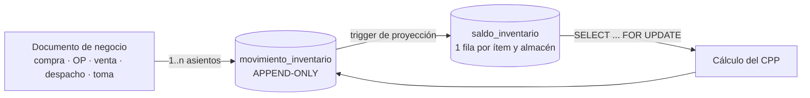

# 07 · Inventario y Kárdex

| | |
|---|---|
| **Sistema** | Tanta Core — módulo `inventario` |
| **Versión** | 1.0 · 01/11/2026 |
| **Norma** | `00-CONTEXTO-Y-DECISIONES.md` D-03 (precisión), D-04 (sin `DELETE`), D-06 (idempotencia) |
| **Implementa** | Informe Ejecutivo §3.3 (Almacén), §4.3 paso 3–6, reportes A-01/A-02, G-08, G-12 |
| **Tablas** | `movimiento_inventario`, `saldo_inventario`, `tipo_movimiento`, `almacen`, `toma_inventario` |
| **Estado** | Normativo. El procedimiento de §11.2 es la única vía de escritura del ledger. |

---

## 1. Modelo: tres piezas, un solo dueño de la verdad



| Pieza | Rol | Se puede escribir |
|---|---|---|
| `core.movimiento_inventario` | **Ledger**: cada asiento con su saldo corriente congelado | Solo `INSERT` |
| `core.saldo_inventario` | **Proyección**: saldo actual bloqueable y rápido de leer | Solo la función de §11.2 |
| `core.tipo_movimiento` | **Catálogo**: signo y efecto sobre el CPP | Solo migración |

**Decisión:** el saldo vive **en los dos** sitios, a propósito. En el asiento porque el kárdex debe
poder leerse sin agregar (y así el `CHECK` de signo detecta asientos invertidos en el instante); en la
tabla de saldo porque bloquear "el último movimiento" es ambiguo bajo concurrencia, mientras que
bloquear una fila fija por ítem es determinista.

**Convención de los ejemplos.** Los bloques marcados `sql` son PostgreSQL válido y ejecutable
(verificados con el parser de PostgreSQL 18). Los bloques marcados `text` son **pseudo-SQL** para
explicar la secuencia: usan `:param` como marcador, `...` para argumentos omitidos y fragmentos de
PL/pgSQL fuera de una función. No se copian a producción: la única implementación real es
`core.registrar_movimiento()` de §11.2.

### 1.1 Invariantes (verificados por el job de §8)

| # | Invariante | Consecuencia si falla |
|---|---|---|
| I1 | `saldo_inventario.saldo_cantidad = Σ movimiento_inventario.cantidad` por (almacén, ítem) | Pérdida de asientos o *lost update* |
| I2 | `saldo_inventario.saldo_valor = Σ movimiento_inventario.valor` | Valorización corrupta |
| I3 | El `saldo_*` del **último** asiento coincide con `saldo_inventario` | Proyección desfasada |
| I4 | `cpp = round(saldo_valor / saldo_cantidad, 6)` cuando `saldo_cantidad > 0`; `NULL` cuando es 0 | CPP inventado |
| I5 | `valor = round(cantidad × costo_unitario_movimiento, 4)` | Asiento con valor arbitrario |
| I6 | `idempotency_key` única en toda la tabla | Doble consumo por reintento |
| I7 | Ningún asiento se actualiza ni se borra | Kárdex no auditable |

---

## 2. Inmutabilidad

### 2.1 Tres barreras

1. **Trigger** `trg_mov_inmutable` (`BEFORE UPDATE OR DELETE`) que lanza excepción. Cubre el `UPDATE`
   accidental del ORM y el `DELETE` en cascada.
2. **Privilegios**: el rol de aplicación (`tanta_app`) recibe `INSERT, SELECT` y **no** recibe
   `UPDATE, DELETE`:

   ```sql
   REVOKE ALL ON core.movimiento_inventario FROM tanta_app;
   GRANT  SELECT, INSERT ON core.movimiento_inventario TO tanta_app;
   GRANT  SELECT, UPDATE ON core.saldo_inventario TO tanta_app;   -- solo la proyección
   REVOKE ALL ON audit.evento FROM tanta_app;
   GRANT  SELECT, INSERT ON audit.evento TO tanta_app;
   ```

3. **Migraciones**: ningún `ALTER`/`UPDATE` masivo sobre el ledger. Un cambio de criterio se aplica
   hacia adelante con asientos nuevos.

### 2.2 Corrección = asiento de reverso

No existe "editar un movimiento". Se registra el espejo exacto (§9):

```
asiento original : cantidad = -60,  costo_unitario = 2.200000, valor = -132.0000
reverso          : cantidad = +60,  costo_unitario = 2.200000, valor = +132.0000
                   reverso_de_id = <id del original>, tipo = REVERSO_SALIDA
```

El reverso **reutiliza el costo unitario del original**, no el CPP del momento. Así el saldo de valor
vuelve exactamente al valor previo y la suma de ambos asientos es cero en cantidad y en valor.

### 2.3 Lo que la inmutabilidad implica para el negocio

| Situación | No se hace | Se hace |
|---|---|---|
| Se digitó mal una compra | `UPDATE` del asiento | Reverso + compra correcta |
| Se anuló una venta | Borrar el `DESPACHO` | Reverso del asiento + CxC anulada |
| Se descubrió un faltante | Ajustar el saldo | `toma_inventario` confirmada → asiento de ajuste |
| Cambió el CPP porque sí | `UPDATE cpp` | Nada: el CPP es derivado, no un dato editable |

**Costo de esta decisión:** corregir un error de hace tres meses deja dos asientos (original y
reverso) en vez de un registro limpio. Es el precio de tener kárdex auditable, y el Informe §4.3 lo
exige para la trazabilidad pedido → OP → consumo → despacho → venta.

---

## 3. Tipos de movimiento y signo

| Código | Signo | ¿Recalcula CPP? | Valorización | Documento | Ejemplo |
|---|---|---|---|---|---|
| `APERTURA` | +1 | Sí | Costo de apertura declarado | Manual (acta) | 100 kg de harina a 2.10 |
| `COMPRA` | +1 | **Sí** | Costo de compra unitario | Compra / manual | 50 kg a 2.40 |
| `CONSUMO_OP` | −1 | No | CPP vigente | Orden de producción | 60 kg para 240 ciabattas |
| `MERMA_INSUMO` | −1 | No | CPP vigente | OP o manual | 2 kg de masa caída |
| `INGRESO_PRODUCTO` | +1 | Sí | Costo real de la OP | Orden de producción | 240 ciabattas a 0.96 |
| `DESPACHO` | −1 | No | CPP del producto | Despacho | 100 ciabattas al cliente |
| `VENTA_DIRECTA` | −1 | No | CPP del producto | Venta a terceros | 20 panes al mostrador |
| `DEVOLUCION` | +1 | No | Costo del snapshot de venta | Venta (devolución) | 10 ciabattas devueltas |
| `AJUSTE_TOMA_POSITIVO` | +1 | Sí | CPP vigente o costo contado | Toma de inventario | Sobrante de 1.5 kg |
| `AJUSTE_TOMA_NEGATIVO` | −1 | No | CPP vigente | Toma de inventario | Faltante de 0.8 kg |
| `REVERSO_ENTRADA` | −1 | Sí | Costo del asiento original | Según origen | Reverso de una compra |
| `REVERSO_SALIDA` | +1 | Sí | Costo del asiento original | Según origen | Reverso de un consumo |
| `AJUSTE_VALORIZACION` | 0 | Sí | Delta de valor puro | Manual autorizado | Residuo de CPP al llegar a 0 |

Reglas duras:

- El **signo de la cantidad** lo impone el tipo. El procedimiento de §11.2 rechaza un asiento con
  signo distinto (`SIGNO_INCORRECTO`); el `CHECK ck_mov_valor_signo` rechaza un valor de signo
  contrario al de la cantidad.
- Una **salida nunca recalcula** el CPP: valoriza al CPP vigente y deja el CPP intacto. Si una salida
  recalculase, el costo promedio oscilaría en cada consumo y el margen sería ruido.
- `REVERSO_ENTRADA` / `REVERSO_SALIDA` existen como dos códigos (y no uno) porque el `CHECK` de signo
  necesita un signo explícito por asiento.
- `AJUSTE_VALORIZACION` es el único con `cantidad = 0`; se usa solo para absorber el residuo de
  redondeo del CPP (§9.3) y nunca para "cuadrar" un faltante.

---

## 4. Algoritmo transaccional del CPP

### 4.1 Secuencia

```text
BEGIN;
SET LOCAL statement_timeout = '5s';

-- 0) Catálogo: signo y efecto sobre el CPP.
SELECT signo, afecta_costo_promedio INTO v_signo, v_afecta_cpp
FROM core.tipo_movimiento WHERE codigo = :tipo;

-- 1) Asegurar la fila de saldo (idempotente ante concurrencia de creación).
INSERT INTO core.saldo_inventario (sucursal_id, almacen_id, item_tipo, insumo_id, producto_id)
VALUES (:suc, :alm, :item_tipo, :insumo_id, :producto_id)
ON CONFLICT DO NOTHING;

-- 2) BLOQUEO: a partir de aquí la fila es exclusiva de esta transacción.
SELECT * INTO s
FROM core.saldo_inventario
WHERE almacen_id = :alm AND item_tipo = :item_tipo
  AND insumo_id IS NOT DISTINCT FROM :insumo_id
  AND producto_id IS NOT DISTINCT FROM :producto_id
FOR UPDATE;

-- 3) Costo unitario del asiento.
IF :reverso_de IS NOT NULL THEN
    v_cu := costo_unitario_del_original;          -- espejo exacto
ELSIF v_signo > 0 THEN
    v_cu := round(:costo_unitario_entrada, 6);    -- costo de compra / apertura
ELSE
    v_cu := s.cpp;                                -- salida: CPP vigente
    IF v_cu IS NULL THEN RAISE 'CPP_NO_DISPONIBLE'; END IF;
END IF;

-- 4) Aritmética exacta.
v_valor       := round(:cantidad * v_cu, 4);                    -- cantidad con signo
v_saldo_cant  := round(s.saldo_cantidad + :cantidad, 6);
v_saldo_valor := round(s.saldo_valor + v_valor, 4);

-- 5) Política de saldo negativo (§6).
IF NOT permite_negativo AND v_saldo_cant < 0 THEN RAISE 'STOCK_INSUFICIENTE'; END IF;

-- 6) CPP resultante.
IF v_saldo_cant = 0 THEN
    v_cpp := NULL;                                -- sin stock no hay costo promedio
ELSIF v_afecta_cpp AND v_saldo_cant > 0 THEN
    v_cpp := round(v_saldo_valor / v_saldo_cant, 6);
ELSE
    v_cpp := s.cpp;                               -- la salida no mueve el CPP
END IF;

-- 7) Asiento (con saldo corriente congelado). La UNIQUE corta el reintento.
INSERT INTO core.movimiento_inventario (..., saldo_cantidad, saldo_valor, cpp_resultante, idempotency_key)
VALUES (..., v_saldo_cant, v_saldo_valor, v_cpp, :idempotency_key)
ON CONFLICT (idempotency_key) DO NOTHING
RETURNING * INTO v_mov;

IF v_mov.id IS NULL THEN
    SELECT * INTO v_mov FROM core.movimiento_inventario WHERE idempotency_key = :idempotency_key;
    RETURN v_mov;                                 -- reintento: cero efectos adicionales
END IF;

-- 8) Proyección.
UPDATE core.saldo_inventario
   SET saldo_cantidad = v_saldo_cant, saldo_valor = v_saldo_valor, cpp = v_cpp,
       ultimo_movimiento_id = v_mov.id, ultimo_movimiento_en = v_mov.ocurrido_en,
       version = version + 1, actualizado_en = now()
 WHERE id = s.id;

COMMIT;
```

### 4.2 Por qué la fórmula es así

```
CPP_nuevo = (saldo_valor + cantidad_compra × costo_compra) / (saldo_cantidad + cantidad_compra)
```

- Se divide el **valor total** entre la **cantidad total**, no se promedian CPPs. Promediar costos
  unitarios da un número distinto y equivocado en cuanto las cantidades difieren.
- El denominador usa `saldo_cantidad + cantidad`, no el stock del mes: el CPP es acumulativo, no
  mensual. No se reinicia al cerrar el período (a diferencia del CIF).
- **`saldo_valor` manda.** El CPP es una **vista** del saldo de valor: `cpp = saldo_valor / saldo_cantidad`
  redondeado a 6. Por eso el residuo de redondeo nunca se acumula en el CPP, se acumula en el valor
  (que es un importe exacto a 4 decimales).

### 4.3 Orden de bloqueo y deadlocks

Una transacción que toca varios ítems (una OP consume 7 insumos) debe bloquear **siempre en el mismo
orden**: `ORDER BY insumo_id, producto_id` antes de iterar. Sin esa regla, dos OP que consumen harina
y levadura en orden distinto se bloquean mutuamente y PostgreSQL mata una con `40P01 deadlock
detected`. El procedimiento de §11.2 bloquea por asiento (una llamada = un ítem), así que el orden lo
impone el llamador: el servicio de consumo de OP ordena las líneas antes de iterar.

`statement_timeout = 5s` evita que una tablet con red lenta mantenga el bloqueo durante minutos.

---

## 5. Concurrencia: dos tablets consumiendo el mismo insumo

### 5.1 Escenario

Harina: saldo `150.000000 kg` / `330.0000` / CPP `2.200000`. Tablet A (OP-312) consume 60 kg;
tablet B (OP-313) consume 50 kg, **al mismo tiempo**. Ambas envían `Idempotency-Key` distintas.

### 5.2 Con el bloqueo (implementación correcta)

| t | Tablet A | Tablet B | `saldo_cantidad` | `saldo_valor` | `cpp` |
|---|---|---|---|---|---|
| t0 | `BEGIN`; `FOR UPDATE` sobre harina → obtiene el lock | — | 150.000000 | 330.0000 | 2.200000 |
| t1 | calcula 60 × 2.200000 = 132.0000; inserta; actualiza; aún sin commit | `BEGIN`; `FOR UPDATE` → **espera** | 90.000000 (no visible) | 198.0000 | 2.200000 |
| t2 | `COMMIT` | desbloquea y **relee la fila actualizada** | 90.000000 | 198.0000 | 2.200000 |
| t3 | — | calcula 50 × 2.200000 = 110.0000; inserta; actualiza | 40.000000 | 88.0000 | 2.200000 |
| t4 | — | `COMMIT` | 40.000000 | 88.0000 | 2.200000 |

Resultado final: `40.000000 kg` / `88.0000` / CPP `2.200000`, y `Σ cantidad = 150 − 60 − 50 = 40`,
`Σ valor = 330 − 132 − 110 = 88`. **Idéntico al resultado secuencial.**

El mecanismo es `EvalPlanQual`: bajo `READ COMMITTED`, cuando `SELECT ... FOR UPDATE` termina de
esperar, PostgreSQL **vuelve a evaluar** la fila con la versión recién confirmada. La tablet B no
calcula con datos obsoletos: los lee después del commit de A. Bajo `REPEATABLE READ` el mismo patrón
lanzaría `40001 could not serialize access` y el servicio reintentaría; por eso el proyecto trabaja en
`READ COMMITTED` (default) y **no** sube el nivel de aislamiento.

### 5.3 Sin bloqueo (lo que se habría construido sin esta decisión)

| t | Tablet A | Tablet B | Proyección |
|---|---|---|---|
| t0 | `SELECT` → 150 / 330 / 2.20 | `SELECT` → 150 / 330 / 2.20 | 150 / 330.0000 |
| t1 | calcula 90 / 198.0000 | calcula 100 / 220.0000 | 150 / 330.0000 |
| t2 | `UPDATE` → 90 / 198.0000 | — | 90 / 198.0000 |
| t3 | — | `UPDATE` → 100 / 220.0000 | **100 / 220.0000** |
| t4 | — | — | Σ asientos = 40 / 88.0000 ⇒ **descuadre de 60 kg y S/ 132.00** |

Eso es *lost update* clásico: el segundo `UPDATE` pisa el primero porque el cálculo se hizo con una
lectura previa no bloqueada. Se detecta (I1/I3 fallan en el job de §8) pero ya corrompió una OP y su
costo.

### 5.4 Prueba de regresión automatizada

El test de integración abre **dos conexiones reales** y ejecuta:

```text
-- Conexión 1
BEGIN;
SELECT (core.registrar_movimiento(..., 'CONSUMO_OP', ..., -60, NULL, '...uuid-a...', ...)).id;
-- (no se hace COMMIT todavía)

-- Conexión 2, en paralelo: debe quedar bloqueada en el FOR UPDATE
BEGIN;
SELECT (core.registrar_movimiento(..., 'CONSUMO_OP', ..., -50, NULL, '...uuid-b...', ...)).id;

-- Conexión 1: COMMIT  →  Conexión 2 continúa automáticamente
```

Aserciones:

| # | Aserción | Consulta |
|---|---|---|
| A1 | El saldo final es 40 / 88.0000 | `SELECT saldo_cantidad, saldo_valor FROM core.saldo_inventario WHERE ...` |
| A2 | La suma del ledger coincide (I1/I2) | consulta de §8.1 |
| A3 | No hay dos asientos con el mismo saldo corriente | `COUNT(DISTINCT (saldo_cantidad, saldo_valor)) = COUNT(*)` |
| A4 | Cada `CONSUMO_OP` valorizó al CPP de su momento | `valor = round(cantidad * cpp_previo, 4)` |
| A5 | Un reintento con la **misma** `Idempotency-Key` no crea un segundo asiento | `SELECT count(*) ... WHERE idempotency_key = '...uuid-a...'` = 1 |

Prueba complementaria (A5): enviar la misma OP dos veces desde dos tablets con la misma clave debe
devolver el mismo `movimiento.id` y dejar `count(*) = 1`. Es el escenario del riesgo "conectividad
inestable en planta" del Informe §8.

---

## 6. Saldos negativos: política configurable

El parámetro `inventario.permite_saldo_negativo` (por defecto `false`) decide.

### 6.1 Política estricta (por defecto)

```text
IF NOT permite_negativo AND v_saldo_cant < 0 THEN
   RAISE EXCEPTION 'STOCK_INSUFICIENTE'
     USING ERRCODE = 'P0001',
           DETAIL  = format('disponible=%s requerido=%s', s.saldo_cantidad, abs(:cantidad));
END IF;
```

La API traduce a `409 STOCK_INSUFICIENTE` con `detalle: { disponible, requerido, item }`. La tablet
muestra el faltante y bloquea el consumo. Para desbloquear hay tres caminos legítimos, todos con
rastro: compra, ajuste por toma de inventario, o una autorización explícita con el permiso
`inventario:salida_sin_stock` (que además exige `motivo` y queda en `audit.evento` con
`accion='AJUSTE_INVENTARIO'`).

### 6.2 Política permisiva (por qué existe la opción)

Una panadería real descuadra: el panadero consume sin registrar, el proveedor entrega sin factura el
mismo día. Bloquear la producción porque el sistema dice 0 kg cuando hay una bolsa abierta empuja al
usuario a inventar datos, que es peor que un saldo negativo visible. Con la política permisiva:

| Asiento | cantidad | valor | saldo_cantidad | saldo_valor | cpp |
|---|---|---|---|---|---|
| Saldo | — | — | 0.000000 | 0.0000 | NULL |
| `CONSUMO_OP` | −10 | −21.0000 | −10.000000 | −21.0000 | `2.100000` (conservado) |
| `COMPRA` 20 @ 2.40 | +20 | +48.0000 | 10.000000 | 27.0000 | **`2.700000`** |

Al volver a positivo, el CPP se recalcula con el valor acumulado (`27/10 = 2.70`), que incluye el
costo del stock que se debía. Es contablemente correcto y no requiere ningún asiento especial. El
`CHECK ck_saldo_coherencia` admite esta fila: cantidad y valor tienen el **mismo signo**.

### 6.3 Regla de CPP con saldo negativo

Mientras `saldo_cantidad <= 0`, el CPP **no se recalcula**: se conserva el último CPP positivo. Sin
esta regla, `valor/cantidad` con ambos negativos daría un CPP positivo por casualidad y con
`cantidad = 0` daría división por cero. La condición del algoritmo es explícita:
`ELSIF v_afecta_cpp AND v_saldo_cant > 0`.

---

## 7. Ejemplo completo: kárdex de harina

Saldo inicial: 100 kg a S/ 2.10 (acta de apertura del 01/11/2026). Cuatro movimientos en el día.

| # | Fecha/hora | Tipo | Documento | Cantidad | Costo unit. movimiento | Valor | Saldo cantidad | Saldo valor | CPP resultante |
|---|---|---|---|---|---|---|---|---|---|
| — | 01/11 07:00 | `APERTURA` | Acta 001 | +100.000000 | 2.100000 | +210.0000 | 100.000000 | 210.0000 | **2.100000** |
| 1 | 01/11 08:15 | `COMPRA` | Factura F-001 | +50.000000 | 2.400000 | +120.0000 | 150.000000 | 330.0000 | **2.200000** |
| 2 | 01/11 09:40 | `CONSUMO_OP` | OP-2026-000312 | −60.000000 | 2.200000 | −132.0000 | 90.000000 | 198.0000 | 2.200000 |
| 3 | 01/11 11:05 | `COMPRA` | Boleta B-014 | +40.000000 | 2.350000 | +94.0000 | 130.000000 | 292.0000 | **2.246154** |
| 4 | 01/11 14:30 | `CONSUMO_OP` | OP-2026-000313 | −100.000000 | 2.246154 | −224.6154 | 30.000000 | 67.3846 | **2.246153** |

Cálculo paso a paso:

```
Movimiento 1  CPP = (210.0000 + 50 × 2.40) / (100 + 50)
                  = (210.0000 + 120.0000) / 150
                  = 330.0000 / 150 = 2.200000          (recalcula: COMPRA)

Movimiento 2  valor = −60 × 2.200000 = −132.0000
              CPP   = 2.200000                        (no recalcula: salida)
              saldo = 90 kg / 198.0000

Movimiento 3  CPP = (198.0000 + 40 × 2.35) / (90 + 40)
                  = (198.0000 + 94.0000) / 130
                  = 292.0000 / 130 = 2.246153846... → 2.246154   (recalcula: COMPRA)

Movimiento 4  valor = −100 × 2.246154 = −224.6154
              saldo = 30 kg / 67.3846
              CPP   = 67.3846 / 30 = 2.24615333... → 2.246153   (no recalcula: salida)
```

### 7.1 El residuo de CPP (detalle que casi nadie modela)

Tras el movimiento 4, `saldo_valor = 67.3846` pero `30 × 2.246153 = 67.384590`. El residuo es
**S/ 0.00001**:

```
residuo = saldo_valor − saldo_cantidad × cpp = 67.3846 − 67.38459 = 0.00001
```

No es un error: el CPP está redondeado a 6 decimales y el valor es exacto a 4. El residuo está
acotado por `saldo_cantidad × 0.0000005` y **no se acumula indefinidamente** porque cada recálculo lo
reabsorbe. Cuando el saldo llega a cero, se cierra la cuenta:

```sql
-- Si al llegar a saldo_cantidad = 0 el saldo_valor no es exactamente 0
-- ($1 sucursal, $2 almacén, $3 insumo, $4 saldo_valor residual, $5 idempotency, $6 usuario):
INSERT INTO core.movimiento_inventario (
  sucursal_id, almacen_id, tipo, item_tipo, insumo_id, cantidad,
  costo_unitario_movimiento, valor, saldo_cantidad, saldo_valor, cpp_resultante,
  idempotency_key, documento_tipo, motivo, registrado_por)
VALUES (
  $1, $2, 'AJUSTE_VALORIZACION', 'INSUMO', $3, 0,
  0, -$4, 0, 0, NULL,
  $5, 'MANUAL', 'Residuo de CPP al llegar a stock cero', $6);
```

Es el **único** asiento con `cantidad = 0`. Se registra con aprobación de Almacén y queda visible en
G-12; nunca se usa para tapar un faltante (para eso está `AJUSTE_TOMA_NEGATIVO`).

### 7.2 Lectura del kárdex (A-01)

```sql
SELECT ocurrido_en, tipo, documento_tipo, documento_id,
       cantidad, costo_unitario_movimiento, valor,
       saldo_cantidad, saldo_valor, cpp_resultante
FROM report.v_kardex
WHERE almacen_id = $1 AND insumo_id = $2
ORDER BY ocurrido_en, id;
```

Devuelve exactamente la tabla de §7. Es la consulta que el Informe llama "kárdex valorizado" y la que
el contador de Tanta va a pedir en Excel el primer día.

---

## 8. Verificación de integridad y reparación

### 8.1 Job nocturno (`pg-boss`, 02:30 `America/Lima`)

**Q1 · Saldo contra suma del ledger (I1, I2)**

```sql
WITH sumas AS (
  SELECT almacen_id, item_tipo, insumo_id, producto_id,
         sum(cantidad) AS suma_cantidad,
         sum(valor)    AS suma_valor
  FROM core.movimiento_inventario
  GROUP BY almacen_id, item_tipo, insumo_id, producto_id
)
SELECT coalesce(s.almacen_id, x.almacen_id)            AS almacen_id,
       coalesce(s.item_tipo, x.item_tipo)              AS item_tipo,
       coalesce(s.insumo_id, x.insumo_id)              AS insumo_id,
       coalesce(s.producto_id, x.producto_id)          AS producto_id,
       s.saldo_cantidad, x.suma_cantidad,
       s.saldo_valor,    x.suma_valor,
       coalesce(s.saldo_cantidad, 0) - coalesce(x.suma_cantidad, 0) AS dif_cantidad,
       coalesce(s.saldo_valor, 0)    - coalesce(x.suma_valor, 0)    AS dif_valor
FROM core.saldo_inventario s
FULL OUTER JOIN sumas x
  ON  x.almacen_id = s.almacen_id
  AND x.item_tipo  = s.item_tipo
  AND x.insumo_id  IS NOT DISTINCT FROM s.insumo_id
  AND x.producto_id IS NOT DISTINCT FROM s.producto_id
WHERE coalesce(s.saldo_cantidad, 0) <> coalesce(x.suma_cantidad, 0)
   OR coalesce(s.saldo_valor, 0)    <> coalesce(x.suma_valor, 0)
   OR s.id IS NULL OR x.almacen_id IS NULL;
```

**Q2 · Último asiento contra proyección (I3)**

```sql
SELECT s.id, s.saldo_cantidad, u.saldo_cantidad AS ultimo_cantidad,
       s.saldo_valor, u.saldo_valor AS ultimo_valor
FROM core.saldo_inventario s
JOIN LATERAL (
  SELECT m.saldo_cantidad, m.saldo_valor
  FROM core.movimiento_inventario m
  WHERE m.almacen_id = s.almacen_id
    AND m.item_tipo  = s.item_tipo
    AND m.insumo_id  IS NOT DISTINCT FROM s.insumo_id
    AND m.producto_id IS NOT DISTINCT FROM s.producto_id
  ORDER BY m.ocurrido_en DESC, m.id DESC
  LIMIT 1
) u ON true
WHERE s.saldo_cantidad <> u.saldo_cantidad OR s.saldo_valor <> u.saldo_valor;
```

**Q3 · Coherencia del CPP (I4)** — solo con tolerancia, porque el CPP es derivado y redondeado:

```sql
SELECT id, saldo_cantidad, saldo_valor, cpp,
       round(saldo_valor / saldo_cantidad, 6) AS cpp_esperado
FROM core.saldo_inventario
WHERE saldo_cantidad > 0
  AND abs(cpp - round(saldo_valor / saldo_cantidad, 6)) > 0.000001;
```

**Q4 · Valor del asiento (I5)**

```sql
SELECT id, tipo, cantidad, costo_unitario_movimiento, valor,
       round(cantidad * costo_unitario_movimiento, 4) AS valor_esperado
FROM core.movimiento_inventario
WHERE valor <> round(cantidad * costo_unitario_movimiento, 4);
```

**Q5 · Asientos huérfanos o sin documento**

```sql
SELECT id, tipo, ocurrido_en
FROM core.movimiento_inventario
WHERE documento_tipo IS NULL
  AND tipo NOT IN ('APERTURA');
```

### 8.2 Qué hacer cuando el job encuentra algo

| Hallazgo | Diagnóstico | Acción |
|---|---|---|
| Q1 con diferencia | Escritura fuera del procedimiento o *lost update* | **Nunca** `UPDATE` del saldo. Se abre una `toma_inventario` de reparación con `observacion='REPARACION_INTEGRIDAD'`, se confirma y genera asientos de ajuste |
| Q2 con diferencia pero Q1 limpio | Proyección desfasada (fallo entre insert y update) | Recalcular `saldo_inventario` desde el ledger con `UPDATE` de la **proyección** (permitido: no es el ledger) y registrar evento de auditoría |
| Q3 fuera de tolerancia | CPP mal calculado | Recalcular `cpp = round(valor/cantidad, 6)` en la proyección; si el asiento tiene `cpp_resultante` erróneo, se documenta: el asiento no se toca |
| Q4 | Asiento con valor manipulado | Reverso + reemisión correcta |
| Q5 | Asiento manual sin documento | Completar `documento_tipo`/`motivo` en el siguiente asiento o anular con reverso |

### 8.3 Reparación transaccional (no destructiva)

```text
BEGIN;
-- 1) Bloquear la proyección del ítem (mismo lock que el flujo normal).
SELECT * FROM core.saldo_inventario
WHERE almacen_id = :alm AND insumo_id = :insumo
FOR UPDATE;

-- 2) Recalcular la verdad desde el ledger, dentro del lock.
SELECT coalesce(sum(cantidad), 0), coalesce(sum(valor), 0)
INTO v_cant, v_valor
FROM core.movimiento_inventario
WHERE almacen_id = :alm AND insumo_id = :insumo;

-- 3) Asiento de ajuste por la diferencia (no UPDATE del ledger).
PERFORM core.registrar_movimiento(
   ..., CASE WHEN v_cant > s.saldo_cantidad THEN 'AJUSTE_TOMA_POSITIVO'
             ELSE 'AJUSTE_TOMA_NEGATIVO' END,
   ..., abs(v_cant - s.saldo_cantidad), s.cpp, ...);

-- 4) Verificar que I1-I5 quedan en cero antes del COMMIT.
COMMIT;
```

El job corre con `pg_advisory_xact_lock(hashtext('inventario.integridad'))` para no solaparse con una
ejecución manual desde el panel de Administración. Idempotencia: cada reparación usa una
`Idempotency-Key` derivada de `(almacen, ítem, fecha)` para que un reintento del job no duplique el
ajuste.

---

## 9. Reversos, anulaciones y devoluciones

### 9.1 Pares permitidos

| Asiento original | Reverso | Efecto |
|---|---|---|
| `COMPRA` | `REVERSO_ENTRADA` | −cantidad, −valor al costo de compra |
| `APERTURA` | `REVERSO_ENTRADA` | Ídem |
| `CONSUMO_OP` | `REVERSO_SALIDA` | +cantidad, +valor al CPP usado |
| `MERMA_INSUMO` | `REVERSO_SALIDA` | Ídem |
| `DESPACHO` / `VENTA_DIRECTA` | `REVERSO_SALIDA` | Ídem |
| `INGRESO_PRODUCTO` | `REVERSO_ENTRADA` | Devuelve el producto al estado previo |
| `DEVOLUCION` | `REVERSO_ENTRADA` | Deshace un reingreso |

Reglas:

1. **Un solo reverso por asiento** — impuesto por `ux_mov_reverso_unico`.
2. **No se revierte un reverso.** Si hay que deshacer una corrección, se registra un asiento nuevo del
   tipo original.
3. **El reverso no reescribe el CPP hacia atrás.** Se recalcula con el saldo resultante. Ejemplo:
   compra de 50 kg a 2.40 que subió el CPP de 2.10 a 2.20; al revertirla quedan 100 kg y
   `210.0000/100 = 2.100000`, que coincide con el CPP previo **solo si no hubo otros movimientos**.
   Si los hubo, el CPP resultante es el correcto para la nueva secuencia, no el histórico.
4. **Fecha del reverso = fecha real de la corrección**, no la del original. Si el original está en un
   período `CERRADO`, el reverso cae en el período abierto y así debe mostrarse (principio de
   devengo: no se reabre un mes cerrado).
5. El reverso hereda `documento_tipo`/`documento_id` del original y añade `motivo` obligatorio.

### 9.2 Anulación de venta

```text
BEGIN;
-- 1) Reverso de cada salida de inventario de la venta.
FOR r IN SELECT id, cantidad, costo_unitario_movimiento
         FROM core.movimiento_inventario
         WHERE venta_id = :venta AND tipo IN ('DESPACHO','VENTA_DIRECTA')
LOOP
  PERFORM core.registrar_movimiento(..., 'REVERSO_SALIDA', ..., -r.cantidad,
                                    r.costo_unitario_movimiento, ..., p_reverso_de := r.id);
END LOOP;

-- 2) CxC a ANULADA (el saldo se conserva como evidencia).
UPDATE core.cuenta_por_cobrar SET estado = 'ANULADA' WHERE venta_id = :venta AND estado <> 'ANULADA';

-- 3) Venta a ANULADA.
UPDATE core.venta SET estado = 'ANULADA', anulada_en = now(), anulada_por = :usuario,
       motivo_anulacion = :motivo WHERE id = :venta;

-- 4) Evento de auditoría.
INSERT INTO audit.evento (sucursal_id, actor_id, accion, entidad, entidad_id, datos_antes, datos_despues)
VALUES (..., 'ANULAR', 'venta', :venta, to_jsonb(v_antes), to_jsonb(v_despues));
COMMIT;
```

La venta anulada **no se borra** y sus líneas conservan el snapshot: G-06 debe poder mostrar "esta
venta existió, tenía margen −12 % y fue anulada el 12/11". Borrarla destruiría la evidencia.

### 9.3 Devolución parcial

Regla: el reingreso se valoriza **al costo del snapshot de la venta**, no al CPP actual.

```
venta: 100 u × 2.36 (neto 2.0000), costo unitario snapshot 0.9000
devuelven 10 u
  → asiento DEVOLUCION: +10 × 0.900000 = +9.0000 al kárdex del producto
  → neto revertido: 10 × 2.0000 = 20.0000
  → venta queda: neto 180.0000, costo 81.0000, utilidad 99.0000, margen 55.0000 %  (idéntico)
```

Si se reingresara al CPP actual (p. ej. 0.96), el margen de la venta cambiaría por un costo que no
tiene relación con esa venta. Caso dorado C11.

---

## 10. Toma de inventario

```mermaid
sequenceDiagram
    participant A as Almacén (tablet)
    participant API as Tanta Core
    participant DB as PostgreSQL
    A->>API: crear toma (BORRADOR) por almacén
    A->>API: enviar conteos (insumo, cantidad_contada)
    API->>DB: BEGIN; capturar cantidad_sistema con FOR SHARE; calcular diferencias
    A->>API: confirmar toma
    API->>DB: por cada diferencia → registrar_movimiento(AJUSTE_TOMA_*)
    API->>DB: estado = CONFIRMADA, confirmada_en = now(); COMMIT
    API-->>A: resumen valorizado de diferencias
```

Decisiones:

- `cantidad_sistema` se captura **al confirmar**, dentro de la transacción, con
  `SELECT ... FOR SHARE` sobre los saldos. Así un movimiento concurrente queda antes o después del
  conteo, nunca a medias.
- El ajuste se hace **por diferencia** (`contada − sistema`), no reemplazando el saldo. Un conteo
  erróneo se corrige con otra toma, no editando.
- La valorización de la diferencia usa el CPP vigente para insumos y el CPP del producto para
  terminados; el signo lo determina el tipo (`AJUSTE_TOMA_POSITIVO`/`NEGATIVO`).
- Los sobrantes (`AJUSTE_TOMA_POSITIVO`) **sí** recalculan el CPP, porque ingresan valor. Los
  faltantes no.
- Motivo de auditoría: la toma guarda responsable, fecha y las diferencias valorizadas (G-10 y G-12).

---

## 11. Implementación de referencia

### 11.1 TypeScript: la aritmética del asiento como función pura

```ts
import { Decimal } from 'decimal.js';

Decimal.set({ precision: 34, rounding: Decimal.ROUND_HALF_UP });
const D = (v: Decimal.Value) => new Decimal(v);
const q = (v: Decimal.Value, dp: number) => D(v).toDecimalPlaces(dp, Decimal.ROUND_HALF_UP);

export type Signo = -1 | 0 | 1;

export interface Saldo {
  cantidad: Decimal;   // puede ser negativo si la política lo permite
  valor: Decimal;
  cpp: Decimal | null;
}

export interface Asiento {
  cantidad: Decimal;
  costoUnitario: Decimal;
  valor: Decimal;
  saldoCantidad: Decimal;
  saldoValor: Decimal;
  cpp: Decimal | null;
}

/**
 * Calcula el asiento y el saldo resultante. Pura: mismas entradas → mismas salidas.
 * `costoEntrada` se ignora en salidas (se usa el CPP vigente).
 */
export function calcularAsiento(e: {
  saldo: Saldo;
  signo: Signo;
  cantidad: Decimal.Value;          // sin signo
  costoEntrada?: Decimal.Value | null;
  afectaCpp: boolean;
  permiteNegativo: boolean;
  costoDelReverso?: Decimal.Value | null;
}): Asiento {
  const s = e.saldo;
  const cant = q(e.cantidad, 6);
  if (cant.lte(0)) throw new Error('CANTIDAD_NO_POSITIVA');

  let cu: Decimal;
  if (e.costoDelReverso != null) {
    cu = q(e.costoDelReverso, 6);                       // espejo exacto
  } else if (e.signo > 0) {
    if (e.costoEntrada == null) throw new Error('COSTO_UNITARIO_REQUERIDO');
    cu = q(e.costoEntrada, 6);
  } else {
    if (s.cpp == null) throw new Error('CPP_NO_DISPONIBLE');
    cu = s.cpp;                                          // salida al CPP vigente
  }

  const cantidad = e.signo > 0 ? cant : e.signo < 0 ? cant.negated() : D(0);
  const valor = q(cantidad.times(cu), 4);
  const saldoCantidad = q(s.cantidad.plus(cantidad), 6);
  const saldoValor = q(s.valor.plus(valor), 4);

  if (!e.permiteNegativo && saldoCantidad.lt(0)) {
    throw new Error(`STOCK_INSUFICIENTE disponible=${s.cantidad} requerido=${cant}`);
  }

  const cpp = saldoCantidad.isZero()
    ? null
    : e.afectaCpp && saldoCantidad.gt(0)
      ? q(saldoValor.dividedBy(saldoCantidad), 6)
      : s.cpp;

  return { cantidad, costoUnitario: cu, valor, saldoCantidad, saldoValor, cpp };
}
```

### 11.2 SQL: la única vía de escritura

```sql
CREATE OR REPLACE FUNCTION core.registrar_movimiento(
  p_sucursal_id     uuid,
  p_almacen_id      uuid,
  p_tipo            text,
  p_item_tipo       text,
  p_insumo_id       uuid,
  p_producto_id     uuid,
  p_cantidad        numeric,          -- con signo
  p_costo_unitario  numeric,          -- obligatorio si el tipo ingresa
  p_idempotency     uuid,
  p_documento_tipo  text,
  p_documento_id    uuid,
  p_documento_linea uuid,
  p_motivo          text,
  p_reverso_de      uuid,
  p_usuario_id      uuid
) RETURNS core.movimiento_inventario
LANGUAGE plpgsql
AS $$
DECLARE
  v_signo       smallint;
  v_afecta_cpp  boolean;
  v_saldo       core.saldo_inventario;
  v_cu          numeric(18,6);
  v_valor       numeric(16,4);
  v_saldo_cant  numeric(18,6);
  v_saldo_valor numeric(16,4);
  v_cpp         numeric(18,6);
  v_mov         core.movimiento_inventario;
  v_permite_neg boolean;
BEGIN
  v_mov := NULL;

  IF p_cantidad IS NULL OR p_cantidad = 0 THEN
    RAISE EXCEPTION 'CANTIDAD_CERO' USING ERRCODE = '22023';
  END IF;

  SELECT signo, afecta_costo_promedio INTO v_signo, v_afecta_cpp
  FROM core.tipo_movimiento WHERE codigo = p_tipo;
  IF NOT FOUND THEN
    RAISE EXCEPTION 'TIPO_MOVIMIENTO_INVALIDO: %', p_tipo USING ERRCODE = '22023';
  END IF;
  IF sign(v_signo) <> 0 AND sign(p_cantidad) <> v_signo THEN
    RAISE EXCEPTION 'SIGNO_INCORRECTO: % exige cantidad de signo %', p_tipo, v_signo
      USING ERRCODE = '22023';
  END IF;

  INSERT INTO core.saldo_inventario (sucursal_id, almacen_id, item_tipo, insumo_id, producto_id)
  VALUES (p_sucursal_id, p_almacen_id, p_item_tipo, p_insumo_id, p_producto_id)
  ON CONFLICT DO NOTHING;

  SELECT * INTO v_saldo
  FROM core.saldo_inventario
  WHERE almacen_id = p_almacen_id
    AND item_tipo  = p_item_tipo
    AND insumo_id  IS NOT DISTINCT FROM p_insumo_id
    AND producto_id IS NOT DISTINCT FROM p_producto_id
  FOR UPDATE;

  IF p_reverso_de IS NOT NULL THEN
    SELECT costo_unitario_movimiento INTO v_cu
    FROM core.movimiento_inventario WHERE id = p_reverso_de;
    IF NOT FOUND THEN
      RAISE EXCEPTION 'REVERSO_INEXISTENTE: %', p_reverso_de USING ERRCODE = '22023';
    END IF;
  ELSIF v_signo > 0 THEN
    IF p_costo_unitario IS NULL OR p_costo_unitario < 0 THEN
      RAISE EXCEPTION 'COSTO_UNITARIO_REQUERIDO' USING ERRCODE = '22023';
    END IF;
    v_cu := round(p_costo_unitario, 6);
  ELSE
    IF v_saldo.cpp IS NULL THEN
      RAISE EXCEPTION 'CPP_NO_DISPONIBLE' USING ERRCODE = '22023';
    END IF;
    v_cu := v_saldo.cpp;
  END IF;

  v_valor       := round(p_cantidad * v_cu, 4);
  v_saldo_cant  := round(v_saldo.saldo_cantidad + p_cantidad, 6);
  v_saldo_valor := round(v_saldo.saldo_valor + v_valor, 4);

  SELECT coalesce((SELECT valor = 'true' FROM core.parametro
                    WHERE clave = 'inventario.permite_saldo_negativo'), false)
    INTO v_permite_neg;

  IF NOT v_permite_neg AND v_saldo_cant < 0 THEN
    RAISE EXCEPTION 'STOCK_INSUFICIENTE'
      USING ERRCODE = 'P0001',
            DETAIL  = format('disponible=%s requerido=%s',
                             v_saldo.saldo_cantidad, abs(p_cantidad));
  END IF;

  IF v_saldo_cant = 0 THEN
    v_cpp := NULL;
  ELSIF v_afecta_cpp AND v_saldo_cant > 0 THEN
    v_cpp := round(v_saldo_valor / v_saldo_cant, 6);
  ELSE
    v_cpp := v_saldo.cpp;
  END IF;

  INSERT INTO core.movimiento_inventario (
    sucursal_id, almacen_id, tipo, item_tipo, insumo_id, producto_id,
    cantidad, costo_unitario_movimiento, valor, saldo_cantidad, saldo_valor,
    cpp_resultante, idempotency_key, registrado_por,
    documento_tipo, documento_id, documento_linea_id, motivo, reverso_de_id)
  VALUES (
    p_sucursal_id, p_almacen_id, p_tipo, p_item_tipo, p_insumo_id, p_producto_id,
    p_cantidad, v_cu, v_valor, v_saldo_cant, v_saldo_valor,
    v_cpp, p_idempotency, p_usuario_id,
    p_documento_tipo, p_documento_id, p_documento_linea, p_motivo, p_reverso_de)
  ON CONFLICT (idempotency_key) DO NOTHING
  RETURNING * INTO v_mov;

  IF v_mov.id IS NULL THEN
    SELECT * INTO v_mov FROM core.movimiento_inventario
     WHERE idempotency_key = p_idempotency;
    RETURN v_mov;
  END IF;

  UPDATE core.saldo_inventario
     SET saldo_cantidad       = v_saldo_cant,
         saldo_valor          = v_saldo_valor,
         cpp                  = v_cpp,
         ultimo_movimiento_id = v_mov.id,
         ultimo_movimiento_en = v_mov.ocurrido_en,
         version              = version + 1,
         actualizado_en       = now()
   WHERE id = v_saldo.id;

  RETURN v_mov;
END $$;

REVOKE ALL ON FUNCTION core.registrar_movimiento(uuid,uuid,text,text,uuid,uuid,
  numeric,numeric,uuid,text,uuid,uuid,text,uuid,uuid) FROM PUBLIC;
```

### 11.3 Equivalencia TS ↔ SQL

| TypeScript | PostgreSQL |
|---|---|
| `q(x, 6)` | `round(x, 6)` — ambos mitad alejándose de cero |
| `cant.negated()` | `-p_cantidad` |
| `saldoCantidad.isZero() ? null` | `IF v_saldo_cant = 0 THEN v_cpp := NULL` |
| `afectaCpp && saldoCantidad.gt(0)` | `v_afecta_cpp AND v_saldo_cant > 0` |
| `throw new Error('STOCK_INSUFICIENTE')` | `RAISE EXCEPTION ... ERRCODE 'P0001'` |

El test de contrato ejecuta ambos con las mismas 200 combinaciones (incluye saldo negativo, CPP 0,
reversos y cantidades fraccionarias) y compara los 6 campos del asiento.

---

## 12. Riesgos

| Riesgo | Impacto | Mitigación decidida | Estado |
|---|---|---|---|
| El kárdex de producto terminado y el de insumos valorizan a costos que pueden divergir (real de OP vs estándar) | Reporte G-12 con dos criterios | Inventario de PT al costo real de la OP (§3 `INGRESO_PRODUCTO`); la ficha estándar es solo comparación | **Mitigado** |
| Sin compras documentadas, `COMPRA` se registra a mano y el CPP depende de la memoria del almacenero | CPP y G-08 poco confiables | `[AMPLIACIÓN]` A-03 de `04`; mientras tanto, `COMPRA` exige `documento_tipo` y foto del comprobante en R2 | **Abierto** |
| `horas_horno` declaradas a mano distorsionan el CIF, no el kárdex | — | Se valida contra consumo de gas en G-07 (§12 de `06`) | **Abierto** |
| La toma de inventario puede coincidir con una OP en curso y generar un faltante artificial | Diferencias falsas | Captura de `cantidad_sistema` en la misma transacción de confirmación; recomendación operativa de contar con el horno apagado | **Abierto** |
| El job de integridad puede tardar en tablas grandes | Ventana de detección de horas | Índice `ix_mov_item` y agregación por ítem; a 3 años el volumen es ~1 M de filas (soportable) | **Mitigado** |

---

*Fin de `07-INVENTARIO-Y-KARDEX.md`. Modelo y DDL en `04-MODELO-DE-DATOS.md`; fórmulas y casos dorados
en `06-MOTOR-DE-COSTEO.md`.*
