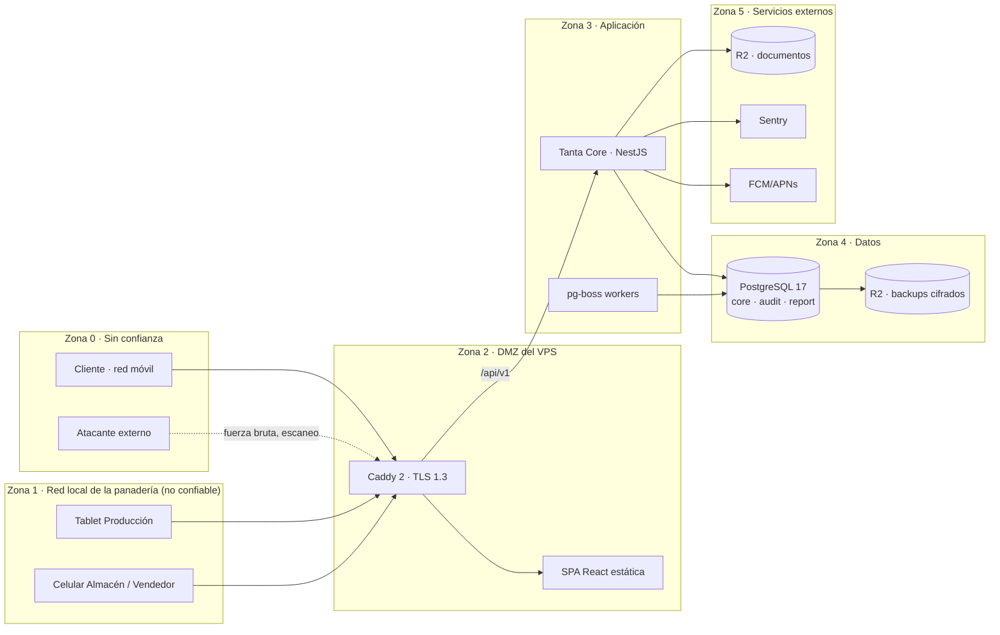
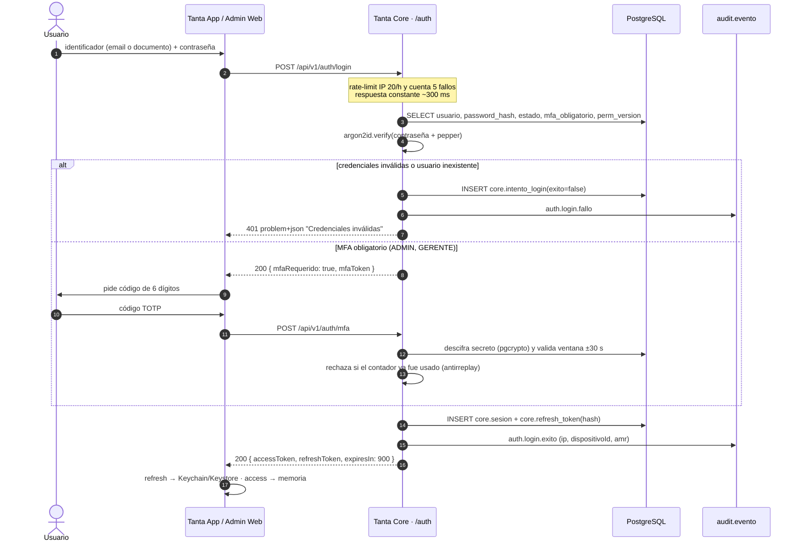
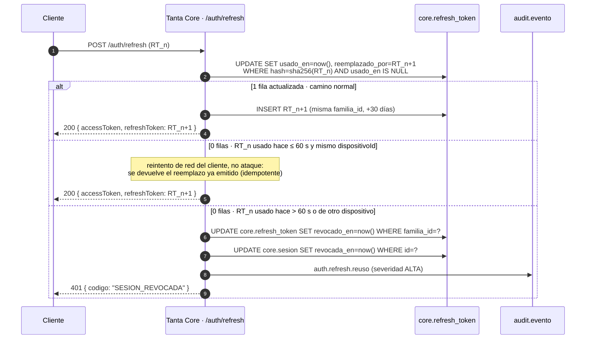

# 08 · Seguridad y cumplimiento

> Diseño de seguridad del Sistema Integral de Gestión de Panadería Tanta.
> No es una lista de buenas prácticas: es la especificación de lo que hay que construir, con el nombre
> del guard, de la tabla, de la cabecera HTTP o del comando.
>
> **Norma superior:** `00-CONTEXTO-Y-DECISIONES.md` (D-07 y siguientes). Este documento **no contradice**
> el contrato: lo desarrolla. Las decisiones nuevas que aquí se fijan (D-11…D-23) deben promoverse al
> contrato antes de escribir código de autenticación.
>
> **Marcas:** `[AMPLIACIÓN]` = la propuesta no lo cubre · `[CORRECCIÓN]` = la propuesta lo dice mal o es
> insuficiente. Toda marca remite a la sección donde se resuelve.

---

## 0. Cómo leer este documento

| Sección | Responde a |
|---|---|
| §1 | Qué falla en el §4.5 de la propuesta (hallazgos H-01…H-18) |
| §2 | Qué protegemos, de quién y por dónde entran |
| §3 | Modelo de amenazas STRIDE (T-01…T-15) |
| §4 | Autenticación, sesión, refresh, MFA |
| §5 | Autorización: RBAC + alcance + campos + atribuciones |
| §6 | Protección de datos en tránsito, en reposo, secretos, logs, respaldos |
| §7 | Auditoría append-only con cadena de hash |
| §8 | Ley 29733, D.S. 016-2024-JUS, artefactos legales, SUNAT |
| §9 | Ciclo de vida: ASVS, CI, hardening, entornos, RPO/RTO |
| §10 | Respuesta a incidentes y notificación a la ANPDP |
| §11 | Checklist de go-live (35 ítems medibles) |

Convención de identificadores usada en todo el dossier: `T-xx` amenaza, `H-xx` hallazgo, `P-xx` playbook,
`C-xx` ítem de checklist, `D-xx` decisión de arquitectura.

---

## 1. Hallazgos sobre «§4.5 Seguridad y control de acceso por rol»

La propuesta dedica media página a seguridad y una tabla. Dice cosas correctas y las deja sin diseño.
Esto es lo que hay que arreglar antes de construir.

| ID | Hallazgo en la propuesta | Marca | Decisión |
|---|---|---|---|
| **H-01** | «JWT de corta duración y renovación segura»: no hay rotación, ni detección de reuso, ni familia de tokens, ni revocación. «Renovación segura» no significa nada verificable. | `[CORRECCIÓN]` | Refresh opaco rotativo con detección de reuso por familia (§4.3) |
| **H-02** | «contraseñas cifradas con hash (bcrypt/argon2)»: dos algoritmos alternativos y sin parámetros. bcrypt con coste 10 es trivialmente atacable hoy con GPU. | `[CORRECCIÓN]` | Argon2id `m=65536, t=3, p=1` + pepper de entorno, sin alternativa (§4.7) |
| **H-03** | «HTTPS/TLS 1.2+». TLS 1.2 admite suites débiles y no es el estándar exigible en 2026. | `[CORRECCIÓN]` | TLS 1.3 exclusivo en Caddy; 1.2 deshabilitado (§6.1) |
| **H-04** | «Auditoría de operaciones críticas» sin tabla, sin inmutabilidad, sin retención, sin consulta. Una auditoría que el DBA puede editar no es auditoría. | `[CORRECCIÓN]` | `audit.evento` append-only con cadena SHA-256 y anclaje diario (§7) |
| **H-05** | Sin MFA, aunque el Administrador cambia recetas, costos indirectos y usuarios. Es la cuenta que más daño hace si cae. | `[AMPLIACIÓN]` | TOTP obligatorio ADMIN/GERENTE + step-up para 6 permisos (§4.8) |
| **H-06** | Tabla 2 agrupa «Insumos y recetas» en una celda: al dar ○ a Producción, Almacén y Gerente **les está dando lectura de costos y márgenes** sin decirlo. | `[CORRECCIÓN]` | Se separan `receta:leer_estructura` (cantidades) de `costo:ver` (§5.3, §5.5) |
| **H-07** | El Administrador tiene ○ en Dashboard, Costos indirectos y Ventas: el perfil con más privilegios es también el que ve todo el negocio. Sin separación de funciones. | `[CORRECCIÓN]` | Se añade 7.º perfil `SOPORTE` (proveedor) sin datos de negocio + revisión trimestral de accesos (§5.2, §6.6) |
| **H-08** | «descuento autorizado» (§3.2) sin flujo, sin umbral y sin rol que autoriza. Ya está detectado como I-06 en `01`. | `[CORRECCIÓN]` | Matriz de atribuciones con montos y `solicitud_descuento` (§5.7) |
| **H-09** | Faltan acciones completas: anular venta, autorizar descuento, reabrir período de costos, ver costo unitario, exportar datos, gestionar usuarios, revocar sesión, aprobar merma. | `[CORRECCIÓN]` | Matriz de 40 permisos (§5.3) |
| **H-10** | «Copias de seguridad diarias, retención 30 días» → **RPO de hasta 24 horas**. Un día perdido es un día de cobranza y de kárdex irrecuperable. | `[CORRECCIÓN]` | WAL continuo, RPO ≤ 15 min, PITR 35 días (§9.9) |
| **H-11** | «restauración probada antes del Go-live»: una vez, en toda la vida del sistema. | `[CORRECCIÓN]` | Prueba de restauración mensual obligatoria con evidencia firmada (§9.9) |
| **H-12** | El único scoping declarado es una nota al pie: «El Cliente solo ve sus propios pedidos». No hay regla para el Vendedor ni para Almacén. | `[AMPLIACIÓN]` | Scoping declarativo en guard + extensión de Prisma (§5.4) |
| **H-13** | No hay field-level security. Que la ficha M-01 sea «Admin/Gerente» no impide que `GET /pedidos/:id` devuelva el costo en el JSON. | `[CORRECCIÓN]` | Allowlist de campos por rol + test de contrato que falla si aparece `costo` (§5.5) |
| **H-14** | «Tratamiento conforme a la Ley N.° 29733» en una línea: sin Reglamento D.S. 016-2024-JUS, sin consentimiento, sin aviso, sin ARCO, sin notificación de incidentes. | `[CORRECCIÓN]` | §8 completo, con artefactos y plazos |
| **H-15** | «Nginx y SSL» contradice D-02 (Caddy 2) y no define una sola cabecera de seguridad. | `[CORRECCIÓN]` | Caddy + HSTS + CSP + CORS allowlist (§6.1–6.3) |
| **H-16** | Sentry SaaS (free tier) sin política de scrubbing: los stack traces llevan cuerpos de request con teléfonos y DNI. | `[AMPLIACIÓN]` | `sendDefaultPii: false` + `beforeSend` + denylist de rutas (§6.7) |
| **H-17** | La exportación a Excel/PDF es un requisito del negocio y **el canal natural de fuga** de recetas y cartera. No hay control. | `[AMPLIACIÓN]` | `reporte:exportar` acotado, marca de agua trazable, rate-limit, auditoría (§5.3, §6.8) |
| **H-18** | «Pruebas de seguridad, rendimiento y dispositivos» en 4 días (F6) sin alcance ni criterio de aceptación; solapa con UAT y no tiene colchón de corrección. | `[CORRECCIÓN]` | ASVS L2 acotado + puertas de CI + checklist medible (§9.1, §11) |

**Decisión de encuadre:** la seguridad de este sistema **no es un capítulo de cumplimiento, es control de
fraude interno**. El 80 % del riesgo real de Tanta no viene de un hacker ruso: viene del vendedor que
anula una cobranza, del almacenero que registra merma para tapar un hurto y del ex-empleado que se lleva
las recetas a la competencia. El diseño se optimiza para eso.

---

## 2. Activos, actores y superficie de ataque

### 2.1 Activos

| ID | Activo | Dónde vive | Criticidad | Por qué |
|---|---|---|---|---|
| **A-01** | **Recetas: composición, rendimiento, % de merma estándar** | `core.receta_version`, `core.receta_detalle` | **Crítica** | Es la ventaja competitiva de la panadería. Copiarla es abrir un local igual al lado. |
| **A-02** | **Costos: CPP de insumos, CIF, costo unitario, margen** | `core.insumo`, `core.costo_indirecto`, `report.ficha_costo` | **Crítica** | Revela el margen real: permite al competidor y al cliente negociar contra Tanta. |
| **A-03** | Cartera de clientes y cuentas por cobrar | `core.cliente`, `core.cuenta_por_cobrar` | Alta | Es el activo que se lleva el vendedor cuando se va. |
| **A-04** | Kárdex y valorización de inventario | `core.movimiento_inventario` | Alta | Si se corrompe, el margen y el costo de ventas dejan de ser confiables. |
| **A-05** | Credenciales y sesiones | `core.usuario`, `core.sesion`, `core.refresh_token` | Alta | Llave de todo lo anterior. |
| **A-06** | Cobranza y Pagos registrados | `core.cobranza` | Alta | Dinero directo, y es el registro que se usa para cobrar. |
| **A-07** | Precios y listas de precio | `core.precio_version` | Media | Impacto comercial inmediato, reversible, auditable. |
| **A-08** | Imágenes de productos y comprobantes internos en R2 | Bucket `tanta-docs` | Media | Puede contener PII en fotos de documentos. |
| **A-09** | Disponibilidad del servicio | VPS, Caddy, Postgres | Media | Una panadería de madrugada sin tablet vuelve al cuaderno. |
| **A-10** | Código fuente, secretos, backups | GitHub, R2, VPS | Alta | Compromiso total si se filtran. |

### 2.2 Actores

| Actor | Privilegio | Motivación | Nivel de confianza |
|---|---|---|---|
| **Cliente** | Solo sus pedidos | Ver precios, a veces pagar menos | Bajo: usuario externo no capacitado |
| **Empleado de producción** | Tablet, OP, merma | Registrar producción; oportunidad de ocultar merma | Medio |
| **Almacenero** | Bajas, ajustes, kárdex | Controla el stock físico: mayor oportunidad de hurto | Medio-bajo |
| **Vendedor** | Despacho, venta a terceros, cobranza | Cobra en efectivo: mayor riesgo de fraude monetario | Medio-bajo |
| **Gerente** | Todo el negocio en lectura + aprobaciones | Rentabilidad; también puede ser cómplice | Alto, con MFA |
| **Administrador** | Maestros, usuarios, recetas, costos | Operación y configuración | Alto, con MFA + auditoría reforzada |
| **SOPORTE (proveedor)** `[AMPLIACIÓN]` | Break-glass, sin datos de negocio | Mantenimiento | Bajo por defecto: acceso just-in-time, auditado |
| **Atacante externo** | Ninguno | Credenciales, PII, extorsión | Ninguno |
| **Ex-empleado** | Credenciales revocadas, conocimiento del proceso | Venganza, competencia, cartera | Bajo, pero **el más peligroso para A-01/A-03** |

### 2.3 Fronteras de confianza



Reglas de frontera, todas verificables:

1. **Ningún componente de Z1/Z0 habla con Z4.** El puerto 5432 no se publica en Docker
   (`ports` ausente en el servicio `db`); solo la red interna `tanta-data`.
2. **Toda la superficie pública es `/api/v1` y `/`.** Caddy no expone `/api/docs` en producción
   (D-06: OpenAPI solo en staging).
3. **Z1 es hostil.** La red wifi de la panadería la comparten clientes y proveedores: se asume
   interceptable (§3, T-09).
4. **Z5 recibe datos, no los devuelve.** FCM nunca recibe PII en el payload (solo `pedidoId` y estado).

---

## 3. Modelo de amenazas (STRIDE)

### 3.1 Método

STRIDE sobre los activos de §2.1, con seis actores de §2.2. Escala de impacto: **C**rítico (pérdida
irrecuperable de A-01/A-02/A-03 o del dinero), **A**lto (fraude repetible o interrupción de un día),
**M**edio (molestia operativa o dato corregible). Cada amenaza lleva mitigación **preventiva** y control
de **detección**, porque el objetivo realista no es impedir el 100 % sino que ninguna manipulación pase
inadvertida.

### 3.2 Tabla de amenazas

| ID | STRIDE | Amenaza | Actor | Vector | Imp. | Mitigación (preventiva) | Detección |
|---|---|---|---|---|---|---|---|
| **T-01** | Information disclosure / Elevation | **Robo de recetas y costos.** Exportación masiva de la ficha de costo, o lectura de la receta completa por un rol que solo necesita cantidades. | Ex-empleado, Vendedor, SOPORTE | `GET /productos/:id/ficha-costo`, export Excel/PDF, screenshot de tablet | **C** | `costo:ver` solo ADMIN/GERENTE; `receta:leer_estructura` sin costos para Producción/Almacén; export único por permiso con marca de agua trazable; `FLAG_SECURE` en Android; sin caché local de fichas de costo en Drift (§5.5, §6.9) | `audit.evento` en cada lectura de ficha y cada export; alerta si un usuario supera **20 exportaciones o 200 lecturas de costo en 1 h**; revisión de `reporte:exportar` en el digest diario al Gerente |
| **T-02** | Tampering | **Manipulación de merma para encubrir hurto.** Se da de baja insumo o producto como «merma» y sale por la puerta trasera. Incluye ajustes de inventario para cuadrar el faltante. | Almacenero, Producción | `POST /merma` con motivo genérico; `POST /inventario/ajuste` sin evidencia | **C** | Catálogo cerrado de motivos (sin texto libre obligatorio); merma > **2 % de la OP** o > **S/ 50** requiere `merma:aprobar` (Gerente/Admin); ajuste de inventario > **S/ 100** requiere aprobación; correlación obligatoria merma↔OP↔movimiento | Reporte semanal de **merma por producto/operador** con desviación estándar; alerta si un operador supera 2σ de su histórico; conciliación `Σ bajas = consumo teórico por receta ± tolerancia`; verificación diaria `saldo = Σ movimientos` |
| **T-03** | Elevation of privilege | **Descuentos no autorizados.** El vendedor aplica 20 % «porque el cliente es frecuente» y cobra el 100 %. | Vendedor | `POST /ventas` con `descuentoPct` | **A** | Límite por rol en `PoliticaDescuento`: Vendedor ≤ **5 %** y ≤ **S/ 30** por venta; sobre eso exige `solicitud_descuento` aprobada por `descuento:autorizar`; el total se recalcula en servidor, nunca se acepta del cliente | Auditoría de toda venta con descuento; reporte G-06 ordenado por margen ascendente; alerta diaria si un vendedor supera 3 descuentos/día o 5 % de su venta mensual |
| **T-04** | Repudiation / Fraud | **Venta a terceros fantasma.** Se entrega mercadería a un no registrado, se registra a nombre de «Cliente Varios», se cobra en efectivo y no se declara — o se declara por menos. | Vendedor | `POST /ventas/tercero` sin identificación suficiente | **C** | Venta a terceros exige **nombre + teléfono** y, si es al crédito, **DNI/RUC**; obliga a despacho con baja de stock en la misma transacción (no se puede vender sin descontar kárdex); pago en efectivo exige `cobranza` con medio y referencia | Cruce diario **ventas a terceros vs. bajas de producto** vs. arqueo; ratio terceros/total por vendedor con alerta sobre 35 %; listado de ventas a terceros > S/ 200 para revisión del Gerente |
| **T-05** | Tampering | **Alteración de cobranza.** Se registra un pago, se cobra en efectivo, y luego se anula el pago o se reaplica a otra cuenta por cobrar. | Vendedor, Admin | `POST /cobranza/:id/anular`, `PATCH /cobranza/:id/reaplicar` | **C** | `cobranza:anular` y `reaplicar` **no** son del Vendedor; exigen `GERENTE`/`ADMIN` con **step-up MFA**; anulación no borra: genera movimiento inverso con motivo; ventana de anulación 48 h | Cadena de auditoría por `cobranza_id` (todos los eventos, ordenados); reporte de anulaciones por usuario; alerta si la suma de anulaciones de un usuario > S/ 200/mes |
| **T-06** | Information disclosure | **Fuga de la cartera de clientes.** El vendedor exporta su cartera antes de irse, o un ex-empleado conserva una sesión abierta. También por PII en logs/Sentry. | Vendedor, ex-empleado | Export V-01/V-02, screenshot, rol aún activo | **C** | Vendedor ve **su** cartera y con campos enmascarados (DNI `****6789`, sin email); export de cartera limitado a 1/día y ≤ 500 filas, con marca de agua; baja del empleado ejecuta `DesvincularUsuarioJob` (§4.6); PII nunca en logs (§6.7) | Alerta al desvincular: cuenta atómica en `core.usuario.estado='BAJA'` + revocación de todas las sesiones + reasignación forzada de cartera; auditoría de export con `filas`, filtros y hash del archivo |
| **T-07** | Spoofing | **Fuerza bruta / credential stuffing / password spraying.** Contra `/auth/login` y `/auth/refresh`. | Externo | Listas de credenciales filtradas, `admin/admin` | **A** | Argon2id; rate-limit por IP y por cuenta; bloqueo progresivo; contraseña mínima 12; verificación contra HIBP en el alta (§4.7) | `core.intento_login` + alerta si > 50 fallos/h desde una IP o > 10 cuentas distintas desde una IP; fail2ban con jail `tanta-auth` sobre el log de Caddy (§9.7) |
| **T-08** | Spoofing / Info disclosure | **Robo de dispositivo con sesión abierta.** Tablet de producción sin bloqueo, celular del vendedor en el taxi. | Externo, cualquiera | Acceso físico | **A** | Access token 15 min en memoria; refresh en Keychain/Keystore con biometría; `FLAG_SECURE`; SQLite cifrado con SQLCipher; bloqueo por inactividad 15 min en móvil; PIN de app; expiración absoluta de sesión 30 días (§4.5, §6.9) | Cierre remoto de sesión (§4.6) + auditoría de actividad desde `dispositivo_id`; alerta por desvío geográfico imposible (IP de otro país con la misma sesión) |
| **T-09** | Information disclosure | **Interceptación en la red local.** Wifi compartida, ARP spoofing, proxy tipo Charles instalado en la tablet para «ver qué pasa». | Externo en la red | MITM, proxy, DNS | **A** | TLS 1.3 exclusivo con HSTS preload; **sin** cabecera `Authorization` en URLs; app móvil con `usesCleartextTraffic=false` y ATS estricto; tokens de 15 min y refresh ligado a `dispositivo_id` | Rotación de refresh detecta reuso desde otro dispositivo; auditoría de `deviceId` distinto para la misma sesión; alerta si una sesión se usa desde 2 IP simultáneas |
| **T-10** | Tampering | **Inyección SQL.** Especialmente en el módulo de reportes y kárdex, donde hay SQL agregado. | Externo, Vendedor | Parámetros en filtros de reporte, orden, cursor | **A** | Prisma parametrizado; `$queryRawUnsafe` **prohibido** por regla Semgrep; SQL crudo solo con `Prisma.sql` etiquetado; `orderBy`/`sort` validados contra allowlist de columnas; RLS no aplicable (rol único), compensado con allowlist | Semgrep en CI (bloqueante); alerta en Postgres por `log_min_error_statement=ERROR`; honeypot: input con `' OR 1=1--` en el suite E2E que debe devolver 200 con 0 resultados |
| **T-11** | Info disclosure / Elevation | **IDOR en endpoints de pedidos.** Cambiar `/pedidos/{uuid}` por otro UUID y ver el pedido ajeno (dirección, teléfono, montos). | Cliente, Vendedor | Enumeración de UUID, fuga de ID en notificación push | **C** | Scoping en **repositorio** (extensión Prisma), no en controlador; **404** en lugar de 403 para no confirmar existencia; UUIDv7 (D-04) no enumerable; el push solo lleva `pedidoId` y el cliente lo resuelve contra su propio scope | Suite E2E de IDOR: 6 roles × 8 endpoints, debe devolver 404 en todos los casos cruzados; alerta si un usuario recibe > 20 404 consecutivos |
| **T-12** | Elevation of privilege | **Manipulación de claims / escalada vía JWT.** Cambiar `rol` en el token, `alg=none`, o reutilizar un token de un usuario dado de baja. | Externo, usuario curioso | JWT mal verificado | **A** | `algorithms: ['HS256']` explícito en `JwtModule` (nunca `verify` sin lista); `iss`/`aud` verificados; **los permisos no viajan en el token**; `pv` (versión de permisos) fuerza recarga si cambian; revocación por `sid` | Test unitario que firma un token con `alg:none` y otro con secreto ajeno y exige 401; alerta ante cualquier 401 con `codigo=TOKEN_INVALIDO` repetido |
| **T-13** | Repudiation | **Repudio de la operación.** El cliente niega haber pedido; el vendedor niega haber cobrado; el almacenero niega la baja. | Cliente, empleado | Falta de prueba | **A** | Auditoría con cadena de hash + `Idempotency-Key` + snapshot de costo en la línea de venta + PDF interno con sello de tiempo; el pedido del cliente se cierra con `aceptado_en` y hash del carrito (§7) | Verificación mensual de la cadena (`audit.verificar_cadena`) y anclaje diario en R2 con Object Lock |
| **T-14** | Denial of service | **Ransomware / secuestro del VPS.** Cifrado del volumen, borrado de backups. | Externo | Credencial SSH filtrada, dependencia comprometida, Caddy/Nest desactualizado | **C** | SSH solo por clave, sin root, `ufw`, fail2ban, contenedores sin privilegios y rootfs de solo lectura; backups a R2 con **Object Lock** y copia offline mensual (§9.9) | `unattended-upgrades` + alerta de integridad (AIDE) sobre `/etc` y binarios; alerta si el job de backup falla 1 vez; verificación semanal de que el objeto en R2 existe y tiene Object Lock |
| **T-15** | Spoofing / Elevation | **Compromiso de secretos o de la cuenta de soporte del proveedor.** `JWT_SECRET` en el repo, `.env` en la imagen, o la cuenta del proveedor usada sin control. | Externo, proveedor | GitHub, imagen Docker, acceso remoto | **C** | gitleaks en pre-commit y CI; secretos solo en `/etc/tanta/secrets/*.env` (0640, root:tanta); rotación calendada (§6.6); `SOPORTE` deshabilitado por defecto, se activa con ticket, por 4 h, con MFA y sin datos de negocio (§5.2) | Auditoría `soporte.acceso` con aprobador; alerta inmediata al Gerente al activarse; revisión mensual de `docker history` y del historial de git |

### 3.3 Fuera de alcance (declarado, no olvidado)

| Amenaza | Por qué se excluye | Compensación |
|---|---|---|
| DDoS volumétrico | El VPS de S/ 150/mes no tiene scrubbing; una mitigación real cuesta más que el proyecto | Caddy con `rate_limit` global 300 rps + fail2ban; plan de contingencia: activar Cloudflare proxy (cambio de DNS, 30 min) |
| Ataque físico al VPS del proveedor | Fuera del control del proyecto | Cifrado de volumen + backups fuera del VPS |
| Insiders del proveedor con `root` | El proveedor administra el servidor: puede leer datos | Contrato: cláusula de confidencialidad + DPA (§8.3), auditoría de accesos, y el hecho de que **los backups y los documentos están cifrados con clave que el proveedor no custodia sola** (custodia compartida §7.4) |
| Malware en el dispositivo del empleado | No hay MDM (excluido del alcance) | SQLCipher + tokens cortos + cierre remoto |

---

## 4. Autenticación

### 4.1 Modelo de tokens

| Token | Formato | Vida | Dónde se guarda | Contenido |
|---|---|---|---|---|
| **Access token** | JWT firmado HS256, `kid` en cabecera | **15 min** | Solo en memoria del proceso | `iss`, `aud`, `sub`, `sid`, `rol`, `sucursalId`, `pv`, `amr`, `authTime`, `jti`, `iat`, `exp` |
| **Refresh token** | Opaco, 32 bytes aleatorios base64url (43 caracteres) | **30 días** | Keychain/Keystore (móvil) · cookie `__Host-` (web) | Nada: es una referencia. En BD solo se guarda `sha256(token)` |
| **MFA token** | Opaco, 24 bytes | **5 min**, un solo uso | Memoria | Sesión de enrolamiento pendiente |

Reglas duras:

- **Los permisos NO viajan en el JWT.** Un token con la lista de permisos queda obsoleto en cuanto se
  revoca un permiso y crece sin control. El token lleva `pv` (entero `core.usuario.perm_version`);
  si `pv` del token ≠ `pv` en BD, el guard recarga permisos (y si el usuario está de baja, 401).
- **Un solo algoritmo.** `JwtModule.register({ signOptions: { algorithm: 'HS256' } })` y
  `verify(token, { algorithms: ['HS256'], issuer: 'tanta-core', audience: 'tanta-app' })`. `alg: none`
  y confusión HS/RS se cierran en la configuración, no en la revisión de código.
- **Nunca en URL.** Ni `?token=`, ni en el `Referer`. El token va en `Authorization: Bearer` o en cookie.

### 4.2 Flujo de login (con MFA)



### 4.3 Refresh con rotación y detección de reuso



Decisión clave y no obvia: **la ventana de gracia de 60 segundos**. Sin ella, un refresh que se pierde
por mala señal revoca la familia entera y expulsa al vendedor en la calle. Con ella, el reuso real
(token robado y usado horas después, o desde otro `dispositivoId`) sigue siendo detectado y castigado
con la revocación de toda la familia. Se implementa en
`apps/api/src/auth/refresh-token.service.ts`, método `rotar(token, dispositivoId)`.

### 4.4 Modelo de datos de sesión

```sql
CREATE TABLE core.sesion (
  id                uuid PRIMARY KEY,
  usuario_id        uuid NOT NULL REFERENCES core.usuario(id),
  dispositivo_id    text NOT NULL,
  plataforma        text NOT NULL CHECK (plataforma IN ('android','ios','web')),
  user_agent        text,
  ip_origen         inet,
  creada_en         timestamptz NOT NULL DEFAULT now(),
  ultima_actividad  timestamptz,
  expira_en         timestamptz NOT NULL,
  revocada_en       timestamptz,
  revocada_por      uuid,
  motivo_revocacion text
);
CREATE INDEX sesion_usuario_vigente ON core.sesion (usuario_id) WHERE revocada_en IS NULL;

CREATE TABLE core.refresh_token (
  id              uuid PRIMARY KEY,
  sesion_id       uuid NOT NULL REFERENCES core.sesion(id) ON DELETE CASCADE,
  familia_id      uuid NOT NULL,
  hash            bytea NOT NULL UNIQUE,          -- sha256 del token, nunca el token
  emitido_en      timestamptz NOT NULL DEFAULT now(),
  expira_en       timestamptz NOT NULL,
  usado_en        timestamptz,
  reemplazado_por uuid REFERENCES core.refresh_token(id),
  revocado_en     timestamptz
);
CREATE INDEX refresh_familia ON core.refresh_token (familia_id);

CREATE TABLE core.intento_login (
  id                 bigint GENERATED ALWAYS AS IDENTITY PRIMARY KEY,
  identificador_hash bytea NOT NULL,             -- hmac del email/documento, no el valor
  ip                 inet NOT NULL,
  exito              boolean NOT NULL,
  ocurrido_en        timestamptz NOT NULL DEFAULT now()
);
CREATE INDEX intento_ip_hora ON core.intento_login (ip, ocurrido_en DESC);
```

`core.intento_login` se purga a los 90 días con un job de pg-boss (`purgar-intentos-login`, diario 03:00
America/Lima).

### 4.5 Almacenamiento de tokens en el cliente

| Plataforma | Access token | Refresh token | Prohibido |
|---|---|---|---|
| **Móvil** (Flutter) | Solo en memoria (provider de Riverpod). Se pierde al cerrar la app y se recupera con refresh. | `flutter_secure_storage`: Android con `EncryptedSharedPreferences` respaldado por **Android Keystore** (StrongBox si existe); iOS con Keychain `kSecAttrAccessibleAfterFirstUnlockThisDeviceOnly` + `local_auth` para desbloquear con biometría | `SharedPreferences`, Drift, archivo, logs |
| **Web** (Tanta Admin) | Solo en memoria (contexto de React + TanStack Query). Nunca `localStorage` ni `sessionStorage`: ambos son legibles por cualquier XSS. | Cookie `__Host-tanta_rt`; `HttpOnly; Secure; SameSite=Strict; Path=/api/v1/auth; Max-Age=2592000` | `localStorage`, `document.cookie` |

`[AMPLIACIÓN]` **Sobre el certificado pinning:** se decide **no** implementarlo. Caddy renueva el
certificado cada 60–90 días con clave nueva y fijar la hoja rompe la app en cada renovación; fijar la CA
raíz no aporta protección real. Se compensa con TLS 1.3 exclusivo, HSTS preload, tokens de 15 minutos y
refresh ligado al dispositivo. Si en el futuro se exige pinning, será un *pin set* con dos respaldos y
un flag remoto de desactivación (`GET /api/v1/config/seguridad`), nunca un pin único.

### 4.6 Revocación y cierre de sesión remoto

| Escenario | Mecanismo | Latencia | Evidencia |
|---|---|---|---|
| Logout normal | `POST /auth/logout` → revoca `core.sesion` y toda la familia de refresh | Inmediata | `auth.logout` |
| «Cerrar sesión en todos los dispositivos» | `POST /auth/sesiones/revocar-todas` | Inmediata | `auth.logout.global` |
| El Gerente expulsa a un empleado | `DELETE /auth/sesiones/:id` con `sesion:revocar` | ≤ 2 s | `sesion.revocada` |
| Baja del empleado | `DesvincularUsuarioJob`: `estado='BAJA'`, `perm_version++`, revoca sesiones, reasigna cartera | ≤ 2 s | `usuario.baja` |
| Cambio de contraseña | Revoca todas las familias salvo la actual | Inmediata | `auth.password.cambiada` |
| Reuso de refresh detectado | Revoca la familia y la sesión | Inmediata | `auth.refresh.reuso` |

**Cómo se propaga la revocación sin Redis** (D-02 prohíbe Redis): al confirmar la transacción, el
servicio ejecuta `NOTIFY tanta_sesion, '<sid>'`. Un `LISTEN tanta_sesion` mantenido por
`SesionRevocadaListener` (NestJS, `onModuleInit`) actualiza un `Set<string>` en memoria del proceso.
El `JwtAuthGuard` consulta ese set: 2 s de latencia máxima, 0 dependencias nuevas. Un access token
robado muere en ≤ 15 min por `exp` y en ≤ 2 s si la sesión se revoca.

### 4.7 Política de contraseñas y bloqueo

| Parámetro | Valor | Justificación |
|---|---|---|
| Longitud mínima | **12** caracteres (máx. 128, Unicode NFC) | NIST SP 800-63B: la longitud manda, no la complejidad |
| Reglas de composición | **Ninguna** (sin mayúsculas obligatorias ni símbolos) | Generan `Password1!` y se anotan en un papel |
| Rotación periódica | **No** | Rota a los empleados hacia variantes predecibles |
| Verificación en el alta y cambio | HIBP k-anonymity (`/range/{5 primeros hex}`), timeout 2 s, **fail-open** | Rechaza contraseñas ya filtradas sin enviar la contraseña |
| Hash | **Argon2id** `m=65536 KiB, t=3, p=1` + **pepper** de 32 bytes en `AUTH_PEPPER` | D-07. El pepper no está en la BD: un dump no permite atacar offline |
| Rehash | Si el login valida con parámetros viejos, se rehashea en caliente | Migración sin fricción |
| Bloqueo por cuenta | 5 fallos consecutivos → 15 min · 10 → 60 min · persiste en `core.intento_login` | Sobrevive a reinicios |
| Límite por IP | 20 intentos/hora → `429` con `Retry-After`; 50/h → fail2ban 1 h | `@nestjs/throttler` con storage en Postgres |
| Enumeración de usuarios | Respuesta y tiempo constantes (`~300 ms` artificial), mensaje único «Credenciales inválidas» | Evita descubrir qué cuentas existen |
| Recuperación | Token de 32 bytes, 30 min, un solo uso, hash en BD; **revoca todas las sesiones** | — |

`[AMPLIACIÓN]` **Correo transaccional:** la propuesta no incluye envío de correo, y sin él no hay
recuperación de contraseña ni canal ARCO (§8.6). Se añade un proveedor transaccional (Resend o SES) para
`no-reply@tantapanaderia.com`, con **SPF, DKIM y DMARC `p=quarantine`** configurados en el DNS. Sin DMARC,
cualquiera puede suplantar el dominio desde el que se envían los enlaces de reseteo: es un vector de
phishing dirigido contra el Gerente.

### 4.8 MFA TOTP

| Aspecto | Decisión |
|---|---|
| Obligatoriedad | `ADMIN` y `GERENTE` desde el primer login. Si el rol se asigna y no se enrola en **7 días**, la cuenta se suspende (`estado='SUSPENDIDA'`) |
| Algoritmo | TOTP RFC 6238, SHA-1, 6 dígitos, paso 30 s, ventana **±1** (`otplib`, `window: 1`) |
| Secreto | 160 bits, cifrado en reposo con `pgcrypto` (`core.usuario.mfa_secret_enc`), descifrado solo en el proceso de verificación |
| Antirreplay | Se guarda `core.usuario.mfa_ultimo_paso`; un código con paso ≤ al último usado se rechaza. Sin esto, un código observado sirve durante 30 s |
| Enrolamiento | `POST /auth/mfa/enrolar` → `otpauth://totp/Tanta:{email}?secret=…&issuer=Tanta`; el usuario confirma con un código antes de activar |
| Códigos de respaldo | **10** códigos de 10 caracteres, hasheados con Argon2id, un solo uso, mostrados **una vez**. Regenerarlos invalida los anteriores |
| Recuperación sin códigos | `POST /auth/mfa/reset` solo con `usuario:gestionar` + MFA del administrador + motivo obligatorio. Para `GERENTE` o `ADMIN` hay **demora de 24 h** antes de aplicar (ventana para que el titular real lo frene) |
| Break-glass | Sobre sellado en custodia del Gerente General: credenciales de `soporte` + 2 códigos de respaldo del `ADMIN` primario. Se abre solo en SEV-1 y se registra en acta |
| Step-up (re-autenticación) | Los permisos marcados `sensible=true` exigen `amr` con `mfa` y `authTime` < **5 min**; si no, `401` con `codigo: STEP_UP_REQUERIDO` y cabecera `X-Tanta-StepUp: totp` |

Permisos que exigen step-up: `venta:anular`, `cobranza:anular`, `descuento:autorizar`,
`periodo_costos:reabrir`, `usuario:gestionar`, `rol:asignar_privilegiado`, `auditoria:leer`,
`backup:restaurar`.

### 4.9 Claims del JWT

```json
{
  "iss": "tanta-core", "aud": "tanta-app",
  "sub": "0193a4f2-...", "sid": "0193a4f2-...",
  "rol": "VENDEDOR", "sucursalId": "0193a4e0-...",
  "pv": 7, "amr": ["pwd"], "authTime": 1762000000,
  "jti": "0193a4f2-...", "iat": 1762000000, "exp": 1762000900
}
```

`rol` es informativo para la UI. **La decisión de autorización no usa `rol`: usa permisos resueltos en
servidor** (§5.6). Un token con `rol` manipulado no sirve de nada porque la firma lo invalida; y aunque
se emitiera uno con otro rol, los permisos se leen de `core.rol_permiso`, no del token.

### 4.10 Anti-patrones prohibidos (regla de revisión)

1. Guardar el access token en `localStorage` o en Drift.
2. Verificar el JWT sin `algorithms` explícito.
3. Firmar el refresh como JWT (deja de ser opaco y no se puede rotar por hash).
4. Devolver tokens en la URL o en el cuerpo de un `GET`.
5. `if (user.rol === 'ADMIN')` fuera de `src/authz/` — lo bloquea la regla Semgrep `tanta-rol-literal`.
6. Aceptar `descuentoPct`, `precioUnitario` o `total` desde el cliente sin recalcular en servidor.

---

## 5. Autorización

### 5.1 Modelo: RBAC + atributos + alcance

Cuatro capas que se evalúan en este orden, todas en el **servidor**:

1. **Autenticación** — `JwtAuthGuard` global; sin token, 401.
2. **Permiso (RBAC)** — `PermisoGuard`: ¿el rol tiene `recurso:acción`?
3. **Alcance (scoping)** — `AlcanceGuard` + extensión de Prisma: ¿este registro es suyo?
4. **Atributo (ABAC ligero)** — `PoliticaService`: ¿el estado y los montos permiten la operación?

Deny-by-default: si un handler no declara `@RequierePermiso(...)` ni `@Publico()`, el guard lanza
`403 RUTA_SIN_PERMISO_DECLARADO`. Un test enumera todos los controladores y falla si encuentra uno sin
decorador.

### 5.2 Roles

| Código | Perfil | Plataforma | Naturaleza |
|---|---|---|---|
| `ADMIN` | Administrador | Web | Negocio: maestros, usuarios, costos. El más privilegiado **legítimamente** |
| `GERENTE` | Gerente | Web | Negocio: lectura total + aprobaciones |
| `VENDEDOR` | Vendedor | Móvil + Web (reportes V-01/V-02) | Operativo con cartera asignada |
| `ALMACEN` | Almacén | Móvil + Web (inventario) | Operativo de stock |
| `PRODUCCION` | Producción | Tablet | Operativo de planta |
| `CLIENTE` | Cliente | Móvil | Externo, solo lo propio |
| `SOPORTE` `[AMPLIACIÓN]` | Proveedor (break-glass) | Solo SSH/túnel + consola | **Sin acceso a datos de negocio.** Se activa por ticket, 4 h, con MFA y aprobación del Gerente |

**Por qué existe `SOPORTE` y no se usa `ADMIN`:** hoy, si el proveedor necesita reiniciar un servicio,
entra con una cuenta de administrador de negocio y ve recetas, costos y márgenes. Eso es una fuga
estructural y una discusión contractual segura. Con `SOPORTE` el proveedor opera el sistema sin ver el
negocio, y queda auditado.

### 5.3 Matriz de permisos (mejora de la Tabla 2)

Leyenda: **A** administrar (crear/editar/baja lógica) · **C** crear · **E** editar · **L** leer ·
**Lc** leer solo cartera asignada · **Lm** leer con campos enmascarados · **Lp** leer solo lo propio ·
**P** aprobar/autorizar · **S** solicitar · **—** sin acceso.

| Recurso · acción | ADMIN | CLIENTE | PRODUCCIÓN | ALMACÉN | VENDEDOR | GERENTE |
|---|---|---|---|---|---|---|
| `usuario:gestionar` (alta, baja, bloqueo) | A | — | — | — | — | L |
| `rol:asignar` (hasta VENDEDOR) | A | — | — | — | — | L |
| `rol:asignar_privilegiado` (ADMIN/GERENTE) | S | — | — | — | — | **P** |
| `sesion:revocar` | A | Lp | — | — | — | A |
| `producto:leer` | L | L | L | L | L | L |
| `producto:editar` | E | — | — | — | — | L |
| `precio:editar` | E | — | — | — | — | L |
| `insumo:leer` | L | — | L | L | — | L |
| `insumo:editar` | E | — | — | E | — | L |
| `receta:leer_estructura` (cantidades) | L | — | L | L | — | L |
| `receta:editar` | E | — | — | — | — | L |
| `receta:publicar` (nueva versión) | E | — | — | — | — | L |
| `costo_indirecto:editar` | E | — | — | — | — | L |
| `costo:ver` (CPP, costo unitario, CIF) | L | — | — | Lm insumos | **—** | L |
| `margen:ver` (utilidad, margen %) | L | — | — | — | **—** | L |
| `periodo_costos:cerrar` | E | — | — | — | — | **P** |
| `periodo_costos:reabrir` | **P** (MFA) | — | — | — | — | A |
| `cliente:leer` | L | Lp | Lm (nombre) | — | Lc | L |
| `cliente:editar` | E | Lp (perfil) | — | — | — | L |
| `cartera:asignar` | A | — | — | — | — | A |
| `pedido:crear` | C | C | — | — | C (tercero) | — |
| `pedido:leer` | L | Lp | L (sin montos) | — | Lc | L |
| `pedido:anular` | P | Lp (solo `REGISTRADO`) | — | — | — | A |
| `op:crear` | C | — | C | — | — | L |
| `op:cerrar` (cantidad real + merma) | — | — | E | — | — | L |
| `inventario:leer` | L | — | L (insumos) | L | L (productos) | L |
| `inventario:ajustar` | P (MFA) | — | — | S | — | A |
| `merma:registrar` | — | — | C | C | — | L |
| `merma:aprobar` (> 2 % u > S/ 50) | P | — | — | — | — | A |
| `despacho:confirmar` | — | — | — | C | C | L |
| `venta:crear` | — | — | — | — | C | — |
| `venta:leer` | L | Lp | — | — | Lc | L |
| `venta:anular` | P (MFA) | — | — | — | S | A |
| `descuento:aplicar` (≤ 5 % y ≤ S/ 30) | — | — | — | — | C | — |
| `descuento:autorizar` (> límite) | P (MFA) | — | — | — | S | A |
| `cobranza:registrar` | — | — | — | — | C | — |
| `cobranza:anular` | P (MFA) | — | — | — | S | A |
| `cxc:leer` | L | Lp (saldo) | — | — | Lc | L |
| `reporte:ver` (V-01, V-02, A-01, A-02) | L | — | — | L (A-01/A-02) | L (V-01/V-02) | L |
| `reporte:exportar` | L | — | — | L (A-01/A-02) | L (V-01/V-02, 1/día) | L |
| `dashboard:ver` (G-01…G-13) | L | — | — | — | — | L |
| `auditoria:leer` | L (MFA) | — | — | — | — | L (MFA) |
| `configuracion:editar` (IGV, margen objetivo) | E | — | — | — | — | L |
| `backup:restaurar` | S | — | — | — | — | **P** |

Diferencias con la Tabla 2 de la propuesta, explícitas:

- **`[CORRECCIÓN]` «Insumos y recetas» deja de ser una celda única.** Producción y Almacén necesitan
  *cantidades*, no *costos*. Separarlas es lo que evita T-01.
- **`[CORRECCIÓN]` El Vendedor pierde el acceso a costo y margen** que la Tabla 2 le daba de forma
  implícita al marcar ○ en «Catálogo» y «Ventas». El Vendedor ve precio de venta, su descuento máximo y
  el saldo; nada más.
- **`[AMPLIACIÓN]` Se añaden las 12 acciones que faltaban:** anular venta, autorizar/rechazar descuento,
  anular cobranza, reabrir período, aprobar merma, ajustar inventario, gestionar usuarios, asignar rol
  privilegiado, revocar sesión, exportar, ver auditoría, restaurar backup.
- **`[AMPLIACIÓN]` El Gerente aprueba, no edita.** Su valor es el control, no la operación: si el Gerente
  puede editar precios sin dejar rastro de quién lo pidió, se pierde la segregación de funciones.

### 5.4 Scoping por recurso

| Rol | Regla de alcance | Implementación |
|---|---|---|
| `CLIENTE` | Solo sus pedidos, sus pagos, su perfil | `pedido.cliente_id = ctx.clienteId` |
| `VENDEDOR` | Solo su cartera vigente (`core.cartera_vendedor.hasta IS NULL`), sus ventas y sus cobranzas | `JOIN core.cartera_vendedor` |
| `PRODUCCION` | Todas las OP de su sucursal; no puede cerrar OP de otro turno ya cerrada | `op.sucursal_id = ctx.sucursalId` + estado |
| `ALMACEN` | Todo el inventario de su sucursal | `sucursal_id` |
| `GERENTE` / `ADMIN` | Toda la sucursal | Sin filtro |
| `SOPORTE` | Ningún dato de negocio | Denegado en el guard, no en el filtro |

```sql
CREATE TABLE core.cartera_vendedor (
  cliente_id  uuid NOT NULL REFERENCES core.cliente(id),
  vendedor_id uuid NOT NULL REFERENCES core.usuario(id),
  desde       date NOT NULL DEFAULT current_date,
  hasta       date,
  PRIMARY KEY (cliente_id, vendedor_id, desde)
);
CREATE UNIQUE INDEX cartera_vigente_uq
  ON core.cartera_vendedor (cliente_id) WHERE hasta IS NULL;
```

El scoping **no se implementa en el controlador**. Se implementa en la capa de datos, con una extensión
de Prisma que inyecta el filtro en toda consulta, de modo que un endpoint nuevo hereda la protección
aunque el desarrollador se olvide:

```ts
// apps/api/src/authz/alcance.extension.ts
const FILTROS: Partial<Record<Prisma.ModelName, (c: Contexto) => object | undefined>> = {
  pedido:  (c) => c.rol === 'CLIENTE' ? { clienteId: c.clienteId }
                 : c.rol === 'VENDEDOR' ? { vendedorId: c.usuarioId } : { sucursalId: c.sucursalId },
  venta:   (c) => c.rol === 'VENDEDOR' ? { vendedorId: c.usuarioId } : { sucursalId: c.sucursalId },
  cliente: (c) => c.rol === 'VENDEDOR'
                 ? { cartera: { some: { vendedorId: c.usuarioId, hasta: null } } } : undefined,
  cobranza:(c) => c.rol === 'VENDEDOR' ? { vendedorId: c.usuarioId } : undefined,
};

export const alcanceExtension = Prisma.defineExtension({
  name: 'alcance-por-rol',
  query: {
    $allModels: {
      async $allOperations({ model, args, query }) {
        const ctx = contextoActual();               // AsyncLocalStorage
        const filtro = FILTROS[model]?.(ctx);
        if (!filtro) return query(args);
        (args as any).where = { AND: [(args as any).where ?? {}, filtro] };
        return query(args);
      },
    },
  },
});
```

Corolario obligatorio: cuando el scoping produce 0 filas, la respuesta es **404**, no 403. Un 403
confirma la existencia del recurso y convierte el IDOR en un oráculo de enumeración.

### 5.5 Field-level security

| Campo | ADMIN | CLIENTE | PRODUCCIÓN | ALMACÉN | VENDEDOR | GERENTE |
|---|---|---|---|---|---|---|
| `producto.precioVenta` | ✓ | ✓ Catálogo | — | — | ✓ | ✓ |
| `producto.costoUnitario` | ✓ | **✗** | **✗** | **✗** | **✗** | ✓ |
| `ventaDetalle.costoUnitarioSnapshot` | ✓ | ✗ | ✗ | ✗ | **✗** | ✓ |
| `venta.margenPct` / `utilidad` | ✓ | ✗ | ✗ | ✗ | **✗** | ✓ |
| `insumo.cpp` | ✓ | ✗ | ✗ | ✓ (A-01) | ✗ | ✓ |
| `recetaDetalle.cantidad` | ✓ | ✗ | ✓ | ✓ | ✗ | ✓ |
| `cliente.documento` | ✓ | propio | ✗ | ✗ | `****6789` | ✓ |
| `cliente.telefono` | ✓ | propio | ✗ | ✗ | ✓ (solo cartera) | ✓ |
| `cliente.email` | ✓ | propio | ✗ | ✗ | **✗** | ✓ |
| `usuario.passwordHash` / `mfaSecret` | **✗** | ✗ | ✗ | ✗ | ✗ | **✗** |

Regla dura: **ninguna respuesta al Vendedor contiene las claves `costo`, `costoUnitario`, `cpp`, `cif`,
`margen` ni `utilidad`**, tampoco dentro de un PDF o Excel. Se implementa en tres niveles:

1. **DTO con grupos de serialización.** `@Expose({ groups: ['gerencia'] })` en los campos sensibles y
   `ClassSerializerInterceptor` con los grupos derivados del contexto. `@Exclude()` por defecto en la
   clase base: lo que no se expone explícitamente, no sale.
2. **`select` explícito en el repositorio.** `selectVenta(ctx)` devuelve un objeto cuyo tipo TypeScript
   *no tiene* el campo de costo para roles no privilegiados. El compilador ayuda antes que el revisor.
3. **Test de contrato que falla el build.** `test/seguridad/field-level.e2e.spec.ts` recorre cada
   endpoint con cada rol y compara las claves del JSON contra una allowlist. Si aparece `costo`, el PR no
   pasa. Es la única forma de que esto no se degrade en el sprint 4.

### 5.6 Implementación en NestJS

```ts
// apps/api/src/authz/requiere-permiso.decorator.ts
export type Permiso = `${Recurso}:${Accion}`;
export const PERMISO_KEY  = 'tanta:permiso';
export const ALCANCE_KEY  = 'tanta:alcance';
export const PUBLICO_KEY  = 'tanta:publico';
export const STEP_UP_KEY  = 'tanta:step-up';

export const RequierePermiso = (...p: Permiso[]) => SetMetadata(PERMISO_KEY, p);
export const Alcance = (r: 'propio' | 'cartera' | 'sucursal' | 'global') => SetMetadata(ALCANCE_KEY, r);
export const Publico = () => SetMetadata(PUBLICO_KEY, true);
export const RequiereStepUp = (maxAgeSeg = 300) => SetMetadata(STEP_UP_KEY, maxAgeSeg);
```

```ts
// apps/api/src/authz/permiso.guard.ts
@Injectable()
export class PermisoGuard implements CanActivate {
  constructor(private readonly reflector: Reflector,
              private readonly authz: AutorizacionService) {}

  async canActivate(c: ExecutionContext): Promise<boolean> {
    const req = c.switchToHttp().getRequest<RequestConContexto>();
    if (this.reflector.getAllAndOverride(PUBLICO_KEY, [c.getHandler(), c.getClass()])) return true;

    const requeridos = this.reflector.getAllAndOverride<Permiso[]>(
      PERMISO_KEY, [c.getHandler(), c.getClass()]);

    // deny-by-default: una ruta sin declaración no se sirve
    if (!requeridos?.length) throw new ForbiddenProblem('RUTA_SIN_PERMISO_DECLARADO');

    const concedidos = await this.authz.permisosDe(req.ctx);   // caché 60 s por usuario+pv
    if (!requeridos.every((p) => concedidos.has(p))) {
      throw new ForbiddenProblem('PERMISO_INSUFICIENTE');
    }
    return true;
  }
}
```

Registro global, en este orden, en `AppModule`:
`RequestIdMiddleware` → `PinoLoggerMiddleware` → `JwtAuthGuard` → `PermisoGuard` →
`StepUpGuard` → `AlcanceGuard` → controlador.

Y siempre, además, la política en la capa de aplicación —porque hay reglas que dependen del **estado del
registro** y un guard no lo sabe:

```ts
// apps/api/src/ventas/ventas.service.ts
async anular(ctx: Contexto, ventaId: string, motivo: string): Promise<Venta> {
  return this.prisma.$transaction(async (tx) => {
    const venta = await this.repo.buscar(ctx, ventaId);        // ya scopeado: 404 si no es suya
    const d = this.politica.puedeAnular(ctx, venta);           // reglas de estado y tiempo
    if (!d.permitido) throw new ForbiddenProblem(d.codigo);

    await this.repo.marcarAnulada(tx, ventaId, motivo);
    await this.inventario.revertirBaja(tx, ventaId);           // el stock vuelve, trazado
    await this.audit.escribir(tx, { accion: 'venta.anular', recurso: 'venta',
      recursoId: ventaId, resultado: 'exito', datos: { motivo, total: venta.total } });
    return venta;
  });
}
```

### 5.7 Atribuciones por monto (control antifraude)

| Operación | Vendedor | Admin | Gerente | Regla |
|---|---|---|---|---|
| Descuento | ≤ 5 % **y** ≤ S/ 30 | ≤ 15 % | Sin límite, con motivo | Sobre el límite: `solicitud_descuento` + push al autorizador |
| Anulación de venta | Solo solicita | ≤ 48 h y ≤ S/ 500 | Sin límite | Genera movimiento inverso, nunca borra |
| Anulación de cobranza | Solo solicita | ≤ S/ 300 | Sin límite | Step-up MFA |
| Merma | Registra hasta 2 % de la OP | Aprueba | Sin límite | Motivo de catálogo cerrado |
| Ajuste de inventario | — | ≤ S/ 100 | Sin límite | Requiere toma de inventario o acta |
| Reapertura de período de costos | — | Solicita | Autoriza (MFA) | Solo el último período cerrado |
| Venta a terceros | ≤ S/ 1 000 | — | Sin límite | Nombre + teléfono obligatorios |

### 5.8 Anti-patrones de autorización prohibidos

1. Filtrar por rol en el controlador y no en la consulta (`where: { clienteId: req.user.sub }` es
   aceptable; `if (user.rol !== 'ADMIN') filter()` no lo es).
2. Devolver la entidad de Prisma completa al cliente.
3. Ocultar campos solo en la UI.
4. Confiar en `X-Sucursal-Id` enviado por el cliente.
5. Autorizar por `rol` en vez de por permiso.

---

## 6. Protección de datos

### 6.1 Tránsito

TLS 1.3 exclusivo en Caddy. Se **deshabilita TLS 1.2** aunque la propuesta diga «1.2+».

```caddyfile
# infra/caddy/Caddyfile
www.tantapanaderia.com {
    tls {
        protocols tls1.3
    }
    encode zstd gzip

    header {
        Strict-Transport-Security "max-age=63072000; includeSubDomains; preload"
        X-Content-Type-Options    "nosniff"
        Referrer-Policy           "no-referrer"
        Permissions-Policy        "geolocation=(), microphone=(), camera=(), payment=()"
        Cross-Origin-Opener-Policy "same-origin"
        Cross-Origin-Resource-Policy "same-site"
        -Server
        Content-Security-Policy "default-src 'self'; script-src 'self'; style-src 'self' 'unsafe-inline'; img-src 'self' data: https://docs.tantapanaderia.com; connect-src 'self' https://*.sentry.io; font-src 'self'; frame-ancestors 'none'; base-uri 'self'; form-action 'self'; object-src 'none'; report-uri /api/v1/csp-report"
    }

    handle /api/v1/* {
        reverse_proxy api:3000
    }
    handle {
        root * /srv/web
        try_files {path} /index.html
        file_server
    }
}
```

Notas de implementación:

- `'unsafe-inline'` en `style-src` se acepta (Tailwind y shadcn inyectan atributos `style`); **no** se
  acepta en `script-src`. Riesgo residual bajo, documentado.
- `report-uri /api/v1/csp-report` alimenta un contador de violaciones; si en 7 días hay violaciones
  legítimas no resueltas, se revisa la política, no se relaja a ciegas.
- En la API (`main.ts`) se usa `helmet()` **sin** CSP y **sin** HSTS, porque ambas las pone Caddy. Duplicar
  cabeceras produce valores concatenados inválidos.

### 6.2 CORS

```ts
app.enableCors({
  origin: [/^https:\/\/www\.tantapanaderia\.com$/],
  credentials: true,
  methods: ['GET', 'POST', 'PATCH', 'DELETE'],
  allowedHeaders: ['Authorization', 'Content-Type', 'Idempotency-Key', 'X-Tanta-CSRF', 'X-Request-Id'],
  exposedHeaders: ['X-Request-Id'],
  maxAge: 600,
});
```

- Sin comodines. Origen desconocido → sin cabecera `Access-Control-Allow-Origin`.
- En desarrollo se permite `http://localhost:5173` **solo** si `NODE_ENV !== 'production'`; la lista se
  construye condicionalmente para que no pueda viajar a producción.
- La app móvil no envía `Origin`. Para evitar que un navegador use el endpoint como proxy, todo request
  sin `Origin` que use autenticación por **cookie** se rechaza (`403 ORIGEN_REQUERIDO`); los que usan
  `Authorization` siguen permitidos.
- CSRF: `SameSite=Strict` + `Path` restringido + verificación de `Origin` en mutaciones con cookie.
  Doble submit `X-Tanta-CSRF` para `/auth/refresh`.

### 6.3 Cabeceras de seguridad (resumen verificable)

| Cabecera | Valor | Se verifica con |
|---|---|---|
| `Strict-Transport-Security` | `max-age=63072000; includeSubDomains; preload` | `curl -sI https://… \| grep -i strict` |
| `Content-Security-Policy` | ver §6.1 | `curl -sI` + ausencia de violaciones en `/api/v1/csp-report` |
| `X-Content-Type-Options` | `nosniff` | `curl -sI` |
| `Referrer-Policy` | `no-referrer` | `curl -sI` |
| `Permissions-Policy` | `geolocation=(), microphone=(), camera=()` | `curl -sI` |
| `X-Powered-By` | **ausente** | `curl -sI \| grep -i x-powered-by` → vacío |
| `Server` | **ausente** | idem |

### 6.4 Clasificación de datos

| Nivel | Ejemplos | Controles |
|---|---|---|
| **Restringido** | Recetas con costo, CPP, CIF, margen, `password_hash`, `mfa_secret`, secretos | Cifrado/aislado + `costo:ver` + auditoría de lectura |
| **Confidencial** | PII de cliente (nombre, DNI/RUC, teléfono, dirección), cartera, cuentas por cobrar | Cifrado en reposo (pgcrypto) + campo enmascarado + scoping |
| **Interno** | Pedidos, OP, kárdex, movimientos | Auth + scoping + auditoría de exportación |
| **Público** | Catálogo de productos sin costos, precios de lista | Sin control especial |

### 6.5 Cifrado en reposo

| Capa | Mecanismo | Responsable |
|---|---|---|
| Volumen del VPS | Cifrado de disco del proveedor (LUKS o equivalente gestionado) | Infraestructura |
| PostgreSQL | `pgcrypto` a nivel de columna para PII; TDE no disponible en la versión estándar | Aplicación |
| Objetos en R2 | SSE de R2 + bucket privado + URLs prefirmadas de 5 min | Aplicación |
| Backups | WAL-G con `libsodium` + Object Lock | Infraestructura |
| Dispositivo móvil | SQLCipher (Drift con `sqlcipher_flutter_libs`) + Keychain/Keystore | App |

**Qué se cifra con `pgcrypto` y qué no** — y por qué:

```sql
ALTER TABLE core.cliente
  ADD COLUMN telefono_enc      bytea,
  ADD COLUMN documento_enc     bytea,
  ADD COLUMN direccion_enc     bytea,
  ADD COLUMN documento_hmac    bytea,   -- índice determinista para búsqueda/unicidad
  ADD COLUMN telefono_hmac     bytea,
  ADD COLUMN pii_key_version   smallint NOT NULL DEFAULT 1;
```

```sql
CREATE OR REPLACE FUNCTION core.pii_enc(p text) RETURNS bytea
LANGUAGE sql AS $$
  SELECT pgp_sym_encrypt(p, current_setting('tanta.pii_key'),
                         'cipher-algo=aes256, compress-algo=0');
$$;

CREATE OR REPLACE FUNCTION core.pii_hmac(p text) RETURNS bytea
LANGUAGE sql AS $$
  SELECT hmac(normalizar_documento(p), current_setting('tanta.pii_hmac_key'), 'sha256');
$$;

CREATE UNIQUE INDEX cliente_documento_uq
  ON core.cliente (documento_hmac) WHERE borrado_en IS NULL;
```

La clave **no viaja en el SQL**: se inyecta por transacción con
`SELECT set_config('tanta.pii_key', $1, true)` (`is_local = true`), ejecutado por el interceptor
`PiiKeyInterceptor` al abrir la transacción. Así la clave no aparece en `pg_stat_statements`, ni en
`log_min_duration_statement`, ni en Sentry.

**Lo que deliberadamente NO se cifra: costos, precios y márgenes.** Cifrarlos por columna haría
imposible `SUM`, `ORDER BY`, filtros por rango y las vistas materializadas de `report` que sostienen
G-02, G-06 y G-07 — es decir, rompería el producto para proteger un dato que ya está protegido por
permiso, campo y auditoría. El riesgo residual (un dump de BD expone las recetas) se asume y se compensa
con: acceso a la BD solo desde `tanta-api`, sin `psql` interactivo en producción, auditoría de todo
`pg_dump` manual y anclaje de la cadena (§7). Esta es una **decisión consciente**, no un olvido.

### 6.6 Gestión de secretos

| Secreto | Variables | Rotación | Custodia |
|---|---|---|---|
| Firma JWT | `JWT_SECRET` (48 bytes b64), `JWT_SECRET_ANTERIOR`, `JWT_KID` | 90 días, solape con `kid` | Infraestructura |
| Pepper de contraseñas | `AUTH_PEPPER` | 12 meses (rehash en login con pepper viejo) | Infraestructura |
| Clave PII | `PGCRYPTO_KEY` + `PGCRYPTO_KEY_VERSION` | 12 meses (job de re-cifrado) | Líder técnico + Gerente |
| HMAC de documentos | `PGCRYPTO_HMAC_KEY` | 24 meses (requiere reindexar) | Líder técnico + Gerente |
| BD | `DATABASE_URL` (password) | 180 días | Infraestructura |
| R2 | `R2_ACCESS_KEY_ID`, `R2_SECRET_ACCESS_KEY` | 180 días | Infraestructura |
| Backups | `WALG_LIBSODIUM_KEY` | Nunca sin re-cifrar el archivo | **Custodia compartida (Shamir 2-de-3)** |
| Sentry | `SENTRY_AUTH_TOKEN` | 180 días | Infraestructura |
| FCM | `FCM_SERVICE_ACCOUNT_JSON` | 365 días | Infraestructura |
| Anclaje de auditoría | `AUDIT_ANCHOR_PRIVATE_KEY` (Ed25519) | 24 meses | **Gerente General (fuera del servidor)** |

Reglas:

1. Los secretos viven en `/etc/tanta/secrets/*.env`, propietario `root:tanta`, modo `0640`, cargados por
   `env_file` de Docker Compose. **Nunca** en el repositorio, en la imagen, en `docker-compose.yml` ni en
   GitHub Secrets como única copia (Secrets es el canal de despliegue, no el almacén).
2. `gitleaks` en pre-commit y en CI sobre **todo el historial**. Un hallazgo bloquea el merge.
3. `Dockerfile` con `.dockerignore` que excluye `.env*`, y `trivy image` como puerta (§9.5).
4. Rotación documentada en `infra/secrets/ROTACION.md`, con fecha y responsable por secreto. Una rotación
   no probada es una rotación que falla el día del incidente: la de `JWT_SECRET` se prueba cada trimestre
   en staging.
5. La clave de backups usa **Shamir 2-de-3**: un share del Líder técnico, uno del Gerente General, uno en
   sobre sellado en caja fuerte. Sin eso, un `SOPORTE` comprometido puede descargar y descifrar todo; con
   eso, no.

### 6.7 Logs y observabilidad

`pino` con redacción obligatoria y `X-Request-Id` propagado:

```ts
// apps/api/src/observabilidad/logger.ts
export const logger = pino({
  redact: {
    paths: [
      'req.headers.authorization', 'req.headers.cookie', 'res.headers["set-cookie"]',
      '*.password', '*.passwordHash', '*.refreshToken', '*.mfaSecret', '*.backupCodes',
      '*.telefono', '*.documento', '*.direccion', '*.numeroDocumento',
    ],
    censor: '[REDACTADO]',
  },
  serializers: { req: (r) => ({ id: r.id, method: r.method, url: r.url, ip: r.ip }) },
});
```

| Regla | Detalle |
|---|---|
| Nunca loguear cuerpos de `/auth/*` | El middleware los excluye por ruta |
| Nunca loguear PII en claro | Solo `clienteId` (UUID) |
| No loguear `query` de reportes con filtros de cliente | Se registra el hash del filtro |
| Retención de logs de aplicación | 14 días en el VPS, rotados por `logrotate`, comprimidos |
| Sentry | `sendDefaultPii: false`, `maxBreadcrumbs: 50`, `tracesSampleRate: 0.05`, `beforeSend` que descarta `request.data`, `cookies` y `headers.authorization`; denylist de rutas `/api/v1/auth/*` |
| Correlación | `X-Request-Id` (UUIDv7) en todas las respuestas y en `audit.evento.datos.requestId` |

Sentry es un tercero en EE. UU.: enviarle un stack trace con un DNI es una transferencia internacional de
datos personales no declarada (§8.9). Por eso la redacción es un control de cumplimiento, no solo de
higiene.

### 6.8 Exportaciones y documentos

Las exportaciones son el canal de fuga más plausible (T-01, T-06). Controles:

1. Permiso `reporte:exportar` acotado por rol y por reporte.
2. Límite: **500 filas** por export; más que eso exige filtro adicional. Rate-limit 10/hora por usuario.
3. **Marca de agua trazable** en el PDF y en la cabecera del Excel: `usuario · fecha · IP · id de
   exportación`. Si un archivo aparece donde no debe, se sabe de dónde salió.
4. Evento `exportacion.ejecutar` con `reporte`, `filtros`, `filas`, `hashSha256` del archivo.
5. El comprobante interno PDF (§8.13) lleva leyenda tributaria y numeración `INT-`, para que no pueda
   confundirse con una boleta.

### 6.9 Datos en el dispositivo y respaldos cifrados

| Control | Implementación |
|---|---|
| SQLite cifrado | Drift con `sqlcipher_flutter_libs` y clave derivada del Keystore/Keychain (no hardcodeada) |
| Retención local | Pedidos y catálogo: 7 días. Fichas de costo: **nunca** se cachean en el móvil |
| Capturas de pantalla | `FLAG_SECURE` en Android (bloquea screenshot y la vista en recientes) |
| Cierre por inactividad | 15 min (móvil), 30 min (web para ADMIN/GERENTE), 8 h (operativos en turno) |
| Limpieza en logout | Borrar Drift, caché de imágenes y refresh del Keystore |
| Wipe remoto | No disponible sin MDM: se compensa con cierre de sesión + SQLCipher + tokens de 15 min |

**Respaldos:** `infra/backup` con WAL-G hacia R2, cifrado `libsodium`, bucket privado con **Object Lock
en modo compliance 35 días** (nadie, ni el proveedor, puede borrar antes). Detalle de RPO/RTO y prueba
mensual en §9.9.

---

## 7. Auditoría y no repudio

### 7.1 Principios

1. **Append-only real.** `UPDATE` y `DELETE` fallan en la base, no solo en el código.
2. **Encadenado.** Cada evento incluye el hash del anterior: alterar o borrar una fila rompe la cadena
   de todas las siguientes.
3. **Anclado fuera del servidor.** El hash de la cabeza de la cadena se firma y se publica a diario.
4. **Consultable.** Una auditoría que nadie puede leer no sirve para resolver una disputa.

### 7.2 Tabla

```sql
CREATE SCHEMA IF NOT EXISTS audit;

CREATE TABLE audit.evento (
  id             uuid PRIMARY KEY DEFAULT gen_random_uuid(),
  secuencia      bigint GENERATED ALWAYS AS IDENTITY,     -- orden de la cadena
  ocurrido_en    timestamptz NOT NULL DEFAULT now(),
  actor_id       uuid,
  actor_rol      text,
  actor_ip       inet,
  dispositivo_id text,
  sesion_id      uuid,
  sucursal_id    uuid,
  accion         text NOT NULL,          -- 'venta.anular'
  recurso        text NOT NULL,          -- 'venta'
  recurso_id     uuid,
  resultado      text NOT NULL CHECK (resultado IN ('exito','denegado','error')),
  datos          jsonb NOT NULL DEFAULT '{}'::jsonb,
  hash_anterior  char(64),
  hash_actual    char(64) NOT NULL,
  UNIQUE (secuencia)
);

CREATE INDEX evento_recurso ON audit.evento (recurso, recurso_id, secuencia);
CREATE INDEX evento_actor   ON audit.evento (actor_id, ocurrido_en DESC);
```

### 7.3 Cadena de hash

```sql
CREATE OR REPLACE FUNCTION audit.cadena_hash(
  p_prev char(64), p_sec bigint, p_cuando timestamptz, p_actor uuid,
  p_accion text, p_recurso text, p_recurso_id uuid, p_datos jsonb
) RETURNS char(64) LANGUAGE sql IMMUTABLE AS $$
  SELECT encode(digest(
    coalesce(p_prev, repeat('0', 64)) || '|' ||
    p_sec::text                      || '|' ||
    to_char(p_cuando AT TIME ZONE 'UTC', 'YYYY-MM-DD"T"HH24:MI:SS.US') || '|' ||
    coalesce(p_actor::text, '')      || '|' ||
    p_accion || '|' || p_recurso     || '|' ||
    coalesce(p_recurso_id::text, '') || '|' ||
    p_datos::text,                            -- jsonb normaliza el orden de claves
    'sha256'), 'hex');
$$;
```

Dos detalles que casi siempre se hacen mal y aquí se fijan:

- **`to_char(... AT TIME ZONE 'UTC', ...)` y no `p_cuando::text`.** La representación textual de un
  `timestamptz` depende del `TimeZone` de la sesión: el mismo evento daría hashes distintos en dos
  conexiones y la verificación fallaría sin que nadie hubiera manipulado nada.
- **El estado de la cadena se guarda en una fila bloqueada**, no se calcula con `ORDER BY … DESC LIMIT 1`
  (que además se degrada con particiones):

```sql
CREATE TABLE audit.cadena_estado (
  id              boolean PRIMARY KEY DEFAULT true CHECK (id),
  ultimo_hash     char(64),
  ultima_secuencia bigint NOT NULL DEFAULT 0
);
INSERT INTO audit.cadena_estado DEFAULT VALUES;

CREATE OR REPLACE FUNCTION audit.evento_encadenar() RETURNS trigger
LANGUAGE plpgsql AS $$
DECLARE v_prev char(64);
BEGIN
  UPDATE audit.cadena_estado SET ultima_secuencia = NEW.secuencia
   WHERE id RETURNING ultimo_hash INTO v_prev;      -- el row lock serializa la cadena
  NEW.hash_anterior := v_prev;
  NEW.hash_actual   := audit.cadena_hash(v_prev, NEW.secuencia, NEW.ocurrido_en,
                                         NEW.actor_id, NEW.accion, NEW.recurso,
                                         NEW.recurso_id, NEW.datos);
  UPDATE audit.cadena_estado SET ultimo_hash = NEW.hash_actual WHERE id;
  RETURN NEW;
END $$;

CREATE TRIGGER trg_evento_encadenar BEFORE INSERT ON audit.evento
  FOR EACH ROW EXECUTE FUNCTION audit.evento_encadenar();
```

### 7.4 Inmutabilidad y anclaje

```sql
REVOKE ALL ON audit.evento FROM PUBLIC;
REVOKE UPDATE, DELETE, TRUNCATE ON audit.evento FROM tanta_app;
GRANT  INSERT, SELECT ON audit.evento TO tanta_app;

CREATE OR REPLACE FUNCTION audit.evento_inmutable() RETURNS trigger
LANGUAGE plpgsql AS $$
BEGIN
  RAISE EXCEPTION 'audit.evento es append-only (secuencia %)', OLD.secuencia;
END $$;

CREATE TRIGGER trg_evento_inmutable BEFORE UPDATE OR DELETE ON audit.evento
  FOR EACH ROW EXECUTE FUNCTION audit.evento_inmutable();
```

Un superusuario puede deshabilitar el trigger. Por eso existe el **anclaje diario** (job pg-boss
`anclar-auditoria`, 23:55 America/Lima):

1. Se toma `(ultima_secuencia, ultimo_hash, total_eventos, timestamp)`.
2. Se firma con la clave **Ed25519 que vive fuera del servidor** (`AUDIT_ANCHOR_PRIVATE_KEY`, custodia del
   Gerente General; el servidor solo tiene la pública para verificar).
3. Se sube a `r2://tanta-audit/anclas/ancla-YYYYMMDD.json` con **Object Lock**.
4. Se envía por correo al Gerente y al Líder técnico.
5. Semanalmente, un job de verificación recalcula la cadena desde el último ancla y alerta cualquier
   discrepancia.

Verificación bajo demanda:

```sql
CREATE OR REPLACE FUNCTION audit.verificar_cadena(p_desde bigint DEFAULT 1, p_hasta bigint DEFAULT NULL)
RETURNS TABLE (secuencia bigint, problema text) LANGUAGE sql STABLE AS $$
  WITH e AS (
    SELECT *, lag(hash_actual) OVER (ORDER BY secuencia) AS prev_real
      FROM audit.evento
     WHERE secuencia >= p_desde AND (p_hasta IS NULL OR secuencia <= p_hasta)
  )
  SELECT secuencia, 'hash_anterior_no_coincide' FROM e
   WHERE hash_anterior IS DISTINCT FROM prev_real
  UNION ALL
  SELECT secuencia, 'hash_actual_no_recalcula' FROM e
   WHERE hash_actual <> audit.cadena_hash(hash_anterior, secuencia, ocurrido_en, actor_id,
                                          accion, recurso, recurso_id, datos);
$$;
```

CLI de operación: `pnpm audit:verify --desde 1 --hasta 999999` sale con código 1 si hay filas.

### 7.5 Qué se audita obligatoriamente

| Categoría | Acciones | Retención |
|---|---|---|
| Autenticación | `auth.login.exito`, `auth.login.fallo`, `auth.mfa.fallo`, `auth.refresh.reuso`, `auth.logout.global`, `auth.password.cambiada`, `auth.mfa.reset` | 2 años |
| Accesos y permisos | `usuario.alta`, `usuario.baja`, `usuario.rol.cambiado`, `permiso.otorgado`, `permiso.revocado`, `sesion.revocada`, `soporte.acceso` | 5 años |
| Maestros | `precio.cambiado`, `receta.creada`, `receta.publicada`, `costo_indirecto.cambiado`, `configuracion.cambiada` | 5 años |
| Costos | `periodo_costos.cerrado`, `periodo_costos.reabierto`, `costo.leido` (ficha M-01) | **5 años** |
| Inventario | `inventario.ajuste`, `merma.registrada`, `merma.aprobada`, `toma_inventario.cerrada` | 5 años |
| Ventas | `venta.creada`, `venta.anulada`, `descuento.solicitado`, `descuento.autorizado`, `descuento.rechazado`, `venta_tercero.creada` | 5 años |
| Cobranza | `cobranza.registrada`, `cobranza.anulada`, `cobranza.reaplicada` | 5 años |
| Datos | `exportacion.ejecutada`, `solicitud_arco.recibida`, `solicitud_arco.respondida`, `cliente.anonimizado` | 5 años |
| Operación | `backup.ejecutado`, `backup.restaurado`, `secreto.rotado`, `caddy.certificado.renovado` | 2 años |

La tabla se particiona por mes (`PARTITION BY RANGE (ocurrido_en)`) y las particiones se archivan a R2
con `pg_dump` comprimido al cumplir la retención, nunca se borran en caliente.

### 7.6 Consulta

- API: `GET /api/v1/auditoria/eventos?recurso=&recursoId=&actorId=&desde=&hasta=&cursor=` con
  `auditoria:leer` + step-up. Devuelve proyección legible (`audit.v_evento_legible` que traduce
  `accion` a texto y resuelve nombres de usuario).
- La propia consulta se audita (`auditoria.leida`): quién miró la auditoría también queda auditado.
- El Vendedor no accede a `auditoria:leer`; solo ve su propio historial de sesiones en la app.
- El Gerente recibe un **digest semanal** por correo: 20 últimos eventos críticos, anulaciones,
  descuentos fuera de límite, mermas aprobadas y estado de la cadena.

### 7.7 Por qué esto protege a ambas partes

| Situación | Sin cadena de hash | Con cadena + anclaje |
|---|---|---|
| Aparece una venta anulada y el vendedor lo niega | «El sistema lo hizo» / «no fui yo». Nadie puede probar nada | Evento con `actor_id`, `ip`, `dispositivo_id`, `sesion_id`, sello de tiempo y hash encadenado, firmado y anclado en R2 con Object Lock |
| Tanta sospecha que el proveedor tocó datos | El proveedor tiene `root`: podría borrar el registro | Borrar una fila rompe la cadena y el ancla diaria ya está fuera del servidor. Alterar el pasado exigiría también reescribir un objeto inmutable en R2 |
| El proveedor es acusado de una pérdida de datos | No puede demostrar que el dato nunca existió ni que él no lo tocó | La cadena muestra exactamente qué se leyó, escribió y exportó, y cuándo. Si la pérdida fue por un bug, el evento lo delata; si fue por un usuario, también |
| Un cliente reclama que su pedido cambió | Ambigüedad | `pedido.creado` con hash del carrito y todos los eventos posteriores, en orden |

Cláusula contractual recomendada: **el archivo de anclaje diario es la referencia de verdad** en
cualquier discrepancia, y su clave de firma está en custodia del cliente, no del proveedor.

### 7.8 Límites (lo que la auditoría no prueba)

- No prueba quién estaba frente al teclado: prueba qué credencial se usó, desde qué IP y dispositivo.
- No protege contra un `UPDATE` hecho por un superusuario **antes** del siguiente ancla si además
  reescribe toda la cadena posterior; por eso el ancla es diaria y externa.
- Depende del reloj: el VPS sincroniza con `chrony` y las anclas registran también la hora del servidor
  de respaldo.

---

## 8. Cumplimiento legal peruano

### 8.1 Marco aplicable

| Norma | Qué obliga | Aplica a este sistema |
|---|---|---|
| **Ley N.° 29733** — Protección de Datos Personales | Principios, consentimiento, derechos ARCO, seguridad, régimen sancionador | **Sí**: trata nombre, documento, teléfono, dirección e historial de compras de personas naturales |
| **D.S. 016-2024-JUS** — Reglamento de la Ley 29733, vigente desde el **30/03/2025** | Aviso de privacidad, ARCO con plazos, Oficial de Datos Personales, documento de seguridad, RAT, notificación de incidentes en **48 h**, portabilidad (desde 30/09/2025) | **Sí**, y la propuesta no lo menciona |
| **Ley N.° 31814** — IA | Obligaciones para sistemas que usan inteligencia artificial | **No aplica**: el motor de costeo es aritmética determinista; no hay modelo, inferencia ni perfilado. Se reabre si se añade pronóstico de demanda o recomendación de precios |
| **Código Tributario / Reglamento de Comprobantes de Pago** | Emisión y conservación de comprobantes | Aplica a Tanta, **fuera del alcance del software** (§8.13) |

### 8.2 Deberes del Reglamento y su traducción a software

| Deber (D.S. 016-2024-JUS) | Obligación concreta en este sistema | Artefacto |
|---|---|---|
| **Principio de transparencia** | Aviso de privacidad accesible antes de recolectar, en lenguaje claro, versión 2026-11-01 | Página `/privacidad` + pantalla de registro |
| **Consentimiento previo, informado, expreso** | Checkbox **no premarcado** en el registro; consentimiento separado para comunicaciones comerciales y para push | `core.consentimiento` |
| **Finalidad determinada** | Cada campo tiene una finalidad declarada; no se recolecta DNI si no hay crédito | RAT |
| **Proporcionalidad / calidad** | Venta a terceros pide solo nombre y teléfono; DNI solo si es al crédito | Validación en `VentaTerceroDto` |
| **Seguridad** | §4–§7 de este documento | Documento de seguridad |
| **Derechos ARCO + portabilidad** | Autoservicio en la app para acceso y rectificación; canal formal por correo; plazo **10 días hábiles** | `core.solicitud_arco` |
| **Registro de actividades de tratamiento (RAT)** | Inventario de tratamientos con base legal y retención | `docs/legal/rat-v1.md` |
| **Documento de seguridad** | Política con procedimientos de gestión de accesos, privilegios y **verificación periódica de privilegios**, con fecha cierta | `docs/legal/documento-de-seguridad-v1.md` |
| **Oficial de Datos Personales** | Designación formal (ver §8.7) | Acta de designación |
| **Notificación de incidentes** | 48 h a la ANPDP; 48 h a los titulares si se afectan sus derechos | Playbook P-03 (§10) |
| **Registro Nacional de Protección de Datos Personales** | Inscripción del banco de datos «Clientes y cartera», gratuita y de aprobación automática | Constancia de inscripción |

> **Nota de verificación legal.** Los plazos y umbrales citados provienen del texto del Reglamento y de
> su alerta de publicación (30/11/2024, vigencia 30/03/2025, notificación de incidentes en 48 h, ODP
> escalonado por UIT). Antes de firmar el contrato, el estudio jurídico de Tanta debe confirmar la
> redacción exacta de los artículos sobre plazos ARCO y cómputo de las 48 h. El diseño del sistema cumple
> con holgura ambos (SLA interno de 5 días hábiles y 24 h), de modo que un ajuste de criterio legal no
> obliga a reescribir software.

### 8.3 Responsable y encargado del tratamiento

| Rol legal | Quién | Obligación |
|---|---|---|
| **Responsable del tratamiento** | **Panadería Tanta** | Decide finalidades y medios; atiende ARCO; notifica incidentes; responde ante la ANPDP |
| **Encargado del tratamiento** | **Team eSolutionsNet** | Trata los datos solo por instrucción de Tanta, con medidas de seguridad, sin finalidad propia, devolviendo o suprimiendo los datos al terminar |

`[AMPLIACIÓN]` **Esto obliga a un contrato de encargo de tratamiento (DPA)**, que la propuesta no
contempla. Sin él: (a) el proveedor no tiene base legal para acceder a los datos; (b) Tanta no puede
demostrar que exigió medidas de seguridad; (c) una filtración deja al proveedor como responsable de
hecho. Contenido mínimo del DPA:

1. Objeto y duración, vinculado al contrato de mantenimiento.
2. Instrucciones documentadas y prohibición de uso para fines propios (incluido entrenar modelos).
3. Medidas de seguridad anexas (este documento, como Anexo de Seguridad).
4. Subencargados autorizados: Cloudflare R2, Google (FCM), Sentry, proveedor de correo — con la misma
   obligación.
5. Confidencialidad del personal y deber de formación.
6. Asistencia a Tanta en ARCO y en notificación de incidentes (plazo de 24 h para informar al responsable).
7. Devolución o supresión al terminar, con constancia.
8. Auditoría: derecho de Tanta a recibir el informe de anclaje y a una revisión anual.

### 8.4 Base legal por tratamiento

| Tratamiento | Datos | Finalidad | Base legal | Retención |
|---|---|---|---|---|
| Registro de cliente y pedidos | Nombre, teléfono, dirección, documento | Gestionar el pedido y la entrega | Ejecución de relación contractual (excepción al consentimiento, Ley 29733 art. 14) | 5 años desde la última transacción |
| Crédito y cobranza | Documento, historial de pagos, saldo | Cobrar y llevar cuentas por cobrar | Relación contractual + obligación legal contable | 5 años |
| Venta a terceros | Nombre, teléfono, DNI si es crédito | Sustentar la entrega y el cobro | Interés legítimo / contractual, mínimo necesario | 2 años |
| Push y comunicaciones | Token FCM, `dispositivo_id`, preferencias | Avisar cambios de estado del pedido | **Consentimiento revocable** | Hasta revocación |
| Logs de seguridad | IP, `user_agent`, eventos | Prevenir fraude y acreditar operaciones | Interés legítimo en seguridad | 2 años |
| Marketing | Nombre, teléfono, correo | Ofertas | **Consentimiento expreso separado** | Hasta revocación |

Nunca se tratan **datos sensibles** (salud, biometría, origen étnico). Si en el futuro se añade control de
asistencia por huella digital, se entra en categoría sensible y en la infracción muy grave por falta de
medidas: queda expresamente fuera de alcance.

### 8.5 Consentimiento y aviso de privacidad

```sql
CREATE TABLE core.consentimiento (
  id                uuid PRIMARY KEY,
  usuario_id        uuid NOT NULL REFERENCES core.usuario(id),
  finalidad         text NOT NULL CHECK (finalidad IN ('servicio','marketing','push')),
  aviso_version     text NOT NULL,          -- '2026-11-01'
  otorgado_en       timestamptz NOT NULL DEFAULT now(),
  revocado_en       timestamptz,
  ip                inet,
  evidencia_hash    char(64) NOT NULL       -- sha256 del texto exacto mostrado
);
```

- Pantalla de registro: dos checkboxes. El de servicio es obligatorio y no premarcado; el de marketing es
  opcional y no premarcado. El botón «Crear cuenta» está deshabilitado hasta marcar el primero.
- El aviso de privacidad se versiona. Cambiarlo no reactiva consentimientos: se pide de nuevo con
  `aviso_version` nueva.
- `evidencia_hash` guarda el hash del texto mostrado: si alguien alega que aceptó otras condiciones, se
  puede probar qué texto vio.
- Push: el permiso del sistema operativo se pide **después** de explicar para qué, y su denegación no
  bloquea el uso de la app.

### 8.6 Derechos ARCO y portabilidad

```sql
CREATE TABLE core.solicitud_arco (
  id             uuid PRIMARY KEY,
  usuario_id     uuid REFERENCES core.usuario(id),
  tipo           text NOT NULL CHECK (tipo IN ('acceso','rectificacion','cancelacion','oposicion','portabilidad')),
  canal          text NOT NULL CHECK (canal IN ('app','email','presencial')),
  detalle        text,
  presentada_en  timestamptz NOT NULL DEFAULT now(),
  vence_en       date NOT NULL,             -- +10 días hábiles (America/Lima)
  estado         text NOT NULL DEFAULT 'RECIBIDA'
                 CHECK (estado IN ('RECIBIDA','EN_PROCESO','RESPONDIDA','RECHAZADA')),
  respondida_en  timestamptz,
  respondida_por uuid,
  fundamento     text,
  documento_url  text
);
```

| Derecho | Implementación | Plazo |
|---|---|---|
| **Acceso** | `GET /api/v1/mis-datos/export` genera JSON + PDF con todos los datos del titular | 10 días hábiles (SLA interno 5) |
| **Rectificación** | Autoservicio en la app para nombre, teléfono y dirección; documento requiere revisión | 10 días hábiles |
| **Cancelación** | **Anonimización**, no borrado: `anonimizar_cliente(id)` sustituye PII por tokens y conserva la transacción (obligación contable). Se explica al titular en la respuesta | 10 días hábiles |
| **Oposición** | Baja de marketing y push inmediata; el servicio sigue | 10 días hábiles |
| **Portabilidad** | Export JSON estructurado (vigente desde 30/09/2025) | 10 días hábiles |

La cancelación **no puede** borrar la venta: el Código Tributario obliga a conservar el registro. Se
anonimiza la PII y se mantiene el hecho económico. Esto se documenta en la respuesta al titular para
evitar un reclamo por incumplimiento.

### 8.7 Oficial de Datos Personales y documento de seguridad

El Reglamento hace obligatorio el ODP para quien trate grandes volúmenes, datos sensibles o afecte
derechos, con entrada en vigor **escalonada por tramo de ventas (UIT)**: 30/11/2025 para grandes,
30/11/2026 para medianas, 30/11/2027 para pequeñas y 30/11/2028 para microempresas.

Decisión: **se designa igual, desde el día 1**, aunque el plazo de Tanta aún no venza. Motivo: el
documento de seguridad ya es exigible desde el 30/03/2025 y alguien tiene que firmarlo con fecha cierta;
y si Tanta crece, no quiere descubrir la obligación el día que cruza el umbral. Designación: **Gerente
General** como ODP titular y **Líder de Proyecto del proveedor** como apoyo técnico, con acta y
publicación del canal `privacidad@tantapanaderia.com`. Revisión anual.

Documento de seguridad: debe incluir gestión de accesos, gestión de privilegios y **verificación periódica
de privilegios**. Se implementa como:

- `docs/legal/documento-de-seguridad-v1.md`, firmado y con fecha cierta (notaría o sello de tiempo).
- Revisión trimestral de accesos: export de `core.usuario_rol` + `core.sesion` vigentes, revisado y
  firmado por el Gerente. Se archiva como evidencia.

### 8.8 Registro de Actividades de Tratamiento (RAT)

`docs/legal/rat-v1.md`, con una fila por tratamiento y estos campos: nombre del tratamiento, finalidad,
base legal, categorías de titulares, categorías de datos, destinatarios y subencargados, transferencias
internacionales, plazo de conservación y medidas de seguridad. Debe actualizarse cada vez que se añade un
tratamiento nuevo (por ejemplo, si se incorpora marketing). Se versiona y se firma.

### 8.9 Transferencias internacionales y encargados

| Destinatario | País | Datos | Base |
|---|---|---|---|
| Cloudflare R2 | EE. UU. | Documentos e imágenes, backups cifrados | Contractual + cifrado |
| Google FCM | EE. UU. | Token de dispositivo, `pedidoId` | Consentimiento (push) |
| Sentry | EE. UU. | Stack traces (sin PII por redacción) | Interés legítimo en seguridad |
| Proveedor de correo | EE. UU. | Correo, nombre | Contractual |

Todas se declaran en el aviso de privacidad y en el RAT. Si alguna envía PII sin declararlo, es una
transferencia no informada: por eso la redacción de logs (§6.7) es también un control legal.

### 8.10 Notificación de incidentes

Obligación: notificar a la **Autoridad Nacional de Protección de Datos Personales** dentro de las **48
horas** de tomado conocimiento, y a los titulares afectados en el mismo plazo cuando se afecten sus
derechos. Además, **todo** incidente se documenta (hechos, efectos, medidas), aunque no sea notificable.

El sistema lo soporta con:

- `audit.evento` como fuente de la línea de tiempo (cuándo, qué, cuántos registros).
- Consulta de alcance: `SELECT count(*) FROM core.cliente WHERE …` acotada por el `recurso_id` afectado.
- Plantilla de notificación en `docs/runbooks/notificacion-anpdp.md` con los campos exigidos: naturaleza
  del incidente, categorías y número aproximado de titulares, datos comprometidos, consecuencias
  previsibles, medidas adoptadas y datos de contacto del ODP.
- Registro en `core.incidente` (id, severidad, detectado_en, notificado_anpdp_en, notificado_titulares_en,
  descripción, medidas, lecciones).

### 8.11 Artefactos legales que debe entregar el proveedor

| # | Artefacto | Responsable | Criterio de aceptación |
|---|---|---|---|
| 1 | Política de privacidad publicada en `/privacidad` | Proveedor redacta, Tanta aprueba | Versionada, con base legal, plazos, ARCO y subencargados |
| 2 | Términos de uso en `/terminos` | Proveedor | Incluye límites del servicio y exclusión SUNAT (§8.13) |
| 3 | Aviso de privacidad en el registro del cliente | Proveedor | Checkbox no premarcado + `evidencia_hash` guardado |
| 4 | Política de retención y supresión | Proveedor | Tabla de §8.4 implementada en jobs de purga |
| 5 | DPA (contrato de encargo) + Anexo de Seguridad | Ambos | Firmado antes del go-live |
| 6 | Registro de Actividades de Tratamiento (RAT) | Proveedor redacta, Tanta firma | Una fila por tratamiento |
| 7 | Documento de seguridad | Proveedor redacta, Tanta firma | Con fecha cierta y procedimiento de revisión de privilegios |
| 8 | Acta de designación de ODP | Tanta | Firmada y comunicada |
| 9 | Constancia de inscripción en el RNPDP | Tanta (proveedor apoya) | Inscripción del banco «Clientes y cartera» |
| 10 | Procedimiento ARCO + plantillas de respuesta | Proveedor | Plazo de 10 días hábiles configurado en `vence_en` |
| 11 | Procedimiento de notificación de incidentes | Proveedor | Con plantilla ANPDP y árbol de contactos |
| 12 | Política de cookies | Proveedor | Declara que solo hay cookie de sesión esencial |

### 8.12 Cookies y analítica en Tanta Admin

Decisión: **sin analítica de terceros ni cookies de marketing** en la web administrativa. Solo cookie de
sesión `__Host-tanta_rt`, estrictamente necesaria, por lo que no requiere banner de consentimiento de
cookies (sí requiere el aviso de privacidad). Esto elimina de raíz un tratamiento completo y un riesgo.

### 8.13 SUNAT: exclusión explícita y qué implicaría

**El sistema no emite comprobantes electrónicos.** La propuesta lo excluye (§9.4) y este documento lo
ratifica. `[CORRECCIÓN]` Pero la propuesta deja un riesgo abierto al llamar al PDF «comprobante interno de
venta/despacho», porque un cliente puede usarlo como si fuera un documento tributario.

Decisión: el documento se denomina **«Constancia interna de despacho»**, lleva numeración propia
`INT-2026-000123` (secuencia distinta de cualquier serie SUNAT) y la leyenda en el pie, en el mismo tamaño
que el total: **«DOCUMENTO INTERNO — NO ES COMPROBANTE DE PAGO NI DOCUMENTO TRIBUTARIO»**. No usa el
formato `F001-`/`B001-` ni imita el diseño de una boleta.

Qué implicaría añadirlo (para cotizarlo como ampliación, no para improvisarlo):

| Componente | Exigencia | Nota |
|---|---|---|
| Certificado digital | PFX emitido por entidad autorizada, custodia, vencimiento y renovación | Costo y trámite anual |
| Series y correlativos | `F001`, `B001`, `FC01`, `BC01`; correlativos independientes y sin huecos | Debe convivir con `correlativo` propio del sistema |
| XML UBL 2.1 | Factura, boleta, nota de crédito y débito; firma XMLDSig | Validación estricta de SUNAT |
| Envío | SEE-SUNAT (servicio del contribuyente) o vía **PSE/OSE** homologado | Un OSE añade costo mensual |
| Resumen diario de boletas | Envío dentro de los plazos de SUNAT | Job programado y reintentos |
| Comunicación de baja | Anulación de un comprobante aceptado, con plazo | No es lo mismo que anular una venta |
| Contingencia | Emisión en contingencia cuando el SEE no responde | Obligatorio |
| Estado y CDR | Persistir el CDR, reintentar rechazos, alertar | Sin esto, se emiten comprobantes inválidos sin saberlo |
| Conservación | XML y CDR conservados por el plazo tributario | Añade almacenamiento y respaldo |
| Contabilidad | Registro de ventas e IGV coherente con el kárdex | Impacta el modelo de datos |

**Diseño preparado, funcionalidad no:** `core.venta` reserva `serie_tributaria text NULL` y
`correlativo_tributario bigint NULL`. Añadir SUNAT no requiere migración destructiva. Esfuerzo estimado:
**8–12 semanas** de un desarrollador con experiencia en facturación electrónica, más el costo anual del
PSE. Fuera del alcance de S/ 3 000 y de 30 días.

---

## 9. Seguridad del ciclo de vida

### 9.1 OWASP ASVS nivel 2 como objetivo verificable

`[CORRECCIÓN]` Un ASVS L2 completo no cabe en un proyecto de 30 días con un solo backend. Se declara el
alcance real, capítulo por capítulo, con su evidencia. Lo que no se cubre entra en un registro de brechas
explícito, no en el olvido.

| Capítulo ASVS 4.0.3 | Nivel | Cómo se verifica | Evidencia |
|---|---|---|---|
| V2 Autenticación | L2 | Tests de §4 + revisión de parámetros Argon2id | `test/seguridad/auth.e2e.spec.ts` |
| V3 Gestión de sesión | L2 | Prueba de reuso de refresh, revocación, expiración | `test/seguridad/sesion.e2e.spec.ts` |
| V4 Control de acceso | L2 | Matriz de permisos automatizada + IDOR 6×8 | `test/seguridad/autorizacion.e2e.spec.ts` |
| V5 Validación y sanidad | L2 | `class-validator` en todos los DTO + regla Semgrep de SQL crudo | CI |
| V7 Errores y logging | L2 | `RFC 9457` sin stack traces al cliente + redacción | Revisión + test |
| V8 Protección de datos | L2 | PII cifrada, TLS 1.3, HSTS | `testssl.sh`, consulta SQL |
| V9 Comunicaciones | L2 | Solo TLS 1.3, sin HTTP | `testssl.sh` en staging |
| V14 Configuración | L2 | Contenedores sin privilegios, secretos fuera de imagen | `trivy config`, `docker inspect` |
| V1, V6, V10–V13 | L1 | Revisión de código, sin verificación formal | Registro de brechas |

El registro de brechas (`docs/legal/registro-brechas-asvs.md`) se entrega al Gerente en el go-live: qué
falta, por qué, y cuándo se cierra. Es más honesto y más útil que decir «cumplimos ASVS L2».

### 9.2 Puertas de CI (todas bloqueantes)

```yaml
# .github/workflows/seguridad.yml (extracto)
- pnpm install --frozen-lockfile
- pnpm lint && pnpm typecheck
- pnpm test -- --coverage --coverageThreshold.overall=70
- pnpm audit --prod --audit-level=high
- pnpm dlx semgrep --config p/owasp-top-ten --config .semgrep/tanta.yml --error
- pnpm dlx gitleaks detect --no-git --redact
- pnpm dlx @cyclonedx/cyclonedx-npm --output-file sbom.json
- docker build -t tanta-api:$GITHUB_SHA .
- pnpm dlx trivy image --severity HIGH,CRITICAL --ignore-unfixed --exit-code 1 tanta-api:$GITHUB_SHA
```

Reglas Semgrep propias (`.semgrep/tanta.yml`):

1. `tanta-rol-literal`: prohíbe `=== 'ADMIN'`/`=== 'GERENTE'` fuera de `src/authz/`.
2. `tanta-queryraw`: prohíbe `$queryRawUnsafe` y `$executeRawUnsafe`.
3. `tanta-sin-permiso`: exige `@RequierePermiso` o `@Publico` en todo método de controlador.
4. `tanta-log-pii`: prohíbe `logger.*` recibiendo variables que contengan `telefono|documento|direccion`.

### 9.3 Checklist de revisión por PR

- [ ] ¿El endpoint nuevo tiene `@RequierePermiso` y `@Alcance`?
- [ ] ¿El DTO excluye los campos de costo para roles no privilegiados?
- [ ] ¿La consulta usa el repositorio scopeado y no `prisma.*` directo?
- [ ] ¿La mutación crítica escribe en `audit.evento` dentro de la misma transacción?
- [ ] ¿Acepta `Idempotency-Key` y la aplica?
- [ ] ¿Los montos se recalculan en servidor (nunca se confía en el total del cliente)?
- [ ] ¿Los errores usan `problem+json` sin filtrar stack trace ni SQL?
- [ ] ¿Hay `@Publico()` justificado por escrito en el PR?
- [ ] ¿Se añadió test de permisos y de scoping para el nuevo recurso?
- [ ] ¿Se añadió migración de Prisma y se probó `migrate deploy` en staging?
- [ ] ¿Aparece PII en un log, en un mensaje de error o en un nombre de archivo?
- [ ] ¿Se actualizó el RAT si hay un tratamiento nuevo?
- [ ] ¿Las dependencias nuevas están justificadas y sin `postinstall` sospechoso?
- [ ] ¿El permiso nuevo está en `core.permiso` y asignado en una migración de datos?

### 9.4 Dependencias

| Control | Implementación |
|---|---|
| Dependabot | Semanal, agrupado por ecosistema; PR automático con CI obligatorio |
| Auditoría | `pnpm audit --prod --audit-level=high` bloqueante |
| Lockfile | `pnpm-lock.yaml` versionado, `--frozen-lockfile` en CI |
| Overrides | `pnpm.overrides` para forzar versiones parcheadas de transitivas |
| SBOM | CycloneDX generado en cada release, archivado con el artefacto |
| Licencias | `license-checker` en modo allowlist (MIT, Apache-2.0, BSD, ISC) |
| Scripts de instalación | Revisión manual de paquetes con `postinstall`; `pnpm` con `ignore-scripts` en CI cuando sea viable |

### 9.5 Imágenes y contenedores

- Base `node:22-bookworm-slim` fijada por **digest**, no por tag.
- Build multi-stage; la imagen final no lleva `pnpm`, ni fuentes, ni `.env`, ni `node_modules` de dev.
- Usuario no root `10001:10001`; `read_only: true`; `tmpfs: /tmp`; `cap_drop: [ALL]`;
  `security_opt: [no-new-privileges:true]`; `pids_limit: 256`; `mem_limit`.
- `HEALTHCHECK` en `/api/v1/health` (sin datos).
- `trivy image` bloqueante; reconstrucción mensual obligatoria aunque no haya cambios de código, para
  recoger parches del sistema base.

### 9.6 SAST, DAST y escaneo de secretos

| Herramienta | Cuándo | Bloqueante |
|---|---|---|
| Semgrep (`p/owasp-top-ten` + reglas propias) | Cada PR | Sí |
| CodeQL | Semanal sobre `main` | No (informativo; el repo privado no tiene GHAS) |
| gitleaks | Pre-commit + cada PR + escaneo semanal del historial | Sí |
| OWASP ZAP baseline | Semanal en staging + antes de cada release | Sí para alertas High |
| `testssl.sh` | Antes de cada release | Sí |
| `trivy fs` / `trivy config` | Cada PR | Sí para HIGH/CRITICAL |

### 9.7 Hardening del VPS

```bash
# /etc/ssh/sshd_config.d/99-tanta.conf
PermitRootLogin no
PasswordAuthentication no
KbdInteractiveAuthentication no
MaxAuthTries 3
AllowUsers deploy
ClientAliveInterval 300
```

```bash
ufw default deny incoming
ufw default allow outgoing
ufw allow 22/tcp          # restringido además por IP de administración
ufw allow 80,443/tcp
ufw enable

apt install -y unattended-upgrades fail2ban aide
dpkg-reconfigure -plow unattended-upgrades   # solo security
aideinit && mv /var/lib/aide/aide.db.new /var/lib/aide/aide.db
```

| Control | Configuración |
|---|---|
| fail2ban jail `sshd` | `maxretry=3`, `bantime=1h` |
| fail2ban jail `tanta-auth` | Filtro sobre `/var/log/caddy/access.log`: 20 respuestas `401` en 10 min → 1 h |
| Usuario de despliegue | `deploy`, sin sudo salvo `docker compose` acotado |
| Docker socket | No montado en contenedores de aplicación |
| Postgres | Sin `ports:` publicados; solo red interna |
| `unattended-upgrades` | Solo parches de seguridad, ventana 04:00 America/Lima |
| Reboot | Programado mensual con aviso; kernel actualizado |
| Monitoreo de integridad | AIDE diario, alerta al Gerente si cambia un binario o `/etc` |

### 9.8 Separación de entornos

| Entorno | Datos | Acceso | Dominio | Secretos | Sentry |
|---|---|---|---|---|---|
| **dev** | Semilla sintética | Local | `localhost` | `.env.local` | Proyecto `tanta-dev` |
| **staging** | Sintéticos o anonimizados; **nunca** datos de producción | Basic auth + allowlist IP + `SOPORTE` | `staging.tantapanaderia.com` | Propios | `tanta-staging` |
| **prod** | Reales | Solo API y SSH restringido | `www.tantapanaderia.com` | Propios, rotados | `tanta-prod` |

Reglas: bases de datos distintas, buckets R2 distintos, proyectos Sentry distintos, claves de firma
distintas. **Prohibido** copiar un dump de producción a staging; el generador de semilla
(`pnpm seed:fake`) produce 2 000 clientes y 5 000 pedidos realistas para probar rendimiento sin PII.

### 9.9 Respaldos verificables

| Parámetro | Valor | Cómo se cumple |
|---|---|---|
| **RPO** | **≤ 15 min** | WAL-G con archivo continuo; `archive_timeout = 300` (5 min) → en la práctica RPO ≤ 5 min |
| **RTO** | **≤ 4 h** | Runbook probado, VPS de reemplazo pre-construido con Docker Compose, restore medido |
| Retención PITR | 35 días | WAL completo en R2 con Object Lock |
| Full semanal | 12 semanas | `wal-g backup-push` domingo 02:00 |
| Copia offline | Mensual | Export cifrado a SSD externo, rotación de 3 discos, custodia del Gerente |
| Cifrado | `libsodium` + clave Shamir 2-de-3 | §6.6 |
| Verificación | `wal-g backup-list` + `wal-g wal-verify` diario | Alerta si el WAL más reciente tiene > 15 min |
| **Prueba de restauración** | **Mensual, obligatoria** | Ver abajo |

Runbook de prueba de restauración (`docs/runbooks/restore-drill.md`):

1. Levantar un contenedor Postgres limpio en una red aislada.
2. `wal-g backup-fetch` del último full + `wal-g wal-fetch` hasta un punto arbitrario de hace 3 días.
3. Verificar integridad lógica: `count(*)` de `pedido`, `venta`, `movimiento_inventario` contra el
   reporte de control del día elegido.
4. Ejecutar `audit.verificar_cadena()` → debe devolver 0 filas.
5. Arrancar la API contra esa base y ejecutar el smoke test (`pnpm test:smoke`).
6. Registrar tiempo total y resultado en `evidence/restore-YYYY-MM.md`, firmado por el Líder técnico.
7. Si el RTO medido supera 4 h, se abre acción correctiva con fecha.

Un backup que no se ha restaurado no es un backup: es una esperanza.

### 9.10 Gestión de vulnerabilidades y parches

| Severidad | Dependencias | Infraestructura | Plazo máximo |
|---|---|---|---|
| Crítica (CVSS ≥ 9) | Parche o mitigación | Parche o aislamiento | **24 h** |
| Alta (7–8.9) | Parche en el siguiente release | Parche | **7 días** |
| Media (4–6.9) | Planificado | Planificado | **30 días** |
| Baja (< 4) | Backlog | Backlog | **90 días** |

Excepción documentada: si el parche rompe compatibilidad, se registra la aceptación del riesgo con fecha
de revisión y se aplica un control compensatorio (WAF, regla Semgrep, restricción de acceso).

---

## 10. Plan de respuesta a incidentes

### 10.1 Severidad

| Nivel | Definición | Ejemplos | Detección → contención | Notificación |
|---|---|---|---|---|
| **SEV-1** | Compromiso de datos personales, de la BD o pérdida de datos de negocio | Dump exfiltrado, ransomware, borrado de ventas | 15 min → 1 h | Gerente inmediato; ANPDP **48 h** |
| **SEV-2** | Acceso no autorizado a una cuenta privilegiada, integridad del kárdex o de la cobranza afectada | Sesión de ADMIN usada por un tercero; cadena de auditoría rota | 30 min → 4 h | Gerente en 1 h |
| **SEV-3** | Degradación con control, intento de intrusión contenido | Fuerza bruta masiva bloqueada, certificado vencido | 2 h → 8 h | Gerente el mismo día |
| **SEV-4** | Incidente menor sin impacto en datos | Error 500 aislado, alerta de dependencia | Día hábil siguiente | Registro |

### 10.2 Roles

| Rol | Quién | Responsabilidad |
|---|---|---|
| **Incident Commander** | Líder de Proyecto (proveedor) | Decide, coordina, no ejecuta |
| **Security Lead** | Backend senior | Contención técnica, análisis |
| **Ops Lead** | Infraestructura | Servidor, red, restauración |
| **Comunicaciones** | Gerente General de Tanta | Habla con clientes y terceros |
| **Privacidad / Legal** | ODP de Tanta | Evalúa notificabilidad, redacta la comunicación |
| **Scribe** | QA | Registra línea de tiempo en `core.incidente` |

Canal fuera de banda: llamada telefónica + grupo de mensajería. **No por correo corporativo**, que puede
estar comprometido. Árbol de contactos impreso en la caja fuerte.

### 10.3 Fases

1. **Detección y triage** (≤ 15 min SEV-1): confirmar, clasificar, abrir `core.incidente`.
2. **Contención**: cortar el acceso sin destruir evidencia. No se apaga el servidor: se aísla.
3. **Erradicación**: eliminar la causa (credencial rotada, parche, componente removido).
4. **Recuperación**: restaurar desde backup verificado, monitorear 72 h.
5. **Notificación**: ANPDP y titulares según §8.10.
6. **Post-mortem sin culpa** en ≤ 7 días, con acciones y responsables.

### 10.4 Playbooks

**P-01 · Base de datos comprometida**

| Paso | Acción concreta |
|---|---|
| Detectar | Alerta de `pg_stat_activity` con IP no esperada; pico de `SELECT` sobre `core.cliente`; exportación inusual en `audit.evento` |
| Contener | `ALTER ROLE tanta_app PASSWORD '<aleatorio>'`; `docker network disconnect tanta-data api`; revocar todas las sesiones (`UPDATE core.sesion SET revocada_en=now()`) |
| Preservar | `pg_dump -Fc` a un volumen aislado + `sha256sum`; exportar `audit.evento`; snapshot del disco del proveedor |
| Evaluar | Consultar `audit.evento` del periodo, contar titulares afectados, identificar qué tablas se leyeron |
| Erradicar | Rotar **todos** los secretos (§6.6), incluida `PGCRYPTO_KEY` si se sospecha acceso a claves; revisar dependencias y accesos SSH |
| Recuperar | Restaurar si hubo integridad comprometida; verificar `audit.verificar_cadena()` |
| Notificar | Si hubo PII: ANPDP 48 h + titulares |
| RTO objetivo | 4 h |

**P-02 · Dispositivo perdido o robado**

| Paso | Acción concreta |
|---|---|
| Detectar | Reporte del empleado o alerta de IP/país inusual |
| Contener | `POST /api/v1/auth/sesiones/revocar-todas` con `usuario:gestionar` (o `DELETE /auth/sesiones/:id`); si el teléfono tiene FCM activo, enviar push de borrado lógico |
| Verificar | Revisar `audit.evento` con `dispositivo_id` desde el momento del extravío; buscar exportaciones o lecturas de costo |
| Evaluar | ¿SQLCipher activo? ¿`FLAG_SECURE` activo? ¿Había PII en caché? (máx. 7 días de pedidos) |
| Recuperar | Re-enrolar dispositivo nuevo: nuevo `dispositivo_id`, revocación de la familia anterior, cambio de contraseña |
| Notificar | Solo si se acredita acceso a PII |
| Plazo | Contención ≤ 30 min |

**P-03 · Filtración de datos personales**

| Paso | Acción concreta |
|---|---|
| Detectar | Alerta de exportación anómala, reporte de tercero, hallazgo en un repositorio público |
| Contener | Revocar la credencial involucrada; retirar el contenido público (takedown); cerrar el endpoint |
| Delimitar | Campos afectados, número de titulares, rango temporal, destinatarios |
| Evaluar riesgo | ¿Datos de contacto? ¿Documento? ¿Historial de compras? ¿Afecta derechos? |
| Notificar | ANPDP en **48 h**; titulares en **48 h** si hay riesgo para sus derechos |
| Documentar | `core.incidente` + informe con hechos, efectos y medidas (exigible aunque no se notifique) |
| Prevenir | Actualizar RAT y documento de seguridad; acción correctiva con fecha |

**P-04 · Ransomware**

| Paso | Acción concreta |
|---|---|
| Detectar | Archivos cifrados, Postgres no arranca, nota de rescate, AIDE reporta cambios |
| Contener | **No apagar.** Desconectar de la red (`ufw deny out`), revocar credenciales, aislar el VPS |
| Preservar | Snapshot del disco; no borrar nada; conservar los logs de Caddy y de auth |
| Recuperar | VPS nuevo desde cero (nunca «limpiar» el comprometido), `wal-g backup-fetch` desde R2 con Object Lock, restaurar y verificar cadena de auditoría |
| Erradicar | Revisar el vector: SSH, dependencia, credencial filtrada. Rotar todo |
| Decidir | **No se paga rescate.** La política es explícita y está en el contrato |
| Notificar | ANPDP si hubo PII; Gerente el mismo día |
| RTO | 4 h para el servicio, 24 h para la verificación completa |

**P-05 · Corrupción de datos de inventario**

| Paso | Acción concreta |
|---|---|
| Detectar | Verificación diaria `saldo = Σ movimientos` falla; kárdex negativo; margen imposible (> 90 % o negativo) |
| Contener | Congelar el período: bloquear nuevas OP y ventas sobre los ítems afectados; no permitir ajustes |
| Delimitar | Ítems, fechas, causa probable (bug de concurrencia, migración, doble registro) |
| Reparar | Reconstruir el saldo desde `movimiento_inventario` (fuente de verdad); si el movimiento está mal, asiento de corrección con motivo y aprobación del Gerente, **nunca** `UPDATE` del histórico |
| Recalcular | Reprocesar CPP y ficha de costo del período afectado; regenerar vistas materializadas |
| Auditar | Abrir incidente SEV-2, registrar la corrección en `audit.evento` con `accion='inventario.correccion'` |
| Prevenir | Añadir test de invariante al CI y alerta diaria permanente |

### 10.5 Notificación a la ANPDP

| Campo | Contenido |
|---|---|
| Responsable | Razón social, RUC, domicilio, ODP y contacto |
| Naturaleza | Descripción del incidente y su causa conocida |
| Cronología | `detectado_en`, `contenido_en`, `notificado_en` (desde `core.incidente`) |
| Categorías | Tipos de dato, número aproximado de titulares, número de registros |
| Consecuencias | Riesgo previsible para los derechos de los titulares |
| Medidas | Contención, erradicación y acciones para mitigar efectos |
| Destinatarios | Si los datos llegaron a terceros, identificación si se conoce |

Regla operativa: **la notificación no espera al análisis completo.** Se notifica dentro de las 48 h con la
información disponible y se complementa después. Notificar tarde es una infracción; notificar incompleto y
completar es aceptable.

---

## 11. Checklist de go-live de seguridad

Cada ítem tiene criterio medible y evidencia. Un ítem sin evidencia es un ítem no cumplido.

| # | Control | Criterio de aceptación medible | Evidencia |
|---|---|---|---|
| **C-01** | MFA obligatorio | `SELECT count(*) FROM core.usuario WHERE rol IN ('ADMIN','GERENTE') AND mfa_activo = false` → **0** | Salida de consulta |
| **C-02** | Hash de contraseñas | 100 % de `password_hash` empieza con `$argon2id$v=19$m=65536,t=3,p=1$` | Consulta + test |
| **C-03** | Rotación de refresh | Reutilizar un refresh usado hace > 60 s devuelve `401 SESION_REVOCADA` y escribe `auth.refresh.reuso` | Test E2E |
| **C-04** | Expiración de access token | Token con `exp` vencido devuelve 401; `expiresIn` = 900 | Test |
| **C-05** | Fuerza bruta | 21 peticiones/min a `/auth/login` → `429` con `Retry-After`; 5 fallos bloquean la cuenta 15 min | Script de prueba |
| **C-06** | Deny-by-default | Test que enumera rutas: **0** handlers sin `@RequierePermiso` ni `@Publico` | Salida del test |
| **C-07** | IDOR | 6 roles × 8 endpoints de pedidos/ventas: 100 % de accesos cruzados → **404** | `autorizacion.e2e` |
| **C-08** | Field-level Vendedor | Ningún JSON de respuesta al rol VENDEDOR contiene `costo`, `costoUnitario`, `cpp`, `cif`, `margen`, `utilidad` | Test de contrato |
| **C-09** | Scoping de cartera | Vendedor A no ve clientes de Vendedor B (0 filas) | Test + consulta |
| **C-10** | Límite de descuento | Descuento de 6 % por Vendedor → `403`, requiere solicitud aprobada | Test |
| **C-11** | Anulación de venta | Vendedor no puede anular; Admin sin step-up recibe `STEP_UP_REQUERIDO` | Test |
| **C-12** | Paso elevado MFA | Los 8 permisos sensibles exigen `amr` con `mfa` y `authTime` < 300 s | Test |
| **C-13** | TLS 1.3 exclusivo | `testssl.sh` no ofrece TLS 1.0/1.1/1.2; calificación A+ | Reporte adjunto |
| **C-14** | HSTS | Cabecera con `max-age=63072000; includeSubDomains; preload` | `curl -sI` |
| **C-15** | Cabeceras y CSP | `Server` y `X-Powered-By` ausentes; `nosniff`, `no-referrer`, `Permissions-Policy` presentes; CSP con `script-src 'self'` y **0** violaciones en 24 h de tráfico real | `curl -sI` + reporte `/csp-report` |
| **C-16** | CORS | Origen `https://evil.example` no recibe `Access-Control-Allow-Origin` | `curl -H Origin` |
| **C-17** | PII cifrada | `SELECT telefono_enc FROM core.cliente LIMIT 1` devuelve `bytea`, no texto legible | Consulta |
| **C-18** | BD no expuesta | `nmap` externo sobre el VPS: **0** puertos abiertos salvo 22, 80, 443 | Reporte nmap |
| **C-19** | SSH endurecido | `ssh -o PreferredAuthentications=password deploy@…` falla; `root` no puede entrar | Salida del comando |
| **C-20** | fail2ban operativo | `fail2ban-client status` muestra `sshd` y `tanta-auth` activos | Salida |
| **C-21** | Contenedores | `docker inspect`: `User != root`, `no-new-privileges`, `read_only`, `cap_drop: ALL` | JSON del inspect |
| **C-22** | Secretos fuera de repo e imagen | `gitleaks detect` sobre todo el historial → **0** hallazgos; `trivy image` sin secretos; `docker history` sin `.env` | Reportes |
| **C-23** | Dependencias e imagen | `pnpm audit --prod --audit-level=high` → 0 altas/críticas; `trivy image --severity HIGH,CRITICAL` → 0 con corrección disponible | Salida de CI |
| **C-24** | Auditoría inmutable | `UPDATE audit.evento SET accion='x' WHERE secuencia=1` falla con excepción | Salida del error |
| **C-25** | Cadena de auditoría | `audit.verificar_cadena()` devuelve **0 filas** | Salida de la función |
| **C-26** | Anclaje diario | Existe `ancla-YYYYMMDD.json` en R2 con Object Lock y firma válida | Objeto + verificación |
| **C-27** | Restauración probada | Drill ejecutado en los últimos 30 días; RTO medido **≤ 4 h** y RPO **≤ 15 min** | `evidence/restore-*.md` firmado |
| **C-28** | Redacción de logs | Petición con `password` y `telefono` en el cuerpo: `grep -c` en logs → **0** coincidencias | Salida de grep |
| **C-29** | Sentry sin PII | Evento de prueba no contiene `request.data`, `cookies` ni `authorization` | Captura del evento |
| **C-30** | Móvil endurecido | `usesCleartextTraffic=false`, `FLAG_SECURE` activo, SQLCipher activo, refresh en Keystore verificado con `adb` | Checklist de QA móvil |
| **C-31** | Artefactos legales | Política, términos y aviso publicados y versionados; consentimiento con `evidencia_hash` en el 100 % de registros de prueba; DPA, RAT y documento de seguridad firmados | Índice documental |
| **C-32** | ARCO operativo | Solicitud de prueba crea ticket con `vence_en` = +10 días hábiles y respuesta descargable | Ticket de prueba |
| **C-33** | Cuenta SOPORTE | Deshabilitada por defecto; activación exige ticket, aprobación del Gerente y deja `soporte.acceso` | Consulta + auditoría |
| **C-34** | Playbooks probados | Simulacro de P-02 (dispositivo perdido) ejecutado en staging en **≤ 30 min** | Acta de simulacro |
| **C-35** | Divulgación responsable | `/.well-known/security.txt` publicado con contacto y vigencia | `curl` |

**Criterio de go-live:** los 35 ítems cumplidos, o máximo **2** ítems con desviación aceptada por escrito
por el Gerente, con fecha de cierre y riesgo residual declarado. Ningún ítem de la lista C-01 a C-12
(autenticación y autorización) admite desviación.

---

## 12. Riesgos residuales aceptados

| ID | Riesgo | Por qué se acepta | Quién lo acepta | Revisión |
|---|---|---|---|---|
| **RR-01** | Un dump de BD expone recetas y costos (no cifrados por columna) | Cifrarlos rompe los reportes de rentabilidad, que son el producto | Gerente | Anual |
| **RR-02** | El proveedor con `root` puede leer datos | Es quien administra el servidor; se compensa con DPA, auditoría y custodia compartida de claves de backup | Gerente | Anual |
| **RR-03** | Sin MDM, no hay borrado remoto del dispositivo | Costo y complejidad desproporcionados para 8 dispositivos | Gerente | Si crece a > 20 dispositivos |
| **RR-04** | Sin DDoS real | Costo mayor que el proyecto | Gerente | Si hay incidente |
| **RR-05** | `'unsafe-inline'` en `style-src` | Necesario para Tailwind/shadcn; `script-src` sí es estricto | Líder técnico | Anual |
| **RR-06** | ASVS L2 incompleto en capítulos V1, V6, V10–V13 | 30 días de plazo; queda en registro de brechas | Ambos | Trimestral |
| **RR-07** | Sin certificado pinning en móvil | Rompe la app en cada renovación de Caddy | Líder técnico | Anual |

---

## 13. Decisiones que este documento fija (a promover en `00`)

| ID | Decisión |
|---|---|
| **D-11** | Refresh opaco rotativo de 30 días con familia, detección de reuso y ventana de gracia de 60 s |
| **D-12** | Séptimo perfil `SOPORTE` para el proveedor: break-glass, sin datos de negocio, activación por ticket |
| **D-13** | Field-level: `costo`, `cpp`, `cif` y `margen` nunca visibles para VENDEDOR, PRODUCCION, ALMACEN ni CLIENTE |
| **D-14** | Step-up MFA para 8 permisos sensibles |
| **D-15** | PII cifrada con `pgcrypto`; costos **no** cifrados por columna (decisión consciente con riesgo residual RR-01) |
| **D-16** | `audit.evento` append-only con cadena SHA-256 y anclaje diario firmado en R2 con Object Lock |
| **D-17** | TLS 1.3 exclusivo, HSTS preload, CSP estricta en `script-src` |
| **D-18** | RPO ≤ 15 min con WAL continuo, RTO ≤ 4 h, prueba de restauración mensual obligatoria |
| **D-19** | ASVS L2 acotado por capítulos, con registro de brechas entregado al go-live |
| **D-20** | Sin certificate pinning en móvil, compensado con tokens cortos y Keychain biométrico |
| **D-21** | Documento interno con serie `INT-` y leyenda de no tributario |
| **D-22** | Notificación de incidentes a la ANPDP en 48 h; SLA interno de detección a notificación de 24 h |
| **D-23** | ARCO con plazo legal de 10 días hábiles y SLA interno de 5 |

---

**Siguiente lectura:** `09-OFFLINE-Y-SINCRONIZACION.md` (seguridad de los datos en el dispositivo y del
outbox) → `10-OPERACION-Y-DESPLIEGUE.md` (runbooks, monitoreo y hardening en ejecución).
