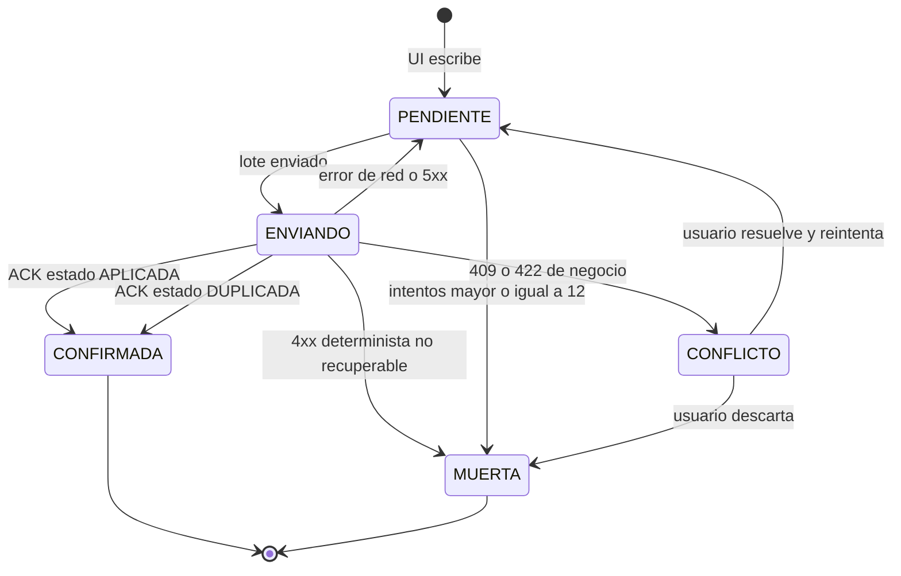
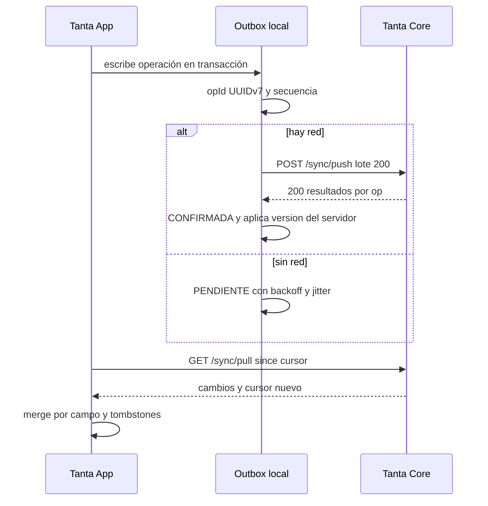
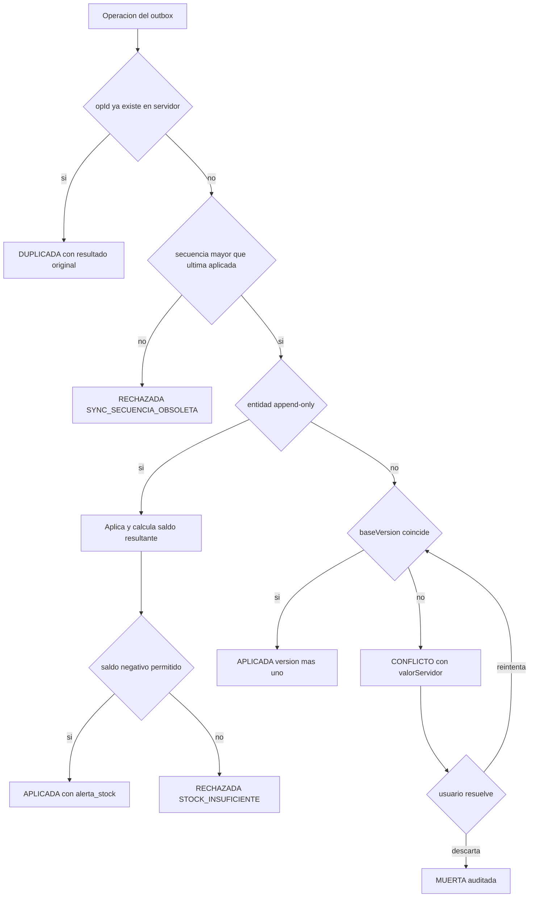

# 09 · Offline y Sincronización — Tanta App

> **Estado:** normativo. Desarrolla D-09 de `00-CONTEXTO-Y-DECISIONES.md` y el contrato de API de
> `05-API-CONTRATOS.md`.
>
> **Riesgo de origen:** §8 de la propuesta declara *"Conectividad inestable en planta o almacén"*
> (probabilidad media, impacto medio) y propone como mitigación *"reintentos automáticos de envío y
> mensajes claros de estado"*.
>
> **`[CORRECCIÓN]`** Reintentar sin idempotencia **duplica** ventas, pagos y bajas de stock: es peor
> que no reintentar. La mitigación real es *offline-first con outbox transaccional, idempotencia
> extremo a extremo y resolución de conflictos explícita*. Eso es lo que define este documento.

---

## 1. Las cuatro decisiones que gobiernan todo lo demás

| # | Decisión | Consecuencia práctica |
|---|---|---|
| S-01 | **El servidor es autoritativo para todo lo que se calcula**: costo, CPP, margen, IGV, saldo de CxC, correlativos, stock consolidado. La app solo previsualiza. | Un dispositivo offline nunca muestra un saldo "definitivo" sin la marca `estimado: true`. |
| S-02 | **El dispositivo es autoritativo para la intención y para el hecho físico**: "vendí 30 panes", "se me cayeron 2", "cobré S/ 100". | Un hecho físico ocurrido no se rechaza por reglas de negocio; se registra y se alerta la inconsistencia. |
| S-03 | **Escritura offline = operación en outbox, nunca escritura directa a la tabla espejo.** | La UI lee del espejo local *y* del outbox pendiente (overlay). Un solo camino de escritura = un solo camino de sync. |
| S-04 | **Ningún reloj de dispositivo decide nada.** | El orden lo da `secuencia` monotónica local; el tiempo de negocio lo da el servidor con `receivedAt`. |

**Prohibido por diseño:** resolver conflictos con *last-write-wins* por `updatedAt`. Dos tablets con
relojes desfasados convierten LWW en una lotería. Los conflictos se resuelven por **regla de entidad**
(§7), no por timestamp.

---

## 2. Estrategia por perfil

### 2.1 Matriz de capacidad offline

| Capacidad | Cliente | Producción (tablet) | Almacén | Vendedor |
|---|---|---|---|---|
| Iniciar sesión sin red (token vigente) | Sí, 30 días | Sí, 30 días | Sí, 30 días | Sí, 30 días |
| Ver catálogo y precios | Sí (caché) | Sí (recetas e insumos) | Sí | Sí |
| Crear pedido | **No** | — | — | **No** |
| Editar pedido propio | Sí, si el pedido está `REGISTRADO` en caché | — | — | Sí (su cartera) |
| Generar OP | — | **Sí** | — | — |
| Registrar producción y merma | — | **Sí** | — | — |
| Iniciar/terminar OP | — | Sí | — | — |
| Baja de insumos / productos | — | Sí (consumo de su OP) | **Sí** | — |
| Requisición de insumos | — | Sí | — | — |
| Atender requisición | — | — | Sí | — |
| Registrar venta a terceros | — | — | — | **Sí** |
| Registrar despacho / entrega | — | — | — | **Sí** |
| Registrar cobranza | — | — | — | **Sí** |
| Ver saldo de cartera | Sí (propio, estimado) | — | — | Sí (estimado) |
| Emitir comprobante PDF | — | — | — | **No** (requiere servidor) |
| Consultar dashboard / reportes G-* | — | — | — | — |
| Anular venta o pedido | — | — | — | **No** (solo online) |
| Cambiar precios, recetas, usuarios | — | — | — | — |

### 2.2 Por qué el Cliente no crea pedidos offline

Un pedido offline no puede validar precio vigente ni disponibilidad. Aceptarlo produce pedidos con
precio viejo o con producto agotado, y el cliente ya recibió confirmación. **Decisión:** el Cliente
puede armar el carrito offline (borrador local, sin `opId` ni envío) y el `POST /pedidos` se ejecuta
al recuperar red; si el precio cambió, la app muestra la diferencia y exige aceptación explícita
antes de enviar. El carrito local **no** es una promesa de precio.

### 2.3 Ventana de operación offline (`offlineMaxHoras`)

| Perfil | Aviso | Bloqueo de escrituras | Fundamento |
|---|---|---|---|
| Producción | 8 h | **48 h** | Una OP sin cerrar más de 2 días rompe el prorrateo CIF diario y la trazabilidad de merma. |
| Almacén | 8 h | **72 h** | El kárdex se desvía demasiado; el stock negativo deja de ser explicable. |
| Vendedor | 4 h | **72 h** | La cobranza física puede esperar 3 días; más allá, el riesgo de fraude y de CxC desactualizada es inaceptable. |
| Cliente | — | Solo lectura a los 7 días | Sin red no hay pedidos nuevos de todos modos. |

Al llegar al bloqueo la app entra en **modo restringido**: lectura total, escritura solo de
operaciones ya encoladas (reintentos), y un banner no descartable que muestra pendientes y último
sync. Nunca borra el outbox.

---

## 3. Modelo local en Drift/SQLite

### 3.1 Reglas del esquema local

1. **Todo instante se guarda como `INTEGER` epoch-milisegundos UTC**, no como `DateTime` de Drift
   (que por defecto usa segundos y pierde precisión). Un solo formato, comparable y ordenable.
2. Toda tabla espejo lleva: `id` (UUIDv7 del servidor), `version` (int), `actualizadoEnMs`,
   `borradoEnMs` (nullable = vigente), `sincronizadoEnMs`, `estimado` (bool: fila tocada por outbox
   pendiente).
3. Las tablas espejo son **de solo lectura desde la UI**; la UI escribe en `outbox_op` (§4).
4. `PRAGMA journal_mode=WAL`, `synchronous=NORMAL`, `foreign_keys=ON`.
5. `schemaVersion` local se migra con migraciones Drift versionadas; el servidor expone
   `esquemaVersion` en `/sync/pull` y una app con esquema local menor se actualiza antes de empujar.

```dart
// packages/mobile/lib/data/local/tanta_db.dart  (extracto normativo)
class ProductosLocal extends Table {
  TextColumn get id => text()();                       // UUIDv7 servidor
  TextColumn get codigo => text().nullable()();
  TextColumn get nombre => text()();
  TextColumn get categoriaId => text()();
  TextColumn get unidadVenta => text()();
  TextColumn get precioConIgv => text()();             // decimal como texto
  TextColumn get precioNeto => text()();
  BoolColumn get vigente => boolean().withDefault(const Constant(true))();
  IntColumn get version => integer()();
  IntColumn get actualizadoEnMs => integer()();
  IntColumn get borradoEnMs => integer().nullable()();
  BoolColumn get estimado => boolean().withDefault(const Constant(false))();
  @override Set<Column> get primaryKey => {id};
}

class StockLocal extends Table {
  TextColumn get itemTipo => text()();                 // INSUMO | PRODUCTO
  TextColumn get itemId => text()();
  TextColumn get cantidad => text()();                 // NUMERIC(18,6) como texto
  TextColumn get cpp => text().nullable()();
  IntColumn get actualizadoEnMs => integer()();
  @override Set<Column> get primaryKey => {itemTipo, itemId};
}

class PedidosLocal extends Table {
  TextColumn get id => text()();
  TextColumn get codigo => text()();
  TextColumn get clienteId => text()();
  TextColumn get estado => text()();
  TextColumn get fechaEntrega => text()();             // 'YYYY-MM-DD', fecha de negocio
  TextColumn get detalleJson => text()();
  TextColumn get totalConIgv => text()();
  IntColumn get version => integer()();
  IntColumn get actualizadoEnMs => integer()();
  BoolColumn get estimado => boolean().withDefault(const Constant(false))();
  @override Set<Column> get primaryKey => {id};
}
```

### 3.2 Qué se cachea, TTL y tamaño

| Tabla local | Contenido | TTL | Filas típicas | Tamaño |
|---|---|---|---|---|
| `productos_local` | Catálogo completo vigente | 24 h | 400 | 480 KB |
| `precios_local` | Precio vigente + margen objetivo | 1 h | 400 | 90 KB |
| `insumos_local` | Insumos con UM, mínimo, CPP | 12 h | 150 | 130 KB |
| `recetas_local` | Versión publicada + detalle | 24 h | 60 × 12 líneas | 220 KB |
| `clientes_local` | Clientes de la cartera del vendedor / padrón | 24 h | 300 | 450 KB |
| `stock_local` | Saldos por ítem (proyección) | 5 min | 550 | 170 KB |
| `movimientos_local` | Kárdex de los últimos 30 días | 30 días | 3 000 | 1.1 MB |
| `pedidos_local` | Pedidos de los últimos 90 días | 90 días | 1 500 | 3.2 MB |
| `despachos_local` | Despachos abiertos + 30 días | 30 días | 400 | 500 KB |
| `ventas_local` | Ventas propias de 60 días | 60 días | 900 | 1.8 MB |
| `cxc_local` | CxC abiertas + pagos 60 días | 15 min | 800 | 420 KB |
| `parametros_local` | IGV, tolerancias, catálogos | 7 días | 30 | 12 KB |
| `outbox_op` | Operaciones pendientes | — | hasta 20 000 | hasta 30 MB |

**Presupuesto total: 64 MB de base local.** Política de purga: si `outbox` + espejos > 48 MB, se
purgan primero `movimientos_local` y `ventas_local` por antigüedad (nunca `outbox`, nunca
`cxc_local`). La app **nunca** cachea kárdex completo ni fichas de costo: eso es servidor.

### 3.3 Ciclo de vida de la caché

- **Hidratación inicial (`bootstrap`):** `GET /api/v1/sync/bootstrap?entidades=...` por lotes de
  500, con `?pageCursor=` paginado. Se ejecuta en el primer login y cuando el cursor expira.
- **Refresco:** `pull` incremental cada 5 min con la app en primer plano, al recuperar conectividad,
  y al volver del background si pasaron > 60 s.
- **Invalidación por evento:** `precio.cambiado` y `producto.inhabilitado` fuerzan pull inmediato de
  la entidad afectada (`?entidades=producto,precio`).
- **Lectura con overlay:** la UI lee `espejo ∪ outbox pendiente`. Un pedido creado offline aparece
  en la lista con etiqueta "pendiente de envío" y `estimado: true`.

---

## 4. Outbox

### 4.1 Estructura

```dart
// Tabla `outbox_op` (nombre alineado con 10-FRONTEND-MOVIL-Y-WEB.md).
class OutboxOp extends Table {
  @override String get tableName => 'outbox_op';
  IntColumn get secuencia => integer().autoIncrement()();   // orden local estricto
  TextColumn get opId => text()();                          // UUIDv7, UNIQUE
  TextColumn get entidad => text()();                       // pedido | op | venta | movimiento | pago
  TextColumn get tipo => text()();                          // CREAR | ACTUALIZAR | ANULAR | MOVIMIENTO
  TextColumn get entidadId => text().nullable()();           // null si lo asigna el servidor
  TextColumn get payloadJson => text()();                    // JSON canónico, claves ordenadas
  IntColumn get baseVersion => integer().nullable()();
  IntColumn get occurredAtMs => integer()();                 // reloj del dispositivo (declarativo)
  TextColumn get dependeDe => text().nullable()();            // JSON array de opIds
  IntColumn get intentos => integer().withDefault(const Constant(0))();
  IntColumn get proximoIntentoEnMs => integer()();
  TextColumn get estado => text().withDefault(const Constant('PENDIENTE'))(); // PENDIENTE|ENVIANDO|CONFIRMADA|CONFLICTO|MUERTA
  TextColumn get ultimoCodigo => text().nullable()();
  TextColumn get ultimoDetalle => text().nullable()();
  IntColumn get tamanoBytes => integer().withDefault(const Constant(0))();
  @override List<String> get customConstraints => const [
    'UNIQUE (opId)',
    "CHECK (estado IN ('PENDIENTE','ENVIANDO','CONFIRMADA','CONFLICTO','MUERTA'))",
  ];
}
```

**`[CORRECCIÓN]` sobre `10-FRONTEND-MOVIL-Y-WEB.md` §2.4:** ese documento define
`OutboxEstado { pendiente, enviando, error, enviado }`. Ese juego de estados mezcla dos cosas
distintas en `error`: "la red falló, reintenta solo" y "el servidor rechazó, necesita un humano". No
tiene dead-letter y un conflicto de negocio quedaría reintentándose para siempre. Aquí `error` se
desdobla en `PENDIENTE` (reintentable), `CONFLICTO` (requiere decisión del usuario) y `MUERTA`
(dead-letter, solo sale con acción humana). **Manda este documento**, que es el contrato de sync.

Índices: `UNIQUE(opId)`, `(estado, proximoIntentoEnMs)`, `(secuencia)`, `(entidad, entidadId)`.
`opId` se genera con `uuidv7()` en el dispositivo y es **la misma clave** que viaja como
`idempotencyKey` en el sobre y como clave única en el servidor.

### 4.2 Orden de envío

1. Orden **estricto por `secuencia` ASC**, agrupando en lotes que no rompan dependencias: una
   operación con `dependeDe` no entra al lote si algún predecesor no está `CONFIRMADA`. El envío es
   *head-of-line blocking* por diseño: si `seq=430` está en `CONFLICTO`, las operaciones 431+ de la
   misma entidad se detienen; el resto de entidades sigue (canales independientes por `entidad`).
2. Lote máximo: **200 operaciones** o **1.5 MB**, lo que ocurra primero. Los lotes se envían en
   serie, no en paralelo (garantiza orden y evita tormentas en la red de planta).
3. Al confirmar un lote, se marcan `CONFIRMADA` y se aplican al espejo local con la `version`
   devuelta por el servidor (nunca con la versión local).



### 4.3 Reintentos con backoff exponencial y jitter

```
delayMs = min(300_000, 2_000 * 2^intentos) * (0.5 + random() * 0.5)
```

| Intento | Base | Rango real con jitter |
|---|---|---|
| 1 | 2 s | 1.0 – 2.0 s |
| 2 | 4 s | 2.0 – 4.0 s |
| 3 | 8 s | 4.0 – 8.0 s |
| 5 | 32 s | 16 – 32 s |
| 8 | 256 s | 128 – 256 s |
| 12+ | 300 s (tope) | 150 – 300 s |

- `jitter` multiplicativo al 50 %: evita que 12 tablets reconecten al mismo segundo cuando vuelve el
  WiFi de la planta (efecto estampida sobre `POST /sync/push`, cuyo límite es 30 lotes/min).
- **Máximo 12 intentos ≈ 24 h** de reintentos por operación; después `MUERTA` (dead-letter).
- Errores **recuperables** (reintentan): timeout, `5xx`, `429`, `SERVICIO_NO_DISPONIBLE`,
  `TIEMPO_AGOTADO`, `IDEMPOTENCIA_EN_CURSO`.
- Errores **deterministas** (van directo a `CONFLICTO` o `MUERTA` sin reintentar): `422`, `403`,
  `409` de negocio, `404` de recurso borrado.
- Los reintentos **reutilizan el mismo `opId`**. Nunca se regenera: regenerarlo crea el duplicado
  que la idempotencia evita.

### 4.4 Dead-letter y visibilidad para el usuario

`MUERTA` no es un cajón oculto. La app tiene una pantalla **"Pendientes y conflictos"** (accesible
desde un badge permanente en la barra superior) con cuatro pestañas: *Por enviar*, *En conflicto*,
*Rechazadas*, *Enviadas hace < 24 h*. Para cada operación muestra:

- Tipo legible (`Venta a terceros — Sra. Rosa Quispe — S/ 147.26`), fecha y hora local.
- Estado y **código** del servidor traducido a lenguaje de negocio ("El pedido ya entró a
  producción; no se puede editar").
- Acciones: **Reintentar**, **Ver diferencias** (para conflictos: valor local vs. valor servidor),
  **Descartar** (solo con confirmación de dos pasos y registro en `audit.evento` del servidor).
- Exportar el JSON de la operación (`share_plus`) para que el usuario lo envíe a soporte.

Regla: **ninguna operación se descarta automáticamente**. Un `MUERTA` permanece hasta que un humano
decide. La app no puede tener más de 50 operaciones `MUERTA` sin mostrar un banner rojo persistente.

---

## 5. Protocolo de sincronización

### 5.1 `POST /api/v1/sync/push`

Sobre del lote:

```json
{
  "loteId": "0192f0f0-1111-7a11-8b11-000000000001",
  "dispositivoId": "0192f0f1-2222-7b22-8c22-000000000002",
  "esquemaVersion": 4,
  "appVersion": "1.8.2",
  "enviadoEn": "2026-11-02T09:15:00.000-05:00",
  "operaciones": [
    {
      "opId": "0192f0f2-3333-7c33-8d33-000000000003",
      "secuencia": 431,
      "entidad": "venta",
      "tipo": "CREAR",
      "entidadId": null,
      "baseVersion": null,
      "occurredAt": "2026-11-02T09:14:33.207-05:00",
      "idempotencyKey": "0192f0f2-3333-7c33-8d33-000000000003",
      "dependeDe": [],
      "payload": {
        "canal": "TERCERO",
        "tercero": { "nombre": "Sra. Rosa Quispe", "documento": "09876543" },
        "fechaVenta": "2026-11-02",
        "formaPago": "CREDITO",
        "diasCredito": 15,
        "detalle": [
          { "productoId": "0192f0c8-1111-7a11-8b11-111111111111",
            "cantidad": "30", "precioUnitarioConIgv": "2.3600" }
        ]
      }
    },
    {
      "opId": "0192f0f3-4444-7d44-8e44-000000000004",
      "secuencia": 432,
      "entidad": "movimiento",
      "tipo": "MOVIMIENTO",
      "entidadId": null,
      "baseVersion": null,
      "occurredAt": "2026-11-02T09:15:02.884-05:00",
      "idempotencyKey": "0192f0f3-4444-7d44-8e44-000000000004",
      "dependeDe": ["0192f0f2-3333-7c33-8d33-000000000003"],
      "payload": {
        "itemTipo": "PRODUCTO",
        "itemId": "0192f0c8-1111-7a11-8b11-111111111111",
        "tipoMovimiento": "SALIDA_VENTA",
        "cantidad": "-30.000000",
        "origenTipo": "VENTA",
        "origenOpId": "0192f0f2-3333-7c33-8d33-000000000003",
        "motivo": "Despacho a tercero"
      }
    }
  ]
}
```

Respuesta — **siempre `200` si el sobre es válido**, con el resultado por operación:

```json
{
  "loteId": "0192f0f0-1111-7a11-8b11-000000000001",
  "recibidoEn": "2026-11-02T14:15:03.512Z",
  "servidorEn": "2026-11-02T09:15:03.512-05:00",
  "esquemaVersion": 4,
  "desfaseRelojSegundos": 2,
  "cursor": "eyJ2Ijo0LCJzZXEiOjE5ODQyMn0.9a0c11e7",
  "resultados": [
    {
      "opId": "0192f0f2-3333-7c33-8d33-000000000003",
      "secuencia": 431,
      "estado": "APLICADA",
      "entidad": "venta",
      "entidadId": "0192f0e3-4b55-7c66-9d77-000000000789",
      "codigo": "VTA-2026-000789",
      "version": 1,
      "aplicadoEn": "2026-11-02T09:15:03.204-05:00"
    },
    {
      "opId": "0192f0f3-4444-7d44-8e44-000000000004",
      "secuencia": 432,
      "estado": "RECHAZADA",
      "entidad": "movimiento",
      "entidadId": null,
      "codigo": "STOCK_INSUFICIENTE",
      "detalle": "Saldo resultante -2.000000 para producto 0192f0c8-1111-7a11-8b11-111111111111; se registró como alerta.",
      "aplicadoEn": "2026-11-02T09:15:03.311-05:00"
    }
  ],
  "resumen": { "aplicadas": 1, "duplicadas": 0, "conflictos": 0, "rechazadas": 1 }
}
```

Estados por operación: `APLICADA`, `DUPLICADA` (idempotencia; trae `entidadId` y `version`
originales), `CONFLICTO` (trae `valorServidor` y `resolucionSugerida`), `RECHAZADA` (regla de
negocio; no se reintenta igual).

Códigos de sobre (fallan el lote completo): `400` sobre malformado, `401` token inválido, `413`
lote > 5 MB o > 500 ops, `422 SYNC_ESQUEMA_DESCONOCIDO`, `426` app por debajo del mínimo, `429`
límite de lotes, `503` mantenimiento.

**Procesamiento:** el servidor ordena las operaciones por `secuencia` ascendente y aplica cada una en
su **propia transacción** (una operación inválida no revierte las demás), pero las ejecuta en serie
para respetar el orden. Cada operación inserta en `core.sync_operacion`
`(dispositivo_id, op_id UNIQUE, secuencia, entidad, tipo, entidad_id, estado, codigo, payload_hash,
recibido_en, aplicado_en)` y en `core.sync_cambio` si produjo un cambio visible.

### 5.2 `GET /api/v1/sync/pull`

```
GET /api/v1/sync/pull?since=eyJ2Ijo0LCJzZXEiOjE5ODQyMn0.9a0c11e7&entidades=producto,precio,pedido&limit=500
```

```json
{
  "cursor": "eyJ2Ijo0LCJzZXEiOjIwMTMzMX0.4b7e22a1",
  "hayMas": true,
  "esquemaVersion": 4,
  "servidorEn": "2026-11-02T09:20:00.000-05:00",
  "cambios": [
    {
      "secuenciaCambio": 201100,
      "entidad": "precio",
      "entidadId": "0192f0c8-1111-7a11-8b11-111111111111",
      "tipo": "UPSERT",
      "version": 8,
      "actualizadoEn": "2026-11-02T08:55:12.001-05:00",
      "payload": {
        "productoId": "0192f0c8-1111-7a11-8b11-111111111111",
        "precioConIgv": "2.5000",
        "precioNeto": "2.1186",
        "vigenteDesde": "2026-11-02",
        "motivo": "Alza de harina"
      }
    },
    {
      "secuenciaCambio": 201133,
      "entidad": "pedido",
      "entidadId": "0192f0c4-8f3a-7c21-9a51-3b2f9c1d4e60",
      "tipo": "UPSERT",
      "version": 4,
      "actualizadoEn": "2026-11-02T09:02:44.773-05:00",
      "payload": {
        "codigo": "PED-2026-000123",
        "estado": "EN_PRODUCCION",
        "totalConIgv": "634.4000"
      }
    },
    {
      "secuenciaCambio": 201140,
      "entidad": "pedido",
      "entidadId": "0192f0c1-2b77-7a02-9e64-0d1c8f3a5b22",
      "tipo": "DELETE",
      "version": 3,
      "actualizadoEn": "2026-11-02T09:05:00.000-05:00",
      "payload": { "borradoEn": "2026-11-02T09:05:00.000-05:00" }
    }
  ]
}
```

- El cursor es un **`bigserial` de `core.sync_cambio`**, no un timestamp: un `since` por fecha pierde
  cambios cuando el reloj del servidor retrocede o hay transacciones concurrentes.
- `tipo: DELETE` es un **tombstone** del borrado lógico (D-04: nunca `DELETE` físico). La app borra
  la fila local, no la resucita en el próximo pull.
- `payload` del pull es un **delta**, no la entidad completa; la app hace merge por campo.
- `hayMas: true` exige repetir con el cursor devuelto hasta agotarlo (chunks de 500).
- Cursor más viejo que la retención (90 días) → `410 CURSOR_EXPIRADO`; la app hace `bootstrap`.
- Cursor manipulado o de otros filtros → `400 CURSOR_INVALIDO` (mismo diseño HMAC que `05` §6).

### 5.3 `GET /api/v1/sync/bootstrap`

Hidratación completa paginada: `?entidades=producto,precio,insumo,cliente&pageCursor=&limit=500`.
Devuelve `{ "datos": [...], "pageCursor": "...", "hayMas": ..., "cursor": "<cursor de sync_cambio al inicio del bootstrap>" }`.
La app **primero** guarda el `cursor`, **después** inserta los datos: si el bootstrap se corta, el
próximo `pull` rellena el hueco sin perder cambios intermedios.

**`[AMPLIACIÓN]`** La propuesta original no contempla hidratación inicial. Sin `bootstrap`, un
dispositivo nuevo (o uno con `410 CURSOR_EXPIRADO`) no tiene forma de operar: `pull` solo entrega
deltas desde un cursor que ese dispositivo nunca tuvo. Es la primera llamada tras cada instalación.

### 5.4 `GET /api/v1/sync/estado`

```json
{
  "dispositivoId": "0192f0f1-2222-7b22-8c22-000000000002",
  "esquemaVersion": 4,
  "esquemaMinimoSoportado": 3,
  "cursorActual": "eyJ2Ijo0LCJzZXEiOjIwMTMzMX0.4b7e22a1",
  "ultimaSecuenciaAplicada": 432,
  "operacionesPendientesServidor": 0,
  "conflictosAbiertos": 1,
  "ventanaOfflineMaxHoras": 72,
  "servidorEn": "2026-11-02T09:21:00.000-05:00"
}
```



---

## 6. Reloj: por qué el dispositivo no decide

### 6.1 Riesgos reales en planta

- Tablets de bajo costo que pierden hora al quedarse sin batería (sin RTC de respaldo).
- Zona horaria mal configurada o cambiada a mano (`UTC-3` en vez de `UTC-5`).
- Usuarios que adelantan la hora para "cerrar el día" antes del corte.
- Cambio de horario de verano en otros países al usar un dispositivo importado (Perú no lo tiene,
  el dispositivo sí puede creerlo).

### 6.2 Regla

| Campo | Quién lo pone | Uso |
|---|---|---|
| `occurredAt` | Dispositivo | Declaración de cuándo ocurrió **según el usuario**. Solo para mostrar en la UI y como dato de auditoría secundario. **Nunca** ordena ni decide. |
| `secuencia` | Dispositivo (autoincrement local) | **Orden real** de las operaciones de un mismo dispositivo. Entero, sin ambigüedad, sin reloj. |
| `receivedAt` | Servidor (`now()` UTC) | Marca temporal autoritativa de llegada. |
| `aplicadoEn` | Servidor | Marca de aplicación efectiva; base del kárdex, CxC y reportes. |
| `fechaEntrega`, `fechaPago`, `fechaProduccion` | Usuario, tipo `date` | Fechas de negocio. Se validan contra el día operativo en `America/Lima`, no se derivan de un timestamp. |

**Orden de operaciones de un mismo dispositivo:** por `secuencia` ascendente. El servidor guarda
`sync_cursor_dispositivo.ultima_secuencia_aplicada` y rechaza con `SYNC_SECUENCIA_OBSOLETA` cualquier
operación con `secuencia <= ultima_secuencia_aplicada` cuyo `opId` no esté ya registrado (es decir:
no es duplicado, es una operación vieja reenviada fuera de orden). Se toleran huecos de hasta 200
posiciones (pérdida de una operación) y se registran como `SYNC_HUECO_SECUENCIA` para revisión.

### 6.3 Detección de desfase

```
desfase = occurredAt_del_sobre_más_reciente - receivedAt
```

| Desfase | Acción |
|---|---|
| \|desfase\| ≤ 120 s | Normal. `desfaseRelojSegundos` informativo en la respuesta. |
| 120 s < \|desfase\| ≤ 24 h | Se registra `desfase_reloj` en `sync_lote`; la app muestra aviso suave. |
| \|desfase\| > 24 h | `occurredAt` se **satura** a `receivedAt` para efectos de negocio; la operación se marca `REQUIERE_REVISION` y aparece en la pestaña *Rechazadas* con la nota "reloj del dispositivo desajustado". |
| Desfase negativo > 24 h y `fechaPago` futura | `422 FECHA_FUERA_DE_RANGO`: la app obliga a corregir la fecha antes de reenviar. |

El servidor **nunca** rechaza una operación solo por el reloj: la registra y la marca. Rechazarla
perdería un hecho físico que ya ocurrió.

---

## 7. Resolución de conflictos por entidad

| Entidad | Autoridad | Mecanismo | Resultado para el usuario |
|---|---|---|---|
| **Catálogo** (`producto`, `insumo`, `categoria`) | Servidor | La app no crea productos offline (solo ADMIN en web). Un `PATCH` offline contra `baseVersion` vieja → `409 SYNC_CONFLICTO_VERSION` y **gana el servidor**. | "El producto fue modificado por Administración. Se muestran los datos actuales." Cambio local descartado, editable de nuevo. |
| **Precios** | Servidor | Solo ADMIN los cambia, y desde web. Ningún dispositivo móvil escribe precios. Op offline de precio → `403 PRECIO_SOLO_SERVIDOR`. | Aviso "el precio cambió" + diferencia antes de confirmar una venta en borrador. |
| **Movimientos de inventario** | Append-only | **Nunca hay conflicto de valor**: un movimiento no se modifica, solo se agrega. El único riesgo es el duplicado, que resuelve `opId`. **Offline** (hecho ya ocurrido, nadie puede corregirlo): el saldo negativo se acepta y dispara `alerta_stock`. **Online** (usuario presente, puede corregir): se verifica saldo con `SELECT … FOR UPDATE` y se responde `409 STOCK_INSUFICIENTE` con el `faltante`. | Nada que resolver; si el saldo quedó negativo aparece en alertas de Almacén. |
| **Pedidos** | Cliente dueño / Vendedor, con guarda de estado | Editable solo mientras el servidor lo tenga en `REGISTRADO`. Si avanzó a `EN_PRODUCCION` → `409 PEDIDO_YA_EN_PRODUCCION`, gana el servidor. | "Tu pedido ya entró a producción; no se puede modificar. Puedes solicitar un cambio." |
| **Conteo de producción / merma** | Servidor, con aviso | Si la OP ya está `TERMINADA` con otra cantidad, op → `CONFLICTO`; se muestra `valorLocal` vs. `valorServidor` y se ofrece **registrar un ajuste** (nueva operación `AJUSTE` que firma Almacén). Nunca se sobrescribe el conteo del servidor. | Pantalla de diferencias con dos botones: "Registrar ajuste" o "Descartar mi conteo". |
| **Ventas a terceros** | Append-only | No se editan; se anulan (solo online). Op de anulación offline → bloqueada. | Aviso: "para anular una venta necesitas conexión". |
| **Pagos / cobranza** | Append-only | Idempotencia por `opId`; dos pagos distintos del mismo monto son **dos pagos reales** (no se deduplican por monto). `422 PAGO_EXCEDE_SALDO` si el saldo ya se cubrió en otro dispositivo. | "Este pago no se registró: la cuenta ya estaba pagada. Verifica con el cliente." |
| **CxC** | Servidor | El saldo siempre se recalcula en servidor a partir de los pagos aplicados. La app muestra `estimado: true` hasta el pull. | Saldo con marca "estimado" hasta sincronizar. |
| **OP (estado)** | Servidor | `PENDIENTE → EN_PROCESO` offline es aceptable (la tablet es la única que produce). `TERMINADA` en servidor + `EN_PROCESO` local → gana servidor con aviso. | Banner "esta OP ya fue cerrada desde otro dispositivo". |

**Regla general:** el servidor gana en los datos *derivados* (saldos, stocks consolidados, estados);
el dispositivo gana en los *hechos* (un movimiento, un pago, una venta). Y todo lo que el servidor
descarta se le **dice al usuario con el valor que tenía**, nunca en silencio.

### 7.1 Diagrama de decisión



---

## 8. Casos difíciles

### 8.1 Dos vendedores venden el último producto

Ambos tablets tienen `stock_local = 1`. Ambos venden. Ambos empujan.

**Decisión:** se aceptan **las dos ventas**. Razón: el pan ya salió del horno y ya se cobró; rechazar
una venta en el servidor dejaría dinero cobrado sin documento y stock inflado. Consecuencia: el
segundo `movimiento` produce saldo `-1.000000` y dispara `stock_negativo`. El sistema:

1. Aplica ambas ventas (`VTA-...789`, `VTA-...790`) y sus movimientos.
2. Emite `stock_negativo` → alerta en `GET /inventario/alertas` y push a Almacén.
3. Muestra a ambos vendedores el chip "vendiste más de lo registrado en stock" en su historial.
4. Almacén resuelve con un ajuste con motivo (`AJU-*`, "diferencia de conteo").

Lo que **sí** se rechaza es un **pedido** (reserva) sobre stock inexistente: ahí no hubo hecho
físico, así que `409 STOCK_INSUFICIENTE` es correcto y el cliente elige otra fecha.

### 8.2 Tablet de Producción con 3 días sin red

Estado: 14 operaciones encoladas (3 OP cerradas, 9 mermas, 2 inicios), `ultima_secuencia=612`.

1. Horas 0–8: banner ámbar discreto.
2. Horas 8–48: banner ámbar persistente con "14 pendientes · sin sync hace 31 h".
3. A las 48 h: **modo restringido**: se bloquean nuevas OP y nuevos registros de producción, se
   permite terminar las OP ya iniciadas y reintentar el outbox.
4. Al recuperar red: se envían 14 ops en 1 lote (≈ 18 KB). El servidor aplica en orden de
   `secuencia`. Las OP se crean, se cierran y el costeo se recalcula en background.
5. Conflictos esperados: si Producción ya había cerrado esas OP desde otra tablet, las 3 ops de
   cierre caen en `CONFLICTO` y el usuario ve el diff. Los movimientos de merma **no** conflictúan:
   se aplican igual (append-only), porque la merma ocurrió.
6. El `pull` posterior trae el estado real; la tablet deja de mostrar `estimado`.

### 8.3 Operación enviada dos veces

Escenario: el servidor aplicó la venta, pero el `200` se perdió (red cortada en el ACK).

La app reintenta con **el mismo `opId`** tras 2 s + jitter. El servidor encuentra
`(dispositivo_id, op_id)` en `core.sync_operacion` y responde `DUPLICADA` con el `entidadId` y
`version` originales, sin volver a escribir nada. La app marca `CONFIRMADA`. **Nunca** se genera un
segundo `VTA-*`, un segundo pago ni un segundo movimiento.

Si por error humano se crea una operación **nueva** para el mismo hecho (nuevo `opId`): el servidor
no puede detectarlo como duplicado. Mitigación: la UI bloquea el botón de envío mientras
`estado == 'ENVIANDO'` y deshabilita "registrar pago" durante 3 s tras un envío exitoso; el vendedor
ve el pago en su lista antes de poder repetirlo.

### 8.4 Usuario desinstala la app con outbox pendiente

**Riesgo residual aceptado y declarado.** El outbox vive en el sandbox de la app; desinstalar lo
borra. Mitigaciones, en orden:

1. `autoBackup` de Android **desactivado** para `tanta_local.db` (un restore parcial del outbox es
   peor que ninguno: produce ops huérfanas con `secuencia` duplicada).
2. Push automático agresivo: cada operación nueva intenta enviarse en ≤ 2 s si hay red; la ventana de
   exposición típica es de segundos.
3. "Cerrar sesión" está **bloqueado** si `outbox pendientes > 0`, con opción "exportar y salir".
4. Botón **"Exportar operaciones pendientes"** → JSON firmado y compartido por correo/WhatsApp; el
   administrador lo reinyecta con `POST /sync/push` desde Tanta Admin (`?origen=importado`).
5. En el flujo de desinstalación de Android no hay hook fiable; no se promete recuperación.

Aceptado: perder a lo sumo las operaciones de las últimas horas de un dispositivo que se desinstala
a propósito. Se documenta en el manual de usuario ("sincroniza antes de cambiar de equipo").

### 8.5 Cambio de dispositivo

- `deviceId` = UUIDv7 generado en el primer arranque y guardado en `flutter_secure_storage`. Se
  registra con `POST /auth/dispositivos`.
- Un dispositivo nuevo tiene **otro** `deviceId` y cursor `null` → ejecuta `bootstrap` completo.
- Las operaciones del dispositivo viejo **siguen siendo aceptadas** hasta que un ADMIN lo revoque
  (`DELETE /auth/dispositivos/{id}`), porque pueden llegar tarde por falta de red. Tras la revocación:
  `401 DISPOSITIVO_REVOCADO` y el outbox local queda en `MUERTA` con instrucción de contacto.
- Se permite un máximo de **5 dispositivos activos** por usuario; registrar el sexto exige revocar
  uno (evita el "tablet compartida" con 20 sesiones).

### 8.6 Cambio de esquema del servidor con dispositivos viejos

`sync.pull` devuelve `esquemaVersion`. Si `cliente < esquemaMinimoSoportado`, el push se rechaza con
`422 SYNC_ESQUEMA_DESCONOCIDO` antes de aplicar nada; la app muestra "actualiza Tanta App" y
**conserva el outbox**. Un dispositivo que no puede actualizarse (tablet vieja) sigue operando en
modo lectura y el administrador registra sus operaciones manualmente desde web. El esquema de sync
solo cambia en versiones mayores de app, con 30 días de coexistencia.

---

## 9. Idempotencia extremo a extremo

| Capa | Mecanismo | Retención |
|---|---|---|
| Dispositivo | `opId` UUIDv7 generado en la transacción de creación de la operación + `UNIQUE(opId)` en `outbox` | Hasta confirmar |
| Transporte | `idempotencyKey == opId` por operación dentro del sobre; `POST /sync/push` acepta `Idempotency-Key` del lote para el caso de lote reenviado completo | 24 h (lote) |
| Servidor | `core.sync_operacion UNIQUE (dispositivo_id, op_id)` + `core.idempotencia` para endpoints REST normales | 90 días |
| Efecto | Toda escritura derivada (movimiento, pago, CxC, asiento de kárdex) hereda el `op_id` y lo guarda en su columna `origen_op_id` | Permanente |

**Por qué UUIDv7 y no UUIDv4:** ordenable por tiempo, lo que hace que los índices `(dispositivo_id,
op_id)` y `(origen_op_id)` tengan localidad de escritura; además permite auditar "qué se generó
cuándo" sin consultar otra tabla. Coherente con D-04.

**ACK perdido:** reenvío del mismo `opId` → `DUPLICADA`. **Lote perdido a medias:** cada operación
tiene su propio `opId`; las que llegaron son `APLICADA` y las que no, se reenvían y son `APLICADA`
(no hay estado de lote que reconciliar). **Doble clic en la UI:** el botón se deshabilita y la
transacción local es única, así que solo puede existir una fila en `outbox`.

**Límite conocido:** pasados 90 días, `sync_operacion` se purga. Una operación reenviada después de
ese plazo podría duplicar. Es aceptable porque el outbox se purga al confirmar y una operación de
más de 90 días sin ACK es, en la práctica, un dispositivo abandonado; al revocarlo se rechaza.

---

## 10. Indicadores de salud del sync

### 10.1 En la app (siempre visibles)

| Indicador | Dónde | Regla |
|---|---|---|
| `pendientes` | Badge en la barra superior | 0 → verde; 1–19 → ámbar; ≥ 20 o `MUERTA > 0` → rojo |
| `ultimoSyncExitoso` | Badge + pantalla de pendientes | > 15 min → ámbar; > 2 h → rojo |
| `conflictosAbiertos` | Badge separado con icono de alerta | > 0 → rojo persistente hasta resolver |
| `desfaseReloj` | Aviso en ajustes | > 120 s → "la hora de tu equipo no coincide con el servidor" + botón "corregir automáticamente" |
| `tamanoCola` | Pantalla de pendientes | > 12 MB → aviso de purga de caché |
| `ventanaOfflineRestante` | Banner en modo restringido | Muestra horas restantes antes del bloqueo |
| `esquemaDesactualizado` | Banner bloqueante | Exige actualizar la app |

La pantalla "Pendientes y conflictos" es alcanzable en **un toque** desde cualquier pantalla
operativa, y muestra el detalle por operación con su código de error. Un usuario de planta no lee
logs: lee "3 ventas sin enviar" y "1 pago en conflicto".

### 10.2 En el servidor (métricas)

| Métrica | Tipo | Objetivo / alerta |
|---|---|---|
| `tanta_sync_push_ops_total{estado}` | counter | Base para ratios de duplicado y rechazo |
| `tanta_sync_push_lotes_total{resultado}` | counter | — |
| `tanta_sync_push_duration_seconds` | histogram | p95 < 2 s para 200 ops |
| `tanta_sync_ops_duplicadas_ratio` | gauge | < 1 %; alerta > 5 % (indica red inestable o bug de ACK) |
| `tanta_sync_ops_rechazadas_ratio` | gauge | < 0.5 %; alerta > 3 % |
| `tanta_sync_deadletter_total` | counter | Alerta si > 20/día |
| `tanta_sync_conflictos_abiertos{entidad}` | gauge | Alerta si > 10 en `pedido` |
| `tanta_sync_lag_segundos` | histogram | p95 < 60 s desde `occurredAt` hasta `aplicadoEn` |
| `tanta_sync_desfase_reloj_segundos` | histogram | p95 < 5 s; alerta si p99 > 300 s |
| `tanta_dispositivos_sin_sync_24h` | gauge | Alerta si > 2 (dispositivo "mudo" con outbox) |
| `tanta_sync_pull_bytes_total` | counter | Detecta tormentas de bootstrap |
| `tanta_sync_esquema_desactualizado{version}` | gauge | Alerta si > 0 antes de subir `esquemaMinimoSoportado` |
| `tanta_sync_outbox_pendientes{dispositivo}` | gauge (reportado por la app vía `X-Pendientes`) | > 500 sostenido → contacto al usuario |

Job pg-boss diario `sync-alerta-dispositivos-mudos`: detecta `max(sync_lote.recibido_en)` por
dispositivo sin revocar y > 24 h; genera `alerta_stock`-equivalente en `notificaciones` para el
ADMIN. **Sin esto, un dispositivo que dejó de sincronizar es invisible.**

---

## 11. Pruebas que este diseño exige (criterio de aceptación)

1. **Corte de red en el ACK:** se mata la conexión tras el commit del servidor y antes de la
   respuesta; al reconectar debe resultar **una** venta, **un** pago, **un** movimiento. (Chaos test
   en CI con Toxiproxy.)
2. **200 operaciones con jitter:** con 12 clientes reintentando simultáneamente, ninguna operación se
   duplica y el p95 de `/sync/push` se mantiene < 3 s.
3. **Conflicto de pedido:** dos dispositivos editan el mismo pedido; el segundo recibe
   `PEDIDO_YA_EN_PRODUCCION` y la UI muestra el diff, no un error genérico.
4. **Reloj adelantado 48 h:** las operaciones se aplican con `occurredAt` saturado y quedan marcadas
   `REQUIERE_REVISION`; ninguna se pierde.
5. **Cursor manipulado:** `400 CURSOR_INVALIDO`, sin fuga de datos de otra sucursal.
6. **Restauración del outbox exportado:** el JSON exportado, reinyectado con `POST /sync/push`,
   reproduce exactamente las operaciones pendientes sin duplicar las ya aplicadas.

---

## 12. Fuera de alcance explícito

- **CRDT / resolución automática de merges de texto.** No hay campos de edición concurrente
  multi-dispositivo que lo justifiquen; los conflictos se muestran al usuario.
- **Sync peer-to-peer entre tablets (Bluetooth/LAN).** Duplica la complejidad de idempotencia y no
  resuelve el problema real (llegar al servidor).
- **Costeo, márgenes y saldos definitivos offline.** D-09 lo prohíbe; la app solo previsualiza.
- **Emisión de comprobantes PDF offline.** Requiere numeración y firma del servidor.
- **Edición de precios, recetas o usuarios desde el móvil.** Son operaciones de web con MFA.

**Riesgos abiertos que este documento no elimina:**

| Riesgo | Impacto | Mitigación residual |
|---|---|---|
| Desinstalación con outbox pendiente | Pérdida de operaciones de las últimas horas | Exportación manual + push agresivo (§8.4). Aceptado. |
| Tablet compartida entre turnos con un solo `deviceId` | La `secuencia` mezcla usuarios, la auditoría atribuye mal | Se exige login por turno y `usuario_id` en cada op; el `deviceId` es del equipo, no de la persona. Riesgo de atribución, no de dato. |
| Stock negativo sistemático por ventas offline simultáneas | Kárdex con saldos negativos recurrentes | Aceptado por diseño (§8.1) + alerta a Almacén + toma de inventario semanal. |
| Purga de `sync_cambio` a 90 días con dispositivo offline > 90 días | `410 CURSOR_EXPIRADO` y bootstrap completo | Aceptado: el bootstrap es idempotente y el outbox local se conserva. |
