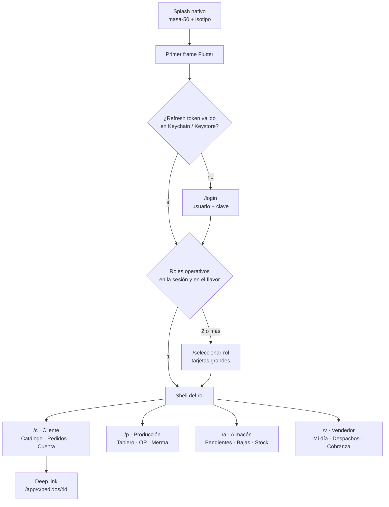

# 10 · Frontend móvil y web — Tanta App y Tanta Admin

> **Documento normativo de frontend.** Desarrolla `00-CONTEXTO-Y-DECISIONES.md` (D-02 stack, D-06 API,
> D-07 seguridad, D-09 offline-first) y el alcance funcional del Informe Ejecutivo v1.0 §3.
> Lo que este documento decide **manda** sobre el código de `apps/mobile` y `apps/web`.
> Lo que contradice la propuesta original va marcado `[CORRECCIÓN]`; lo que la amplía, `[AMPLIACIÓN]`.

| Campo | Valor |
|---|---|
| Cliente | Panadería Tanta (Lima, Perú) |
| Piezas | **Tanta App** (Flutter 3.3x, Android/iOS/tablet) · **Tanta Admin** (React 19 + Vite 6) |
| Perfiles app | Cliente · Producción (tablet) · Almacén · Vendedor |
| Perfiles web | Administrador · Almacén · Vendedor · Gerente |
| Documentos hermanos | `02-MODELO-DE-DATOS.md`, `05-API-Y-CONTRATOS.md`, `06-MOTOR-DE-COSTEO.md`, `09-OFFLINE-Y-SINCRONIZACION.md` |
| Fecha | 01/11/2026 |

---

## 0. Decisiones que este documento cierra

| ID | Decisión | Sección |
|---|---|---|
| FE-01 | **Una** app Flutter con cuatro perfiles y **dos artefactos** de distribución: flavor `cliente` (tiendas) y flavor `planta` (APK/IPA directo). | §1.1 |
| FE-02 | Navegación por rol con `go_router`: prefijos `/c` `/p` `/a` `/v`, guarda por prefijo y selector de rol solo si el usuario tiene 2+ roles operativos. | §1.4 |
| FE-03 | Feature-first + tres capas (presentación → dominio ← datos). Riverpod 2 con codegen. Drift es la **fuente de verdad local**. | §2 |
| FE-04 | La UI **nunca** anuncia un éxito que el servidor no confirmó: todo registro tiene estado `Local` o `Confirmado` visible. | §4.2 |
| FE-05 | Producción: tablet en horizontal, blancos de 72 dp, cero teclado, confirmación de dos pasos con el número repetido. | §3.2 |
| FE-06 | Almacén: el **escaneo** es la entrada primaria, no la búsqueda en listas. | §3.3 |
| FE-07 | Tema claro de alto contraste por defecto en perfiles de planta; oscuro solo en Cliente y Vendedor. | §8.4 |
| FE-08 | Web: TanStack Query = estado de servidor; Zustand = estado de interfaz. Filtros viven en la URL. | §6.6 |
| FE-09 | Dashboard: **8 visualizaciones**, cada una con pregunta, decisión habilitada y drill-down a tabla. Nada decorativo. | §7 |
| FE-10 | Tokens en `packages/tokens/tokens.json` (formato DTCG) → `tokens.css` (Tailwind 4) y `tokens.g.dart`. Fuente única. | §8.6 |
| FE-11 | Cliente HTTP generado del OpenAPI publicado; montos viajan como **string decimal**; CI falla si hay deriva. | §9 |
| FE-12 | Presupuestos de rendimiento medidos: el build se rompe si se exceden. | §10.1 |
| FE-13 | El go-live **no depende** de las tiendas de aplicaciones: planta arranca con instalación directa. | §11.5 |
| FE-14 | Las cuentas de desarrollador las paga y las posee Tanta; están **excluidas** del precio de la propuesta. | §11.1 |

---

## 1. Estrategia de aplicación única con cuatro perfiles

### 1.1 Por qué una sola app y no cuatro

Se construye **una** aplicación Flutter con cuatro experiencias de rol. No se construyen cuatro apps.

1. **El dominio es el mismo y es caro.** `Producto`, `Receta`, `OP`, `Insumo`, `MovimientoInventario`
   son entidades compartidas por los cuatro perfiles. Cuatro apps significan cuatro traducciones del mismo
   DTO y cuatro oportunidades de divergir del contrato (`05-API-Y-CONTRATOS.md`).
2. **Las reglas de costeo no se duplican.** D-09: la app nunca calcula costo, margen ni saldo definitivo.
   Con una sola app hay **un** módulo de "previsualización" que se audita una vez.
3. **La persona es una, los roles son varios.** El Informe §6.4 dice explícitamente que "una misma persona
   puede cubrir más de un rol". Cuatro apps obligarían a instalar dos aplicaciones y a iniciar sesión dos veces
   en el mismo teléfono. Inaceptable en planta.
4. **Costo de propiedad.** Cuatro listados en Play Store, cuatro ciclos de revisión, cuatro juegos de firma,
   cuatro canales de soporte y cuatro matrices de pruebas de dispositivo para un proyecto de 30 días.
   Es inviable en el plazo del §6.2.
5. **La tablet de Producción no es un dispositivo distinto, es un layout distinto.** Flutter resuelve eso con
   `LayoutBuilder` + densidades, no con un binario nuevo.

**Coste asumido de la decisión:** un binario único pesa más y expone código de perfiles que el usuario no usa.
Se mitiga con dos artefactos (abajo), `deferred` imports en las features pesadas (PDF, reportes) y gating por
rol en el router.

### 1.2 Los dos artefactos

| Artefacto | Flavor | Destino | Contenido | Firma |
|---|---|---|---|---|
| `tanta-cliente.aab` / `.ipa` | `cliente` | Play Store / App Store | Perfiles Cliente + Vendedor (un cliente puede además ser vendedor) | Play App Signing / Apple Distribution |
| `tanta-planta.apk` / `.ipa` (ad-hoc) | `planta` | Instalación directa en tablet de producción y celulares de almacén | Perfiles Producción + Almacén + Vendedor | Keystore de planta (Tanta) |

El flavor se resuelve en **tiempo de compilación** (`--dart-define=TANTA_FLAVOR=planta`) y solo controla
qué perfiles se ofrecen y qué módulos se registran; la autorización real es del servidor (D-07).
El flavor `planta` **no** exige Play Integrity ni servicios de Google para funcionar.

```dart
// lib/app/flavor.dart
enum TantaFlavor { cliente, planta }

const _flavorCrudo = String.fromEnvironment('TANTA_FLAVOR', defaultValue: 'cliente');

final tantaFlavor = switch (_flavorCrudo) {
  'planta' => TantaFlavor.planta,
  _ => TantaFlavor.cliente,
};

/// Perfiles que este binario puede ofrecer. La sesión puede tener más roles;
/// los que no estén aquí no se muestran aunque el JWT los traiga.
const rolesPorFlavor = <TantaFlavor, Set<RolApp>>{
  TantaFlavor.cliente: {RolApp.cliente, RolApp.vendedor},
  TantaFlavor.planta: {RolApp.produccion, RolApp.almacen, RolApp.vendedor},
};
```

### 1.3 Roles, prefijos y shells

| Rol | Prefijo | Shell | Navegación | Perfil del Informe §3.1 |
|---|---|---|---|---|
| Cliente | `/c` | `ClienteShell` (bottom nav 3 tabs) | Catálogo · Pedidos · Cuenta | ● app |
| Producción | `/p` | `PlantaShell` (rail lateral) | Tablero · OPs · Merma | ● app (tablet) |
| Almacén | `/a` | `PlantaShell` (rail lateral) | Pendientes · Bajas · Stock | ● app / ● web |
| Vendedor | `/v` | `PlantaShell` (rail lateral) | Mi día · Despachos · Cobranza | ● app / ● web |

Gerente y Administrador **no** tienen app: su superficie es Tanta Admin (§6). Decisión cerrada, no se
construye dashboard móvil.

### 1.4 Arranque, guardas y `go_router`

Secuencia de arranque: **splash nativo → primer frame Flutter → restauración de sesión → login si no hay
sesión → selector de rol si hay 2+ roles → shell del rol**. El splash nativo (`android:windowBackground` /
`LaunchScreen.storyboard`) usa el color `masa-50` y el isotipo, para que no haya destello blanco.



> El MFA TOTP de D-07 aplica a `ADMIN` y `GERENTE`, que son perfiles **solo web**: no aparece en el árbol
> de la app. Ningún rol operativo de planta tiene MFA, y añadirlo frenaría la operación sin mejorar el riesgo.

```dart
// lib/core/auth/auth_state.dart
import 'sesion.dart';

/// Estado de sesión como unión cerrada: el `switch` de la guarda es exhaustivo
/// por construcción, y añadir un estado nuevo rompe la compilación en un solo sitio.
sealed class AuthState {
  const AuthState();
}

final class AuthArrancando extends AuthState {
  const AuthArrancando();
}

final class AuthAnonimo extends AuthState {
  const AuthAnonimo();
}

/// Sesión válida pero con más de un rol operativo: falta elegir con cuál entrar.
final class AuthPendienteDeRol extends AuthState {
  const AuthPendienteDeRol(this.roles);
  final List<RolApp> roles;
}

final class AuthActivo extends AuthState {
  const AuthActivo({required this.sesion, required this.rolActivo});
  final Sesion sesion;
  final RolApp rolActivo;

  /// Cambiar de rol no cierra sesión ni pide credenciales otra vez.
  AuthActivo conRol(RolApp rol) =>
      rol == rolActivo ? this : AuthActivo(sesion: sesion, rolActivo: rol);
}
```

```dart
// lib/app/router/app_router.dart
import 'package:flutter/foundation.dart';
import 'package:flutter_riverpod/flutter_riverpod.dart';
import 'package:go_router/go_router.dart';

import '../../core/auth/auth_state.dart';
import '../../core/ui/pantalla_no_disponible.dart';
import '../../features/auth/presentation/login_screen.dart';
import '../../features/auth/presentation/role_picker_screen.dart';
import '../../features/auth/presentation/splash_screen.dart';
import '../../features/cliente/presentation/catalogo_screen.dart';
import '../../features/cliente/presentation/cliente_shell.dart';
import '../../features/cliente/presentation/cuenta_screen.dart';
import '../../features/cliente/presentation/mis_pedidos_screen.dart';
import '../../features/cliente/presentation/pedido_detalle_screen.dart';
import '../../features/cliente/presentation/producto_screen.dart';
import '../../features/almacen/presentation/pendientes_screen.dart';
import '../../features/planta/planta_shell.dart';
import '../../features/produccion/presentation/op_detalle_screen.dart';
import '../../features/produccion/presentation/tablero_screen.dart';
import '../../features/vendedor/presentation/mi_dia_screen.dart';

/// Puente entre el estado de Riverpod y el `Listenable` que go_router necesita.
class _RefrescoDeSesion extends ChangeNotifier {
  _RefrescoDeSesion(Ref ref) {
    ref.listen<AuthState>(
      authControllerProvider,
      (_, __) => notifyListeners(),
    );
  }
}

final routerProvider = Provider<GoRouter>((ref) {
  final refresco = _RefrescoDeSesion(ref);
  ref.onDispose(refresco.dispose);

  return GoRouter(
    initialLocation: '/splash',
    refreshListenable: refresco,
    redirect: (context, state) => _guard(ref.read(authControllerProvider), state),
    errorBuilder: (context, state) => const PantallaNoDisponible(),
    routes: [
      GoRoute(path: '/splash', builder: (_, __) => const SplashScreen()),
      GoRoute(path: '/login', builder: (_, __) => const LoginScreen()),
      GoRoute(path: '/seleccionar-rol', builder: (_, __) => const RolePickerScreen()),

      // ---- Cliente: 3 ramas persistentes, cada una conserva su pila ----
      StatefulShellRoute.indexedStack(
        builder: (context, state, shell) => ClienteShell(shell: shell),
        branches: [
          StatefulShellBranch(routes: [
            GoRoute(
              path: '/c/catalogo',
              builder: (_, __) => const CatalogoScreen(),
              routes: [
                GoRoute(
                  path: 'producto/:productoId',
                  builder: (_, s) => ProductoScreen(productoId: s.pathParameters['productoId']!),
                ),
              ],
            ),
          ]),
          StatefulShellBranch(routes: [
            GoRoute(
              path: '/c/pedidos',
              builder: (_, __) => const MisPedidosScreen(),
              routes: [
                GoRoute(
                  path: ':pedidoId',
                  name: 'pedidoDetalle',
                  builder: (_, s) => PedidoDetalleScreen(pedidoId: s.pathParameters['pedidoId']!),
                ),
              ],
            ),
          ]),
          StatefulShellBranch(routes: [
            GoRoute(path: '/c/cuenta', builder: (_, __) => const CuentaScreen()),
          ]),
        ],
      ),

      // ---- Planta: producción y almacén comparten shell de rail ----
      ShellRoute(
        builder: (context, state, child) => PlantaShell(location: state.uri.path, child: child),
        routes: [
          GoRoute(
            path: '/p/tablero',
            builder: (_, __) => const TableroScreen(),
            routes: [
              GoRoute(
                path: 'op/:opId',
                name: 'opDetalle',
                builder: (_, s) => OpDetalleScreen(opId: s.pathParameters['opId']!),
              ),
            ],
          ),
          GoRoute(path: '/a/pendientes', builder: (_, __) => const PendientesScreen()),
          GoRoute(path: '/v/mi-dia', builder: (_, __) => const MiDiaScreen()),
        ],
      ),
    ],
  );
});

const _rutasPublicas = {'/login', '/splash', '/recuperar'};

String _homeDe(RolApp rol) => switch (rol) {
      RolApp.cliente => '/c/catalogo',
      RolApp.produccion => '/p/tablero',
      RolApp.almacen => '/a/pendientes',
      RolApp.vendedor => '/v/mi-dia',
    };

String _prefijoDe(RolApp rol) => switch (rol) {
      RolApp.cliente => '/c',
      RolApp.produccion => '/p',
      RolApp.almacen => '/a',
      RolApp.vendedor => '/v',
    };

String? _guard(AuthState auth, GoRouterState state) {
  final destino = state.matchedLocation;
  switch (auth) {
    case AuthArrancando():
      return destino == '/splash' ? null : '/splash';
    case AuthAnonimo():
      return _rutasPublicas.contains(destino) && destino != '/splash' ? null : '/login';
    case AuthPendienteDeRol():
      return destino == '/seleccionar-rol' ? null : '/seleccionar-rol';
    case AuthActivo(:final rolActivo):
      if (_rutasPublicas.contains(destino) || destino == '/seleccionar-rol') {
        return _homeDe(rolActivo);
      }
      // Un Cliente que abre un enlace de Producción no ve un error 403:
      // aterriza en su home. El servidor igual rechaza el dato.
      return destino.startsWith('${_prefijoDe(rolActivo)}/') ? null : _homeDe(rolActivo);
  }
}
```

**Reglas de la guarda, sin excepciones:**

- La guarda **solo enruta**; nunca autoriza datos. Toda lectura sigue pasando por el servidor con
  *scoping* por recurso (D-07: el Cliente solo ve lo suyo).
- El cambio de rol activo no cierra sesión: `AuthActivo.conRol()` y `router.go(_homeDe(rol))`.
- Si el refresh token venció, el estado pasa a `AuthAnonimo` y la guarda devuelve a `/login` conservando
  la ruta pedida en `?volverA=` para retomarla después del login (solo si el rol la permite).

### 1.5 Deep links y notificaciones

| Caso | Enlace | Manejo |
|---|---|---|
| Push de cambio de estado | payload FCM `{"deepLink":"/c/pedidos/PED-2026-000123"}` | `onMessageOpenedApp` → `router.go(ruta)` |
| Enlace universal | `https://www.tantapanaderia.com/app/c/pedidos/{id}` | `assetlinks.json` + `apple-app-site-association`, host `/app/*` |
| Enlace inválido o de otro rol | cualquiera | La guarda redirige al home del rol; se muestra snackbar "Ese enlace no está disponible para tu perfil." |

El prefijo `/app/` separa los enlaces móviles de Tanta Admin (que vive en `/`). Sin esta separación, un
enlace de pedido abriría el panel de administración en el navegador del cliente.

`[AMPLIACIÓN]` Permiso de notificaciones: se pide **después** del primer pedido confirmado, no al abrir la
app (tasa de aceptación). En iOS se explica en una hoja previa al diálogo del sistema; sin ese paso,
`UNUserNotificationCenter` se rechaza una sola vez y no se puede volver a pedir.

---

## 2. Arquitectura de la app móvil

### 2.1 Estructura de carpetas (feature-first)

```
apps/mobile/
├─ lib/
│  ├─ main.dart                      # bootstrap: bindings, errores, runApp
│  ├─ app/
│  │  ├─ app.dart                    # MaterialApp.router + temas + localización es_PE
│  │  ├─ bootstrap.dart              # init diferido: Drift, FCM, Sentry, wakelock
│  │  ├─ flavor.dart
│  │  └─ router/                     # app_router.dart, deep_links.dart
│  ├─ core/
│  │  ├─ api/                        # cliente generado (no editar) + transporte + problemas
│  │  ├─ auth/                       # sesión, tokens, roles, permisos
│  │  ├─ db/                         # AppDatabase (Drift), tablas, DAOs, migraciones
│  │  ├─ sync/                       # outbox, scheduler, políticas de conflicto
│  │  ├─ money/                      # Decimal, formateo PEN, redondeo
│  │  ├─ ui/                         # tokens.g.dart, widgets base, banners
│  │  └─ utils/                      # reloj, uuid v7, conectividad
│  └─ features/
│     ├─ auth/          { data/ domain/ presentation/ }
│     ├─ planta/        shell compartido por Producción, Almacén y Vendedor
│     ├─ cliente/       { catalogo/ carrito/ pedidos/ cuenta/ }
│     ├─ produccion/    { tablero/ op/ merma/ }
│     ├─ almacen/       { pendientes/ bajas/ stock/ escaneo/ }
│     └─ vendedor/      { mi_dia/ despachos/ venta_terceros/ cobranza/ cartera/ }
└─ test/ integration_test/ golden/
```

Cada feature repite `data/ · domain/ · presentation/`. No hay carpeta `models/` global ni `services/`
global: son el síntoma de que las fronteras no existen.

### 2.2 Capas y regla de dependencia

| Capa | Contiene | Puede importar | Prohibido |
|---|---|---|---|
| `presentation` | Screens, widgets, `Notifier`s, providers de UI | `domain`, `core/ui` | `data`, Drift, cliente HTTP generado |
| `domain` | Entidades, objetos de valor, interfaces de repositorio, reglas puras | `core/money`, `core/utils` | Flutter widgets, Drift, HTTP |
| `data` | Implementación de repositorios, mappers DTO↔entidad, DAOs, outbox | `domain`, `core/api`, `core/db`, `core/sync` | `presentation` |

Se verifica en CI con `custom_lint` + `import_rules`: si `presentation` importa `data`, el pipeline falla.
Es la única forma de que la regla sobreviva a la prisa del sprint 3.

### 2.3 Riverpod: reglas de uso

- **Un provider por pantalla y por consulta**, no un `StateNotifier` gigante por perfil.
- `@riverpod` con codegen (`riverpod_generator`); nunca `ref.read` dentro de `build`.
- `AsyncNotifier` para todo lo que tiene estado de servidor + estado local (OP, carrito, cobranza).
- `AsyncValue` se renderiza **siempre** con `switch` exhaustivo: `data` / `loading` / `error`, y en
  `loading` con dato previo se muestra el dato atenuado, no un spinner de pantalla completa.
- Los providers de familia usan `keepAlive` solo cuando el costo de recomputar supera el de retener
  (catálogo, tablero del día). Todo lo demás se auto-dispose.

### 2.4 Drift como caché y outbox

Drift (SQLite) **no** es un caché opcional: es la fuente de verdad local del dispositivo (D-09). Toda
pantalla lee primero de Drift y luego refresca desde la API. Si no hay red, la pantalla funciona.

Tablas locales (además de las réplicas de lectura `producto`, `insumo`, `cliente`, `op`, `pedido`,
`movimiento_inventario`, cada una con `sincronizado_en` y `cursor`):

| Tabla | Propósito | Retención |
|---|---|---|
| `outbox_op` | Operaciones pendientes de envío, con `idempotency_key` | Hasta confirmación + 7 días |
| `sync_cursor` | Último cursor por entidad (`/sync?since=`) | Permanente |
| `sesion_local` | Rol activo, sucursal, permisos cacheados | Hasta logout |
| `borrador` | Carrito, conteo de OP en curso, formulario de venta | 30 días |
| `evento_local` | Log de lo descartado y de los conflictos | 7 días |

```dart
// lib/core/sync/outbox.dart
import 'dart:async';
import 'dart:convert';
import 'dart:math';

import 'package:drift/drift.dart';
import 'package:uuid/uuid.dart';

import '../api/problema_de_api.dart';
import '../api/transporte_crudo.dart';
import '../db/app_database.dart';

/// Cinco estados, alineados con `09 §4` (ADR-008).
/// `error` se descartó como estado: mezclaba reintento automático con decisión humana
/// y no permitía representar una dead-letter. Ver `09 §4.4`.
enum OutboxEstado { pendiente, enviando, confirmada, conflicto, muerta }

class ResultadoDrenaje {
  const ResultadoDrenaje({this.enviados = 0, this.rechazados = 0});
  final int enviados;
  final int rechazados;
  bool get todoBien => rechazados == 0;
}

class OutboxOp extends Table {
  TextColumn get id => text()();
  TextColumn get idempotencyKey => text()();
  TextColumn get metodo => text()();          // POST | PATCH | DELETE
  TextColumn get ruta => text()();            // /api/v1/ordenes-produccion/{id}/produccion
  TextColumn get cuerpoJson => text()();
  TextColumn get entidad => text()();         // op | baja_insumo | venta | cobranza
  TextColumn get entidadId => text()();
  IntColumn get intentos => integer().withDefault(const Constant(0))();
  IntColumn get estado => intEnum<OutboxEstado>()();
  DateTimeColumn get creadoEn => dateTime()();
  DateTimeColumn get proximoIntentoEn => dateTime().nullable()();
  TextColumn get ultimoError => text().nullable()();
  TextColumn get usuarioId => text()();

  @override
  Set<Column> get primaryKey => {id};
}

class OutboxRepository {
  OutboxRepository(this._db, this._transporte);

  final AppDatabase _db;
  final TransporteCrudo _transporte;

  /// Escribe la operación ANTES de tocar la red. Si el proceso muere aquí,
  /// al reiniciar se reintenta con la misma Idempotency-Key: el servidor
  /// no duplica (D-06).
  Future<String> encolar({
    required String metodo,
    required String ruta,
    required Map<String, Object?> cuerpo,
    required String entidad,
    required String entidadId,
    required String usuarioId,
  }) async {
    final id = const Uuid().v7();
    await _db.into(_db.outboxOp).insert(OutboxOpCompanion.insert(
          id: id,
          idempotencyKey: id,
          metodo: metodo,
          ruta: ruta,
          cuerpoJson: jsonEncode(cuerpo),
          entidad: entidad,
          entidadId: entidadId,
          estado: OutboxEstado.pendiente,
          creadoEn: DateTime.now().toUtc(),
          usuarioId: usuarioId,
        ));
    return id;
  }

  /// Drena en orden FIFO estricto: una venta no puede llegar antes que la baja
  /// que la respalda. Ante el primer fallo de red se detiene el lote.
  Future<ResultadoDrenaje> drenar({int limite = 20}) async {
    final lote = await _db.daoOutbox.siguientes(limite: limite);
    var enviados = 0;
    var rechazados = 0;

    for (final op in lote) {
      await _db.daoOutbox.marcarEnviando(op.id);
      try {
        await _transporte.enviar(
          metodo: op.metodo,
          ruta: op.ruta,
          cuerpo: jsonDecode(op.cuerpoJson) as Map<String, Object?>,
          idempotencyKey: op.idempotencyKey,
        );
        await _db.daoOutbox.marcarEnviado(op.id);
        enviados++;
      } on ProblemaDeApi catch (e) when (e.esDefinitivo) {
        // 4xx de negocio: reintentar no arregla nada. Se detiene y se avisa.
        await _db.daoOutbox.marcarError(op.id, e.codigo, e.mensajeUsuario);
        rechazados++;
        break;
      } catch (e) {
        final intento = op.intentos + 1;
        await _db.daoOutbox.reintentarMasTarde(
          id: op.id,
          intentos: intento,
          cuando: DateTime.now().toUtc().add(_retroceso(intento)),
          error: e.toString(),
        );
        break; // sin red: no tiene sentido seguir con el resto del lote
      }
    }
    return ResultadoDrenaje(enviados: enviados, rechazados: rechazados);
  }

  Duration _retroceso(int intento) {
    final base = min(900, 5 * pow(2, intento).toInt()); // 10s, 20s, 40s… 15min
    return Duration(seconds: base + Random().nextInt(5));
  }
}
```

**Disparadores del drenaje** (los cuatro, no dos): al recuperar conectividad (`connectivity_plus`), al
volver la app a `resumed`, cada 30 s mientras haya pendientes, y al pulsar "Reintentar" en la cola.

### 2.5 Repositorios: la única puerta a los datos

El repositorio es la frontera que hace que la UI no sepa si el dato vino de Drift o de la red. Devuelve
entidades de dominio, nunca DTOs. Su contrato vive en `domain/`; su implementación en `data/`.

```dart
// lib/features/produccion/domain/op_repository.dart
abstract interface class OpRepository {
  /// Lee de Drift. Nunca lanza por falta de red: lanza solo si no hay copia local.
  Future<OpDetalle> obtenerLocal(String opId);

  /// Trae del servidor, escribe en Drift y avisa a quien escuche.
  Future<void> refrescar(String opId);

  Future<List<OpResumen>> tableroDelDia(DateTime fechaOperativa);

  /// Escribe el cierre en Drift y lo encola. Devuelve si el servidor ya confirmó.
  Future<ResultadoCierre> cerrar({
    required String opId,
    required int cantidadProducida,
    required int merma,
    required MotivoMerma? motivo,
  });
}
```

```dart
// lib/features/produccion/data/op_repository_impl.dart
class OpRepositoryImpl implements OpRepository {
  OpRepositoryImpl(this._dao, this._api, this._outbox, this._reloj, this._red, this._sesion);

  final OpDao _dao;
  final TantaApi _api;          // cliente generado, solo se usa aquí
  final OutboxRepository _outbox;
  final Reloj _reloj;
  final Conectividad _red;
  final SesionActual _sesion;

  @override
  Future<OpDetalle> obtenerLocal(String opId) async {
    final fila = await _dao.buscar(opId);
    if (fila == null) {
      throw const SinCopiaLocal('Esta orden no está disponible sin conexión.');
    }
    return fila.aDominio();
  }

  @override
  Future<void> refrescar(String opId) async {
    final dto = await _api.ordenesProduccionGet(opId);       // puede lanzar; el controller decide
    await _dao.guardar(OpMapper.desdeDto(dto));
  }

  @override
  Future<ResultadoCierre> cerrar({
    required String opId,
    required int cantidadProducida,
    required int merma,
    required MotivoMerma? motivo,
  }) async {
    final cuerpo = {
      'cantidadProducida': cantidadProducida,
      'mermaReal': merma,
      'motivoMerma': motivo?.codigo,
      'cerradaEn': _reloj.ahoraUtc().toIso8601String(),
    };

    // 1) Estado local: la OP queda cerrada en el equipo, con marca de pendiente.
    await _dao.marcarCierreLocal(
      opId: opId,
      cantidadProducida: cantidadProducida,
      merma: merma,
      motivo: motivo,
      sincronizacion: SyncEstado.local,
    );

    // 2) Envío inmediato si hay red; si no, queda en la cola.
    if (await _red.hayRed()) {
      try {
        final r = await _api.ordenesProduccionCierre(opId, cuerpo: cuerpo);
        await _dao.marcarSincronizada(opId);
        return ResultadoCierre.confirmado(folio: r.folio!);
      } on ProblemaDeApi catch (e) when (e.esDefinitivo) {
        await _dao.revertirCierreLocal(opId);   // el servidor manda: no se cierra
        rethrow;
      } catch (_) {
        // red inestable: se encola y se reintenta con la misma Idempotency-Key
      }
    }

    await _outbox.encolar(
      metodo: 'POST',
      ruta: '/api/v1/produccion/op/$opId/cierre',
      cuerpo: cuerpo,
      entidad: 'op',
      entidadId: opId,
      usuarioId: _sesion.usuarioId,
    );
    return const ResultadoCierre.pendienteDeEnvio();
  }
}
```

**Regla de oro del repositorio:** toda mutación escribe primero en Drift y luego encola; ninguna devuelve
"éxito" sin decir si fue local o confirmado. El tipo `ResultadoCierre` obliga a la UI a distinguirlo
(`ResultadoCierre.confirmado` / `.pendienteDeEnvio` / `.rechazado`). No se puede ignorar por accidente.

### 2.6 Controlador de ejemplo: cierre de OP

```dart
// lib/features/produccion/presentation/op_detalle_controller.dart
import 'dart:async';

import 'package:riverpod_annotation/riverpod_annotation.dart';

import '../../../core/sync/resultado.dart';
import '../domain/op_detalle.dart';
import '../domain/op_repository.dart';

part 'op_detalle_controller.g.dart';

@riverpod
class OpDetalleController extends _$OpDetalleController {
  @override
  Future<OpDetalle> build(String opId) async {
    // Local-first: Drift responde aunque no haya red; luego se refresca.
    final repo = ref.watch(opRepositoryProvider);
    unawaited(repo.refrescar(opId));
    return repo.obtenerLocal(opId);
  }

  Future<ResultadoCierre> cerrar({
    required int cantidadProducida,
    required int merma,
    required MotivoMerma? motivo,
  }) async {
    final actual = state.requireValue;
    if (actual.estado == OpEstado.terminada) {
      return const ResultadoCierre.rechazado('Esta orden ya fue cerrada.');
    }

    state = const AsyncLoading<OpDetalle>().copyWithPrevious(state);
    try {
      final resultado = await ref.read(opRepositoryProvider).cerrar(
            opId: actual.id,
            cantidadProducida: cantidadProducida,
            merma: merma,
            motivo: motivo,
          );
      state = AsyncData(actual.copyWith(
        estado: OpEstado.terminada,
        cantidadProducida: cantidadProducida,
        mermaReal: merma,
        // El producto ya está en stock local, pero el servidor no lo sabe aún.
        sincronizacion: resultado.confirmadoEnServidor ? SyncEstado.confirmado : SyncEstado.local,
      ));
      return resultado;
    } catch (e, st) {
      state = AsyncValue<OpDetalle>.error(e, st).copyWithPrevious(AsyncData(actual));
      rethrow;
    }
  }
}
```

---

## 3. Diseño por perfil

Regla transversal: **toda pantalla listada abajo corresponde a una función del Informe §3.2/§3.3**, o va
marcada. Los tamaños de toque son mínimos absolutos, no objetivos.

### 3.1 Cliente

| Pantalla | Función de origen | Notas de diseño |
|---|---|---|
| Splash + Login / Registro | §3.2 "Registro e inicio de sesión" | Login por teléfono + clave; "¿Olvidaste tu clave?" por SMS |
| Catálogo | §3.2 "Catálogo de productos con categorías, imágenes, precios y disponibilidad" | Chips de categoría fijos arriba; buscador |
| Ficha de producto | §3.2 catálogo | Precio con IGV visible; "Disponible"/"Agotado" |
| Carrito | §3.2 "Carrito y registro de pedidos" | Persistido en Drift: cerrar la app no lo pierde |
| Checkout | §3.2 "fecha y hora de entrega, observaciones y datos de personalización" | Fecha por chips (hoy/mañana/otra), hora por bloques |
| Confirmación | §3.2 | "Tu pedido quedó registrado" + número; si no hubo red, número provisional y se sustituye al sincronizar |
| Seguimiento de pedido | §3.2 "Registrado → En producción → Listo → Despachado → Entregado" | Línea de tiempo con horas |
| Historial + repetir pedido | §3.2 "Historial de pedidos con opción de repetir" | "Repetir" reconstruye el carrito con precios vigentes |
| Cuenta (perfil, direcciones, saldo) | §3.2 "perfil con datos de contacto y dirección" + "consulta de saldo pendiente" | Saldo solo si > 0, con fecha de vencimiento |
| Notificaciones | §3.2 push por cambio de estado | — |

**Pantalla principal: Catálogo.**

- **Sin scroll se ve:** barra de búsqueda, chips de las 4 categorías más usadas, y las **2 primeras filas**
  de productos (4 tarjetas de 2 columnas). En pantalla de 360×740 dp eso son 4 productos con precio.
- Barra inferior fija: `Ver carrito · 3 · S/ 24.50`, a 56 dp del borde inferior, dentro de la zona del pulgar.
- Tarjeta de producto: imagen 1:1, nombre 2 líneas máximo, precio 18 sp semibold, chip de disponibilidad.
  Toda la tarjeta es el blanco de toque (mínimo 160×200 dp).
- **Una mano:** acciones primarias en el 40 % inferior; el `AppBar` solo lleva el nombre de la panadería
  y el icono de cuenta. Nada que requiera llegar a la esquina superior derecha.
- El catálogo se sirve de Drift en < 100 ms; si la última sincronización tiene más de 12 h, se muestra una
  franja discreta: "Precios actualizados hace 2 días".

**Flujo crítico, paso a paso:**

1. Catálogo → tocar producto → ficha con cantidad (stepper 48 dp) → "Agregar · S/ 7.00".
2. Barra del carrito → revisar líneas (editar cantidad, quitar con botón explícito, no swipe).
3. "Continuar" → fecha de entrega (chips: Hoy / Mañana / Elegir fecha) → hora (bloques de 30 min dentro del
   horario de atención) → observaciones (opcional) → personalización si el producto la admite.
4. "Confirmar pedido" → se escribe local + outbox → pantalla "Pedido recibido". El folio `PED-2026-000123`
   lo asigna el servidor (D-05): con red aparece en la misma pantalla en menos de un segundo; sin red se
   muestra el identificador provisional del equipo y se reemplaza al confirmarse el envío.
5. La pantalla de seguimiento se actualiza por push. Al pasar a **Listo**, se ofrece "Agregar al calendario".

`[CORRECCIÓN]` El Informe no define qué pasa si el cliente confirma sin conexión. Decisión: el pedido se
guarda y se envía al recuperar señal, **pero** la fecha/hora elegida se valida contra la ventana de
atención cacheada; si esa ventana tiene más de 24 h de antigüedad, el checkout exige conexión y lo dice:
"No podemos confirmar la fecha sin conexión. Vuelve a intentarlo en un momento."

### 3.2 Producción (tablet)

**Justificación del diseño.** La tablet vive sobre la mesada, a 50–70 cm del usuario, inclinada; se lee de
pie a 0,8–1,5 m; las manos están enharinadas, engrasadas o con guantes; el horno y los extractores producen
75–85 dB; hay vapor y harina en el aire. Consecuencias de diseño, una por una:

1. **Blancos de 72 dp, no 48.** El dedo con guante de algodón tiene una huella efectiva mayor y menos
   precisión; 48 dp produce toques fallidos y dobles toques. Separación mínima entre blancos: 12 dp.
2. **Cero campos de texto libre en el camino crítico.** La cantidad se captura con stepper de 72×72 dp y
   presets por charola (+6, +12, +24). El motivo de merma es un chip, no un textarea. La única escritura
   libre es "observación", colapsada y opcional. Un teclado en pantalla a 1 m de distancia es una fuente
   de errores de dedo y de pérdida de tiempo.
3. **Los números mandan.** La cantidad se muestra a 40 sp, peso 700, tabular; la etiqueta a 24 sp. A 1,5 m
   se lee sin acercarse. Contraste ≥ 7:1 en esos números.
4. **Confirmación de dos pasos con el número repetido.** Cerrar una OP es irreversible e impacta stock y
   costo. La hoja de confirmación repite el dato: *"¿Cerrar OP-2026-000045 con 118 unidades producidas y
   4 de merma?"* con dos botones de 72 dp: `Cancelar` / `Sí, cerrar OP`.
5. **Sin gestos ocultos.** Nada de swipe-to-dismiss, long-press ni doble toque. Todo lo destructivo o
   definitivo tiene botón visible. El scroll existe, pero nunca es la única forma de llegar a la acción:
   la barra de acción está fija al pie.
6. **La pantalla no se apaga.** `wakelock_plus` activo mientras haya una OP en proceso; se libera al cerrar.
7. **Sonido y háptica.** Acierto: click corto + `HapticFeedback.mediumImpact`. Error: doble pulso grave.
   Conmutables desde el rail (hay quien trabaja con audífonos).

| Pantalla | Función de origen | Notas |
|---|---|---|
| Tablero del día | §3.2 "Tablero de pedidos consolidados por fecha de entrega y prioridad" | Agrupado por fecha, ordenado por hora de entrega |
| Lista de OPs | §3.2 "Generación de órdenes de producción (OP) por producto y cantidad" | Sugerencia de OP desde pedidos consolidados |
| Detalle de OP | §3.2 "Cálculo automático del requerimiento de insumos y alerta de insumos insuficientes" | Requerimiento vs stock, en rojo lo que falta |
| Ejecutar OP (iniciar / pausar) | §3.2 "Pendiente → En proceso → Terminada" | Cronómetro visible `[AMPLIACIÓN]` |
| Registrar producción y merma | §3.2 "cantidad producida real y de merma, con motivo" | Stepper + chips de motivo |
| Cierre de OP | §3.2 "el producto terminado ingresa al stock" | Confirmación de dos pasos |
| Merma rápida | §3.2 "Registro de merma" | Acceso directo desde el tablero |

**Pantalla principal: Tablero del día.**

- **Sin scroll se ve:** la fecha de hoy, tres contadores (`Pedidos 14 · OPs 6 · Por entregar 3`) y las
  **6 primeras tarjetas de OP** con producto, cantidad y hora límite. En tablet de 10" horizontal caben 8;
  el mínimo garantizado es 6.
- Fila de OP: producto a 24 sp, cantidad a 40 sp, hora de entrega a 20 sp, chip de estado a 18 sp.
  Altura de fila 96 dp.
- Rail lateral izquierdo con 3 destinos, icono 32 dp + etiqueta 18 sp; ancho 120 dp.

**Flujo crítico:**

1. Tablero → tocar `OP-2026-000045` → detalle con receta y requerimiento de insumos.
2. Si falta insumo: banda superior roja con "Faltan 2.4 kg de harina" y botón `Pedir a almacén`
   (crea requisición — ver §3.3).
3. `Iniciar producción` (72 dp) → estado `En proceso`, cronómetro arriba, la OP se bloquea para otras tabletas.
4. Al terminar: `Registrar producción` → stepper de cantidad real (viene precargada la cantidad planificada)
   → chips de merma → resumen en vivo "Ingresarán 118 a stock · merma 4 (3.3 %)".
5. `Sí, cerrar OP` → escrito en Drift + outbox → fila pasa a `Terminada · por enviar` (o `Confirmada`).

`[CORRECCIÓN]` El Informe no contempla la tablet perdiendo Wi-Fi a mitad de una OP. Decisión: la OP se
ejecuta 100 % offline; el cierre se guarda local y se sincroniza. Si otra tablet ya cerró la misma OP,
el servidor responde `OP_YA_CERRADA` y la app recarga el estado real con un aviso claro (§6.9, catálogo
de errores).

### 3.3 Almacén

`[CORRECCIÓN]` La propuesta describe las funciones ("atención de requisiciones", "bajas con motivo",
"consulta de stock") pero **no resuelve cómo se identifica el insumo**. En un almacén con poca luz, sacos
sin etiqueta legible y decenas de SKU, una lista alfabética es un cuello de botella: el operario no puede
teclear "harina sin preparar" con una mano mientras sostiene el saco con la otra. Se corrige con
**escaneo como entrada primaria** y búsqueda por código como respaldo.

| Pantalla | Función de origen | Notas |
|---|---|---|
| Pendientes de atender | §3.2 "Atención de requisiciones de insumos de producción" | Ordenado por OP y urgencia |
| Detalle de requisición | §3.2 | Esperado vs entregado, diferencia obligatoria |
| Escanear | `[CORRECCIÓN]` | Cámara + linterna; alta por código de barras/QR |
| Baja de insumo | §3.2 "baja de insumos (consumo, merma, vencimiento, ajuste)" | 4 motivos en chips |
| Baja de producto terminado | §3.2 "despacho, merma, devolución, vencimiento" | Requiere referencia a pedido/venta/OP |
| Consulta de stock | §3.2 "Consulta de stock en línea y alertas de stock mínimo" | Búsqueda + escaneo + semáforo de mínimo |
| Recepción de compra | `[AMPLIACIÓN]` | El ingreso por compra hoy es solo web; el almacenero está físicamente en la puerta |

**Por qué la recepción de compra se sube a la app `[AMPLIACIÓN]`:** el Informe §3.2 solo da al Almacén
bajas en la app y deja el ingreso por compra en la web (§3.3). Pero el que recibe al proveedor es el
almacenero, de pie, con la guía de remisión en la mano. Obligarlo a subir a una oficina a digitar la compra
garantiza que la compra se registre tarde y que el CPP (D-03, `06-MOTOR-DE-COSTEO.md`) se distorsione.
Se implementa recepción en app con: escaneo de insumo, cantidad, costo de compra, número de guía y
**foto de la guía** como evidencia. El CPP lo calcula el servidor; la app muestra solo la previsualización
rotulada "estimado, se confirma al guardar".

**Flujo crítico (baja por consumo):**

1. `Pendientes` → requisición de `OP-2026-000045` → lista de 5 insumos con cantidad pedida.
2. Tocar un insumo → hoja inferior con stock actual (grande), cantidad con stepper de 64 dp y atajos
   `Todo` / `Mitad`; si se entrega menos, el campo "diferencia" obliga a elegir un motivo.
3. `Confirmar entrega` → escribe baja por consumo asociada a la OP + movimiento de kárdex local.
4. El estado de la requisición se actualiza a `Atendida parcialmente` o `Atendida`.

**Reglas de interfaz:**

- El stock disponible se muestra siempre antes de confirmar; si la cantidad excede el stock, el botón
  `Confirmar` se deshabilita y aparece "Solo hay 12.5 kg disponibles" (no un diálogo de error después).
- Escanear un código que no corresponde a la requisición abre una pantalla roja con el código leído y
  "Este código no corresponde a esta requisición" + `Volver a escanear`. Nunca se acepta "el más parecido".
- Toda baja queda con responsable = usuario de la sesión, automático, sin campo editable.
- Ajuste de inventario: motivo obligatorio + justificación escrita (único caso con teclado) + marca de
  auditoría. El ajuste no es una baja: no consume, corrige.

### 3.4 Vendedor

| Pantalla | Función de origen | Notas |
|---|---|---|
| Mi día | §3.2 despacho + cobranza + cartera | 3 KPIs y las 5 tareas más urgentes |
| Despachos pendientes | §3.2 "Lista de pedidos listos para despacho" | — |
| Confirmar entrega | §3.2 "generación del despacho y confirmación de entrega" | Firma/foto opcional `[AMPLIACIÓN]` |
| Venta a terceros | §3.2 "selección de productos, precio, descuento autorizado y forma de pago" | — |
| Cobranza | §3.2 "pagos totales o parciales (efectivo, transferencia, Yape/Plin como referencia)" | — |
| Cartera por cliente | §3.2 "saldo, vencimientos y estado de cuenta" | Antigüedad 0–7/8–15/16–30/+30 |
| Comprobante interno PDF | §3.2 "comprobante interno compartible (no SUNAT)" | Compartir por WhatsApp/correo |

`[CORRECCIÓN]` El Informe dice "descuento autorizado" sin definir **quién** autoriza. Decisión: el vendedor
puede aplicar hasta 5 % sin fricción; entre 5 % y 15 % pide **PIN de supervisor** en una hoja con teclado
numérico grande; por encima de 15 % la venta no se puede cerrar desde la app (va a la web con rol
Administrador). El umbral vive en Maestros como parámetro, no en el código.

`[CORRECCIÓN]` El comprobante interno depende de un correlativo que **no se genera en el cliente** (D-05).
Si la venta se registra sin señal, el PDF definitivo no puede existir todavía. Decisión: se emite un
"recibo provisional" local con folio `TMP-0007` y marca de agua **"PENDIENTE DE SINCRONIZAR — no válido
como comprobante interno"**; al sincronizar, el servidor devuelve `VTA-2026-000789` y la app regenera y
comparte el PDF definitivo. El vendedor ve el cambio en la lista de pendientes.

**Pantalla principal: Mi día.**

- **Sin scroll se ve:** saludo con nombre, tres tarjetas (`Por despachar 4 · Por cobrar S/ 1,240 · Vencido S/ 380`),
  y la lista de las 5 tareas más urgentes con hora.
- Botonera fija inferior de 64 dp: `Despachar` · `Venta a terceros` · `Cobrar`.
- La tarjeta "Vencido" se toca y abre la cartera ya filtrada por antigüedad > 30 días.

**Flujo crítico (venta a terceros):** buscar producto (o escanear) → cantidad con stepper → precio
editable (con autorización si hay descuento) → forma de pago (efectivo / transferencia / Yape-Plin con
número de operación) → `Cobrar y emitir` → recibo provisional o definitivo → `Compartir`.

### 3.5 Resumen de ergonomía por perfil

| Criterio | Cliente | Producción | Almacén | Vendedor |
|---|---|---|---|---|
| Blanco mínimo | 48 dp | **72 dp** | 64 dp | 48 dp |
| Texto base | 16 sp | **20 sp** | 18 sp | 16 sp |
| Dato crítico | precio 18 sp | cantidad **40 sp** | stock 28 sp | saldo 24 sp |
| Contraste dato crítico | 4.5:1 | **7:1** | 7:1 | 4.5:1 |
| Orientación | vertical | **horizontal fija** | vertical | vertical |
| Teclado | libre | **prohibido en el camino crítico** | solo en ajuste | numérico |
| Uso a una mano | sí | no aplica | **sí (mano ocupada)** | sí |
| Offline | carrito y pedido | **OP completa** | **bajas y stock** | venta y cobranza |
| Feedback | visual | **visual + sonido + háptica** | visual + háptica | visual |

---

## 4. Modo offline en la interfaz

El offline no es un estado de error: es el modo normal de operación en planta. La UI lo comunica en tres
niveles —franja persistente, insignia por registro y pantalla de cola— y **nunca** con un diálogo modal
que interrumpa el trabajo.

### 4.1 Franja persistente (banner)

Va debajo del `AppBar` del shell, ancho completo, altura 56 dp ampliable a 72 dp con dos líneas. Toda la
franja es tocable y abre la cola. No se puede cerrar: si desaparece, el usuario deja de saber en qué
estado está.

```
┌──────────────────────────────────────────────────────────────┐
│ ⚠  Sin conexión. Puedes seguir trabajando.                   │   alerta-50 · texto alerta-700
│    3 registros esperando envío                        Ver ›  │
└──────────────────────────────────────────────────────────────┘
```

| Estado | Color | Icono | Texto | Acción al tocar |
|---|---|---|---|---|
| Sin red, cola vacía | `alerta-50` / texto `alerta-700` | `cloud_off` | "Sin conexión. Puedes seguir trabajando." | Abre la cola (vacía) |
| Sin red, con cola | `alerta-50` / texto `alerta-700` | `cloud_off` | "Sin conexión. **3 registros** esperando envío." | Cola |
| Con red, enviando | `info-50` / texto `info-700` | `sync` | "Enviando 3 registros…" | Cola |
| Con red, todo enviado (3 s) | `ok-50` / texto `ok-700` | `cloud_done` | "Todo enviado." | — (desaparece) |
| Error de envío | `peligro-50` / texto `peligro-700` | `error` | "1 registro no se pudo enviar." | Cola con el detalle |
| Modo restringido | `peligro-100` / texto `peligro-700` | `lock_clock` | "Demasiados registros sin enviar. Conéctate para continuar." | Explica qué falta |

**Modo restringido:** se activa con más de 200 operaciones pendientes o más de 72 h sin sincronizar con la
cola no vacía. Bloquea **nuevas** altas (no la consulta) y explica por qué. Evita la ilusión de un sistema
que funciona cuando en realidad acumula un riesgo de pérdida inaceptable.

### 4.2 Insignia de sincronización por registro

Cada registro creado localmente lleva una insignia al lado del estado de negocio, no en lugar de él:

| Insignia | Significado | Texto accesible (`Semantics`) |
|---|---|---|
| `⏳ Por enviar` | Guardado en el equipo | "Guardado en este equipo, pendiente de envío" |
| `✓ Confirmado` | El servidor lo aceptó | "Confirmado por el servidor" |
| `⚠ Con observación` | Rechazado por regla de negocio | "El servidor rechazó este registro: motivo" |

`[CORRECCIÓN]` Sin esta distinción, "Terminada" en la tablet puede significar dos cosas distintas y el
supervisor no tiene cómo saber si el stock ya se descontó en el servidor. Con ella, el tablero de gerencia
nunca muestra datos que la planta cree haber enviado y no envió.

### 4.3 Pantalla "Pendientes de envío"

Lista ordenada por antigüedad. Cada fila: tipo (`Cierre de OP`, `Baja de insumo`, `Venta`, `Cobranza`),
referencia (`OP-2026-000045`), hora local, intentos y estado. Acciones por fila: `Reintentar` (solo si el
estado es error de red) y `Ver detalle`. El botón superior `Reintentar todo` reencola el lote.

Descartar existe, pero es una acción secundaria, en rojo, con confirmación que escribe el motivo en
`evento_local` durante 7 días. Nada se descarta solo y en silencio.

### 4.4 Mensajes exactos (español, sin jerga técnica)

Regla de redacción: nunca "error 500", "timeout", "servidor", "sincronización fallida". Se dice qué pasó,
qué se conservó y qué hacer.

| Contexto | Mensaje |
|---|---|
| Pérdida de conexión | "Sin conexión. Puedes seguir trabajando; lo que registres se guarda en este equipo." |
| Guardado local | "Guardado en el equipo. Se enviará cuando haya internet." |
| Registro confirmado | "Listo, ya quedó registrado." |
| Cola con pendientes | "3 registros esperando envío. Se enviarán solos cuando vuelva la señal." |
| Envío en curso | "Enviando 3 registros…" |
| Envío exitoso | "Todo enviado. Nada pendiente." |
| Fallo de red al reintentar | "No pudimos enviar todavía. Lo intentaremos otra vez en unos segundos." |
| Rechazo de negocio (stock) | "No hay stock suficiente para esta baja. Revisa la cantidad e inténtalo de nuevo." |
| Rechazo de negocio (OP cerrada) | "Esta orden ya fue cerrada en otro equipo. Actualizamos la pantalla con el dato más reciente." |
| Rechazo de negocio (permiso) | "Tu usuario no tiene permiso para esta acción. Pídeselo al administrador." |
| Modo restringido | "Hay demasiados registros sin enviar. Conéctate a internet para seguir registrando." |
| Cierre de app con pendientes | Snackbar persistente al volver: "Quedan 2 registros sin enviar." |
| Cliente sin conexión al confirmar | "No pudimos confirmar tu pedido sin conexión. Vuelve a intentarlo en un momento." |
| Precio desactualizado | "Los precios pueden haber cambiado. Conéctate para confirmar esta venta." |

### 4.5 Cómo se evita registrar algo que se perderá

1. **Escritura local transaccional primero.** Ninguna acción de negocio toca la red antes de estar en Drift.
   Si el proceso muere, la operación está en `outbox_op` y se reintenta con la misma `Idempotency-Key`.
2. **Nunca se muestra "éxito" sin confirmación.** El texto cambia según el estado: "Guardado en el equipo"
   ≠ "Registrado". El check verde solo aparece con respuesta 2xx del servidor.
3. **Idempotencia real.** El reintento no duplica: el servidor deduplica por `Idempotency-Key` (D-06).
4. **FIFO estricto.** Una venta no se envía antes que la baja que la respalda; si una falla, se detiene el lote.
5. **Candados de negocio en la UI.** Stock insuficiente deshabilita `Confirmar`; OP ya cerrada recarga;
   precio vencido bloquea la venta; permiso ausente oculta la acción (el servidor la rechaza igual).
6. **Límite de la cola.** El modo restringido impide acumular un riesgo impagable.
7. **Nada se borra sin rastro.** Lo descartado queda 7 días en `evento_local` y se envía como evento de
   auditoría cuando vuelve la red.
8. **Prueba de fuego documentada:** matar la app con el cierre de OP a medio confirmar debe dejar la OP
   cerrada o no cerrada, nunca a medias. Está en `integration_test` (§10.3).

---

## 5. Accesibilidad y realidad de planta

Objetivo declarado: **WCAG 2.2 nivel AA** en Tanta Admin y en el perfil Cliente. En los perfiles de planta
se aplica AA **y** se endurecen los criterios que la norma deja al mínimo, porque el entorno es peor que
una oficina.

| Criterio WCAG 2.2 | Meta | Cómo se aplica realmente |
|---|---|---|
| 1.4.3 Contraste (texto) | 4.5:1 | Verificado en CI sobre los tokens; 7:1 en datos críticos de planta |
| 1.4.11 Contraste no textual | 3:1 | Bordes de campos, iconos, series de gráficos |
| 1.4.4 Redimensionar texto | 200 % | Prueba con `textScaler: 2.0` en golden tests; nada se corta ni se solapa |
| 2.5.8 Tamaño del objetivo (mínimo) | 24×24 CSS px | Se adopta **48 dp** como mínimo y 72 dp en producción |
| 2.5.7 Movimientos de arrastre | Alternativa | Prohibido swipe como única acción; siempre hay botón |
| 1.4.1 Uso del color | No depender del color | Semáforo = color + icono + texto + número |
| 2.4.7 Foco visible | Visible | Anillo de 2 px `horno-600` con offset 2 px en web |
| 2.2.1 Tiempo ajustable | Sin límites | Ninguna pantalla caduca; el cronómetro de OP es informativo |
| 3.3.1 Identificación de errores | Texto | Errores junto al campo, en español, con qué hacer |
| 4.1.3 Mensajes de estado | Anuncio | `Semantics(liveRegion:)` en Flutter; `aria-live="polite"` en web |

**Lo que se aplica de verdad y lo que no:**

- **Se aplica:** contraste, tamaño de objetivo, escalado de texto, foco visible, etiquetas semánticas en
  botones de icono, `Semantics` en las cifras (para que TalkBack lea "ciento dieciocho unidades producidas"
  y no "118"), y navegación completa por teclado en la web.
- **No se aplica:** lector de pantalla en planta. Ningún operario de producción usa TalkBack; fingir que sí
  desvía esfuerzo. Se implementa la semántica correcta (cuesta poco) pero **no** se diseñan flujos
  alternativos para ciegos en Producción.
- **No se aplica:** modo de alto contraste del sistema operativo como requisito de aceptación. Se respeta
  si está activo, pero el diseño ya es de alto contraste por defecto.

**Realidad física, decisión por factor:**

| Factor | Dato de planta | Decisión de diseño |
|---|---|---|
| Iluminación | 300–600 lux con reflejos de acero inoxidable y vapor | Fondo claro mate, sin glassmorphism; texto oscuro sobre crema; película antirreflejo en las tablets |
| Distancia de lectura | 0,8–1,5 m en producción | 20 sp mínimo, 40 sp en cifras; filas de 96 dp |
| Guantes | Algodón/nitrilo, humedad y harina | 72 dp, separación 12 dp, sin long-press ni doble toque |
| Manos ocupadas | Almacén carga sacos | Acciones al pie, una sola mano, sin necesidad de precisión |
| Ruido | 75–85 dB | Sonido + háptica + confirmación visual redundante; nunca solo sonido |
| Vibración | Mesada y amasadoras | Blancos grandes y confirmación explícita; nada de gestos que dependan de precisión |
| Prisa | Picos de 6–8 a. m. | Máximo 3 pasos por operación; sin pantallas intermedias decorativas |
| Rotación de personal | Alta | Iconos + texto siempre; no se depende de memoria de iconos |

---

## 6. Plataforma web — Tanta Admin

### 6.1 Arquitectura de la SPA

- **Sin SSR.** Es un back-office interno; el SEO no existe y el despliegue estático detrás de Caddy es más
  simple y barato que un servidor Node para React. Decisión cerrada.
- **Mismo origen que la API.** Caddy sirve `/` (estático) y hace proxy de `/api/*` al contenedor NestJS.
  No hay CORS, no hay preflight, la cookie de refresco es `HttpOnly; Secure; SameSite=Strict`.
- **Auth:** access token JWT (15 min) **en memoria** (estado de Zustand no persistido); refresh token en
  cookie `HttpOnly`. Nada de `localStorage`. Al recargar, se recupera la sesión con `POST /auth/refresh`.
- **Code splitting por ruta** con `autoCodeSplitting` de TanStack Router. El dashboard y los reportes
  densos no se descargan hasta que se visitan.
- **MFA TOTP** obligatorio para `ADMIN` y `GERENTE` (D-07): el login tiene un segundo paso.
- **Bloqueo por inactividad:** 20 min en rutas de Gerencia → pantalla de bloqueo con `Continuar`
  (re-autentica con contraseña, no cierra sesión).

### 6.2 Estructura de carpetas

```
apps/web/src/
├─ main.tsx · router.tsx
├─ api/            client.ts · schema.d.ts (generado) · problem-details.ts · queries/
├─ components/     ui/ (shadcn) · data-table/ · charts/ · form/
├─ features/
│  ├─ auth/  dashboard/  maestros/  almacen/  ventas/  gerencia/  sistema/
├─ layouts/        AdminLayout · AuthLayout · ErrorLayout
├─ lib/            permisos.ts · formato.ts · periodo.ts · cn.ts
└─ stores/         ui.ts (Zustand)
```

### 6.3 Rutas y permisos

Cada ruta declara `permiso: 'recurso:accion'`. El layout filtra el sidebar; la ruta valida y muestra
`/403` si falta. La matriz sale de la Tabla 2 del Informe (● edita · ○ consulta · — sin acceso).

| Ruta | Módulo | Pantalla | Admin | Almacén | Vendedor | Gerente | Reporte |
|---|---|---|---|---|---|---|---|
| `/dashboard` | Gerencia | Dashboard | ○ | — | — | ● | G-01…G-13 |
| `/maestros/usuarios` | Maestros | Usuarios y roles | ● | — | — | — | — |
| `/maestros/productos` | Maestros | Productos y precios | ● | ○ | ○ | ○ | — |
| `/maestros/productos/:id/receta` | Maestros | Receta y ficha de costo | ● | ○ | — | ○ | M-01 |
| `/maestros/insumos` | Maestros | Insumos y CPP | ● | ○ | — | ○ | — |
| `/maestros/costos-indirectos` | Maestros | CIF y prorrateo | ● | — | — | ○ | — |
| `/maestros/clientes` | Maestros | Clientes | ● | — | ○ | ○ | — |
| `/maestros/parametros` | Maestros | IGV, márgenes objetivo, umbrales | ● | — | — | ○ | — |
| `/almacen/stock` | Almacén | Inventario valorizado | ○ | ● | — | ○ | G-12 |
| `/almacen/compras` | Almacén | Ingreso por compra | ○ | ● | — | ○ | — |
| `/almacen/kardex` | Almacén | Kárdex valorizado | ○ | ● | — | ○ | A-01 |
| `/almacen/toma-inventario` | Almacén | Toma física y ajustes | ○ | ● | — | ○ | — |
| `/almacen/stock-critico` | Almacén | Stock crítico y reposición | ○ | ● | — | ○ | A-02 |
| `/ventas/deudas` | Vendedor | Deudas por cobrar | ○ | — | ● | ○ | V-01 / G-11 |
| `/ventas/pedidos` | Vendedor | Pedidos por cliente | ○ | — | ● | ○ | V-02 |
| `/gerencia/rentabilidad` | Gerencia | Producto / categoría / cliente / vendedor | — | — | — | ● | G-02…G-05 |
| `/gerencia/ventas` | Gerencia | Margen por venta (detalle) | — | — | — | ● | G-06 |
| `/gerencia/costos` | Gerencia | Estructura de costos y CPP | — | — | — | ● | G-07 / G-08 |
| `/gerencia/equilibrio` | Gerencia | Punto de equilibrio | — | — | — | ● | G-09 |
| `/gerencia/mermas` | Gerencia | Mermas y desperdicio | — | — | — | ● | G-10 |
| `/gerencia/produccion` | Gerencia | Producción vs ventas | — | — | — | ● | G-13 |
| `/sistema/auditoria` | Sistema | Auditoría | ● | — | — | ○ | — |

`[AMPLIACIÓN]` `/gerencia/mermas` y `/gerencia/produccion` existen como rutas propias porque G-10 y G-13
no caben en el dashboard sin romper la lectura; el dashboard enlaza a ellas.

### 6.4 Layout

```
┌───────────────┬──────────────────────────────────────────────────────────────┐
│  Tanta        │  Maestros / Productos / Ciabatta          ⌘K   Período  ⋯  │  ← topbar 56
│  Admin        ├──────────────────────────────────────────────────────────────┤
│               │  ┌─ Filtros ──────────────────────────────────────────────┐  │
│ ▸ Maestros    │  │ Categoría ▾   Estado ▾   Buscar…          Exportar ▾  │  │  ← 64
│   Productos   │  └────────────────────────────────────────────────────────┘  │
│   Recetas     │  ┌────────────────────────────────────────────────────────┐  │
│ ▸ Almacén     │  │ tabla                                                  │  │
│   Stock       │  │ …                                                      │  │
│   Kárdex      │  └────────────────────────────────────────────────────────┘  │
│ ▸ Ventas      │                                                            │
│ ▸ Gerencia    │                                                            │
└───────────────┴──────────────────────────────────────────────────────────────┘
   sidebar 256       contenido max-width 1440, padding 24
```

- Sidebar con grupos colapsables y solo los módulos con permiso ● u ○. Items a 40 px de alto, icono 18 px.
- Breadcrumbs derivados del árbol de rutas, nunca escritos a mano.
- Un solo nivel de anidación visible: módulo › pantalla › entidad.
- El selector de período de la topbar es **global** y se refleja en la URL (`?desde=&hasta=`).

### 6.5 Tablas de datos

Componente único `DataTable` sobre TanStack Table + TanStack Virtual. Reglas:

- **Paginación por cursor**, no por offset (D-06): botón `Cargar más` y scroll infinito, sin números de
  página. El usuario nunca ve "página 3 de 47".
- **Filtros y orden en la URL** (`useSearch`), serializables y compartibles por enlace.
- **Orden del lado del servidor** con lista blanca de columnas; ordenar una columna no ordena la página.
- **Selección de columnas** persistida por usuario y por tabla.
- **Exportación**: no se genera en el cliente. `POST /reportes/{codigo}/export` crea un job con pg-boss y
  devuelve un `jobId`; la UI muestra "Preparando archivo…" y luego un enlace firmado a R2. Un Excel de
  40 000 filas no se arma en el navegador.
- **Estados vacíos explícitos:** "No hay deudas para este período" ≠ "Cargando…" ≠ "Falló la consulta".
- **Cifras alineadas a la derecha con `tabular-nums`**, montos formateados con `Decimal`, nunca `parseFloat`.

```tsx
// apps/web/src/components/data-table/deudas-table.tsx
import type { ColumnDef } from '@tanstack/react-table';
import { MoneyText } from '@/components/ui/money-text';
import { SemaforoBadge } from '@/components/ui/semaforo-badge';
import type { DeudaRow } from '@/api/queries/deudas';

export const columnasDeudas: ColumnDef<DeudaRow>[] = [
  { accessorKey: 'cliente', header: 'Cliente', size: 260 },
  {
    accessorKey: 'saldo',
    header: 'Saldo',
    size: 140,
    enableSorting: true,
    cell: ({ getValue }) => <MoneyText value={getValue<string>()} className="text-right" />,
  },
  {
    id: 'antiguedad',
    header: 'Antigüedad',
    size: 160,
    cell: ({ row }) => (
      <SemaforoBadge
        nivel={row.original.diasVencido > 30 ? 'rojo' : row.original.diasVencido > 7 ? 'ambar' : 'verde'}
        etiqueta={etiquetaAntiguedad(row.original.diasVencido)} // "0–7 días", "8–15 días"…
      />
    ),
  },
  {
    accessorKey: 'vencimiento',
    header: 'Vence',
    size: 120,
    cell: ({ getValue }) => <time dateTime={getValue<string>()}>{formatoFecha(getValue<string>())}</time>,
  },
];
```

### 6.6 Patrón de estado

| Estado | Dónde vive | Regla |
|---|---|---|
| Datos del servidor | **TanStack Query** | Única fuente. `staleTime` 30 s en maestros, 5 min en reportes, 0 en dashboard |
| Filtros aplicados | **URL** (`search`) | Compartibles, sobreviven al refresh |
| Borrador de filtros (sin aplicar) | Zustand (`useUiStore`) | Se descarta al salir |
| Sidebar, tema, columnas visibles | Zustand + `persist` | Solo preferencias |
| Sesión (access token) | Zustand **sin** persist | Se pierde al recargar y se recupera con refresh |
| Formularios | react-hook-form + zod | Nunca en Zustand |

**Nunca se copian datos del servidor a Zustand.** Es el error que produce las dos verdades. Si un
componente necesita el dato, lo pide con `useQuery` y comparte la caché por `queryKey`.

`[AMPLIACIÓN]` Mutaciones **sin** actualización optimista en todo lo que toca dinero, costos, recetas o
inventario: se muestra estado `pending` en el botón y se invalida al confirmar. La velocidad se sacrifica
porque un "ya se guardó" falso en un costo es peor que 400 ms de espera.

```ts
// apps/web/src/api/client.ts
import createClient from 'openapi-fetch';
import type { paths } from './schema';

export const api = createClient<paths>({
  baseUrl: '/api/v1',           // mismo origen: Caddy hace el proxy
  credentials: 'include',
  headers: { 'Content-Type': 'application/json' },
});

api.use({
  async onRequest({ request }) {
    const token = useSession.getState().accessToken;
    if (token) request.headers.set('Authorization', `Bearer ${token}`);
    return request;
  },
  async onResponse({ response }) {
    if (response.status === 401) await useSession.getState().refrescar();
    return response;
  },
});

/**
 * Toda mutación sale con Idempotency-Key (D-06) y traduce problem+json a un
 * error tipado. No se usa `api.POST` directo desde un componente.
 */
export async function ejecutar<T>(
  peticion: (headers: Record<string, string>) => Promise<{
    data?: T;
    error?: unknown;
    response: Response;
  }>,
): Promise<T> {
  const { data, error, response } = await peticion({
    'Idempotency-Key': crypto.randomUUID(),
  });
  if (error || !response.ok) throw parseProblem(error, response.status);
  return data as T;
}

export function useCrearProducto() {
  const qc = useQueryClient();
  return useMutation({
    mutationFn: (cuerpo: ProductoCrear) =>
      ejecutar((headers) => api.POST('/productos', { body: cuerpo, headers })),
    onSuccess: () => qc.invalidateQueries({ queryKey: ['maestros', 'productos'] }),
  });
}
```

```ts
// apps/web/src/api/queries/dashboard.ts
import { queryOptions, useQuery } from '@tanstack/react-query';
import { api } from '../client';
import { parseProblem } from '../problem-details';

export interface FiltroDashboard {
  desde: string; hasta: string;
  categoriaIds: string[]; clienteIds: string[]; vendedorIds: string[];
  canal: 'todos' | 'app' | 'terceros';
}

export const qkDashboard = {
  raiz: ['dashboard'] as const,
  resumen: (f: FiltroDashboard) => ['dashboard', 'resumen', f] as const,
  productos: (f: FiltroDashboard) => ['dashboard', 'productos', f] as const,
};

export const resumenQuery = (f: FiltroDashboard) =>
  queryOptions({
    queryKey: qkDashboard.resumen(f),
    queryFn: async ({ signal }) => {
      const { data, error, response } = await api.GET('/reportes/g-01/resumen', {
        params: { query: { desde: f.desde, hasta: f.hasta, categoriaId: f.categoriaIds, canal: f.canal } },
        signal,
      });
      if (error) throw parseProblem(error, response.status);
      return data; // montos como string → MoneyText los interpreta con Decimal
    },
    staleTime: 0,
    placeholderData: (prev) => prev, // no parpadea al cambiar de filtro
  });
```

### 6.7 Formularios complejos

**Receta (lista de materiales).** `useFieldArray` para las líneas; el costo **no se calcula en el navegador**:
se pide una previsualización al servidor con debounce. El usuario ve el costo casi en vivo, pero el número
que se guarda es el del motor (D-09, `06-MOTOR-DE-COSTEO.md`).

```tsx
// apps/web/src/features/maestros/receta/receta-form.tsx (extracto)
const form = useForm<RecetaForm>({
  resolver: zodResolver(recetaSchema),
  defaultValues: { productoId, rendimiento: 1, mermaPct: '3.000000', lineas: [] },
});
const { fields, append, remove, move } = useFieldArray({ control: form.control, name: 'lineas' });

const lineas = useWatch({ control: form.control, name: 'lineas' });
const diferidas = useDeferredValue(lineas);           // evita una petición por tecla
const { data: previa, isFetching } = useQuery({
  ...previewCostoQuery({ productoId, lineas: diferidas, mermaPct, rendimiento }),
  enabled: diferidas.length > 0,
  placeholderData: (p) => p,
});

// La UI muestra "Costo estimado S/ 0.9043 · margen 54.8 %" con la marca "estimado"
// hasta que el usuario guarda y el servidor devuelve el definitivo.
```

Reglas de los formularios complejos:

- Validación **zod** en el cliente (rápida, para el usuario) y **la misma regla en el servidor** (la que vale).
- El botón `Guardar` se deshabilita solo por validación, no por "sucio"; y muestra `Guardando…` mientras dura.
- Protección de salida: si hay cambios sin guardar, `beforeunload` + diálogo de ruta.
- Errores del servidor por campo: `problem+json` trae `errors[]` con `path`; se mapean al campo.
- Costos indirectos: tabla con `tipo` (fijo/variable), monto mensual, base de prorrateo (unidades, horas de
  horno, costo de insumos) y vigencia `desde`. Se avisa si el total de CIF del período es cero: el margen
  quedaría inflado.

### 6.8 Permisos

```ts
// apps/web/src/lib/permisos.ts
export type Recurso = 'usuario' | 'producto' | 'insumo' | 'receta' | 'costo_indirecto' |
  'cliente' | 'inventario' | 'venta' | 'cobranza' | 'reporte' | 'dashboard';
export type Accion = 'leer' | 'escribir' | 'exportar' | 'anular';

export function usePermiso(recurso: Recurso, accion: Accion = 'leer'): boolean {
  const permisos = useSession((s) => s.permisos);       // vienen del JWT, firmados
  return permisos.includes(`${recurso}:${accion}`);
}

// Uso: <BotonExportar disabled={!usePermiso('reporte', 'exportar')} />
```

El cliente **oculta**; el servidor **decide**. Ocultar sin validar en servidor es una fuga; validar sin
ocultar es una mala experiencia. Se hacen las dos.

### 6.9 Catálogo de errores de la API en la UI

`problem+json` (RFC 9457) trae `codigo`. La UI traduce por tabla, nunca muestra `detail` crudo.

| `codigo` | Mensaje en pantalla | Acción ofrecida |
|---|---|---|
| `VALIDACION` | "Revisa los campos marcados." | Resalta campos con `errors[]` |
| `PERMISO_DENEGADO` | "Tu usuario no tiene permiso para esta acción." | — |
| `STOCK_INSUFICIENTE` | "No hay stock suficiente: disponible 12.5 kg." | Ajustar cantidad |
| `OP_YA_CERRADA` | "Esta orden ya fue cerrada." | Recargar |
| `PRECIO_DESACTUALIZADO` | "El precio cambió mientras editabas." | Recargar precios |
| `RECETA_EN_USO` | "No puedes borrar un insumo usado en una receta activa." | Ver recetas |
| `CONFLICTO_VERSION` | "Otro usuario modificó este registro. Revisa los cambios." | Ver diferencias |
| `SESION_EXPIRADA` | "Tu sesión terminó. Vuelve a ingresar." | Ir a login |
| `TASA_LIMITE` | "Demasiados intentos. Espera un momento." | Reintento con cuenta atrás |

---

## 7. Dashboard gerencial

### 7.1 Principio: cada gráfico responde una pregunta y habilita una decisión

Un gráfico que no cambia una decisión se elimina. Por eso cada visualización tiene: **pregunta**,
**decisión que habilita**, **dato fuente** y **drill-down**. Sin drill-down no se publica: el gerente
siempre debe poder llegar a las filas.

### 7.2 Las 8 visualizaciones

| # | Visualización | Tipo | Pregunta que responde | Decisión que habilita | Dato fuente |
|---|---|---|---|---|---|
| V1 | Resumen del período | 4 tarjetas KPI + variación vs período anterior | ¿Gané más o menos que el mes pasado? | Priorizar dónde mirar | `report.mv_resumen_periodo` (G-01) |
| V2 | Ventas, costo y utilidad por día | Barras + línea (combo) | ¿Qué días sostienen el margen? | Ajustar producción por día | `report.mv_venta_diaria` (G-01) |
| V3 | Semáforo de márgenes por categoría | Barras horizontales con umbral | ¿Qué categoría está por debajo del objetivo? | Revisar precio o receta | `mv_rentabilidad_categoria` + `parametro` (G-03) |
| V4 | Top 10 y bottom 10 de productos por margen | Barras horizontales divergentes | ¿Qué producto me está costando dinero? | Reprecio, descontinuar o reformular | `mv_rentabilidad_producto` (G-02) |
| V5 | Clientes: volumen vs margen | Dispersión con cuadrantes y burbuja = utilidad | ¿Quién compra mucho y deja poco? | Renegociar condiciones | `mv_rentabilidad_cliente` (G-04) |
| V6 | Estructura de costos sobre ventas | Barras apiladas al 100 % (insumos, merma, CIF) | ¿A dónde se va cada sol vendido? | Atacar el componente dominante | `mv_estructura_costos` (G-07) |
| V7 | Variación del CPP por insumo | Líneas múltiples + tabla de alertas | ¿Qué insumo subió y cuánto me cuesta? | Comprar antes, cambiar proveedor | `kardex` + `insumo_cpp_historico` (G-08) |
| V8 | Punto de equilibrio | Bullet: ventas del mes vs ventas mínimas | ¿Cuánto falta para no perder? | Fijar meta comercial | `mv_punto_equilibrio` (G-09) |

Fuera del dashboard, en rutas propias: **G-06** (tabla de margen por venta, con filtro "margen < objetivo"),
**G-10** mermas, **G-11** cartera, **G-12** inventario valorizado, **G-13** producción vs ventas, y
**V-01/V-02** en el módulo de Vendedor.

### 7.3 Layout en grid de 12 columnas

```
fila 1  [V1·KPI 3][V1·KPI 3][V1·KPI 3][V1·KPI 3]
fila 2  [V2 · ventas/costo/utilidad por día — 8 col      ][V3 · semáforo categorías — 4 col]
fila 3  [V4 · top/bottom productos — 6 col               ][V5 · clientes dispersión — 6 col]
fila 4  [V6 · estructura de costos — 4][V7 · CPP — 4][V8 · equilibrio — 4]
fila 5  [Bandeja de alertas: ventas con margen bajo · 12 col]
```

Breakpoints: `≥1280` 12 columnas; `1024–1279` 8 columnas (V3 y V5 bajan a fila completa);
`768–1023` 4 columnas apiladas; `<768` el dashboard no se muestra con gráficos, solo tarjetas KPI y enlaces
a reportes. No se construye dashboard móvil (§1.3).

Altura de tarjeta de gráfico: 320 px fijos (evita saltos al cargar); `skeleton` con la misma altura.

### 7.4 Semáforo de márgenes

Umbrales **configurables en Maestros** (`parametro`), nunca en el código:

| Parámetro | Ejemplo | Alcance |
|---|---|---|
| `margen_objetivo_pct` | 55 % | Por categoría, con valor por defecto global |
| `margen_tolerancia_pp` | 5 puntos porcentuales | Global |
| `margen_minimo_absoluto_pct` | 20 % | Global: por debajo, siempre rojo |

Regla:

- **Verde:** `margen ≥ objetivo`.
- **Ámbar:** `objetivo − tolerancia ≤ margen < objetivo`.
- **Rojo:** `margen < objetivo − tolerancia` **o** `margen < margen_minimo_absoluto`.

El color nunca va solo: cada marca lleva icono (`check` / `alert-triangle` / `x-octagon`), etiqueta textual
("Sobre objetivo", "Cerca del objetivo", "Bajo el objetivo") y la cifra. Un daltónico y una impresora en
blanco y negro deben poder leer el dashboard.

### 7.5 Filtros globales

Período (mes actual, mes anterior, últimos 30 días, rango personalizado), categoría (multi), cliente
(buscador con selección múltiple), vendedor (multi), canal (todos / app / terceros). Todos viven en la URL.
`Restablecer` aparece solo si hay algún filtro activo. El rango por defecto es **mes en curso hasta hoy**,
no "últimos 30 días", porque el gerente piensa en meses.

### 7.6 Cómo se evita el gráfico decorativo

1. **Regla de la decisión:** si nadie puede nombrar la decisión que habilita, el gráfico no entra.
2. **Sin pastel/dona** con más de 3 categorías ni con categorías de tamaños parecidos: no se comparan ángulos.
3. **Sin doble eje** salvo que esté rotulado y las escalas sean legibles; se prefiere dos gráficos apilados.
4. **Sin 3D, sin sombras, sin degradados de relleno, sin animaciones > 200 ms.**
5. Toda serie tiene **línea de objetivo** dibujada; sin referencia, un 40 % no significa nada.
6. Estados vacíos honestos: "No hay ventas registradas en este período", no un gráfico en cero que parece
   una caída.
7. Cada tarjeta tiene `Ver detalle` que abre la tabla filtrada con las mismas condiciones.
8. Los colores de serie salen de los tokens (paleta categórica de 6), no del gusto de cada desarrollador.

```tsx
// apps/web/src/features/gerencia/semaforo-margen.tsx
import Decimal from 'decimal.js';

type Nivel = 'verde' | 'ambar' | 'rojo';

interface Props {
  /** Fracción tal como la devuelve la API: "0.548000" (D-03). Nunca un number. */
  margen: string;
  /** Puntos porcentuales, desde `parametro`: 55 */
  objetivoPp: string;
  /** Puntos porcentuales de tolerancia: 5 */
  toleranciaPp: string;
}

const ETIQUETA: Record<Nivel, string> = {
  verde: 'Sobre objetivo',
  ambar: 'Cerca del objetivo',
  rojo: 'Bajo el objetivo',
};

const ESTILO: Record<Nivel, string> = {
  verde: 'bg-ok-50 text-ok-700',
  ambar: 'bg-alerta-50 text-alerta-700',
  rojo: 'bg-peligro-50 text-peligro-700',
};

export function SemaforoMargen({ margen, objetivoPp, toleranciaPp }: Props) {
  const pp = new Decimal(margen).times(100);
  const objetivo = new Decimal(objetivoPp);
  const nivel: Nivel = pp.gte(objetivo)
    ? 'verde'
    : pp.gte(objetivo.minus(toleranciaPp)) ? 'ambar' : 'rojo';

  return (
    <span
      role="status"
      className={`inline-flex items-center gap-1 rounded-campo px-2 py-1 text-sm ${ESTILO[nivel]}`}
      title={`Objetivo ${objetivoPp}% · tolerancia ${toleranciaPp} pp`}
    >
      <IconoPorNivel nivel={nivel} aria-hidden />
      <span className="tabular-nums">{pp.toFixed(1)} %</span>
      <span className="sr-only">{ETIQUETA[nivel]}</span>
    </span>
  );
}
```

---

## 8. Sistema de diseño

### 8.1 Identidad

Cálido y artesanal, sin kitsch: **no** hay íconos de croissant animados, ni texturas de papel, ni tipografía
manuscrita en los datos. La calidez viene del color (crema, corteza, horno), de una serif de marca usada con
cuenta gotas y de una fotografía de producto bien hecha. El resto es interfaz sobria: la calidez no puede
costar legibilidad.

### 8.2 Tokens

```jsonc
// packages/tokens/tokens.json  (formato DTCG; es la ÚNICA fuente)
{
  "color": {
    "masa":   { "50": { "$value": "#FDF8F1", "$type": "color" }, "100": { "$value": "#F7EBDC", "$type": "color" },
                "200": { "$value": "#EBD5BC", "$type": "color" } },
    "corteza":{ "700": { "$value": "#6E3A18", "$type": "color" } },
    "horno":  { "500": { "$value": "#C2571A", "$type": "color" }, "600": { "$value": "#A3460F", "$type": "color" } },
    "trigo":  { "400": { "$value": "#D9A441", "$type": "color" } },
    "tinta":  { "900": { "$value": "#1F1712", "$type": "color" }, "700": { "$value": "#44362C", "$type": "color" } },
    "ok":     { "50": { "$value": "#E8F3E9", "$type": "color" }, "600": { "$value": "#2E7D32", "$type": "color" },
                "700": { "$value": "#1E5B22", "$type": "color" } },
    "alerta": { "50": { "$value": "#FFF4DC", "$type": "color" }, "700": { "$value": "#7A4F00", "$type": "color" } },
    "peligro":{ "50": { "$value": "#FCEBEA", "$type": "color" }, "100": { "$value": "#F8D7D4", "$type": "color" },
                "600": { "$value": "#B3261E", "$type": "color" }, "700": { "$value": "#8C1D17", "$type": "color" } },
    "info":   { "50": { "$value": "#EAF1FA", "$type": "color" }, "700": { "$value": "#1D5FA8", "$type": "color" } }
  },
  "space": { "1": { "$value": "4px" }, "2": { "$value": "8px" }, "3": { "$value": "12px" },
             "4": { "$value": "16px" }, "6": { "$value": "24px" }, "8": { "$value": "32px" },
             "12": { "$value": "48px" }, "16": { "$value": "64px" } },
  "radius": { "campo": { "$value": "4px" }, "tarjeta": { "$value": "8px" }, "hoja": { "$value": "16px" } },
  "font": { "ui": { "$value": "Inter" }, "marca": { "$value": "Fraunces" } }
}
```

**Contraste verificado, no supuesto:** `horno-500` sobre blanco da 4.49:1 y **no se usa con texto blanco**;
los botones usan `horno-600` (6.1:1) y `horno-500` queda para acentos decorativos e iconos grandes. Un test
de CI recorre todos los pares token-de-fondo × token-de-texto declarados y falla si alguno baja de 4.5:1.

### 8.3 Tipografía y escala

| Rol | Web | Planta (app) | Uso |
|---|---|---|---|
| Marca | Fraunces 600 | Fraunces 600 | Solo login, portada de reportes, cabecera del splash |
| Título | Inter 600, 28/32 | Inter 600, 32 | Título de pantalla |
| Sección | Inter 600, 18/24 | Inter 600, 24 | Encabezado de tarjeta |
| Cuerpo | Inter 400, 14/20 | Inter 400, 20/28 | Texto |
| Dato | Inter 600 `tnum` | Inter 700 `tnum`, 40 | Cifras de producción |
| Micro | Inter 500, 12/16 | Inter 500, 18 | Chips, ayudas |

Cifras siempre con `font-variant-numeric: tabular-nums` (`FontFeature.tabularFigures()` en Flutter). Sin
esto, las columnas de dinero bailan al actualizarse y el ojo pierde la comparación.

### 8.4 Tema claro / oscuro

| Perfil | Claro | Oscuro | Motivo |
|---|---|---|---|
| Cliente | Sí (por defecto) | Sí, sigue al sistema | Uso nocturno real: pedir pan a las 21:00 |
| Producción | Sí, alto contraste (forzado) | **No** | Pantalla reflectante bajo luz de planta; el oscuro produce espejo y refleja el horno |
| Almacén | Sí, alto contraste (forzado) | **No** | Galpón con luz mixta (fluorescente + natural) |
| Vendedor | Sí (por defecto) | Sí, manual | Visitas nocturnas |
| Web admin | Sí (por defecto) | Sí, por usuario | Oficina |

"Alto contraste" en planta significa: fondo `masa-50` sin tarjetas translúcidas, texto `tinta-900`, bordes
de 1.5 px `masa-200`, iconos de 32 px y sin imágenes de fondo.

### 8.5 Componentes base (los mismos nombres en las dos plataformas)

| Concepto | Web (`components/ui`) | Flutter (`core/ui`) |
|---|---|---|
| Botón primario | `Button` (shadcn) con variantes | `TantaButton` |
| Cifra monetaria | `MoneyText` (Decimal, tabular) | `MoneyText` |
| Semáforo | `SemaforoBadge` | `EstadoChip` |
| Estado de sincronización | `SyncBadge` | `SyncBadge` |
| Franja de conexión | `ConnectivityBar` (solo lectura) | `SyncBanner` |
| Tabla | `DataTable` | `ListaDensa` (no hay tabla real en móvil) |
| Hoja de confirmación | `ConfirmDialog` | `ConfirmSheet` |
| Stepper grande | `QuantityInput` | `BigStepper` (72 dp) |
| Filtro de período | `PeriodoPicker` | `PeriodoChips` |

No se comparten componentes entre web y móvil: son runtimes distintos y un "componente universal" termina
siendo un denominador común pobre. Se comparten **tokens, vocabulario y contrato**; los componentes se
implementan dos veces, con el mismo nombre y el mismo comportamiento.

### 8.6 Fuente única de tokens y su build

`packages/tokens/tokens.json` se compila con `style-dictionary` en el `prebuild` de ambos proyectos:

```
packages/tokens/
├─ tokens.json
├─ build.mjs                  # style-dictionary: 2 plataformas
└─ dist/
   ├─ tokens.css              # → apps/web/src/styles/tokens.css  (@theme de Tailwind 4)
   └─ tokens.g.dart           # → apps/mobile/lib/core/ui/tokens.g.dart
```

```css
/* generado — no editar */
@theme {
  --color-masa-50: #FDF8F1;
  --color-corteza-700: #6E3A18;
  --color-horno-600: #A3460F;
  --color-tinta-900: #1F1712;
  --radius-campo: 4px;
  --radius-tarjeta: 8px;
  --font-ui: "Inter", system-ui, sans-serif;
  --font-marca: "Fraunces", Georgia, serif;
}

/* semánticos: lo que usan los componentes */
:root {
  --tanta-canvas: var(--color-masa-50);
  --tanta-superficie: #FFFFFF;
  --tanta-texto: var(--color-tinta-900);
  --tanta-primario: var(--color-horno-600);
}
[data-tema="oscuro"] {
  --tanta-canvas: #17110D;
  --tanta-superficie: #221A14;
  --tanta-texto: #F6EDE3;
}
```

```dart
// generado — no editar. Fuente: packages/tokens/tokens.json
import 'package:flutter/widgets.dart';

abstract final class TantaColor {
  static const masa50 = Color(0xFFFDF8F1);
  static const corteza700 = Color(0xFF6E3A18);
  static const horno600 = Color(0xFFA3460F);
  static const tinta900 = Color(0xFF1F1712);
  static const ok600 = Color(0xFF2E7D32);
  static const peligro600 = Color(0xFFB3261E);
}

abstract final class TantaSpace {
  static const s1 = 4.0, s2 = 8.0, s3 = 12.0, s4 = 16.0, s6 = 24.0, s8 = 32.0;
}

abstract final class TantaRadius {
  static const campo = 4.0, tarjeta = 8.0, hoja = 16.0;
}
```

Si un color aparece en un `Color(0xFF…)` escrito a mano dentro de `apps/`, el lint falla. Es la única
manera de que un sistema de diseño siga siendo un sistema a los seis meses.

---

## 9. Componentes compartidos y generación desde OpenAPI

### 9.1 Qué se comparte y qué no

| Artefacto | Compartido | Mecanismo |
|---|---|---|
| Tokens de diseño | Sí | `tokens.json` → CSS + Dart (§8.6) |
| Contrato de API | Sí | `openapi.json` versionado en `packages/contracts` |
| Tipos TypeScript | Sí (api ↔ web) | `openapi-typescript` |
| Modelos Dart | Sí (api ↔ mobile) | `swagger_dart_code_generator` |
| Cliente HTTP | Generado en cada plataforma | `openapi-fetch` / `chopper` |
| Componentes visuales | No | Dos implementaciones (§8.5) |
| Reglas de negocio | No | Viven en el servidor (D-09) |

### 9.2 Pipeline del contrato

```
NestJS (@nestjs/swagger)  ──►  /api/docs-json  ──►  packages/contracts/openapi.json   (commit del bot)
                                                        │
                        ┌───────────────────────────────┼───────────────────────────────┐
                        ▼                               ▼                               ▼
        openapi-typescript → schema.d.ts      swagger_dart_code_generator      oasdiff (breaking)
                (apps/web)                     → lib/core/api/generated          (gate de PR)
```

El contrato **se commitea**. Si solo existiera en tiempo de build, un cambio incompatible pasaría
inadvertido hasta el despliegue.

### 9.3 Web: `openapi-typescript` + `openapi-fetch`

```jsonc
// apps/web/package.json (scripts)
{
  "scripts": {
    "api:types": "openapi-typescript ../contracts/openapi.json -o src/api/schema.d.ts",
    "api:check": "pnpm api:types && git diff --exit-code src/api/schema.d.ts"
  }
}
```

`api:check` corre en CI: si el contrato cambió y los tipos no se regeneraron, el PR falla. Los tipos son
`type` puros (cero runtime) y `openapi-fetch` añade ~2 KB; no se necesita un cliente pesado.

### 9.4 Flutter: `swagger_dart_code_generator`

Se elige **`swagger_dart_code_generator`** sobre `openapi_generator` porque es Dart puro: no exige JVM ni
`openapi-generator-cli` en el pipeline ni en las máquinas Windows del equipo, y el build de CI baja de
minutos a segundos. Contrapartida asumida: su soporte de `oneOf`/`anyOf` es limitado, así que el contrato
**prohíbe polimorfismo en payloads**: se usan objetos planos con un campo `tipo` discriminador.

```yaml
# apps/mobile/build.yaml
targets:
  $default:
    builders:
      swagger_dart_code_generator:
        options:
          input_folder: "../contracts"
          input_files: ["openapi.json"]
          output_folder: "lib/core/api/generated"
          with_base_url: false          # la URL viene del entorno, no del contrato
          with_converter: true
          separate_models: true
          use_required_attribute_for_headers: true
          enums_case_sensitive: false
```

**Montos como string.** El generador convierte `number` en `double` y eso viola D-03. Por eso el contrato
declara todo importe como `type: string` con `pattern` decimal y `x-tanta-decimal: true`. El generador
produce `String`, y un mapper lo convierte a `Decimal` en la frontera de `data/`:

```dart
// lib/features/produccion/data/op_mapper.dart
import 'package:decimal/decimal.dart';

OpDetalle opDesdeDto(OpDto dto) => OpDetalle(
      id: dto.id!,
      folio: dto.folio!,
      estado: OpEstado.desdeApi(dto.estado!),
      cantidadPlanificada: Decimal.parse(dto.cantidadPlanificada!), // string, sin pérdida
      costoEstimadoUnitario: Decimal.parse(dto.costoEstimadoUnitario!),
      lineas: dto.lineas!.map(lineaDesdeDto).toList(growable: false),
    );
```

Regla: **el código generado no se edita ni se importa desde `presentation`**. Solo `data/` lo toca.

### 9.5 Cómo se evita la deriva (cuatro compuertas)

| Compuerta | Cuándo | Qué rompe el build |
|---|---|---|
| `spectral lint` del OpenAPI | En cada PR de API | Reglas de estilo: nombres camelCase, `operationId` único, `problem+json` en 4xx/5xx |
| `oasdiff breaking` | En cada PR de API contra `main` | Quitar un campo, cambiar un tipo, volver obligatorio un opcional |
| Regeneración reproducible | En cada PR de frontend | `git diff --exit-code` tras regenerar tipos y modelos |
| Smoke de contrato | Nightly contra staging | El cliente generado llama 12 endpoints clave; si un `operationId` desapareció, alerta |

Además: `/api/v1` está **congelado**; solo se admiten cambios aditivos. Una ruptura obliga a `/api/v2` o a
un periodo de deprecación con cabeceras `Deprecation` y `Sunset` y dos sprints de convivencia. El bot que
publica el contrato abre un PR con la etiqueta `contract` y asigna al líder de frontend.

---

## 10. Rendimiento y calidad

### 10.1 Presupuestos (se miden, no se declaran)

| Métrica | Umbral | Dónde se mide | Consecuencia |
|---|---|---|---|
| Arranque en frío (primer frame útil) | ≤ 2.0 s | Android de gama media (Snapdragon 6 Gen 1, 6 GB) con `--trace-startup` | Aviso; > 2.5 s rompe el build |
| Arranque en caliente | ≤ 1.2 s | Igual | Aviso |
| Frame p95 en scroll de 500 ítems | ≤ 16 ms, 0 frames > 32 ms | `flutter drive --profile` + timeline | Rompe |
| Primera consulta con caché | ≤ 100 ms | Drift, test de integración | Rompe |
| Primera consulta sin caché (p95) | ≤ 800 ms | Staging con 4G simulada | Aviso |
| Consulta de dashboard (p95) | ≤ 1.2 s | Vistas materializadas `report.*` | Aviso |
| APK arm64 | ≤ 22 MB | CI (`flutter build apk --split-per-abi`) | Rompe |
| AAB (descarga estimada) | ≤ 18 MB | Play Console / bundletool | Aviso |
| IPA adelgazado | ≤ 45 MB | `flutter build ipa --export-method app-store` | Aviso |
| Web LCP (4G, mobile) | ≤ 2.5 s | Lighthouse CI | Rompe |
| Web INP / CLS | ≤ 200 ms / ≤ 0.1 | Lighthouse CI | Rompe |
| JS inicial (gzip) | ≤ 250 KB | `rollup-plugin-visualizer` | Rompe |

### 10.2 Cómo se consiguen

- **Arranque:** `main()` no inicializa nada pesado. Firebase, Sentry y Drift se inicializan tras el primer
  frame (`WidgetsBinding.instance.addPostFrameCallback`), salvo la sesión, que es lo único bloqueante.
- **Imports diferidos:** PDF, exportación y reportes densos en `deferred as`. En web, `autoCodeSplitting`.
- **Listas:** `ListView.builder` con `itemExtent` fijo donde la fila es homogénea; `RepaintBoundary` en
  tarjetas con imagen; `const` en todo lo que no cambia.
- **Imágenes:** R2 con variantes por ancho (`?w=320|640`), WebP, `cached_network_image` con
  `memCacheWidth`; en web, `loading="lazy"` y `srcset`. Prohibido subir fotos de 4 MB desde el celular:
  el picker comprime a 1600 px antes de subir.
- **Paginación:** cursor de 50 filas, `Cargar más`; nunca se pide "todo" (`limit=1000` está prohibido por
  el contrato).
- **Dashboard:** agregados precalculados en vistas materializadas, refrescadas por job; el dashboard no
  escanea tablas de hechos.

### 10.3 Pruebas

| Nivel | Herramienta | Qué cubre | Objetivo |
|---|---|---|---|
| Unitario | `flutter_test` / `vitest` | Reglas puras, mappers, formateo de dinero, semáforo | ≥ 80 % en `domain` |
| Widget | `flutter_test` + `matchesGoldenFile` | Pantallas críticas en 3 tamaños y con `textScaler` 1.0 y 2.0 | 100 % de pantallas de planta |
| Integración | `integration_test` | Flujos completos, **incluido el offline** | 6 flujos |
| E2E web | Playwright | Login, permisos, CRUD de maestros, receta, exportación | 12 escenarios |
| Accesibilidad | `flutter_test` semantics + `axe-core` en Playwright | Etiquetas, contraste de tokens, foco | 0 violaciones críticas |
| Contrato | Newman/Playwright | Cliente generado contra staging | 12 endpoints |

```dart
// integration_test/op_offline_test.dart
void main() {
  testWidgets('cierra una OP sin señal y la envía al reconectar', (tester) async {
    await iniciarSesionComo(tester, rol: RolApp.produccion);
    red.simularCaida();

    await tester.tap(find.byKey(const Key('op_OP-2026-000045')));
    await tester.pumpAndSettle();
    await tester.tap(find.text('Iniciar producción'));
    await tester.pumpAndSettle();
    await tester.tap(find.text('Registrar producción'));
    await tester.pumpAndSettle();
    // Nada de teclado: se ajusta con el stepper grande (FE-05). Planificadas: 116 → 118.
    await tester.tap(find.byKey(const Key('stepper-mas')));
    await tester.pump();
    await tester.tap(find.byKey(const Key('stepper-mas')));
    await tester.pump();
    expect(find.text('118'), findsOneWidget);
    await tester.tap(find.byKey(const Key('motivo-merma-quemado')));
    await tester.tap(find.text('Sí, cerrar OP'));
    await tester.pumpAndSettle();

    // Sin red: la OP está cerrada localmente y marcada como pendiente.
    expect(find.text('Por enviar'), findsOneWidget);

    red.restaurar();
    await tester.pump(const Duration(seconds: 31)); // dispara el drenaje periódico
    await tester.pumpAndSettle();
    expect(find.text('Confirmado'), findsOneWidget);
    expect(find.text('Por enviar'), findsNothing);
  });
}
```

```ts
// apps/web/e2e/permisos.spec.ts
test('un vendedor no ve el dashboard ni puede forzarlo por URL', async ({ page }) => {
  await iniciarSesion(page, 'vendedor@tanta.pe');
  await expect(page.getByRole('link', { name: 'Dashboard' })).toHaveCount(0);
  await page.goto('/dashboard');
  await expect(page.getByRole('heading', { name: 'No tienes acceso a esta sección' })).toBeVisible();
});
```

---

## 11. Distribución

### 11.1 Cuentas y costos (excluidos de la propuesta)

El Informe §9.4 dice: *"No incluye … cuentas de desarrollador de tiendas de aplicaciones (Google Play /
App Store)"*. Se ratifica: **las cuentas las contrata y las posee Tanta**; eSolutionsNet opera como
administrador delegado. Si la cuenta está a nombre del proveedor, Tanta no puede publicar ni recuperar la
app si cambia de proveedor.

| Concepto | Costo aproximado | Periodicidad | Titular | Plazo real de obtención |
|---|---|---|---|---|
| Apple Developer Program | **USD 99 / año** | Anual | Tanta | 1–3 días (organización: requiere D-U-N-S) |
| Google Play Console | **USD 25** (pago único) | Una vez | Tanta | 1–2 días; verificación de organización 2–5 días |
| Número D-U-N-S | Gratuito (vía Apple/Google) | — | Tanta | 5–14 días hábiles |
| Play App Signing | Gratuito | — | Tanta | Inmediato al crear la app |
| Certificado de distribución Apple + perfiles | Incluido en el programa | — | Tanta | 1 día |
| FCM / APNs | Gratuito | — | Tanta | Inmediato |
| **Total primer año** | **≈ USD 124** | | | |

Segundo año y siguientes: **≈ USD 99 / año**. No hay costo de hardware de firma: los builds de iOS se hacen
en CI (runners macOS) con `fastlane match` y el repositorio de certificados cifrado.

`[AMPLIACIÓN]` Si Tanta no puede obtener el D-U-N-S a tiempo, se publica con cuenta **personal** de Google,
pero eso obliga a un *closed testing* de 12 probadores durante 14 días antes de producción. Es una razón
más para tramitar el D-U-N-S en la semana 1 y no en la semana 4.

### 11.2 Android

| Canal | Artefacto | Destino | Requisitos |
|---|---|---|---|
| **Interno (planta)** | `tanta-planta.apk` firmado, arm64 + armeabi-v7a | Tablet de producción, celulares de almacén y vendedores | Solo el keystore de planta y acceso a los equipos. Sin tienda, sin revisión |
| **Play Store (clientes)** | `tanta-cliente.aab` con Play App Signing | Clientes | Cuenta de Play Console verificada, ficha, política de privacidad, data safety |

Instalación en planta: se entrega el APK por enlace firmado + código QR de instalación, con
"orígenes desconocidos" habilitado en los equipos de Tanta. Si Tanta habilita un MDM, se distribuye por ahí.
Actualización de planta: la app consulta `GET /app/version` y, si `versionInstalada < minSoportada`,
muestra una pantalla de bloqueo suave con `Actualizar` que descarga el APK. No hay actualización silenciosa
fuera de Play.

### 11.3 iOS

| Canal | Artefacto | Destino | Revisión |
|---|---|---|---|
| TestFlight interno | `tanta.ipa` | Hasta 100 testers internos | Sin revisión (solo cumplimiento de exportación) |
| TestFlight externo | `tanta.ipa` | Hasta 10 000 testers | Revisión ligera, 1–2 días |
| App Store | `tanta.ipa` | Clientes | 24–48 h típico; hasta 7 días si hay rechazo |

La tablet de producción es **Android** (decisión): un iPad exigiría Mac para el despliegue, perfiles ad-hoc
y un costo por dispositivo mayor sin beneficio. iOS se usa solo para el perfil Cliente. Esto saca a iOS de
la ruta crítica del go-live.

### 11.4 Qué necesitamos de la panadería

1. Cuenta de Apple Developer **de organización** (D-U-N-S de Panadería Tanta) y acceso como administrador
   delegado.
2. Cuenta de Google Play Console verificada, con la misma razón social.
3. Correo y teléfono de contacto público para las fichas de tienda (los muestra la tienda).
4. Política de privacidad publicada (Ley 29733) — la redacta eSolutionsNet, la aprueba Tanta.
5. Capturas y textos de ficha de tienda — los produce eSolutionsNet, los aprueba Tanta.
6. Keystore de planta generado en la semana 1 y **respaldado en dos lugares**: perderlo impide actualizar la
   app instalada, no solo publicar.
7. Equipos de Tanta (tablets y celulares) con acceso a internet en planta y almacén — ya está en el Informe
   §6.4 como responsabilidad del cliente.

### 11.5 Cómo no se bloquea el go-live (H5, 24/11/2026)

> **Nota de coherencia:** el Informe Ejecutivo §6.3 fecha H5 el 20/11, pero su propio Gantt y el
> cronograma de pagos lo fijan el 24/11. Este dossier usa **24/11/2026** en todos los documentos
> (ver `01-DIAGNOSTICO-Y-RIESGOS.md` I-01).

| Semana | Acción | Depende de la tienda |
|---|---|---|
| S1 | Solicitar D-U-N-S y crear cuentas | No |
| S2 | Generar keystores, configurar `fastlane`, primer build firmado | No |
| S3 | Distribuir `tanta-planta.apk` a las tablets reales; UAT sobre el artefacto definitivo | No |
| S4 | Subir a TestFlight interno y a Play *internal testing* | No (revisión no aplica) |
| S4 | Enviar a revisión de tiendas **en paralelo** al go-live | Sí, pero fuera de la ruta crítica |
| Post H5 | Publicación en producción cuando las tiendas aprueben | Sí |

**Decisión FE-13:** el hito H5 se cumple con la app instalada directamente en los equipos de planta y la web
en producción. La publicación en tiendas es un entregable posterior que no puede retrasar la operación.
Si la revisión de Apple rechaza algo, se corrige y se reenvía sin tocar el sistema en producción.

### 11.6 Versionado y actualizaciones

`version: 1.4.2+57` (semver + build number = número de ejecución de CI). El servidor expone
`GET /app/version` con `minimaSoportada`, `ultima` y `notas`. La app:

- Si `< minimaSoportada` → pantalla de bloqueo con `Actualizar` (no se puede operar con un cliente viejo
  contra un contrato nuevo).
- Si `< ultima` → aviso descartable "Hay una versión nueva disponible".
- Las migraciones de Drift son **siempre aditivas y con versión explícita**; una migración destructiva
  pierde la cola de pendientes y con ella trabajo real de la planta.

---

## 12. Riesgos de frontend y móvil

| # | Riesgo | Prob. | Impacto | Mitigación |
|---|---|---|---|---|
| R-FE-1 | **Pérdida de operaciones registradas offline** (tablet sin red, app cerrada, cola corrupta) | Media | Alto | Escritura local transaccional + outbox con idempotencia + prueba de integración que mata la app a mitad del cierre + modo restringido a las 200 ops |
| R-FE-2 | **Deriva entre contrato y código** en la semana 3, cuando backend cambia payloads a diario | Alta | Medio | Cuatro compuertas en CI (§9.5), contrato commiteado y `oasdiff` bloqueante en PR |
| R-FE-3 | **Revisión de tiendas retrasa el arranque** o rechaza la app por política de datos | Media | Alto | Go-live por instalación directa (FE-13); TestFlight y Play internal desde S4; política de privacidad lista en S2 |
| R-FE-4 | **Usabilidad en planta falla con guantes y a distancia** y el personal vuelve al cuaderno | Media | Alto | Prueba con guantes reales y a 1,5 m en la UAT (19–20/11) sobre la tablet física; ajuste de tamaños antes del cierre |
| R-FE-5 | **Rendimiento del dashboard** con 12 meses de datos | Baja | Medio | Vistas materializadas + presupuesto de 1.2 s medido en staging con volumen real antes de H4 |
| R-FE-6 | **Cuentas de tienda no tramitadas a tiempo** por el D-U-N-S | Media | Bajo | Solicitud en S1; el go-live no depende de ellas |

---

*Fin del documento. Cualquier cambio en las decisiones FE-01…FE-14 se registra primero aquí y luego en
`12-ADRS.md`.*
