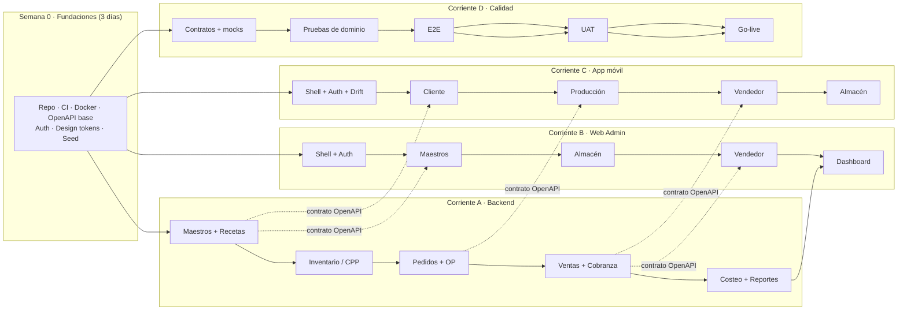

# 11 · Plan de ejecución y orquestación

> Cómo se ejecuta esto de verdad: fases con criterio de salida, flujo paralelo sin colisiones,
> y qué se recorta primero cuando el tiempo aprieta.

---

## 1. Punto de partida honesto

La propuesta promete el alcance completo en 22 días hábiles. El análisis de `01 §6` muestra que el
alcance real son ~155–190 persona-día y que 22 días con 3 personas dan ~66. **La diferencia no se
cierra trabajando más horas: se cierra eligiendo qué se entrega.**

Este plan ofrece tres escenarios. **El recomendado es el B.**

| Escenario | Plazo | Alcance | Equipo | Veredicto |
|---|---|---|---|---|
| **A · Piloto de 30 días** | 30 días calendario | Núcleo del dinero: 4 reportes, offline solo en Producción, sin CIF cerrado | 4 personas | Cumple la fecha. Entrega un sistema que opera. |
| **B · Fase 1 realista** | 8–10 semanas | Núcleo + CIF cerrado + offline completo + 8 reportes | 4 personas | **Recomendado.** Calidad sostenible. |
| **C · Alcance completo** | 16–20 semanas | Los 16 reportes + integraciones + pulido | 4–5 personas | Solo si Tanta paga el alcance real. |

---

## 2. Arquitectura de entrega: 4 corrientes en paralelo

El error clásico es hacer "primero el backend, después la app". Eso duplica el plazo. La propuesta
acierta al proponer trabajo solapado; aquí se concreta con **contrato primero**.



**La regla que hace que esto funcione:** el **OpenAPI se publica antes** de implementar. La app y la web
trabajan contra un *mock server* generado del contrato (Prism/MSW), no contra "lo que el backend vaya
soltando". Así las tres corrientes avanzan sin esperarse y la integración final es un evento, no una
crisis.

---

## 3. El plan de 30 días (Escenario A) — día por día

Diseñado para **4 personas**: 1 líder/arquitecto (parcial en código), 1 backend, 1 full-stack
(web + apoyo backend), 1 móvil. Si son solo 3, ver §7 (recorte).

### Semana 0 — Fundaciones (días 1–2, antes del arranque formal)

| # | Entregable | Criterio de terminado |
|---|---|---|
| 0.1 | Repo, ramas protegidas, CI verde en vacío | `pnpm test` corre en GitHub Actions |
| 0.2 | Docker Compose dev (Postgres) + migración inicial | `docker compose up` + `prisma migrate dev` sin errores |
| 0.3 | OpenAPI base con auth + maestros (aunque sean stubs) | Publicado en `/api/docs`, mock server levantado |
| 0.4 | Design tokens + shell de la web + shell de la app | Login funcional contra mock |
| 0.5 | Seed sintético de panadería (12 productos, 20 insumos, 8 recetas) | `pnpm seed` idempotente |

### Semana 1 (26–30/10) — Datos maestros y seguridad

| Día | Corriente A (backend) | Corriente B (web) | Corriente C (móvil) | Corriente D (QA) |
|---|---|---|---|---|
| 1 | Auth JWT + refresh + RBAC | Login + layout por rol | Login + arranque por rol | Plan de pruebas + casos dorados de costeo |
| 2 | Usuarios y roles CRUD | Usuarios | Sesión persistente (Keychain) | Pruebas de auth (IDOR, expiración) |
| 3 | Clientes, proveedores, UoM | Clientes + UoM | Drift: esquema base | Contrato de maestros congelado |
| 4 | Productos + categorías + imágenes | Productos (tabla + form + upload) | Catálogo local (solo lectura) | Pruebas de validación |
| 5 | **Recetas versionadas** + líneas | Receta (form con líneas dinámicas) | — | Demo #1 · revisión con Tanta |

**Demo del viernes 30/10:** el gerente ve cargar un producto, su receta y su costo preliminar.

### Semana 2 (02–06/11) — Inventario y precios

| Día | A | B | C | D |
|---|---|---|---|---|
| 6 | Listas de precio + vigencias | Precios por lista | — | Casos de precio y vigencia |
| 7 | Movimientos de inventario (ledger) | — | — | Pruebas de ledger (invariantes) |
| 8 | **CPP con bloqueo** + saldo | Kárdex (tabla con filtros) | — | Prueba de concurrencia (2 consumos simultáneos) |
| 9 | Compras + recepción | Ingreso de compra | — | — |
| 10 | Ajustes + toma de inventario | Toma de inventario | Almacén: consulta de stock | Demo #2 · kárdex en vivo |

**Demo del viernes 06/11:** dos compras de harina a distinto precio y el CPP resultante correcto.

### Semana 3 (09–13/11) — El flujo del dinero

| Día | A | B | C | D |
|---|---|---|---|---|
| 11 | Pedidos + estados + eventos | — | Cliente: catálogo + carrito | E2E pedido (mock) |
| 12 | Correlativos + idempotencia | Pedidos (lista + detalle) | Cliente: confirmar pedido | Pruebas de idempotencia |
| 13 | **Órdenes de producción** + requisición | OP (tablero) | Producción: tablero de OP | Pruebas de máquina de estados |
| 14 | Producción: consumo real + merma + ingreso a stock | — | Producción: registrar producción (offline) | — |
| 15 | Ventas + despacho | — | Vendedor: despacho | Demo #3 · flujo pedido→producción |

**Demo del viernes 13/11:** flujo completo pedido → OP → consumo → producto terminado, en la tablet.

### Semana 4 (16–20/11) — Dinero: ventas, cobranza, costeo, dashboard

| Día | A | B | C | D |
|---|---|---|---|---|
| 16 | Ventas a terceros + descuentos | — | Vendedor: venta a terceros | Margen negativo: caso borde |
| 17 | Cobranza + CxC + antigüedad | Reporte V-01 deudas | Vendedor: cobranza | Pruebas de cobranza parcial |
| 18 | **Motor de costeo** + ficha | Ficha de costo (M-01) | — | **Verificación contra casos dorados** |
| 19 | Reportes G-01, G-02, G-11 | Dashboard gerencial | — | UAT formal día 1 |
| 20 | Ajustes de UAT | Ajustes de UAT | Ajustes de UAT | UAT formal día 2 · acta |

**Hito H3 (16/11):** demo del flujo completo. **Hito H4 (19–20/11):** UAT.

### Semana 5 (23–24/11) — Despliegue y salida

| Día | Actividad | Criterio |
|---|---|---|
| 21 | Despliegue a producción, migración, smoke test | `/health/ready` verde · login · 1 venta real de prueba |
| 21 | **Ensayo de restauración de backup cronometrado** | RTO medido y documentado |
| 22 | Capacitación por perfil (2 h) + entrega de manuales | Acta de capacitación firmada |
| 22 | **Go-live** + soporte en sitio el primer día | Acta de puesta en marcha (H5 = 24/11) |

> **Corrección a la propuesta:** el hito H5 debe fijarse en **24/11/2026** en todos los documentos
> (la tabla §6.3 dice 20/11, el Gantt y el pago dicen 24/11). Ver `01 I-01`.

---

## 4. Definición de Terminado (DoD)

Una historia **no** está terminada porque "funciona en mi máquina". Está terminada cuando:

| # | Criterio | Verificación |
|---|---|---|
| 1 | Código con PR revisado por otra persona | GitHub: 1 aprobación mínima |
| 2 | Lint y typecheck sin errores | CI verde |
| 3 | Prueba unitaria del caso de negocio | CI verde, cobertura no baja |
| 4 | Prueba de integración si toca BD | Testcontainers |
| 5 | Contrato OpenAPI actualizado y cliente regenerado | `pnpm gen:client` sin diff inesperado |
| 6 | Regla de autorización implementada **en el caso de uso** | Test de rol negativo incluido |
| 7 | Evento de auditoría si es operación crítica | Registro verificado en `audit.evento` |
| 8 | Idempotencia si es mutación | Test de doble envío |
| 9 | Textos en español revisados (sin "Lorem", sin códigos técnicos al usuario) | Revisión visual |
| 10 | Documentado en el manual de usuario si lo ve un operario | Sección actualizada |

**Regla dura:** una historia que toca dinero (costeo, kárdex, cobranza) **no se mergea** sin un caso de
prueba que reproduzca un número concreto y verificable.

---

## 5. Orquestación con agentes de IA

El equipo va a usar agentes de código (como el que escribió este dossier). Usados mal, generan un
vertedero de código que nadie entiende. Usados bien, multiplican la capacidad del equipo pequeño.
Estas son las reglas que lo hacen funcionar.

### 5.1 Contrato primero = agentes en paralelo sin colisión

Un agente solo puede trabajar en paralelo con otro si **el contrato entre ambos ya existe**. Por eso el
OpenAPI se escribe a mano en la semana 0 y no se "genera al final". Con el contrato publicado:

- Agente A implementa `POST /ventas` en `apps/api/src/modules/ventas/`.
- Agente B implementa la pantalla de venta en `apps/mobile/lib/features/vendedor/` contra el mock.
- No se pisan: no comparten archivos ni necesitan hablarse.

### 5.2 Carriles de propiedad (un agente = un directorio)

| Agente | Carril exclusivo | Prohibido tocar |
|---|---|---|
| Backend-inventario | `apps/api/src/modules/inventario/**` | migraciones ya aplicadas, `audit/` |
| Backend-ventas | `apps/api/src/modules/ventas/**` | `prisma/schema.prisma` (lo toca solo el líder) |
| Móvil-producción | `apps/mobile/lib/features/produccion/**` | `core/sync/**` (lo toca solo el líder) |
| Web-maestros | `apps/web/src/modules/maestros/**` | `lib/api-client/**` (generado) |
| QA | `apps/**/test/**`, `e2e/**` | código de producción |

**Regla:** si dos agentes necesitan el mismo archivo, ese archivo es del líder. Se serializa.

### 5.3 Compuertas de revisión (nadie mergea solo)

```
Agente propone PR
      ↓
CI: lint · typecheck · unit · integration · Trivy
      ↓  (si falla, el agente corrige; máximo 3 iteraciones)
Revisión humana ENFOCADA en:
   · reglas de dinero (¿el cálculo es correcto?)
   · autorización (¿quién puede llamar esto?)
   · idempotencia y transacción
   · migraciones
      ↓
Merge
```

La revisión humana **no** se gasta en formato ni en nombres: de eso se encarga el linter. Se gasta en
lo que un agente hace mal con seguridad: **semántica de negocio, bordes y permisos**.

### 5.4 Los tests dorados como barandilla

`06-MOTOR-DE-COSTEO.md` fija casos con entrada y salida exactas (ciabatta: costo S/ 0.90, neto S/ 2.00,
margen 55.0 %). Ese archivo de tests es **intocable por agentes**. Cualquier cambio propuesto a los
valores esperados exige aprobación humana explícita y una justificación de negocio. Es lo que impide
que un agente "arregle" el test para que pase.

### 5.5 Qué NO se delega a un agente

| Tarea | Por qué |
|---|---|
| Migraciones sobre datos reales | Un `ALTER TABLE` mal pensado bloquea la tabla y tumba la producción. |
| Cambios en `audit/` o en la cadena de hash | Romper la auditoría destruye la defensa legal del proyecto. |
| Configuración de seguridad (CORS, TLS, guards base) | Un `cors: true` copiado de un ejemplo abre el sistema. |
| Fórmulas de costeo | Es el corazón del producto; lo define el negocio y lo valida el gerente. |
| Contrato OpenAPI | Es el contrato entre las tres corrientes; se versiona con revisión. |

### 5.6 Higiene de contexto

- Cada tarea de agente cita **la sección del dossier** que implementa (`docs/06 §4.2`), no una
  descripción libre.
- Sesiones cortas y con alcance cerrado. Un agente al que se le pide "implementa el inventario" produce
  2,000 líneas inrevisables.
- Al cerrar una tarea, el agente deja: qué hizo, qué no, qué decisión tomó y por qué. Ese resumen va al
  PR, no al chat.

---

## 6. Matriz de responsabilidades (RACI)

| Actividad | Líder | Backend | Web | Móvil | QA | Tanta |
|---|---|---|---|---|---|---|
| Alcance y reglas de costeo | **A/R** | C | C | C | C | **A** |
| Arquitectura y contratos | **R** | C | C | C | I | I |
| Modelo de datos | **A/R** | C | I | I | C | I |
| API | A | **R** | I | I | C | I |
| Web admin | A | C | **R** | I | C | C |
| App móvil | A | C | I | **R** | C | C |
| Pruebas y calidad | A | C | C | C | **R** | C |
| Datos base (recetas, insumos) | C | I | I | I | I | **R** |
| UAT y aceptación | C | I | I | I | C | **R** |
| Despliegue y operación | **R** | C | I | I | C | I |
| Capacitación | C | I | I | I | **R** | C |

`R` = responsable de hacerlo · `A` = aprueba · `C` = consultado · `I` = informado.

---

## 7. Recorte por riesgo: qué se cae primero

Si el tiempo se acorta, **no se recorta por gusto ni por lo que es más fácil de borrar**. Se recorta en
este orden, que es el orden del riesgo de negocio:

| Prioridad de recorte | Qué se elimina | Qué se conserva y por qué |
|---|---|---|
| **1.º** | Reportes G-03 a G-10, G-12, G-13 (13 → 4 reportes) | G-01 (resumen), G-02 (rentabilidad por producto), G-11 (cobranza) y M-01 (ficha de costo) son los que el gerente abre cada mañana. |
| **2.º** | CIF con cierre de período formal | Se usa **CIF provisional** con tasa estimada mensual. El margen es aproximado pero honesto y señalizado. |
| **3.º** | Offline en Almacén y Vendedor | Se conserva **offline solo en Producción** (la tablet es la que no puede parar). Los otros dos perfiles exigen señal. |
| **4.º** | App de Almacén | El almacén opera desde la web en la oficina. Se pierde la baja en el pasillo. |
| **5.º** | Exportación a Excel/PDF de reportes | La tabla en pantalla sigue; el PDF se genera a mano si hace falta. |
| **6.º** | Publicación en Play Store / App Store | APK interno + TestFlight. Los clientes usan Web o APK mientras tanto. |
| **NUNCA se recorta** | Cálculo de costo y margen · kárdex y CPP · auditoría · autorización · idempotencia · backups verificados | Si se recorta cualquiera de estos, el sistema deja de ser confiable y el proyecto entero pierde sentido. |

---

## 8. Control de cambios

Toda solicitud nueva entra por este flujo, sin excepción:

```
Solicitud escrita (correo o acta)
        ↓
Análisis de impacto: ¿toca modelo de datos? ¿toca contrato API? ¿toca una fórmula?
        ↓
Estimación en persona-día + impacto en plazo
        ↓
Decisión del Gerente de Tanta: entra al alcance (con nueva fecha) o se agenda a Fase 2
        ↓
Si entra: se firma adenda. Si no: se registra en el backlog de Fase 2.
```

**Umbral:** un cambio de ≤ 4 horas se absorbe sin adenda (cortesía). Por encima, siempre adenda. Sin
este umbral, el proyecto se hunde en cortesías.

---

## 9. Plan de entrega y aceptación

| Entregable | Cuándo | Aceptado por |
|---|---|---|
| Acta de alcance firmada | Día 3 | Gerente de Tanta |
| Prototipos de app y web | Día 5 | Gerente + usuario clave |
| Demo funcional del flujo completo | Día 13 (H3) | Usuario clave |
| Acta de conformidad UAT | Día 20 (H4) | Gerente |
| Sistema en producción + respaldos verificados | Día 21 | Líder del proyecto |
| Manual por perfil (4 documentos de 5–8 páginas) | Día 22 | Usuario clave |
| Capacitación ejecutada (4 sesiones de 45 min) | Día 22 | Acta de asistencia |
| Acta de puesta en marcha | Día 22 (H5 = 24/11) | Gerente |

---

## 10. Qué pasa después del Go-live (primeros 30 días)

| Día | Actividad | Responsable |
|---|---|---|
| 1–7 | Soporte en caliente: revisión diaria de logs, sync y saldos negativos | Líder |
| 7 | Primera revisión de márgenes con el gerente (¿los números cuadran con su intuición?) | Líder + Gerente |
| 15 | Ajuste de merma estándar con datos reales de producción | Producción + Líder |
| 30 | Cierre del primer período de costos y comparación provisional vs definitivo | Líder + Gerente |
| 30 | Retrospectiva y backlog de Fase 2 priorizado | Todos |

**El día 7 es el más importante del proyecto.** Si los márgenes que muestra el sistema no coinciden con
lo que el gerente "sabe" de su negocio, el sistema pierde credibilidad y no se vuelve a abrir. Ese
contraste es la verdadera aceptación.

---

**Siguiente lectura:** `12-ADRS.md` — el registro de decisiones, para que nadie las reabra sin argumentos.
